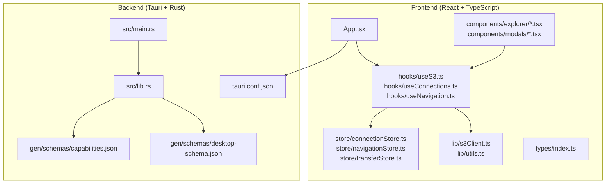
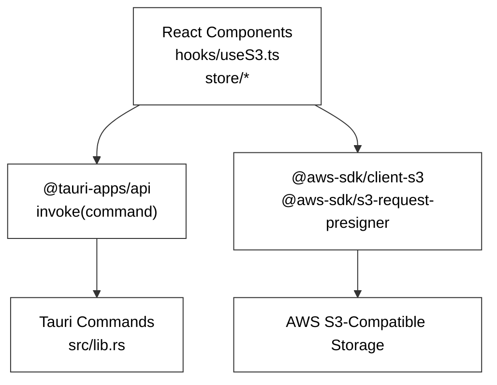
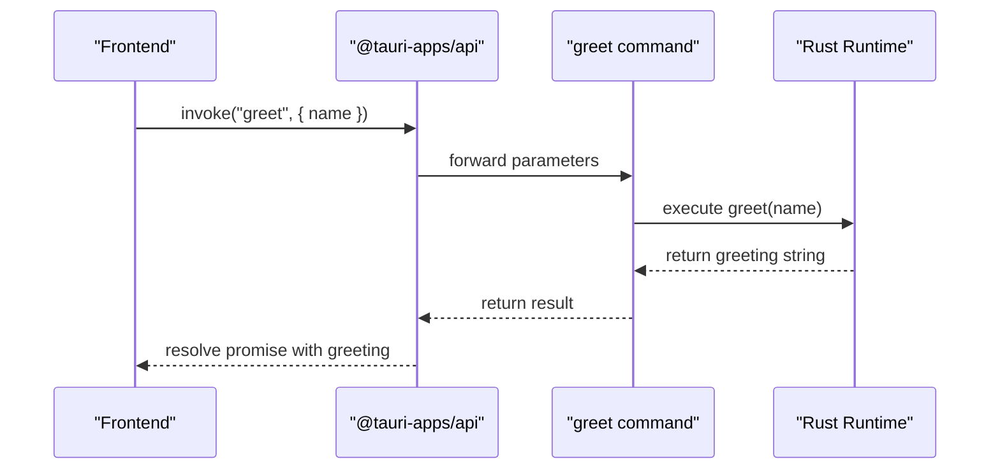
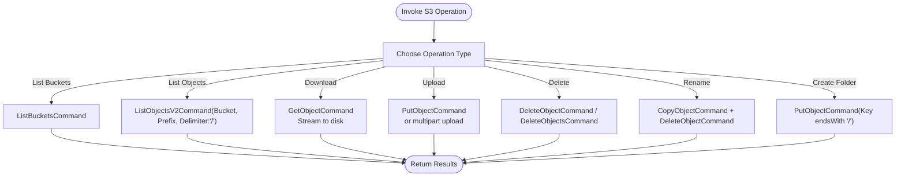
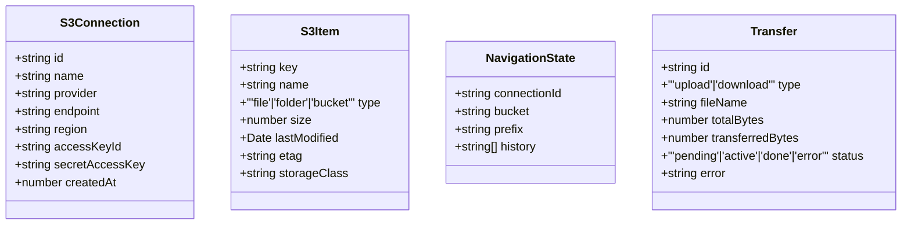
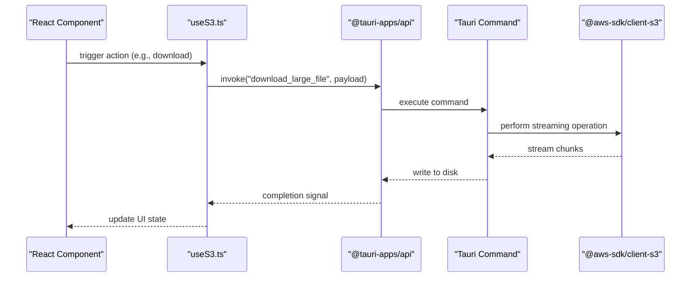
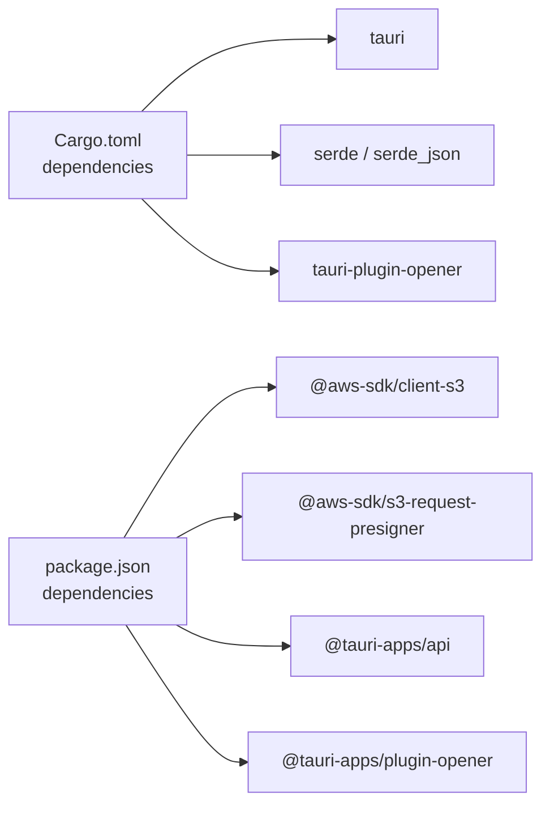

# API Reference

<cite>
**Referenced Files in This Document**
- [Cargo.toml](file://src-tauri/Cargo.toml)
- [lib.rs](file://src-tauri/src/lib.rs)
- [main.rs](file://src-tauri/src/main.rs)
- [tauri.conf.json](file://src-tauri/tauri.conf.json)
- [desktop-schema.json](file://src-tauri/gen/schemas/desktop-schema.json)
- [capabilities.json](file://src-tauri/gen/schemas/capabilities.json)
- [package.json](file://package.json)
- [PROJECT.md](file://PROJECT.md)
</cite>

## Table of Contents
1. [Introduction](#introduction)
2. [Project Structure](#project-structure)
3. [Core Components](#core-components)
4. [Architecture Overview](#architecture-overview)
5. [Detailed Component Analysis](#detailed-component-analysis)
6. [Dependency Analysis](#dependency-analysis)
7. [Performance Considerations](#performance-considerations)
8. [Troubleshooting Guide](#troubleshooting-guide)
9. [Conclusion](#conclusion)
10. [Appendices](#appendices)

## Introduction
This document provides a comprehensive API reference for the S3 Explorer Tauri application. It covers:
- Public Tauri command interfaces and their parameter specifications, return value schemas, and error handling patterns
- AWS SDK integration methods for S3 operations, including authentication, bucket management, file operations, and transfer handling
- Frontend integration patterns using @tauri-apps/api and React, including TypeScript interface definitions and usage patterns for extending the API

The application follows a clear separation of concerns:
- Rust backend exposes Tauri commands for sensitive or performance-critical operations (e.g., large downloads)
- JavaScript/TypeScript frontend handles UI, state management, and S3 SDK interactions
- AWS SDK JS v3 is used for S3 operations on the frontend; Rust commands handle streaming and reliability for large transfers

## Project Structure
The project is organized into two primary layers:
- Frontend (React + TypeScript): located under src/, with hooks, stores, and components
- Backend (Tauri + Rust): located under src-tauri/, with commands and plugins

**Diagram sources**
- [main.rs:1-7](file://src-tauri/src/main.rs#L1-L7)
- [lib.rs:1-15](file://src-tauri/src/lib.rs#L1-L15)
- [tauri.conf.json:1-36](file://src-tauri/tauri.conf.json#L1-L36)
- [capabilities.json:1-1](file://src-tauri/gen/schemas/capabilities.json#L1-L1)
- [desktop-schema.json:1-800](file://src-tauri/gen/schemas/desktop-schema.json#L1-L800)

**Section sources**
- [main.rs:1-7](file://src-tauri/src/main.rs#L1-L7)
- [lib.rs:1-15](file://src-tauri/src/lib.rs#L1-L15)
- [tauri.conf.json:1-36](file://src-tauri/tauri.conf.json#L1-L36)
- [capabilities.json:1-1](file://src-tauri/gen/schemas/capabilities.json#L1-L1)
- [desktop-schema.json:1-800](file://src-tauri/gen/schemas/desktop-schema.json#L1-L800)

## Core Components
This section documents the current Tauri command surface and the AWS SDK integration patterns used in the frontend.

- Current Tauri Command Surface
  - The Rust library exposes a single example command named greet. This demonstrates the Tauri command macro usage and handler registration.
  - The greet command accepts a string parameter and returns a formatted greeting string. It serves as a baseline for adding more commands.

- AWS SDK Integration Patterns
  - The frontend uses @aws-sdk/client-s3 and @aws-sdk/s3-request-presigner for S3 operations.
  - Authentication is handled via credential providers; the project notes emphasize secure storage of credentials.
  - S3 operations documented in the project overview include listing buckets, listing folder contents, downloading, uploading, deleting, generating presigned URLs, renaming (via copy + delete), and creating folders.

- Frontend Integration with Tauri
  - The frontend uses @tauri-apps/api to invoke Tauri commands and manage native capabilities.
  - The project’s capabilities schema grants core and opener permissions to the main window, enabling basic app and URL handling.

**Section sources**
- [lib.rs:1-15](file://src-tauri/src/lib.rs#L1-L15)
- [package.json:12-25](file://package.json#L12-L25)
- [PROJECT.md:143-168](file://PROJECT.md#L143-L168)
- [PROJECT.md:200-205](file://PROJECT.md#L200-L205)
- [capabilities.json:1-1](file://src-tauri/gen/schemas/capabilities.json#L1-L1)
- [desktop-schema.json:1-800](file://src-tauri/gen/schemas/desktop-schema.json#L1-L800)

## Architecture Overview
The system architecture separates UI and S3 operations:
- Frontend: React components, hooks, stores, and typed interfaces
- Backend: Tauri commands for operations requiring native capabilities or reliability
- AWS SDK: JS client for S3 operations on the frontend

**Diagram sources**
- [lib.rs:1-15](file://src-tauri/src/lib.rs#L1-L15)
- [package.json:12-25](file://package.json#L12-L25)
- [PROJECT.md:143-168](file://PROJECT.md#L143-L168)

## Detailed Component Analysis

### Tauri Command: greet
- Purpose: Demonstrates a basic Tauri command signature and handler registration
- Parameter: name (string)
- Return: string (formatted greeting)
- Error Handling: Not shown in the example; typical patterns involve returning Result-like structures or using Tauri’s error propagation mechanisms

**Diagram sources**
- [lib.rs:2-5](file://src-tauri/src/lib.rs#L2-L5)

**Section sources**
- [lib.rs:1-15](file://src-tauri/src/lib.rs#L1-L15)

### AWS SDK Integration Methods
The frontend integrates AWS SDK JS v3 for S3 operations. The project overview outlines the operations used and emphasizes secure credential handling and reliability for large downloads.

- Authentication
  - Credential providers are used; avoid hardcoding credentials
  - Store credentials securely using Tauri’s secure store or OS keychain

- Bucket Management
  - ListBucketsCommand: enumerate available buckets

- File Operations
  - ListObjectsV2Command with delimiter "/" to list folder contents
  - GetObjectCommand for downloading objects
  - PutObjectCommand for uploading objects
  - DeleteObjectCommand / DeleteObjectsCommand for deletion
  - CopyObjectCommand followed by DeleteObjectCommand for rename
  - Create folder via PutObjectCommand with a trailing slash key

- Transfer Handling
  - For large downloads, prefer Rust commands for reliability
  - Use presigned URLs for sharing via @aws-sdk/s3-request-presigner

**Diagram sources**
- [PROJECT.md:143-168](file://PROJECT.md#L143-L168)

**Section sources**
- [PROJECT.md:143-168](file://PROJECT.md#L143-L168)
- [PROJECT.md:200-205](file://PROJECT.md#L200-L205)

### TypeScript Interfaces and Usage Patterns
The project defines core TypeScript interfaces for S3 connections, items, navigation state, and transfers. These types guide frontend implementation and extension.

- S3Connection
  - Fields: id, name, provider, endpoint?, region, accessKeyId, secretAccessKey, createdAt
  - Usage: Manage saved S3 connections and pass to S3 client factories

- S3Item
  - Fields: key, name, type ('file' | 'folder' | 'bucket'), size?, lastModified?, etag?, storageClass?
  - Usage: Represent items returned by S3 listings

- NavigationState
  - Fields: connectionId, bucket, prefix, history[]
  - Usage: Track current location and support back navigation

- Transfer
  - Fields: id, type ('upload' | 'download'), fileName, totalBytes, transferredBytes, status ('pending' | 'active' | 'done' | 'error'), error?
  - Usage: Track progress and status of uploads/downloads

**Diagram sources**
- [PROJECT.md:70-113](file://PROJECT.md#L70-L113)

**Section sources**
- [PROJECT.md:70-113](file://PROJECT.md#L70-L113)

### Frontend Integration Patterns
- Using @tauri-apps/api to invoke backend commands
- Using @aws-sdk/client-s3 for S3 operations on the frontend
- Using @aws-sdk/s3-request-presigner to generate shareable URLs
- Managing state with Zustand stores and async data with TanStack Query

**Diagram sources**
- [lib.rs:1-15](file://src-tauri/src/lib.rs#L1-L15)
- [package.json:12-25](file://package.json#L12-L25)
- [PROJECT.md:200-205](file://PROJECT.md#L200-L205)

**Section sources**
- [lib.rs:1-15](file://src-tauri/src/lib.rs#L1-L15)
- [package.json:12-25](file://package.json#L12-L25)
- [PROJECT.md:200-205](file://PROJECT.md#L200-L205)

## Dependency Analysis
- Rust crate dependencies
  - tauri, serde, serde_json, tauri-plugin-opener are declared in Cargo.toml
  - The project builds a staticlib/ cdylib/ rlib for cross-platform compatibility

- Frontend dependencies
  - @aws-sdk/client-s3 and @aws-sdk/s3-request-presigner for S3 operations
  - @tauri-apps/api for invoking Tauri commands
  - @tauri-apps/plugin-opener for URL handling
  - Additional UI and state management libraries

**Diagram sources**
- [Cargo.toml:20-25](file://src-tauri/Cargo.toml#L20-L25)
- [package.json:12-25](file://package.json#L12-L25)

**Section sources**
- [Cargo.toml:20-25](file://src-tauri/Cargo.toml#L20-L25)
- [package.json:12-25](file://package.json#L12-L25)

## Performance Considerations
- Large downloads: Prefer Rust commands for streaming reliability
- Batch operations: Use DeleteObjectsCommand for batch deletions
- Pagination: Implement continuation token handling for large listings
- Retry/backoff: Apply exponential backoff for rate-limited or transient failures
- Virtualization: Use TanStack Virtual for rendering large file lists efficiently

## Troubleshooting Guide
- Capability and Permission Issues
  - Verify capabilities.json and desktop-schema.json grant required permissions for the main window
  - Ensure opener permissions are configured if URL handling is needed

- Command Invocation Failures
  - Confirm command registration in the Tauri Builder and that the command name matches frontend invocations
  - Check error propagation patterns and ensure consistent return schemas

- AWS SDK Errors
  - Wrap S3 calls in try/catch blocks and surface errors via toast notifications
  - Validate credentials and region configuration before executing operations

**Section sources**
- [capabilities.json:1-1](file://src-tauri/gen/schemas/capabilities.json#L1-L1)
- [desktop-schema.json:1-800](file://src-tauri/gen/schemas/desktop-schema.json#L1-L800)
- [lib.rs:8-14](file://src-tauri/src/lib.rs#L8-L14)
- [PROJECT.md:183-185](file://PROJECT.md#L183-L185)

## Conclusion
S3 Explorer provides a solid foundation for S3-compatible storage management with a clear separation between frontend S3 operations and backend Tauri commands. The current Tauri command surface includes a simple greet example, while the frontend leverages AWS SDK JS v3 for robust S3 integration. Extending the API involves adding new Tauri commands for sensitive or performance-critical tasks and integrating them with existing frontend patterns and TypeScript interfaces.

## Appendices
- Adding a New Tauri Command
  - Define the command function annotated with #[tauri::command]
  - Register the command in the invoke_handler during Tauri Builder initialization
  - Expose the command name via capabilities and schema
  - Invoke the command from the frontend using @tauri-apps/api and handle results accordingly

- Extending TypeScript Interfaces
  - Add new interfaces or modify existing ones in types/index.ts
  - Update frontend components and hooks to consume the new shapes
  - Maintain backward compatibility where possible

**Section sources**
- [lib.rs:2-14](file://src-tauri/src/lib.rs#L2-L14)
- [tauri.conf.json:1-36](file://src-tauri/tauri.conf.json#L1-L36)
- [PROJECT.md:70-113](file://PROJECT.md#L70-L113)