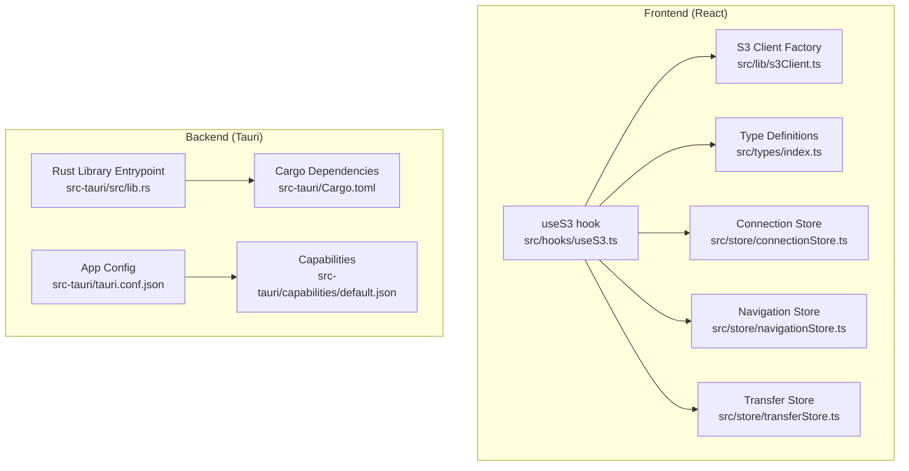
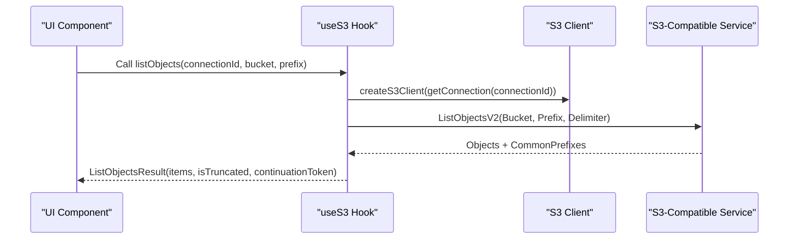
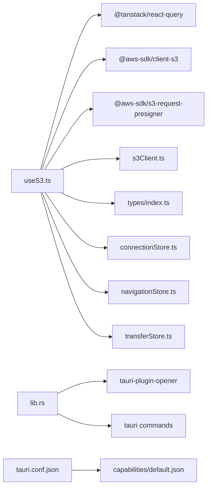

# API Reference

<cite>
**Referenced Files in This Document**
- [useS3.ts](file://src/hooks/useS3.ts)
- [s3Client.ts](file://src/lib/s3Client.ts)
- [index.ts](file://src/types/index.ts)
- [connectionStore.ts](file://src/store/connectionStore.ts)
- [navigationStore.ts](file://src/store/navigationStore.ts)
- [transferStore.ts](file://src/store/transferStore.ts)
- [lib.rs](file://src-tauri/src/lib.rs)
- [Cargo.toml](file://src-tauri/Cargo.toml)
- [tauri.conf.json](file://src-tauri/tauri.conf.json)
- [default.json](file://src-tauri/capabilities/default.json)
</cite>

## Table of Contents
1. [Introduction](#introduction)
2. [Project Structure](#project-structure)
3. [Core Components](#core-components)
4. [Architecture Overview](#architecture-overview)
5. [Detailed Component Analysis](#detailed-component-analysis)
6. [Dependency Analysis](#dependency-analysis)
7. [Performance Considerations](#performance-considerations)
8. [Troubleshooting Guide](#troubleshooting-guide)
9. [Conclusion](#conclusion)
10. [Appendices](#appendices)

## Introduction
This document provides a comprehensive API reference for S3 Explorer’s public interfaces. It covers:
- The useS3 hook and its exposed methods for S3 operations
- TypeScript interfaces and type definitions used across the app
- Authentication and provider configuration
- Error handling patterns
- Tauri command capabilities and permissions
- Practical usage examples and integration scenarios

Where applicable, examples refer to specific source locations to help you locate the exact implementation.

## Project Structure
S3 Explorer is a Tauri v2 application with a React frontend and a Rust backend. The frontend exposes a centralized hook for S3 operations and manages state via local stores. The backend currently registers a minimal greeting command and an opener plugin, with capability definitions for the main window.

**Diagram sources**
- [useS3.ts:62-409](file://src/hooks/useS3.ts#L62-L409)
- [s3Client.ts:60-82](file://src/lib/s3Client.ts#L60-L82)
- [index.ts:38-166](file://src/types/index.ts#L38-L166)
- [connectionStore.ts:30-87](file://src/store/connectionStore.ts#L30-L87)
- [navigationStore.ts:36-85](file://src/store/navigationStore.ts#L36-L85)
- [transferStore.ts:28-61](file://src/store/transferStore.ts#L28-L61)
- [lib.rs:8-14](file://src-tauri/src/lib.rs#L8-L14)
- [Cargo.toml:20-25](file://src-tauri/Cargo.toml#L20-L25)
- [tauri.conf.json:1-36](file://src-tauri/tauri.conf.json#L1-L36)
- [default.json:1-11](file://src-tauri/capabilities/default.json#L1-L11)

**Section sources**
- [useS3.ts:62-409](file://src/hooks/useS3.ts#L62-L409)
- [s3Client.ts:60-82](file://src/lib/s3Client.ts#L60-L82)
- [index.ts:38-166](file://src/types/index.ts#L38-L166)
- [connectionStore.ts:30-87](file://src/store/connectionStore.ts#L30-L87)
- [navigationStore.ts:36-85](file://src/store/navigationStore.ts#L36-L85)
- [transferStore.ts:28-61](file://src/store/transferStore.ts#L28-L61)
- [lib.rs:8-14](file://src-tauri/src/lib.rs#L8-L14)
- [Cargo.toml:20-25](file://src-tauri/Cargo.toml#L20-L25)
- [tauri.conf.json:1-36](file://src-tauri/tauri.conf.json#L1-L36)
- [default.json:1-11](file://src-tauri/capabilities/default.json#L1-L11)

## Core Components
This section documents the primary public APIs and types used by the application.

- useS3 hook
  - Purpose: Centralized S3 operations using TanStack Query (queries and mutations)
  - Exposed methods:
    - listBuckets(connectionId: string | null): UseQueryResult<S3Item[]>
    - listObjects(connectionId: string | null, bucket: string | null, prefix: string): UseQueryResult<ListObjectsResult>
    - downloadFile(): UseMutationResult<void>
    - uploadFile(): UseMutationResult<void>
    - deleteItem(): UseMutationResult<void>
    - createFolder(): UseMutationResult<void>
    - getPresignedUrl(): UseMutationResult<string>
    - renameItem(): UseMutationResult<void>
    - headObject(): UseMutationResult<{ size, lastModified, contentType, etag, storageClass }>
  - Return types:
    - Queries return TanStack Query UseQueryResult
    - Mutations return TanStack Query UseMutationResult
  - Parameters:
    - All methods accept a connectionId except listBuckets which requires a valid connectionId
    - listObjects requires bucket and prefix
    - Mutations accept typed parameters per method signature

- TypeScript Interfaces and Types
  - S3Provider: "aws" | "minio" | "r2" | "b2" | "custom"
  - S3Connection: { id, name, provider, endpoint?, region, accessKeyId, secretAccessKey, createdAt }
  - S3Item: { key, name, type, size?, lastModified?, etag?, storageClass? }
  - ListObjectsResult: { items: S3Item[], isTruncated: boolean, continuationToken?: string }
  - NavigationState: { connectionId, bucket, prefix, history }
  - Transfer: { id, type, fileName, totalBytes, transferredBytes, status, error?, key?, bucket?, connectionId? }
  - Additional enums and interfaces for sort/filter/context actions are defined in the types module

- Stores
  - Connection store: CRUD operations for S3Connection with active selection
  - Navigation store: bucket/prefix navigation and history
  - Transfer store: upload/download progress tracking

**Section sources**
- [useS3.ts:62-409](file://src/hooks/useS3.ts#L62-L409)
- [index.ts:7-166](file://src/types/index.ts#L7-L166)
- [connectionStore.ts:30-87](file://src/store/connectionStore.ts#L30-L87)
- [navigationStore.ts:36-85](file://src/store/navigationStore.ts#L36-L85)
- [transferStore.ts:28-61](file://src/store/transferStore.ts#L28-L61)

## Architecture Overview
The frontend orchestrates S3 operations through the useS3 hook, which creates S3 clients based on stored connections. Mutations leverage browser APIs for small downloads and presigned URLs, while larger downloads may leverage Tauri commands (as indicated by comments). The backend registers a greeting command and an opener plugin, with capability definitions for the main window.

**Diagram sources**
- [useS3.ts:91-144](file://src/hooks/useS3.ts#L91-L144)
- [s3Client.ts:60-82](file://src/lib/s3Client.ts#L60-L82)

**Section sources**
- [useS3.ts:62-409](file://src/hooks/useS3.ts#L62-L409)
- [s3Client.ts:60-82](file://src/lib/s3Client.ts#L60-L82)

## Detailed Component Analysis

### useS3 Hook API
The useS3 hook exposes TanStack Query-powered methods for S3 operations. Each method encapsulates client creation, request execution, and result shaping.

- listBuckets(connectionId)
  - Behavior: Lists all buckets for a given connection
  - Parameters:
    - connectionId: string | null
  - Returns: UseQueryResult<S3Item[]>
  - Notes: Enabled only when connectionId is truthy

- listObjects(connectionId, bucket, prefix)
  - Behavior: Lists objects and virtual folders under a prefix
  - Parameters:
    - connectionId: string | null
    - bucket: string | null
    - prefix: string
  - Returns: UseQueryResult<ListObjectsResult>
  - Notes: Enabled only when connectionId and bucket are truthy; groups CommonPrefixes as folders and Contents as files

- downloadFile()
  - Behavior: Downloads a single object via a short-lived presigned URL and triggers a browser download
  - Parameters: { connectionId, bucket, key }
  - Returns: UseMutationResult<void>
  - Notes: Suitable for files up to a few tens of MB; for larger files, consider a Rust-based download command

- uploadFile()
  - Behavior: Uploads a File to S3 with Content-Type derived from the file
  - Parameters: { connectionId, bucket, prefix, file }
  - Returns: UseMutationResult<void>
  - Notes: Automatically prepends prefix to filename

- deleteItem()
  - Behavior: Deletes a single object or folder placeholder
  - Parameters: { connectionId, bucket, key }
  - Returns: UseMutationResult<void>

- createFolder()
  - Behavior: Creates a virtual folder by uploading an empty object ending with "/"
  - Parameters: { connectionId, bucket, prefix, folderName }
  - Returns: UseMutationResult<void>
  - Notes: Validates that folderName is non-empty and does not contain "/"

- getPresignedUrl()
  - Behavior: Generates a presigned GET URL valid for 1 hour
  - Parameters: { connectionId, bucket, key }
  - Returns: UseMutationResult<string>

- renameItem()
  - Behavior: Renames an object by copying to new key then deleting the original
  - Parameters: { connectionId, bucket, oldKey, newKey }
  - Returns: UseMutationResult<void>
  - Notes: Requires different oldKey and newKey

- headObject()
  - Behavior: Retrieves object metadata without downloading the body
  - Parameters: { connectionId, bucket, key }
  - Returns: UseMutationResult<{ size, lastModified, contentType, etag, storageClass }>
  - Notes: Useful for “Get Info” dialogs

Usage examples (paths):
- Basic usage pattern for listing buckets and objects: [useS3.ts:51-61](file://src/hooks/useS3.ts#L51-L61)
- Uploading a file: [useS3.ts:195-227](file://src/hooks/useS3.ts#L195-L227)
- Deleting an item: [useS3.ts:232-256](file://src/hooks/useS3.ts#L232-L256)
- Creating a folder: [useS3.ts:261-288](file://src/hooks/useS3.ts#L261-L288)
- Getting a presigned URL: [useS3.ts:293-312](file://src/hooks/useS3.ts#L293-L312)
- Renaming an item: [useS3.ts:319-360](file://src/hooks/useS3.ts#L319-L360)
- Getting object metadata: [useS3.ts:366-391](file://src/hooks/useS3.ts#L366-L391)

**Section sources**
- [useS3.ts:62-409](file://src/hooks/useS3.ts#L62-L409)

### S3 Client Factory
The S3 client factory constructs a properly configured S3Client based on provider-specific rules and endpoint resolution.

Key behaviors:
- Endpoint resolution:
  - aws: defaults to SDK-resolved endpoint
  - minio: requires endpoint URL
  - r2: requires endpoint URL (account-based)
  - b2: requires endpoint URL or region fallback
  - custom: requires endpoint URL
- Path-style addressing:
  - forcePathStyle is enabled for non-AWS providers to support path-style addressing
- Credentials:
  - Uses accessKeyId and secretAccessKey from the connection

References:
- Endpoint resolution and validation: [s3Client.ts:12-49](file://src/lib/s3Client.ts#L12-L49)
- Client creation and configuration: [s3Client.ts:60-82](file://src/lib/s3Client.ts#L60-L82)

**Section sources**
- [s3Client.ts:12-49](file://src/lib/s3Client.ts#L12-L49)
- [s3Client.ts:60-82](file://src/lib/s3Client.ts#L60-L82)

### TypeScript Interfaces and Types
Core domain and UI-related types define the shape of data passed around the application.

- Providers and item types:
  - S3Provider: "aws" | "minio" | "r2" | "b2" | "custom"
  - ItemType: "file" | "folder" | "bucket"
  - TransferType: "upload" | "download"
  - TransferStatus: "pending" | "active" | "done" | "error"
  - SortField: "name" | "size" | "lastModified" | "storageClass"
  - SortDirection: "asc" | "desc"
  - FileContextAction and FolderContextAction enums

- Domain models:
  - S3Connection: connection metadata and credentials
  - S3Item: bucket/object representation
  - ListObjectsResult: paginated listing result

- UI and state:
  - NavigationState and BreadcrumbItem
  - Transfer model for progress tracking
  - ItemInfo for “Get Info” modal
  - PresignedUrlResult
  - ContextMenuTarget
  - AsyncState generic wrapper

References:
- Type definitions: [index.ts:7-166](file://src/types/index.ts#L7-L166)

**Section sources**
- [index.ts:7-166](file://src/types/index.ts#L7-L166)

### Stores and State Management
Local state is managed via Zustand stores for connections, navigation, and transfers.

- Connection store
  - Actions: addConnection, updateConnection, removeConnection, setActiveConnection
  - Persistence: localStorage via zustand/middleware

- Navigation store
  - Actions: setBucket, setPrefix, goBack, goHome, pushHistory
  - State: connectionId, bucket, prefix, history

- Transfer store
  - Actions: addTransfer, updateTransfer, removeTransfer, clearCompleted

References:
- Connection store: [connectionStore.ts:30-87](file://src/store/connectionStore.ts#L30-L87)
- Navigation store: [navigationStore.ts:36-85](file://src/store/navigationStore.ts#L36-L85)
- Transfer store: [transferStore.ts:28-61](file://src/store/transferStore.ts#L28-L61)

**Section sources**
- [connectionStore.ts:30-87](file://src/store/connectionStore.ts#L30-L87)
- [navigationStore.ts:36-85](file://src/store/navigationStore.ts#L36-L85)
- [transferStore.ts:28-61](file://src/store/transferStore.ts#L28-L61)

### Tauri Commands and Capabilities
Current backend exposes:
- A greeting command (example)
- An opener plugin for opening URLs/paths

Capabilities:
- Identifier: default
- Description: Capability for the main window
- Permissions: core:default, opener:default
- Windows: main

Configuration highlights:
- App windows, build configuration, and bundling are defined in tauri.conf.json

References:
- Command registration and plugin initialization: [lib.rs:2-14](file://src-tauri/src/lib.rs#L2-L14)
- Cargo dependencies: [Cargo.toml:20-25](file://src-tauri/Cargo.toml#L20-L25)
- App configuration: [tauri.conf.json:1-36](file://src-tauri/tauri.conf.json#L1-L36)
- Capabilities definition: [default.json:1-11](file://src-tauri/capabilities/default.json#L1-L11)

Note: While the frontend indicates a Rust-based download command exists (based on project documentation), the current backend code registers only a greeting command. If you intend to use Rust-backed downloads, ensure the corresponding command is registered in the backend.

**Section sources**
- [lib.rs:2-14](file://src-tauri/src/lib.rs#L2-L14)
- [Cargo.toml:20-25](file://src-tauri/Cargo.toml#L20-L25)
- [tauri.conf.json:1-36](file://src-tauri/tauri.conf.json#L1-L36)
- [default.json:1-11](file://src-tauri/capabilities/default.json#L1-L11)

## Dependency Analysis
The frontend depends on AWS SDK clients and TanStack Query for S3 operations. The backend registers Tauri commands and plugins, with capability definitions for the main window.

**Diagram sources**
- [useS3.ts:1-15](file://src/hooks/useS3.ts#L1-L15)
- [s3Client.ts:1-2](file://src/lib/s3Client.ts#L1-L2)
- [index.ts:1-3](file://src/types/index.ts#L1-L3)
- [connectionStore.ts:1-3](file://src/store/connectionStore.ts#L1-L3)
- [navigationStore.ts:1-2](file://src/store/navigationStore.ts#L1-L2)
- [transferStore.ts:1-2](file://src/store/transferStore.ts#L1-L2)
- [lib.rs:10-11](file://src-tauri/src/lib.rs#L10-L11)
- [tauri.conf.json:1-36](file://src-tauri/tauri.conf.json#L1-L36)
- [default.json:6-9](file://src-tauri/capabilities/default.json#L6-L9)

**Section sources**
- [useS3.ts:1-15](file://src/hooks/useS3.ts#L1-L15)
- [s3Client.ts:1-2](file://src/lib/s3Client.ts#L1-L2)
- [index.ts:1-3](file://src/types/index.ts#L1-L3)
- [connectionStore.ts:1-3](file://src/store/connectionStore.ts#L1-L3)
- [navigationStore.ts:1-2](file://src/store/navigationStore.ts#L1-L2)
- [transferStore.ts:1-2](file://src/store/transferStore.ts#L1-L2)
- [lib.rs:10-11](file://src-tauri/src/lib.rs#L10-L11)
- [tauri.conf.json:1-36](file://src-tauri/tauri.conf.json#L1-L36)
- [default.json:6-9](file://src-tauri/capabilities/default.json#L6-L9)

## Performance Considerations
- Pagination: listObjects returns isTruncated and continuationToken for efficient loading of large folder listings
- Virtual folders: CommonPrefixes are treated as folders to reduce unnecessary object listings
- Presigned URLs: Short-lived URLs (e.g., 5 minutes) minimize server-side overhead for downloads
- Path-style addressing: Enabling forcePathStyle for non-AWS providers ensures compatibility and predictable behavior
- Browser vs Rust downloads: For large files, prefer Rust-backed downloads to avoid browser memory limits and improve reliability

[No sources needed since this section provides general guidance]

## Troubleshooting Guide
Common issues and resolutions:
- Connection not found
  - Symptom: Error thrown when connectionId is invalid
  - Resolution: Ensure the connection exists in the connection store and is selected
  - Reference: [useS3.ts:22-34](file://src/hooks/useS3.ts#L22-L34)

- Missing endpoint for non-AWS providers
  - Symptom: Validation errors when provider is minio, r2, b2, or custom without endpoint
  - Resolution: Provide a valid endpoint URL or region for b2
  - Reference: [s3Client.ts:20-48](file://src/lib/s3Client.ts#L20-L48)

- Invalid folder name
  - Symptom: Error when creating a folder with empty or invalid name
  - Resolution: Ensure folderName is non-empty and does not contain "/"
  - Reference: [useS3.ts:274-278](file://src/hooks/useS3.ts#L274-L278)

- Rename failure
  - Symptom: Error during copy or delete steps in renameItem
  - Resolution: Verify bucket/key correctness and permissions
  - Reference: [useS3.ts:338-358](file://src/hooks/useS3.ts#L338-L358)

- Download failures
  - Symptom: HTTP errors when fetching presigned URLs
  - Resolution: Check expiration and network connectivity; regenerate URL if expired
  - Reference: [useS3.ts:163-187](file://src/hooks/useS3.ts#L163-L187)

- Upload failures
  - Symptom: Non-2xx HTTP status from PutObject
  - Resolution: Inspect server response and credentials
  - Reference: [useS3.ts:220-225](file://src/hooks/useS3.ts#L220-L225)

**Section sources**
- [useS3.ts:22-34](file://src/hooks/useS3.ts#L22-L34)
- [s3Client.ts:20-48](file://src/lib/s3Client.ts#L20-L48)
- [useS3.ts:274-278](file://src/hooks/useS3.ts#L274-L278)
- [useS3.ts:338-358](file://src/hooks/useS3.ts#L338-L358)
- [useS3.ts:163-187](file://src/hooks/useS3.ts#L163-L187)
- [useS3.ts:220-225](file://src/hooks/useS3.ts#L220-L225)

## Conclusion
S3 Explorer provides a cohesive set of React hooks and TypeScript types for interacting with S3-compatible storage. The useS3 hook centralizes S3 operations with robust error handling and pagination support. Authentication and provider configuration are handled via a dedicated client factory. The Tauri backend currently registers a greeting command and an opener plugin, with capability definitions for the main window. For production-grade deployments, ensure proper credential management, consider rate limiting at the service level, and implement Rust-backed downloads for large files.

[No sources needed since this section summarizes without analyzing specific files]

## Appendices

### API Method Specifications

- listBuckets(connectionId)
  - Parameters: connectionId: string | null
  - Returns: UseQueryResult<S3Item[]>
  - Notes: Enabled when connectionId is present

- listObjects(connectionId, bucket, prefix)
  - Parameters: connectionId: string | null, bucket: string | null, prefix: string
  - Returns: UseQueryResult<ListObjectsResult>
  - Notes: Enabled when connectionId and bucket are present

- downloadFile()
  - Parameters: { connectionId: string, bucket: string, key: string }
  - Returns: UseMutationResult<void>
  - Notes: Suitable for smaller files; presigned URL valid for 5 minutes

- uploadFile()
  - Parameters: { connectionId: string, bucket: string, prefix: string, file: File }
  - Returns: UseMutationResult<void>
  - Notes: Prepends prefix to filename; sets Content-Type from file

- deleteItem()
  - Parameters: { connectionId: string, bucket: string, key: string }
  - Returns: UseMutationResult<void>

- createFolder()
  - Parameters: { connectionId: string, bucket: string, prefix: string, folderName: string }
  - Returns: UseMutationResult<void>
  - Notes: Validates folderName

- getPresignedUrl()
  - Parameters: { connectionId: string, bucket: string, key: string }
  - Returns: UseMutationResult<string>
  - Notes: URL valid for 1 hour

- renameItem()
  - Parameters: { connectionId: string, bucket: string, oldKey: string, newKey: string }
  - Returns: UseMutationResult<void>
  - Notes: oldKey must differ from newKey

- headObject()
  - Parameters: { connectionId: string, bucket: string, key: string }
  - Returns: UseMutationResult<{ size, lastModified, contentType, etag, storageClass }>

**Section sources**
- [useS3.ts:69-85](file://src/hooks/useS3.ts#L69-L85)
- [useS3.ts:91-144](file://src/hooks/useS3.ts#L91-L144)
- [useS3.ts:152-189](file://src/hooks/useS3.ts#L152-L189)
- [useS3.ts:195-227](file://src/hooks/useS3.ts#L195-L227)
- [useS3.ts:232-256](file://src/hooks/useS3.ts#L232-L256)
- [useS3.ts:261-288](file://src/hooks/useS3.ts#L261-L288)
- [useS3.ts:293-312](file://src/hooks/useS3.ts#L293-L312)
- [useS3.ts:319-360](file://src/hooks/useS3.ts#L319-L360)
- [useS3.ts:366-391](file://src/hooks/useS3.ts#L366-L391)

### Authentication and Provider Configuration
- Supported providers: aws, minio, r2, b2, custom
- Required fields:
  - aws: region, credentials
  - minio: endpoint, region, credentials
  - r2: endpoint, credentials
  - b2: region or endpoint, credentials
  - custom: endpoint, credentials
- Endpoint overrides and path-style addressing are applied based on provider

**Section sources**
- [s3Client.ts:12-49](file://src/lib/s3Client.ts#L12-L49)
- [s3Client.ts:60-82](file://src/lib/s3Client.ts#L60-L82)

### Rate Limiting Considerations
- Use listObjects pagination to avoid excessive requests
- Prefer batch operations where supported by the S3-compatible service
- Implement client-side throttling for bulk uploads/downloads
- Monitor HTTP status codes and adjust retry/backoff policies accordingly

[No sources needed since this section provides general guidance]

### Practical Usage Patterns
- Listing buckets and objects
  - Steps: Select active connection, call listBuckets, then listObjects with bucket and prefix
  - References: [useS3.ts:51-61](file://src/hooks/useS3.ts#L51-L61), [useS3.ts:69-85](file://src/hooks/useS3.ts#L69-L85), [useS3.ts:91-144](file://src/hooks/useS3.ts#L91-L144)

- Uploading a file
  - Steps: Prepare File, call uploadFile with connectionId, bucket, prefix, and file
  - References: [useS3.ts:195-227](file://src/hooks/useS3.ts#L195-L227)

- Downloading a file
  - Steps: Generate presigned URL or trigger download mutation, then open/save via browser
  - References: [useS3.ts:152-189](file://src/hooks/useS3.ts#L152-L189), [useS3.ts:293-312](file://src/hooks/useS3.ts#L293-L312)

- Deleting and renaming items
  - Steps: Call deleteItem or renameItem with correct bucket and key(s)
  - References: [useS3.ts:232-256](file://src/hooks/useS3.ts#L232-L256), [useS3.ts:319-360](file://src/hooks/useS3.ts#L319-L360)

- Getting object metadata
  - Steps: Call headObject with connectionId, bucket, and key
  - References: [useS3.ts:366-391](file://src/hooks/useS3.ts#L366-L391)

**Section sources**
- [useS3.ts:51-61](file://src/hooks/useS3.ts#L51-L61)
- [useS3.ts:69-85](file://src/hooks/useS3.ts#L69-L85)
- [useS3.ts:91-144](file://src/hooks/useS3.ts#L91-L144)
- [useS3.ts:152-189](file://src/hooks/useS3.ts#L152-L189)
- [useS3.ts:195-227](file://src/hooks/useS3.ts#L195-L227)
- [useS3.ts:232-256](file://src/hooks/useS3.ts#L232-L256)
- [useS3.ts:293-312](file://src/hooks/useS3.ts#L293-L312)
- [useS3.ts:319-360](file://src/hooks/useS3.ts#L319-L360)
- [useS3.ts:366-391](file://src/hooks/useS3.ts#L366-L391)