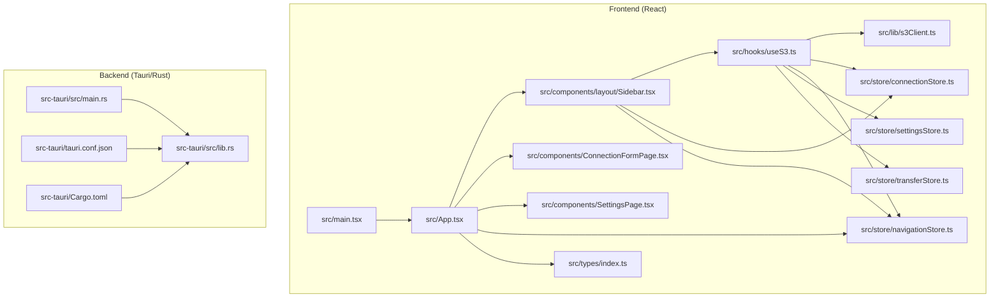
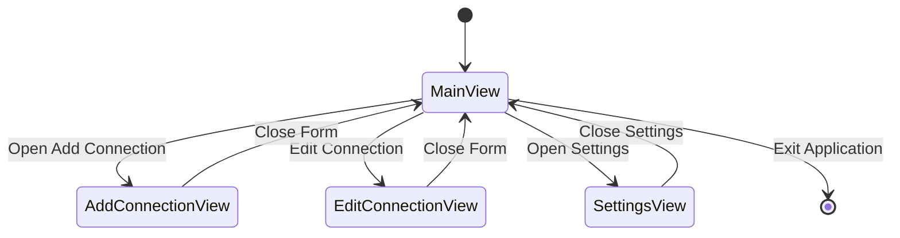
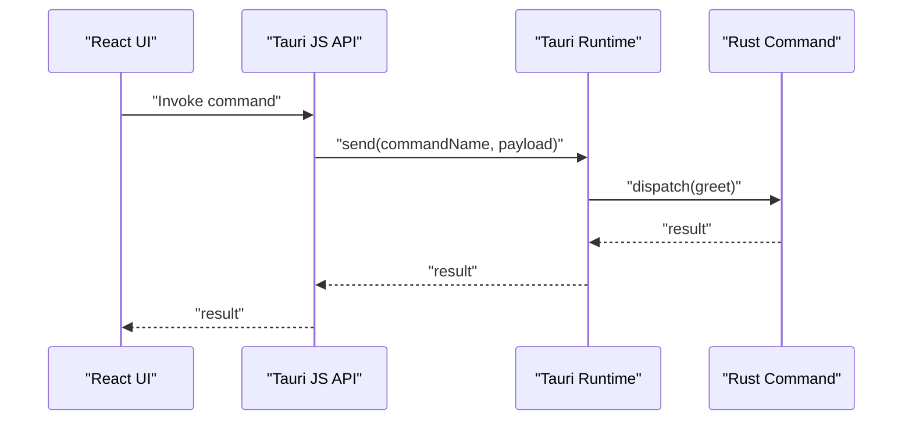
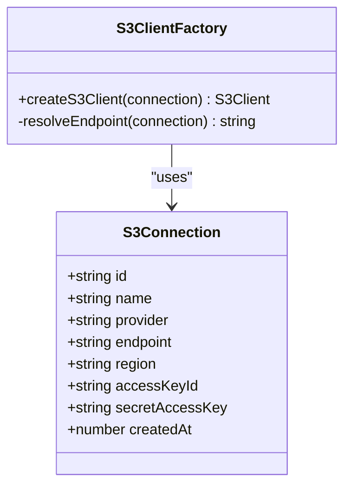
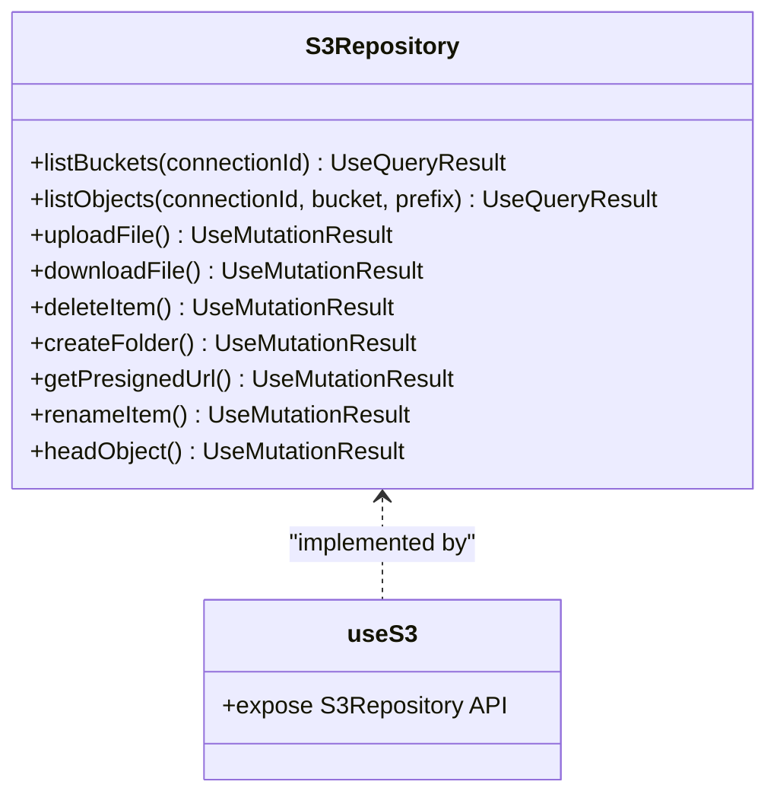
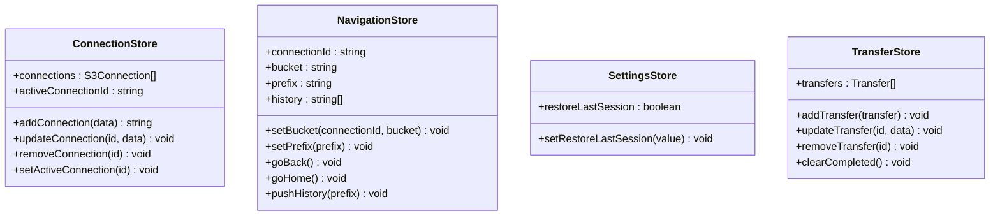
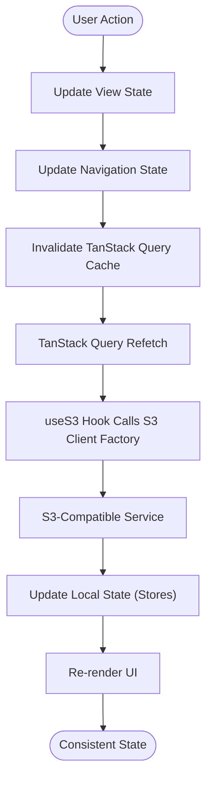
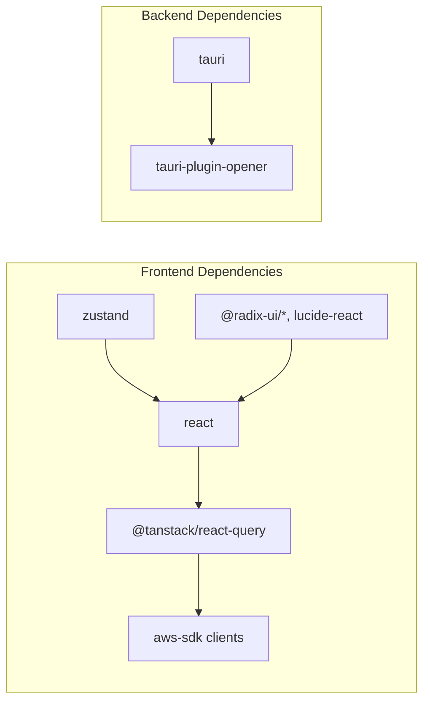

# Architecture Overview

<cite>
**Referenced Files in This Document**
- [main.tsx](file://src/main.tsx)
- [App.tsx](file://src/App.tsx)
- [Sidebar.tsx](file://src/components/layout/Sidebar.tsx)
- [ConnectionFormPage.tsx](file://src/components/ConnectionFormPage.tsx)
- [SettingsPage.tsx](file://src/components/SettingsPage.tsx)
- [AddConnectionModal.tsx](file://src/components/modals/AddConnectionModal.tsx)
- [useS3.ts](file://src/hooks/useS3.ts)
- [s3Client.ts](file://src/lib/s3Client.ts)
- [connectionStore.ts](file://src/store/connectionStore.ts)
- [navigationStore.ts](file://src/store/navigationStore.ts)
- [settingsStore.ts](file://src/store/settingsStore.ts)
- [transferStore.ts](file://src/store/transferStore.ts)
- [index.ts](file://src/types/index.ts)
- [main.rs](file://src-tauri/src/main.rs)
- [lib.rs](file://src-tauri/src/lib.rs)
- [tauri.conf.json](file://src-tauri/tauri.conf.json)
- [Cargo.toml](file://src-tauri/Cargo.toml)
- [package.json](file://package.json)
</cite>

## Update Summary
**Changes Made**
- Updated navigation architecture section to reflect the transition from modal-based to page-based routing system
- Added new View state management pattern with four distinct views: main, addConnection, editConnection, and settings
- Updated component interaction diagrams to show the new page-based navigation flow
- Revised state management documentation to include view state alongside existing navigation state
- Enhanced architectural patterns section to include the new page composition approach

## Table of Contents
1. [Introduction](#introduction)
2. [Project Structure](#project-structure)
3. [Core Components](#core-components)
4. [Architecture Overview](#architecture-overview)
5. [Detailed Component Analysis](#detailed-component-analysis)
6. [Dependency Analysis](#dependency-analysis)
7. [Performance Considerations](#performance-considerations)
8. [Security Considerations](#security-considerations)
9. [Troubleshooting Guide](#troubleshooting-guide)
10. [Conclusion](#conclusion)

## Introduction
This document describes the architecture of S3 Explorer, a hybrid desktop application built with React for the frontend and Tauri/Rust for the backend. The system separates concerns between a browser-rendered UI and a native-capable runtime that exposes controlled APIs to JavaScript. The application integrates with S3-compatible storage services through a factory-configured SDK client and manages state locally using lightweight stores. It leverages a command bridge pattern to communicate between frontend and backend layers, enabling secure and efficient operations.

**Updated** The application has undergone a major navigation architecture redesign, transitioning from modal-based workflows to a comprehensive page-based routing system with dedicated view state management.

## Project Structure
The repository follows a clear separation of concerns:
- Frontend (React + TypeScript):
  - Application bootstrap and global query client configuration
  - UI layout, components, and state stores
  - Hooks encapsulating S3 operations and TanStack Query integration
  - Shared types and models
  - Page-based navigation system with dedicated view components
- Backend (Tauri/Rust):
  - Application entry points and command registration
  - Runtime configuration and plugin setup
  - Build and packaging metadata



**Diagram sources**
- [main.tsx:1-30](file://src/main.tsx#L1-L30)
- [App.tsx:1-341](file://src/App.tsx#L1-L341)
- [Sidebar.tsx:1-255](file://src/components/layout/Sidebar.tsx#L1-L255)
- [ConnectionFormPage.tsx:1-433](file://src/components/ConnectionFormPage.tsx#L1-L433)
- [SettingsPage.tsx:1-97](file://src/components/SettingsPage.tsx#L1-L97)
- [useS3.ts:1-410](file://src/hooks/useS3.ts#L1-L410)
- [s3Client.ts:1-83](file://src/lib/s3Client.ts#L1-L83)
- [connectionStore.ts:1-88](file://src/store/connectionStore.ts#L1-L88)
- [navigationStore.ts:1-100](file://src/store/navigationStore.ts#L1-L100)
- [settingsStore.ts:1-29](file://src/store/settingsStore.ts#L1-L29)
- [transferStore.ts:1-62](file://src/store/transferStore.ts#L1-L62)
- [index.ts:1-168](file://src/types/index.ts#L1-L168)
- [main.rs:1-7](file://src-tauri/src/main.rs#L1-L7)
- [lib.rs:1-15](file://src-tauri/src/lib.rs#L1-L15)
- [tauri.conf.json:1-36](file://src-tauri/tauri.conf.json#L1-L36)
- [Cargo.toml:1-26](file://src-tauri/Cargo.toml#L1-L26)

**Section sources**
- [main.tsx:1-30](file://src/main.tsx#L1-L30)
- [package.json:1-37](file://package.json#L1-L37)
- [tauri.conf.json:1-36](file://src-tauri/tauri.conf.json#L1-L36)
- [Cargo.toml:1-26](file://src-tauri/Cargo.toml#L1-L26)

## Core Components
- React application bootstrap initializes a TanStack Query client with caching and retry policies, ensuring robust data fetching and offline-friendly behavior.
- The App component orchestrates layout, toolbar, and navigation state, delegating S3 operations to a dedicated hook. **Updated** Now includes comprehensive view state management with four distinct views: main, addConnection, editConnection, and settings.
- The Sidebar component renders connections and buckets, integrating with S3 operations via the hook and navigation state.
- The ConnectionFormPage provides a dedicated page for adding and editing S3 connections with comprehensive validation and testing capabilities.
- The SettingsPage offers a dedicated interface for application configuration and preferences.
- The useS3 hook encapsulates S3 operations as TanStack Query queries and mutations, returning typed results and managing errors.
- The S3 client factory builds provider-aware clients with endpoint resolution and credential injection.
- Zustand stores manage connection, navigation, settings, and transfer state with persistence and local updates.

**Section sources**
- [main.tsx:10-21](file://src/main.tsx#L10-L21)
- [App.tsx:36-43](file://src/App.tsx#L36-L43)
- [App.tsx:178-211](file://src/App.tsx#L178-L211)
- [Sidebar.tsx:162-254](file://src/components/layout/Sidebar.tsx#L162-L254)
- [ConnectionFormPage.tsx:52-208](file://src/components/ConnectionFormPage.tsx#L52-L208)
- [SettingsPage.tsx:10-23](file://src/components/SettingsPage.tsx#L10-L23)
- [useS3.ts:62-409](file://src/hooks/useS3.ts#L62-L409)
- [s3Client.ts:60-82](file://src/lib/s3Client.ts#L60-L82)
- [connectionStore.ts:30-87](file://src/store/connectionStore.ts#L30-L87)
- [navigationStore.ts:36-85](file://src/store/navigationStore.ts#L36-L85)
- [settingsStore.ts:15-28](file://src/store/settingsStore.ts#L15-L28)
- [transferStore.ts:28-61](file://src/store/transferStore.ts#L28-L61)

## Architecture Overview
The system employs a hybrid architecture with a redesigned page-based navigation system:
- Frontend: React components render UI and manage local state. TanStack Query handles remote data fetching and caching. **Updated** Now uses a view state management pattern with four distinct pages: main content, connection forms, and settings.
- Backend: Tauri exposes a command bridge to JavaScript, enabling privileged operations and OS integrations.
- Data flow: UI triggers operations via hooks; hooks use the S3 client factory to call cloud services; state updates propagate through stores and invalidate queries.

```mermaid
graph TB
UI["React UI<br/>App.tsx, Sidebar.tsx"] --> Views["View State Management<br/>main, addConnection, editConnection, settings"]
Views --> Pages["Page Components<br/>ConnectionFormPage, SettingsPage"]
Pages --> Hooks["useS3.ts<br/>TanStack Query"]
Hooks --> Client["s3Client.ts<br/>Factory"]
Client --> S3["S3-Compatible Services"]
UI --> Stores["Zustand Stores<br/>connectionStore.ts, navigationStore.ts, settingsStore.ts, transferStore.ts"]
Stores --> UI
subgraph "Tauri Bridge"
JS["JavaScript Layer"] <- --> |Invoke Commands| RS["Rust Layer<br/>lib.rs"]
end
UI -.->|Optional: Invoke| JS
JS --> RS
```

**Diagram sources**
- [App.tsx:36-43](file://src/App.tsx#L36-L43)
- [App.tsx:178-211](file://src/App.tsx#L178-L211)
- [ConnectionFormPage.tsx:52-208](file://src/components/ConnectionFormPage.tsx#L52-L208)
- [SettingsPage.tsx:10-23](file://src/components/SettingsPage.tsx#L10-L23)
- [Sidebar.tsx:162-254](file://src/components/layout/Sidebar.tsx#L162-L254)
- [useS3.ts:62-409](file://src/hooks/useS3.ts#L62-L409)
- [s3Client.ts:60-82](file://src/lib/s3Client.ts#L60-L82)
- [connectionStore.ts:30-87](file://src/store/connectionStore.ts#L30-L87)
- [navigationStore.ts:36-85](file://src/store/navigationStore.ts#L36-L85)
- [settingsStore.ts:15-28](file://src/store/settingsStore.ts#L15-L28)
- [transferStore.ts:28-61](file://src/store/transferStore.ts#L28-L61)
- [lib.rs:8-14](file://src-tauri/src/lib.rs#L8-L14)

## Detailed Component Analysis

### Page-Based Navigation Architecture (Updated)
The application has transitioned from modal-based workflows to a comprehensive page-based routing system with dedicated view state management. The new architecture introduces four distinct views:

- **Main View**: Primary content area displaying file explorer and toolbar
- **Add Connection View**: Dedicated page for creating new S3 connections
- **Edit Connection View**: Dedicated page for modifying existing connections  
- **Settings View**: Dedicated page for application configuration



**Diagram sources**
- [App.tsx:36-43](file://src/App.tsx#L36-L43)
- [App.tsx:139-147](file://src/App.tsx#L139-L147)
- [App.tsx:178-211](file://src/App.tsx#L178-L211)

**Section sources**
- [App.tsx:36-43](file://src/App.tsx#L36-L43)
- [App.tsx:139-147](file://src/App.tsx#L139-L147)
- [App.tsx:178-211](file://src/App.tsx#L178-L211)

### Command Bridge Pattern (JS-Rust Communication)
The Tauri command bridge enables invoking Rust functions from JavaScript. The Rust side registers commands and runs the Tauri runtime; the JavaScript side can call these commands through Tauri's API. This pattern allows the app to perform privileged tasks (e.g., file system access, OS integrations) securely and efficiently.



**Diagram sources**
- [lib.rs:2-5](file://src-tauri/src/lib.rs#L2-L5)
- [lib.rs:10-12](file://src-tauri/src/lib.rs#L10-L12)
- [main.rs:4-6](file://src-tauri/src/main.rs#L4-L6)

**Section sources**
- [lib.rs:1-15](file://src-tauri/src/lib.rs#L1-L15)
- [main.rs:1-7](file://src-tauri/src/main.rs#L1-L7)
- [tauri.conf.json:6-11](file://src-tauri/tauri.conf.json#L6-L11)

### S3 Client Factory Pattern
The S3 client factory encapsulates provider-specific endpoint resolution and SDK configuration. It ensures consistent client creation across the application, supporting AWS, MinIO, Cloudflare R2, Backblaze B2, and custom endpoints.



**Diagram sources**
- [s3Client.ts:60-82](file://src/lib/s3Client.ts#L60-L82)
- [index.ts:38-48](file://src/types/index.ts#L38-L48)

**Section sources**
- [s3Client.ts:12-49](file://src/lib/s3Client.ts#L12-L49)
- [s3Client.ts:60-82](file://src/lib/s3Client.ts#L60-L82)
- [index.ts:7-48](file://src/types/index.ts#L7-L48)

### Repository Pattern for S3 Operations
S3 operations are exposed through a cohesive hook that acts as a repository facade. It groups related operations (list buckets, list objects, upload, download, delete, rename, head) and returns TanStack Query primitives for caching, invalidation, and optimistic updates.



**Diagram sources**
- [useS3.ts:62-409](file://src/hooks/useS3.ts#L62-L409)

**Section sources**
- [useS3.ts:62-409](file://src/hooks/useS3.ts#L62-L409)

### Store Pattern for State Management (Updated)
Zustand stores manage distinct application domains with enhanced view state coordination:
- Connection store: CRUD operations for S3 connections with persistence.
- Navigation store: bucket selection, prefix traversal, and back navigation history.
- **Updated** Settings store: Application preferences including session restoration behavior.
- Transfer store: lifecycle tracking for uploads/downloads.



**Diagram sources**
- [connectionStore.ts:30-87](file://src/store/connectionStore.ts#L30-L87)
- [navigationStore.ts:36-85](file://src/store/navigationStore.ts#L36-L85)
- [settingsStore.ts:15-28](file://src/store/settingsStore.ts#L15-L28)
- [transferStore.ts:28-61](file://src/store/transferStore.ts#L28-L61)

**Section sources**
- [connectionStore.ts:30-87](file://src/store/connectionStore.ts#L30-L87)
- [navigationStore.ts:29-85](file://src/store/navigationStore.ts#L29-L85)
- [settingsStore.ts:15-28](file://src/store/settingsStore.ts#L15-L28)
- [transferStore.ts:28-61](file://src/store/transferStore.ts#L28-L61)

### Data Flow Between Layers (Updated)
The data flow emphasizes separation of concerns with enhanced view state management:
- UI triggers navigation and S3 operations via hooks and view state.
- Hooks fetch or mutate data using the S3 client factory.
- Stores update local state; TanStack Query invalidates and refetches as needed.
- **Updated** View state coordinates page transitions and maintains consistent navigation flow.
- Optional Tauri commands can be invoked for privileged operations.



**Diagram sources**
- [App.tsx:36-43](file://src/App.tsx#L36-L43)
- [App.tsx:139-147](file://src/App.tsx#L139-L147)
- [useS3.ts:69-84](file://src/hooks/useS3.ts#L69-L84)
- [useS3.ts:91-144](file://src/hooks/useS3.ts#L91-L144)
- [s3Client.ts:60-82](file://src/lib/s3Client.ts#L60-L82)
- [connectionStore.ts:30-87](file://src/store/connectionStore.ts#L30-L87)
- [navigationStore.ts:36-85](file://src/store/navigationStore.ts#L36-L85)

**Section sources**
- [App.tsx:36-43](file://src/App.tsx#L36-L43)
- [App.tsx:139-147](file://src/App.tsx#L139-L147)
- [useS3.ts:69-144](file://src/hooks/useS3.ts#L69-L144)
- [s3Client.ts:60-82](file://src/lib/s3Client.ts#L60-L82)
- [connectionStore.ts:30-87](file://src/store/connectionStore.ts#L30-L87)
- [navigationStore.ts:36-85](file://src/store/navigationStore.ts#L36-L85)

## Dependency Analysis
External dependencies span frontend and backend:
- Frontend depends on React, TanStack Query, AWS SDKs, and UI libraries.
- Backend depends on Tauri and plugins for OS integration.



**Diagram sources**
- [package.json:12-25](file://package.json#L12-L25)
- [Cargo.toml:20-25](file://src-tauri/Cargo.toml#L20-L25)

**Section sources**
- [package.json:12-25](file://package.json#L12-L25)
- [Cargo.toml:20-25](file://src-tauri/Cargo.toml#L20-L25)

## Performance Considerations
- Caching and retries: The global TanStack Query client is configured with a stale time and retry policy to balance responsiveness and network efficiency.
- Pagination and incremental loading: The S3 list objects operation supports pagination tokens for large directories.
- Endpoint configuration: Provider-specific endpoint overrides and path-style addressing reduce latency and compatibility issues for non-AWS services.
- **Updated** View state optimization: The page-based navigation system reduces memory overhead compared to modal stacking and improves rendering performance.
- Local state consistency: Zustand stores minimize re-renders by updating only affected slices and coordinating with TanStack Query invalidations.

**Section sources**
- [main.tsx:10-21](file://src/main.tsx#L10-L21)
- [useS3.ts:137-142](file://src/hooks/useS3.ts#L137-L142)
- [s3Client.ts:71-79](file://src/lib/s3Client.ts#L71-L79)

## Security Considerations
- Credentials handling: Access keys and secrets are stored in connection configurations; ensure secure storage and avoid logging sensitive data.
- Endpoint validation: Provider-specific endpoint checks prevent misconfiguration and enforce required fields for non-AWS providers.
- CSP configuration: The Tauri configuration disables CSP; evaluate security implications for production deployments.
- **Updated** View state security: The page-based system reduces attack surface by eliminating modal-based navigation vulnerabilities.
- Privileged operations: Use Tauri commands for OS-level tasks and avoid exposing unnecessary webview permissions.

**Section sources**
- [s3Client.ts:20-48](file://src/lib/s3Client.ts#L20-L48)
- [tauri.conf.json:20-22](file://src-tauri/tauri.conf.json#L20-L22)

## Troubleshooting Guide
- Connection not found errors: The S3 hook throws explicit errors when a connection ID is missing; verify active connection selection and persistence.
- Provider endpoint issues: Ensure provider-specific endpoint requirements are met (e.g., R2 requires an account-based endpoint; B2 requires a region).
- **Updated** View state issues: If pages don't render correctly, verify view state transitions and ensure proper view state cleanup when closing forms.
- Query invalidation: Use the refresh handler to invalidate current folder queries when navigating or performing mutations.
- Store state resets: Active connection removal clears selection; re-select a valid connection after deletion.

**Section sources**
- [useS3.ts:21-34](file://src/hooks/useS3.ts#L21-L34)
- [s3Client.ts:20-48](file://src/lib/s3Client.ts#L20-L48)
- [App.tsx:23-28](file://src/App.tsx#L23-L28)
- [connectionStore.ts:62-69](file://src/store/connectionStore.ts#L62-L69)

## Conclusion
S3 Explorer's architecture cleanly separates the frontend React application from the Tauri backend, leveraging a command bridge for privileged operations and a cohesive S3 repository pattern for data access. **Updated** The recent navigation architecture redesign introduces a comprehensive page-based routing system with dedicated view state management, replacing modal-based workflows for improved user experience and maintainability. The factory pattern for client creation, combined with TanStack Query and Zustand stores, ensures scalable, maintainable, and responsive behavior across diverse S3-compatible services.