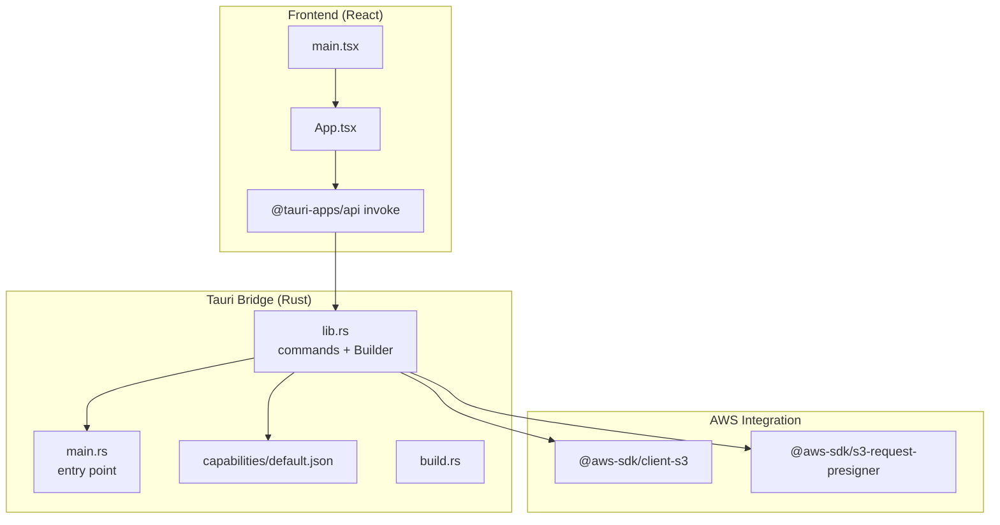
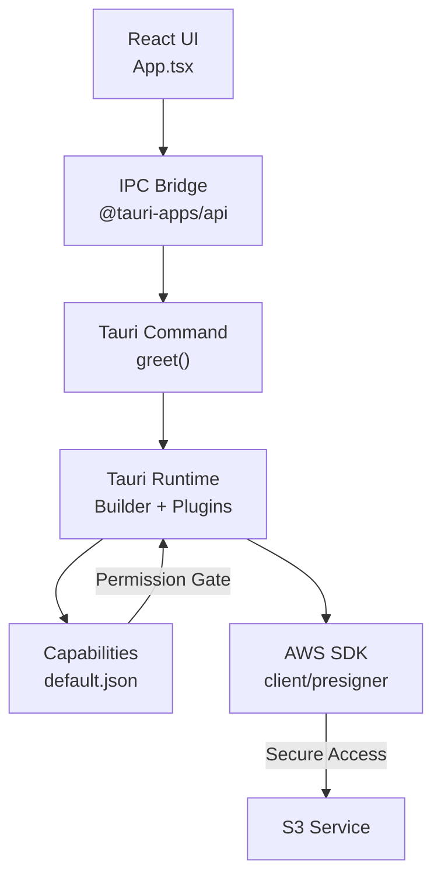
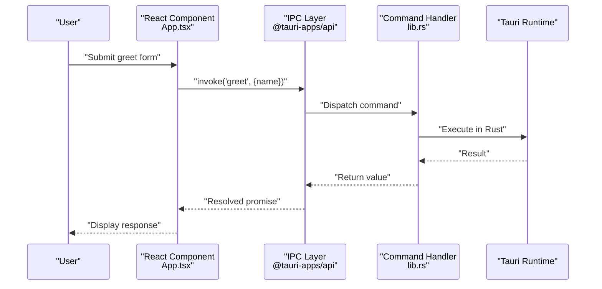
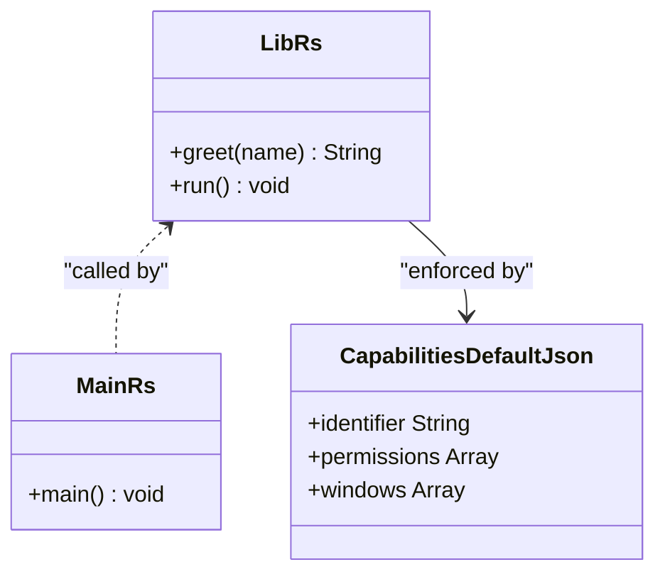
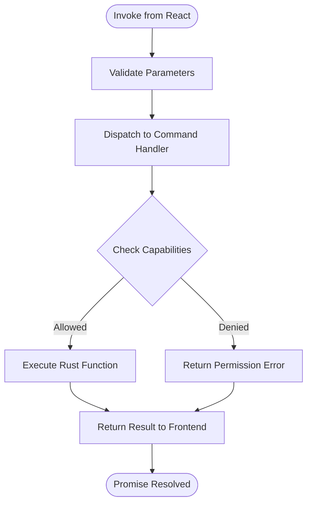
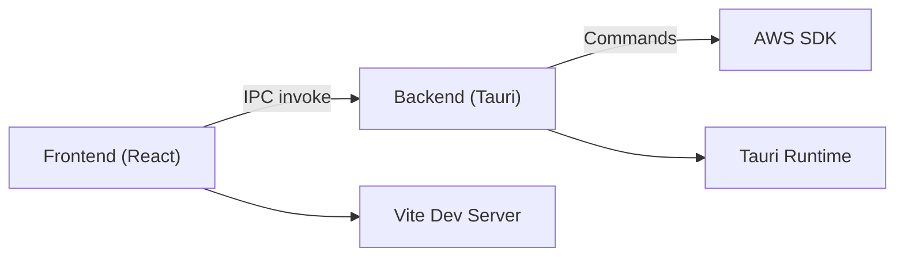

# Architecture Overview

<cite>
**Referenced Files in This Document**
- [tauri.conf.json](file://src-tauri/tauri.conf.json)
- [Cargo.toml](file://src-tauri/Cargo.toml)
- [lib.rs](file://src-tauri/src/lib.rs)
- [main.rs](file://src-tauri/src/main.rs)
- [default.json](file://src-tauri/capabilities/default.json)
- [build.rs](file://src-tauri/build.rs)
- [vite.config.ts](file://vite.config.ts)
- [package.json](file://package.json)
- [main.tsx](file://src/main.tsx)
- [App.tsx](file://src/App.tsx)
- [capabilities.json](file://src-tauri/gen/schemas/capabilities.json)
</cite>

## Table of Contents
1. [Introduction](#introduction)
2. [Project Structure](#project-structure)
3. [Core Components](#core-components)
4. [Architecture Overview](#architecture-overview)
5. [Detailed Component Analysis](#detailed-component-analysis)
6. [Dependency Analysis](#dependency-analysis)
7. [Performance Considerations](#performance-considerations)
8. [Troubleshooting Guide](#troubleshooting-guide)
9. [Conclusion](#conclusion)

## Introduction
This document describes the hybrid desktop architecture of S3 Explorer built with Tauri v2, featuring a React frontend and Rust backend. It explains how Tauri commands enable secure native functionality access, documents the IPC communication mechanism, and traces the data flow from the user interface through the Tauri bridge to AWS SDK integration. The document also outlines system boundaries, the Tauri capabilities security model, and the role of each major architectural layer.

## Project Structure
The project follows a clear separation of concerns:
- Frontend: React application bootstrapped with Vite and TypeScript
- Backend: Tauri v2 application written in Rust, exposing commands to the frontend
- Configuration: Tauri configuration, capabilities, and build scripts
- AWS Integration: AWS SDK clients and presigner for S3 operations

**Diagram sources**
- [main.tsx:1-10](file://src/main.tsx#L1-L10)
- [App.tsx:1-56](file://src/App.tsx#L1-L56)
- [lib.rs:1-15](file://src-tauri/src/lib.rs#L1-L15)
- [main.rs:1-7](file://src-tauri/src/main.rs#L1-L7)
- [default.json:1-11](file://src-tauri/capabilities/default.json#L1-L11)
- [build.rs:1-4](file://src-tauri/build.rs#L1-L4)

**Section sources**
- [tauri.conf.json:1-36](file://src-tauri/tauri.conf.json#L1-L36)
- [vite.config.ts:1-34](file://vite.config.ts#L1-L34)
- [package.json:1-37](file://package.json#L1-L37)

## Core Components
- React Frontend
  - Bootstrapped via Vite and TypeScript
  - Uses @tauri-apps/api for invoking backend commands
  - Provides a simple greet flow demonstrating IPC invocation
- Tauri Backend (Rust)
  - Defines Tauri commands and registers them with the invoke handler
  - Initializes plugins (e.g., opener) and runs the Tauri runtime
  - Enforces capability-based permissions for window access and plugin usage
- AWS SDK Integration
  - Includes client and presigner packages for S3 operations
  - Positioned conceptually behind the Tauri command boundary for secure access

Key implementation references:
- Frontend invoke usage: [App.tsx:10-12](file://src/App.tsx#L10-L12)
- Command definition and registration: [lib.rs:2-14](file://src-tauri/src/lib.rs#L2-L14)
- Capability permissions: [default.json:6-9](file://src-tauri/capabilities/default.json#L6-L9)
- Build configuration: [build.rs:1-4](file://src-tauri/build.rs#L1-L4)

**Section sources**
- [App.tsx:1-56](file://src/App.tsx#L1-L56)
- [lib.rs:1-15](file://src-tauri/src/lib.rs#L1-L15)
- [default.json:1-11](file://src-tauri/capabilities/default.json#L1-L11)
- [build.rs:1-4](file://src-tauri/build.rs#L1-L4)

## Architecture Overview
The system architecture adheres to Tauri v2's hybrid desktop pattern:
- Frontend renders the UI and triggers actions
- IPC invokes Rust commands via @tauri-apps/api
- Commands execute in the Rust backend with explicit capability permissions
- AWS SDK integration is invoked from Rust to maintain security isolation

**Diagram sources**
- [App.tsx:10-12](file://src/App.tsx#L10-L12)
- [lib.rs:2-14](file://src-tauri/src/lib.rs#L2-L14)
- [default.json:1-11](file://src-tauri/capabilities/default.json#L1-L11)

## Detailed Component Analysis

### Frontend Layer (React + Vite)
- Entry point initializes React app and mounts the root component
- The greet form demonstrates invoking a Tauri command with typed parameters
- The invoke pattern is the primary IPC mechanism to Rust

Implementation references:
- Application bootstrap: [main.tsx:1-10](file://src/main.tsx#L1-L10)
- IPC invocation example: [App.tsx:10-12](file://src/App.tsx#L10-L12)

**Diagram sources**
- [App.tsx:10-12](file://src/App.tsx#L10-L12)
- [lib.rs:2-5](file://src-tauri/src/lib.rs#L2-L5)

**Section sources**
- [main.tsx:1-10](file://src/main.tsx#L1-L10)
- [App.tsx:1-56](file://src/App.tsx#L1-L56)

### Backend Layer (Tauri v2 + Rust)
- Command definition: A single greet command illustrates the pattern for extending functionality
- Runtime builder: Registers the command handler and initializes plugins
- Entry point: Delegates to the library run function

Implementation references:
- Command declaration and handler: [lib.rs:2-5](file://src-tauri/src/lib.rs#L2-L5)
- Runtime builder and plugin initialization: [lib.rs:9-14](file://src-tauri/src/lib.rs#L9-L14)
- Application entry point: [main.rs:4-6](file://src-tauri/src/main.rs#L4-L6)

**Diagram sources**
- [lib.rs:1-15](file://src-tauri/src/lib.rs#L1-L15)
- [main.rs:1-7](file://src-tauri/src/main.rs#L1-L7)
- [default.json:1-11](file://src-tauri/capabilities/default.json#L1-L11)

**Section sources**
- [lib.rs:1-15](file://src-tauri/src/lib.rs#L1-L15)
- [main.rs:1-7](file://src-tauri/src/main.rs#L1-L7)

### IPC Communication Mechanism
- Frontend uses @tauri-apps/api invoke to call named commands
- Tauri generates a handler for registered commands
- The bridge ensures type-safe parameter passing and return values

References:
- Invoke usage: [App.tsx:10-12](file://src/App.tsx#L10-L12)
- Handler registration: [lib.rs](file://src-tauri/src/lib.rs#L11)

**Diagram sources**
- [App.tsx:10-12](file://src/App.tsx#L10-L12)
- [lib.rs](file://src-tauri/src/lib.rs#L11)
- [default.json:6-9](file://src-tauri/capabilities/default.json#L6-L9)

**Section sources**
- [App.tsx:1-56](file://src/App.tsx#L1-L56)
- [lib.rs:1-15](file://src-tauri/src/lib.rs#L1-L15)
- [default.json:1-11](file://src-tauri/capabilities/default.json#L1-L11)

### Security Model and Capabilities
- Capabilities define which permissions are granted to the main window
- The default capability grants core permissions and opener plugin access
- Generated schemas reflect the compiled capability set

References:
- Capability definition: [default.json:1-11](file://src-tauri/capabilities/default.json#L1-L11)
- Generated capability schema: [capabilities.json:1-1](file://src-tauri/gen/schemas/capabilities.json#L1-L1)

**Section sources**
- [default.json:1-11](file://src-tauri/capabilities/default.json#L1-L11)
- [capabilities.json:1-1](file://src-tauri/gen/schemas/capabilities.json#L1-L1)

### AWS SDK Integration Pattern
- AWS SDK packages are declared in the frontend dependencies
- Conceptual placement: Commands in Rust would orchestrate AWS operations
- Security benefit: Native access remains behind the Tauri command boundary

References:
- AWS SDK dependencies: [package.json:12-25](file://package.json#L12-L25)

**Section sources**
- [package.json:1-37](file://package.json#L1-L37)

## Dependency Analysis
The project exhibits clean separation between frontend and backend with explicit IPC boundaries. Dependencies flow as follows:
- Frontend depends on React, Vite, and @tauri-apps/api for IPC
- Backend depends on Tauri v2, serde, and optional plugins
- AWS SDK is included for S3 operations

**Diagram sources**
- [package.json:12-25](file://package.json#L12-L25)
- [lib.rs:10-11](file://src-tauri/src/lib.rs#L10-L11)
- [vite.config.ts:17-27](file://vite.config.ts#L17-L27)

**Section sources**
- [package.json:1-37](file://package.json#L1-L37)
- [vite.config.ts:1-34](file://vite.config.ts#L1-L34)
- [lib.rs:1-15](file://src-tauri/src/lib.rs#L1-L15)

## Performance Considerations
- Keep IPC payloads minimal to reduce serialization overhead
- Batch frequent updates from Rust to avoid excessive UI re-renders
- Use efficient data structures and avoid heavy computations in the frontend
- Leverage Tauri plugins judiciously to minimize runtime overhead

## Troubleshooting Guide
Common issues and resolutions:
- IPC invocation fails due to missing command registration
  - Ensure the command is included in the generated handler list
  - Verify the command signature matches the frontend invocation
  - Reference: [lib.rs](file://src-tauri/src/lib.rs#L11)
- Permission denied errors
  - Confirm the capability includes required permissions for the main window
  - Reference: [default.json:6-9](file://src-tauri/capabilities/default.json#L6-L9)
- Development server conflicts
  - Tauri dev expects a fixed port; ensure port 1420 is available
  - Reference: [vite.config.ts:17-27](file://vite.config.ts#L17-L27)
- Build failures during Tauri compilation
  - Run the Tauri build script to generate necessary schemas and bindings
  - Reference: [build.rs:1-4](file://src-tauri/build.rs#L1-L4)

**Section sources**
- [lib.rs:1-15](file://src-tauri/src/lib.rs#L1-L15)
- [default.json:1-11](file://src-tauri/capabilities/default.json#L1-L11)
- [vite.config.ts:1-34](file://vite.config.ts#L1-L34)
- [build.rs:1-4](file://src-tauri/build.rs#L1-L4)

## Conclusion
S3 Explorer employs a robust Tauri v2 hybrid architecture that cleanly separates the React frontend from the Rust backend. The IPC bridge, powered by Tauri commands, enables secure and type-safe access to native functionality. The capability-based security model enforces permission boundaries, while the AWS SDK integration remains protected behind the command boundary. This design provides a scalable foundation for building secure, high-performance desktop applications with modern web technologies.