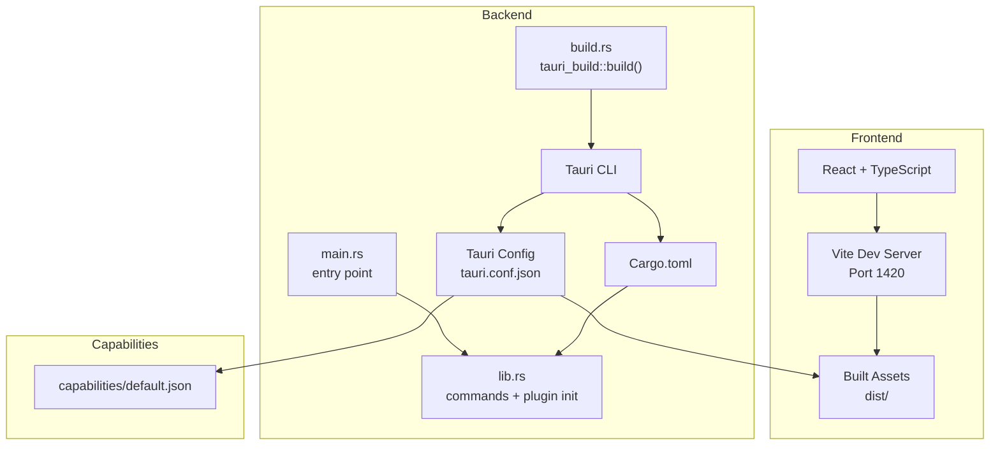
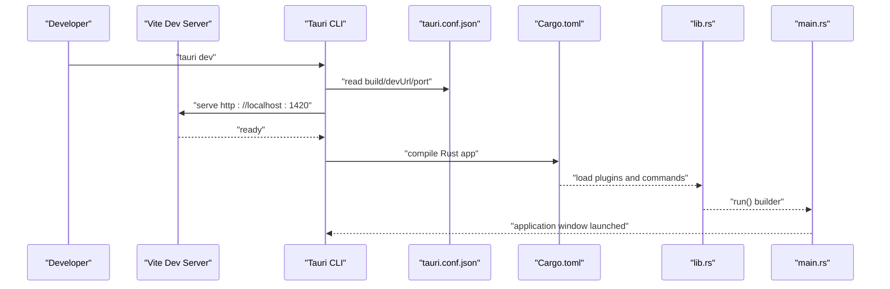
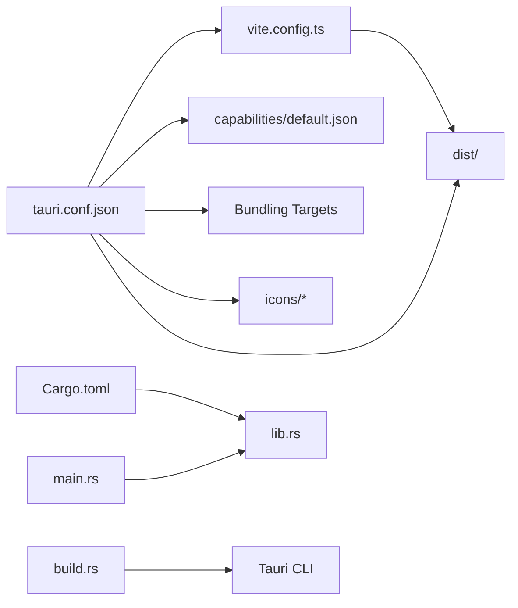

# Configuration

<cite>
**Referenced Files in This Document**
- [tauri.conf.json](file://src-tauri/tauri.conf.json)
- [Cargo.toml](file://src-tauri/Cargo.toml)
- [vite.config.ts](file://vite.config.ts)
- [package.json](file://package.json)
- [main.rs](file://src-tauri/src/main.rs)
- [lib.rs](file://src-tauri/src/lib.rs)
- [build.rs](file://src-tauri/build.rs)
- [default.json](file://src-tauri/capabilities/default.json)
- [tsconfig.json](file://tsconfig.json)
- [tsconfig.node.json](file://tsconfig.node.json)
- [README.md](file://README.md)
- [PROJECT.md](file://PROJECT.md)
</cite>

## Table of Contents
1. [Introduction](#introduction)
2. [Project Structure](#project-structure)
3. [Core Components](#core-components)
4. [Architecture Overview](#architecture-overview)
5. [Detailed Component Analysis](#detailed-component-analysis)
6. [Dependency Analysis](#dependency-analysis)
7. [Performance Considerations](#performance-considerations)
8. [Troubleshooting Guide](#troubleshooting-guide)
9. [Conclusion](#conclusion)
10. [Appendices](#appendices)

## Introduction
This document provides comprehensive configuration documentation for S3 Explorer, focusing on Tauri configuration, Vite build configuration, environment variables, development versus production settings, Cargo.toml dependencies and Rust crate configurations, build optimization options, and customization guidelines for branding and application metadata. It also includes practical examples of common configuration scenarios and troubleshooting guidance for build-related issues.

## Project Structure
The project follows a hybrid frontend-backend architecture:
- Frontend: React + TypeScript with Vite for development and building.
- Backend: Tauri v2 with Rust, integrating with the frontend via a bundled distribution.
- Configuration is centralized in Tauri’s configuration file, Vite config, and Cargo manifest.

**Diagram sources**
- [tauri.conf.json](file://src-tauri/tauri.conf.json)
- [vite.config.ts](file://vite.config.ts)
- [Cargo.toml](file://src-tauri/Cargo.toml)
- [lib.rs](file://src-tauri/src/lib.rs)
- [main.rs](file://src-tauri/src/main.rs)
- [build.rs](file://src-tauri/build.rs)
- [default.json](file://src-tauri/capabilities/default.json)

**Section sources**
- [tauri.conf.json](file://src-tauri/tauri.conf.json)
- [vite.config.ts](file://vite.config.ts)
- [Cargo.toml](file://src-tauri/Cargo.toml)
- [lib.rs](file://src-tauri/src/lib.rs)
- [main.rs](file://src-tauri/src/main.rs)
- [build.rs](file://src-tauri/build.rs)
- [default.json](file://src-tauri/capabilities/default.json)
- [README.md](file://README.md)
- [PROJECT.md](file://PROJECT.md)

## Core Components
- Tauri configuration defines product metadata, build pipeline integration, window defaults, security policy, and bundling targets.
- Vite configuration sets up the dev server, HMR, and ignores backend directories during watch.
- Cargo manifest defines Rust crate types, dependencies, and build dependencies.
- Capability configuration grants permissions to the main window and enables plugins.
- TypeScript configuration enforces strictness and bundler-mode resolution.

**Section sources**
- [tauri.conf.json](file://src-tauri/tauri.conf.json)
- [vite.config.ts](file://vite.config.ts)
- [Cargo.toml](file://src-tauri/Cargo.toml)
- [default.json](file://src-tauri/capabilities/default.json)
- [tsconfig.json](file://tsconfig.json)
- [tsconfig.node.json](file://tsconfig.node.json)

## Architecture Overview
The configuration architecture ties together frontend tooling, backend runtime, and capability permissions.

**Diagram sources**
- [tauri.conf.json](file://src-tauri/tauri.conf.json)
- [vite.config.ts](file://vite.config.ts)
- [Cargo.toml](file://src-tauri/Cargo.toml)
- [lib.rs](file://src-tauri/src/lib.rs)
- [main.rs](file://src-tauri/src/main.rs)

## Detailed Component Analysis

### Tauri Configuration (tauri.conf.json)
- Product identity: productName, version, identifier.
- Build pipeline:
  - beforeDevCommand and devUrl integrate Vite dev server on a fixed port.
  - beforeBuildCommand and frontendDist connect to the built frontend assets.
- Application windows:
  - Single window with title, width, height.
- Security:
  - CSP set to null (no CSP enforced).
- Bundling:
  - Targets all platforms.
  - Icons configured for multiple sizes and formats.

Customization highlights:
- Window size and title can be adjusted under the windows array.
- Security policies can be hardened by setting a CSP value.
- Icon assets should match the configured paths.

**Section sources**
- [tauri.conf.json](file://src-tauri/tauri.conf.json)

### Vite Configuration (vite.config.ts)
- Fixed port 1420 with strictPort enabled to ensure Tauri can connect reliably.
- Host binding controlled by optional TAURI_DEV_HOST environment variable for remote HMR.
- HMR disabled by default; when TAURI_DEV_HOST is set, WebSocket HMR is enabled with a secondary port.
- Watcher excludes src-tauri to avoid unnecessary rebuilds.
- Plugins include React Fast Refresh and Tailwind CSS integration.

Environment variables:
- TAURI_DEV_HOST: when present, enables remote HMR host binding and websocket HMR.

Development vs production:
- In dev, Vite serves locally; in build, Tauri bundles the dist output defined in tauri.conf.json.

**Section sources**
- [vite.config.ts](file://vite.config.ts)

### Cargo.toml Dependencies and Crate Configurations
- Package metadata and edition.
- Library configuration:
  - Crate types include staticlib, cdylib, and rlib for flexibility.
- Build dependency:
  - tauri-build integrates Tauri’s build-time code generation.
- Runtime dependencies:
  - tauri base crate.
  - tauri-plugin-opener for opening URLs and files.
  - serde and serde_json for serialization.

Build optimization options:
- Release builds automatically strip debug symbols; consider enabling lto and opt-level tuning in downstream configurations if needed.
- Use cargo profiles to optimize for size or speed depending on deployment goals.

**Section sources**
- [Cargo.toml](file://src-tauri/Cargo.toml)

### Capability Configuration (capabilities/default.json)
- Assigns the "default" capability to the "main" window.
- Grants core permissions and opener plugin default permissions.
- References the desktop schema for validation.

Customization:
- Extend permissions arrays to enable additional APIs or plugins.
- Add new capabilities for multi-window setups.

**Section sources**
- [default.json](file://src-tauri/capabilities/default.json)

### TypeScript Configuration (tsconfig.json and tsconfig.node.json)
- Strict TypeScript compiler options for safety.
- Bundler module resolution with ESNext modules.
- Node-side config includes Vite config for type checking.

**Section sources**
- [tsconfig.json](file://tsconfig.json)
- [tsconfig.node.json](file://tsconfig.node.json)

### Rust Entry Points and Plugin Initialization
- main.rs sets the Windows subsystem in release and delegates to the library run function.
- lib.rs initializes the Tauri Builder, registers the opener plugin, and exposes commands.

Customization:
- Add commands and plugins in lib.rs.
- Adjust the mobile entry point attribute if targeting mobile.

**Section sources**
- [main.rs](file://src-tauri/src/main.rs)
- [lib.rs](file://src-tauri/src/lib.rs)

### Build Script Integration (build.rs)
- Delegates to tauri_build::build() to generate runtime code and resources.

**Section sources**
- [build.rs](file://src-tauri/build.rs)

### Scripts and Tooling (package.json)
- Scripts:
  - dev: starts Vite dev server.
  - build: compiles TypeScript then builds frontend assets.
  - preview: serves built assets locally.
  - tauri: invokes Tauri CLI.
- Dependencies include React, Tauri APIs, AWS SDK, state management, and UI libraries.
- Dev dependencies include Vite, React plugin, Tailwind, TypeScript, and Tauri CLI.

**Section sources**
- [package.json](file://package.json)

## Dependency Analysis
High-level dependency relationships among configuration components:

**Diagram sources**
- [tauri.conf.json](file://src-tauri/tauri.conf.json)
- [vite.config.ts](file://vite.config.ts)
- [Cargo.toml](file://src-tauri/Cargo.toml)
- [lib.rs](file://src-tauri/src/lib.rs)
- [main.rs](file://src-tauri/src/main.rs)
- [build.rs](file://src-tauri/build.rs)
- [default.json](file://src-tauri/capabilities/default.json)

**Section sources**
- [tauri.conf.json](file://src-tauri/tauri.conf.json)
- [vite.config.ts](file://vite.config.ts)
- [Cargo.toml](file://src-tauri/Cargo.toml)
- [lib.rs](file://src-tauri/src/lib.rs)
- [main.rs](file://src-tauri/src/main.rs)
- [build.rs](file://src-tauri/build.rs)
- [default.json](file://src-tauri/capabilities/default.json)

## Performance Considerations
- Keep Vite watcher scoped; avoid watching backend directories to reduce overhead.
- Use strictPort in dev to prevent port conflicts that could stall builds.
- Consider enabling Tauri’s release optimizations and appropriate Rust profile settings for production builds.
- Minimize plugin count and only load necessary commands/plugins in production builds.

[No sources needed since this section provides general guidance]

## Troubleshooting Guide
Common build and configuration issues:

- Port conflicts in dev:
  - Ensure port 1420 is free or configure strictPort to fail fast.
  - Verify TAURI_DEV_HOST is not set unintentionally causing HMR to expect a remote host.

- Missing frontend assets:
  - Confirm frontendDist matches the built output directory.
  - Re-run the frontend build script before tauri build.

- Capability permission errors:
  - Validate capability identifiers and window assignments.
  - Ensure permissions align with required plugins and APIs.

- Rust compilation failures:
  - Check tauri-build integration and schema generation.
  - Verify crate types and dependencies match Tauri v2 expectations.

- HMR not working:
  - When using remote HMR, ensure TAURI_DEV_HOST is set and accessible.
  - Disable HMR temporarily by unsetting TAURI_DEV_HOST if needed.

**Section sources**
- [vite.config.ts](file://vite.config.ts)
- [tauri.conf.json](file://src-tauri/tauri.conf.json)
- [default.json](file://src-tauri/capabilities/default.json)
- [build.rs](file://src-tauri/build.rs)
- [Cargo.toml](file://src-tauri/Cargo.toml)

## Conclusion
S3 Explorer’s configuration is designed for a streamlined Tauri + React + TypeScript development workflow. Tauri’s configuration coordinates the dev server, bundling, window defaults, and security posture. Vite’s configuration ensures a reliable dev experience with optional remote HMR. Cargo’s manifest and build script integrate Tauri’s runtime and plugins. By following the customization guidelines and troubleshooting tips herein, you can adapt the configuration to your branding and deployment needs while maintaining a robust build pipeline.

[No sources needed since this section summarizes without analyzing specific files]

## Appendices

### A. Branding and Metadata Customization
- Product identity:
  - Update productName, version, and identifier in Tauri config.
- Window defaults:
  - Adjust title, width, height in the windows array.
- Security:
  - Set a CSP value in the security block to enforce stricter policies.
- Icons and bundling:
  - Replace icon files and adjust the icon array to match your branding assets.
- Capabilities:
  - Modify permissions arrays to reflect required APIs and plugins.

**Section sources**
- [tauri.conf.json](file://src-tauri/tauri.conf.json)
- [default.json](file://src-tauri/capabilities/default.json)

### B. Environment Variables Reference
- TAURI_DEV_HOST:
  - Optional; when set, enables remote HMR host binding and websocket HMR on a secondary port.

**Section sources**
- [vite.config.ts](file://vite.config.ts)

### C. Example Scenarios
- Enable remote HMR:
  - Set TAURI_DEV_HOST to the host IP; Vite/HMR will bind accordingly.
- Hardened security:
  - Define a CSP value in the security block to restrict content and script sources.
- Multi-window setup:
  - Add additional windows in the windows array and assign capabilities accordingly.

**Section sources**
- [vite.config.ts](file://vite.config.ts)
- [tauri.conf.json](file://src-tauri/tauri.conf.json)
- [default.json](file://src-tauri/capabilities/default.json)