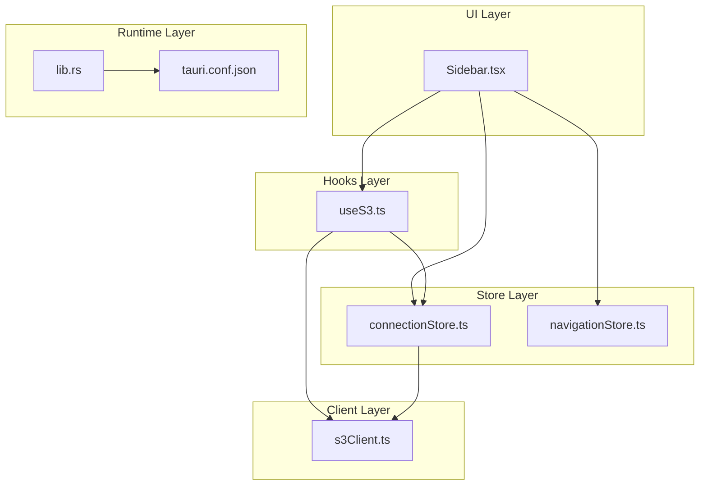
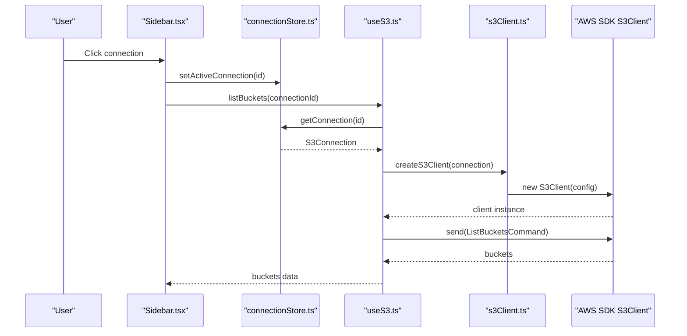
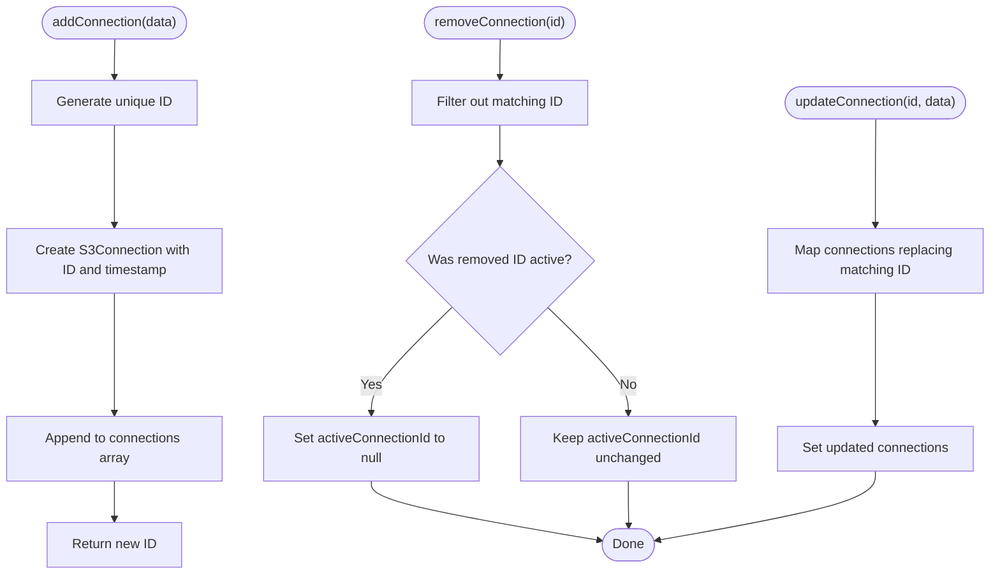
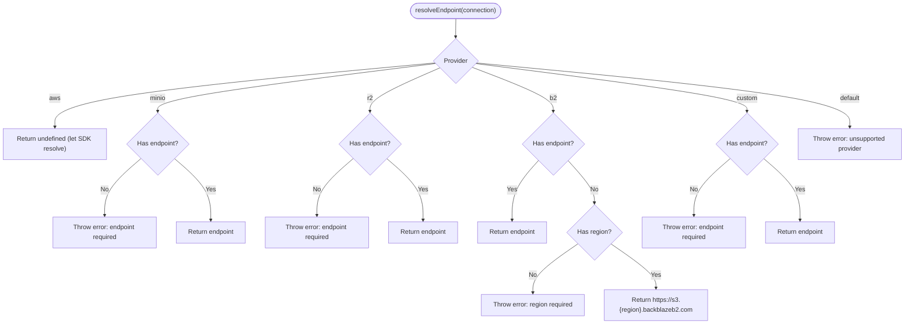
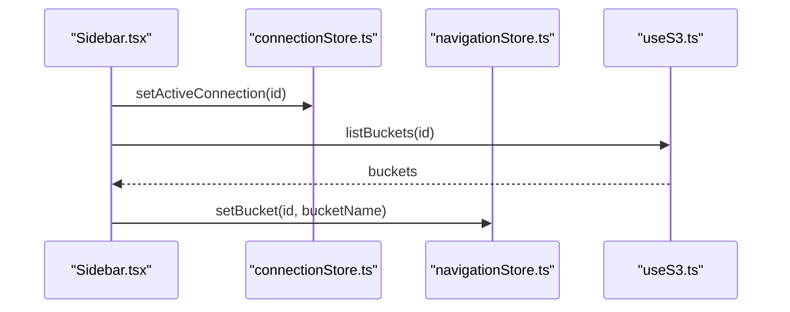
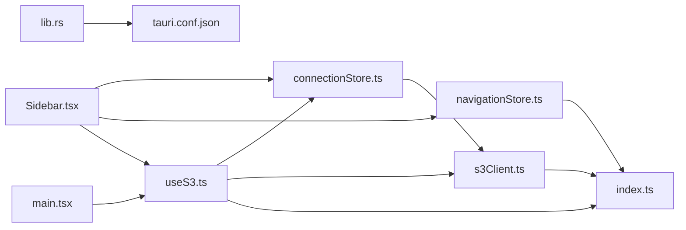

# Connection Management

<cite>
**Referenced Files in This Document**
- [connectionStore.ts](file://src/store/connectionStore.ts)
- [s3Client.ts](file://src/lib/s3Client.ts)
- [index.ts](file://src/types/index.ts)
- [useS3.ts](file://src/hooks/useS3.ts)
- [Sidebar.tsx](file://src/components/layout/Sidebar.tsx)
- [navigationStore.ts](file://src/store/navigationStore.ts)
- [main.tsx](file://src/main.tsx)
- [lib.rs](file://src-tauri/src/lib.rs)
- [tauri.conf.json](file://src-tauri/tauri.conf.json)
</cite>

## Table of Contents
1. [Introduction](#introduction)
2. [Project Structure](#project-structure)
3. [Core Components](#core-components)
4. [Architecture Overview](#architecture-overview)
5. [Detailed Component Analysis](#detailed-component-analysis)
6. [Dependency Analysis](#dependency-analysis)
7. [Performance Considerations](#performance-considerations)
8. [Troubleshooting Guide](#troubleshooting-guide)
9. [Conclusion](#conclusion)
10. [Appendices](#appendices)

## Introduction
This document explains the connection management feature in S3 Explorer. It covers how users add, configure, and manage S3 connections to multiple providers (AWS, MinIO, Cloudflare R2, Backblaze B2, and custom endpoints). It documents the connection store architecture, credential handling, endpoint resolution, and authentication methods. It also provides step-by-step guides for adding connections, testing connectivity, and managing multiple connections, along with error handling strategies and security considerations for credential storage.

## Project Structure
The connection management feature spans several layers:
- Store layer: connection persistence and selection
- Client layer: provider-aware S3 client creation and endpoint resolution
- Hooks layer: S3 operations orchestrated via TanStack Query
- UI layer: sidebar integration and bucket discovery
- Navigation layer: connection-to-bucket binding
- Runtime layer: Tauri configuration and plugin initialization

**Diagram sources**
- [Sidebar.tsx:117-120](file://src/components/layout/Sidebar.tsx#L117-L120)
- [connectionStore.ts:30-87](file://src/store/connectionStore.ts#L30-L87)
- [navigationStore.ts:36-85](file://src/store/navigationStore.ts#L36-L85)
- [useS3.ts:62-409](file://src/hooks/useS3.ts#L62-L409)
- [s3Client.ts:60-82](file://src/lib/s3Client.ts#L60-L82)
- [lib.rs:8-14](file://src-tauri/src/lib.rs#L8-L14)
- [tauri.conf.json:1-36](file://src-tauri/tauri.conf.json#L1-L36)

**Section sources**
- [connectionStore.ts:1-88](file://src/store/connectionStore.ts#L1-L88)
- [s3Client.ts:1-83](file://src/lib/s3Client.ts#L1-L83)
- [index.ts:38-51](file://src/types/index.ts#L38-L51)
- [useS3.ts:62-409](file://src/hooks/useS3.ts#L62-L409)
- [Sidebar.tsx:117-120](file://src/components/layout/Sidebar.tsx#L117-L120)
- [navigationStore.ts:36-85](file://src/store/navigationStore.ts#L36-L85)
- [main.tsx:6-17](file://src/main.tsx#L6-L17)
- [lib.rs:8-14](file://src-tauri/src/lib.rs#L8-L14)
- [tauri.conf.json:1-36](file://src-tauri/tauri.conf.json#L1-L36)

## Core Components
- Connection model and form data define the shape of stored connections and the data accepted for creation/update.
- Connection store persists connections and active selection, with selective persistence of state.
- S3 client factory builds provider-aware clients with correct endpoints and credentials.
- useS3 hook orchestrates S3 operations and uses the active connection to create clients.
- Sidebar integrates with the connection store to render connections and trigger bucket loading.
- Navigation store binds a selected connection to a chosen bucket.

Key responsibilities:
- Connection model: identity, provider, endpoint, region, credentials, and timestamps
- Connection store: CRUD operations, active selection, and persistence
- Endpoint resolution: provider-specific endpoint computation and validation
- Authentication: access key and secret passed to the AWS SDK client
- UI integration: sidebar renders connections and triggers bucket queries

**Section sources**
- [index.ts:38-51](file://src/types/index.ts#L38-L51)
- [connectionStore.ts:10-28](file://src/store/connectionStore.ts#L10-L28)
- [connectionStore.ts:30-87](file://src/store/connectionStore.ts#L30-L87)
- [s3Client.ts:12-49](file://src/lib/s3Client.ts#L12-L49)
- [s3Client.ts:60-82](file://src/lib/s3Client.ts#L60-L82)
- [useS3.ts:62-409](file://src/hooks/useS3.ts#L62-L409)
- [Sidebar.tsx:117-120](file://src/components/layout/Sidebar.tsx#L117-L120)
- [navigationStore.ts:36-85](file://src/store/navigationStore.ts#L36-L85)

## Architecture Overview
The connection management architecture connects UI, store, and S3 operations:

**Diagram sources**
- [Sidebar.tsx:124-127](file://src/components/layout/Sidebar.tsx#L124-L127)
- [connectionStore.ts:71-76](file://src/store/connectionStore.ts#L71-L76)
- [useS3.ts:69-84](file://src/hooks/useS3.ts#L69-L84)
- [s3Client.ts:60-82](file://src/lib/s3Client.ts#L60-L82)

## Detailed Component Analysis

### Connection Store
The connection store manages:
- State: list of connections and the active connection ID
- Actions: add, update, remove, set active
- Persistence: selective persistence of state (connections and active ID)

**Diagram sources**
- [connectionStore.ts:39-52](file://src/store/connectionStore.ts#L39-L52)
- [connectionStore.ts:54-60](file://src/store/connectionStore.ts#L54-L60)
- [connectionStore.ts:62-69](file://src/store/connectionStore.ts#L62-L69)
- [connectionStore.ts:71-76](file://src/store/connectionStore.ts#L71-L76)

**Section sources**
- [connectionStore.ts:10-28](file://src/store/connectionStore.ts#L10-L28)
- [connectionStore.ts:30-87](file://src/store/connectionStore.ts#L30-L87)

### S3 Client Factory and Endpoint Resolution
The client factory creates provider-aware S3 clients:
- Endpoint resolution depends on provider and optional overrides
- Credentials are passed directly to the SDK
- Path-style addressing is enforced for non-AWS providers

**Diagram sources**
- [s3Client.ts:12-49](file://src/lib/s3Client.ts#L12-L49)

**Section sources**
- [s3Client.ts:12-49](file://src/lib/s3Client.ts#L12-L49)
- [s3Client.ts:60-82](file://src/lib/s3Client.ts#L60-L82)

### Provider-Specific Configuration Options
Supported providers and their configuration:
- aws: default region used if none provided; endpoint not overridden
- minio: requires endpoint URL
- r2: requires endpoint URL (account-based)
- b2: requires either endpoint URL or region to construct endpoint
- custom: requires endpoint URL

Validation ensures required fields per provider are present before creating the client.

**Section sources**
- [s3Client.ts:15-48](file://src/lib/s3Client.ts#L15-L48)
- [index.ts:7-8](file://src/types/index.ts#L7-L8)

### Credential Handling and Security Considerations
- Credentials are stored in the connection model as plain strings
- The client factory passes credentials directly to the AWS SDK
- Persistence uses selective state serialization to avoid storing actions
- Considerations:
  - Avoid logging sensitive fields
  - Prefer least-privilege credentials
  - Review persistence strategy if storing secrets long-term

**Section sources**
- [index.ts:45-46](file://src/types/index.ts#L45-L46)
- [connectionStore.ts:78-85](file://src/store/connectionStore.ts#L78-L85)

### UI Integration and Navigation Binding
- Sidebar displays connections and toggles expansion to show buckets
- On selecting a connection, the active connection is set
- Bucket lists are fetched via useS3 and bound to the active connection
- Navigation store associates a connection with a bucket

**Diagram sources**
- [Sidebar.tsx:124-127](file://src/components/layout/Sidebar.tsx#L124-L127)
- [connectionStore.ts:71-76](file://src/store/connectionStore.ts#L71-L76)
- [useS3.ts:69-84](file://src/hooks/useS3.ts#L69-L84)
- [navigationStore.ts:42-52](file://src/store/navigationStore.ts#L42-L52)

**Section sources**
- [Sidebar.tsx:117-120](file://src/components/layout/Sidebar.tsx#L117-L120)
- [useS3.ts:69-84](file://src/hooks/useS3.ts#L69-L84)
- [navigationStore.ts:42-52](file://src/store/navigationStore.ts#L42-L52)

## Dependency Analysis
The following diagram shows how components depend on each other:

**Diagram sources**
- [Sidebar.tsx:117-120](file://src/components/layout/Sidebar.tsx#L117-L120)
- [connectionStore.ts:30-87](file://src/store/connectionStore.ts#L30-L87)
- [navigationStore.ts:36-85](file://src/store/navigationStore.ts#L36-L85)
- [useS3.ts:62-409](file://src/hooks/useS3.ts#L62-L409)
- [s3Client.ts:60-82](file://src/lib/s3Client.ts#L60-L82)
- [index.ts:38-51](file://src/types/index.ts#L38-L51)
- [main.tsx:6-17](file://src/main.tsx#L6-L17)
- [lib.rs:8-14](file://src-tauri/src/lib.rs#L8-L14)
- [tauri.conf.json:1-36](file://src-tauri/tauri.conf.json#L1-L36)

**Section sources**
- [index.ts:38-51](file://src/types/index.ts#L38-L51)
- [connectionStore.ts:30-87](file://src/store/connectionStore.ts#L30-L87)
- [s3Client.ts:60-82](file://src/lib/s3Client.ts#L60-L82)
- [useS3.ts:62-409](file://src/hooks/useS3.ts#L62-L409)
- [Sidebar.tsx:117-120](file://src/components/layout/Sidebar.tsx#L117-L120)
- [navigationStore.ts:36-85](file://src/store/navigationStore.ts#L36-L85)
- [main.tsx:6-17](file://src/main.tsx#L6-L17)
- [lib.rs:8-14](file://src-tauri/src/lib.rs#L8-L14)
- [tauri.conf.json:1-36](file://src-tauri/tauri.conf.json#L1-L36)

## Performance Considerations
- Client reuse: The client factory creates a new S3Client per operation; consider caching clients keyed by connection properties if repeated calls become frequent.
- Query defaults: TanStack Query is configured with a short stale time and retries to balance freshness and resilience.
- Endpoint resolution: Minimal overhead; ensure endpoint URLs are pre-validated to avoid runtime errors.

[No sources needed since this section provides general guidance]

## Troubleshooting Guide
Common issues and resolutions:
- Unsupported provider: Ensure the provider is one of the supported values; otherwise, endpoint resolution throws an error.
- Missing endpoint or region: Provider-specific validation enforces required fields; supply endpoint for MinIO/R2/Custom and region for Backblaze B2 when endpoint is not provided.
- Active connection mismatch: If a connection disappears, attempting to use it throws an error; reselect a valid connection.
- Bucket loading failures: Errors from bucket listing are surfaced in the UI; verify credentials and endpoint reachability.

**Section sources**
- [s3Client.ts:15-48](file://src/lib/s3Client.ts#L15-L48)
- [useS3.ts:21-34](file://src/hooks/useS3.ts#L21-L34)
- [Sidebar.tsx:68-75](file://src/components/layout/Sidebar.tsx#L68-L75)

## Conclusion
S3 Explorer’s connection management provides a robust foundation for working with multiple S3-compatible providers. The store persists connections and tracks the active selection, the client factory handles provider-specific endpoint resolution and authentication, and the UI integrates seamlessly with TanStack Query for responsive operations. By following the steps below, users can add, test, and manage connections effectively while adhering to security best practices.

## Appendices

### Step-by-Step: Adding a New Connection
1. Open the Add Connection dialog (placeholder action wired in the sidebar).
2. Select a provider from the supported list.
3. Fill in required fields:
   - For AWS: region is used if endpoint is not overridden.
   - For MinIO: provide endpoint URL.
   - For Cloudflare R2: provide endpoint URL.
   - For Backblaze B2: provide endpoint URL or region.
   - For Custom: provide endpoint URL.
4. Enter credentials (access key and secret).
5. Save the connection; the store generates an ID and timestamp.
6. Select the newly saved connection to activate it.

**Section sources**
- [index.ts:7-8](file://src/types/index.ts#L7-L8)
- [s3Client.ts:15-48](file://src/lib/s3Client.ts#L15-L48)
- [connectionStore.ts:39-52](file://src/store/connectionStore.ts#L39-L52)

### Step-by-Step: Testing Connectivity
1. Select an active connection in the sidebar.
2. Trigger a bucket listing operation via the UI.
3. Observe results:
   - Success: buckets appear in the UI.
   - Failure: error message is shown; inspect provider configuration and credentials.

**Section sources**
- [Sidebar.tsx:52-75](file://src/components/layout/Sidebar.tsx#L52-L75)
- [useS3.ts:69-84](file://src/hooks/useS3.ts#L69-L84)

### Managing Multiple Connections
- Add multiple connections with distinct names and providers.
- Switch between connections by clicking in the sidebar; the active connection drives subsequent operations.
- Remove unused connections to keep the list manageable.

**Section sources**
- [connectionStore.ts:62-69](file://src/store/connectionStore.ts#L62-L69)
- [connectionStore.ts:71-76](file://src/store/connectionStore.ts#L71-L76)
- [Sidebar.tsx:163-174](file://src/components/layout/Sidebar.tsx#L163-L174)

### Relationship to Other System Components
- Store layer: connectionStore and navigationStore coordinate state.
- Hooks layer: useS3 orchestrates S3 operations using the active connection.
- Client layer: s3Client constructs provider-aware clients.
- UI layer: Sidebar renders connections and triggers bucket queries.
- Runtime layer: Tauri initializes plugins and runs the app.

**Section sources**
- [connectionStore.ts:30-87](file://src/store/connectionStore.ts#L30-L87)
- [navigationStore.ts:36-85](file://src/store/navigationStore.ts#L36-L85)
- [useS3.ts:62-409](file://src/hooks/useS3.ts#L62-L409)
- [s3Client.ts:60-82](file://src/lib/s3Client.ts#L60-L82)
- [Sidebar.tsx:117-120](file://src/components/layout/Sidebar.tsx#L117-L120)
- [lib.rs:8-14](file://src-tauri/src/lib.rs#L8-L14)
- [tauri.conf.json:1-36](file://src-tauri/tauri.conf.json#L1-L36)