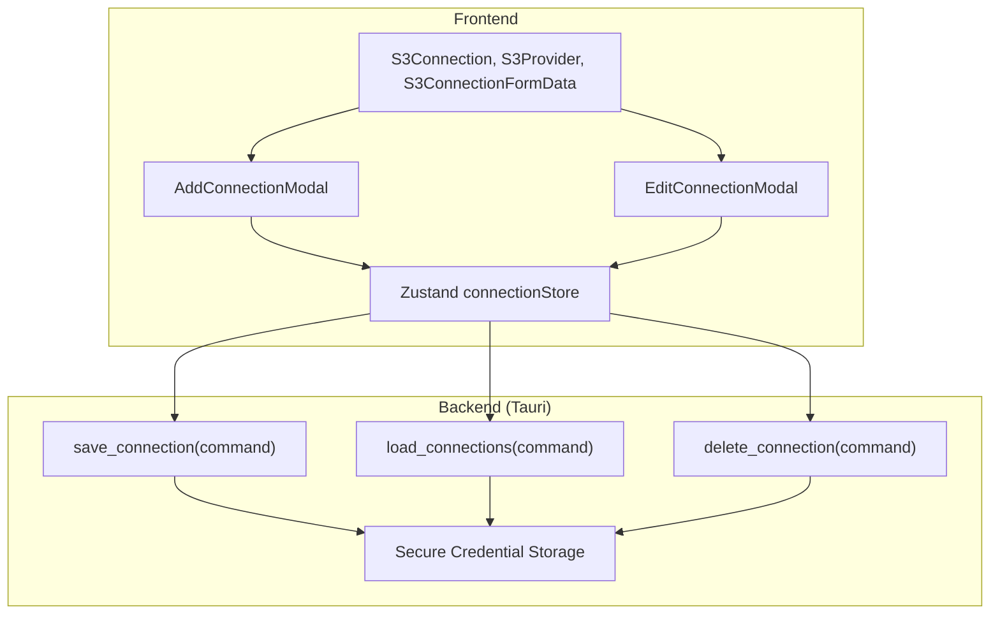
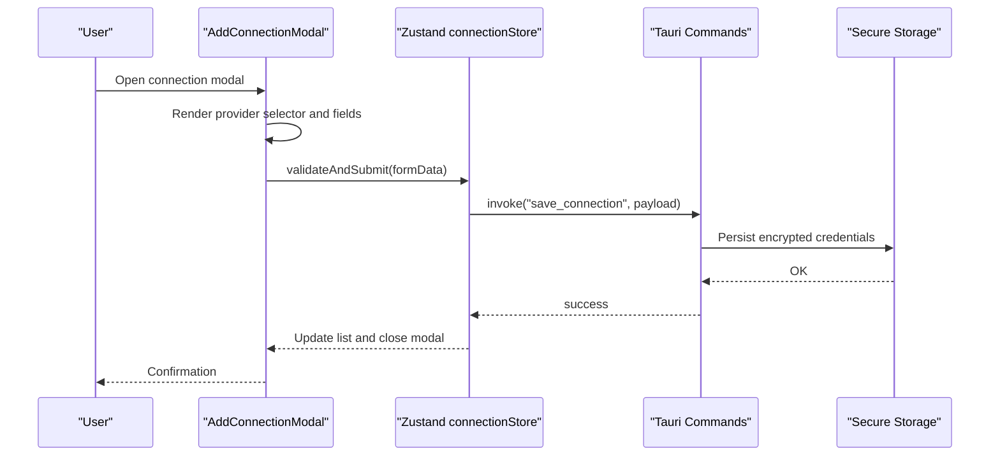
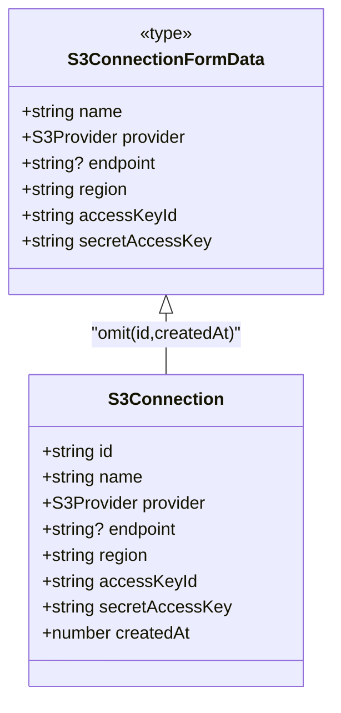
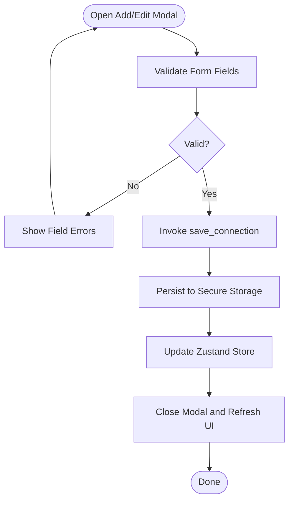
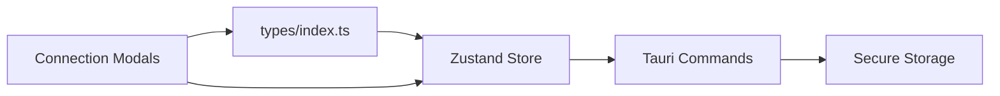

# Connection Management

<cite>
**Referenced Files in This Document**
- [types/index.ts](file://src/types/index.ts)
- [PROJECT.md](file://PROJECT.md)
- [src-tauri/src/lib.rs](file://src-tauri/src/lib.rs)
- [src-tauri/tauri.conf.json](file://src-tauri/tauri.conf.json)
</cite>

## Table of Contents
1. [Introduction](#introduction)
2. [Project Structure](#project-structure)
3. [Core Components](#core-components)
4. [Architecture Overview](#architecture-overview)
5. [Detailed Component Analysis](#detailed-component-analysis)
6. [Dependency Analysis](#dependency-analysis)
7. [Performance Considerations](#performance-considerations)
8. [Troubleshooting Guide](#troubleshooting-guide)
9. [Conclusion](#conclusion)

## Introduction
This document explains the S3 Explorer connection management feature. It covers how users add, edit, and delete S3 connections supporting multiple providers (AWS, MinIO, Cloudflare R2, Backblaze B2, and custom endpoints). It documents the credential model, security considerations for sensitive data, connection validation, the connection modal interface, form validation, error handling, and the underlying implementation using a TypeScript interface and Tauri commands for secure storage. Examples of provider configurations and troubleshooting steps are included to help users configure and operate connections reliably.

## Project Structure
The connection management feature is composed of:
- TypeScript domain models defining the S3 connection structure and related types
- Frontend UI components for adding and editing connections
- A Zustand-backed connection store for managing the list of saved connections
- Tauri commands for secure credential storage and retrieval
- Provider-specific configuration logic and validation

**Diagram sources**
- [PROJECT.md:20-60](file://PROJECT.md#L20-L60)
- [types/index.ts:38-51](file://src/types/index.ts#L38-L51)

**Section sources**
- [PROJECT.md:20-60](file://PROJECT.md#L20-L60)
- [types/index.ts:38-51](file://src/types/index.ts#L38-L51)

## Core Components
- S3Connection: The primary data model representing a stored S3-compatible connection, including provider, endpoint, region, credentials, and metadata.
- S3Provider: Enumerated provider types including aws, minio, r2, b2, and custom.
- S3ConnectionFormData: A form-friendly subset of S3Connection excluding id and createdAt.
- Zustand connectionStore: A global store for managing the list of connections and current selection.
- Tauri commands: save_connection, load_connections, delete_connection for secure persistence and retrieval.

Key implementation references:
- S3Connection interface definition and provider enumeration
- S3ConnectionFormData type alias
- Store and modal components location as per project structure
- Tauri command registration and plugin initialization

**Section sources**
- [types/index.ts:7-8](file://src/types/index.ts#L7-L8)
- [types/index.ts:38-51](file://src/types/index.ts#L38-L51)
- [PROJECT.md:20-60](file://PROJECT.md#L20-L60)
- [src-tauri/src/lib.rs:1-14](file://src-tauri/src/lib.rs#L1-L14)

## Architecture Overview
The connection management flow integrates frontend UI, a state store, and backend secure storage via Tauri commands. Users open the connection modal, fill out provider-specific fields, and submit. The store validates the form, persists the connection using a Tauri command, and updates the UI. Retrieval and deletion follow similar patterns.

**Diagram sources**
- [PROJECT.md:20-60](file://PROJECT.md#L20-L60)
- [src-tauri/src/lib.rs:1-14](file://src-tauri/src/lib.rs#L1-L14)

## Detailed Component Analysis

### S3Connection TypeScript Interface
The S3Connection interface defines the shape of a saved connection:
- id: Unique identifier
- name: Human-readable label
- provider: One of aws, minio, r2, b2, custom
- endpoint?: Optional custom endpoint for non-AWS providers
- region: AWS region or compatible region string
- accessKeyId: Public credential
- secretAccessKey: Sensitive credential
- createdAt: Timestamp for creation

S3ConnectionFormData excludes id and createdAt to prevent accidental duplication or tampering during form submission.

**Diagram sources**
- [types/index.ts:38-51](file://src/types/index.ts#L38-L51)

**Section sources**
- [types/index.ts:38-51](file://src/types/index.ts#L38-L51)

### Provider Configuration Matrix
Supported providers and recommended configuration patterns:
- AWS: provider=aws, region=<your-aws-region>, endpoint empty or omitted
- MinIO: provider=minio, region=<compatible-region>, endpoint=https://minio.example.com
- Cloudflare R2: provider=r2, region=auto, endpoint=https://<account-id>.r2.cloudflarestorage.com
- Backblaze B2: provider=b2, region=auto, endpoint=https://s3.<region>.backblazeb2.com
- Custom: provider=custom, region=<your-region>, endpoint=<your-s3-compatible-endpoint>

Notes:
- For providers requiring custom endpoints, ensure HTTPS URLs and correct hostnames.
- Region values vary by provider; consult provider documentation for supported values.

**Section sources**
- [types/index.ts:7-8](file://src/types/index.ts#L7-L8)
- [PROJECT.md:115-134](file://PROJECT.md#L115-L134)

### Connection Modal Interface and Validation
The connection modal should:
- Present provider selector and conditional fields (endpoint for non-AWS)
- Validate presence of name, provider, region, accessKeyId, and secretAccessKey
- Validate endpoint URL format when present
- Prevent duplicate names within the store
- Show inline errors and disable submit until valid

Form validation logic:
- Required fields: name, provider, region, accessKeyId, secretAccessKey
- Endpoint validation: if present, must be a valid absolute URL
- Duplicate detection: compare against existing connection names

UI behavior:
- Real-time validation feedback
- Disabled submit button until all checks pass
- Clear error messages for each field

[No sources needed since this section provides general guidance]

### Secure Credential Storage and Security Considerations
Security measures:
- Store credentials locally using Tauri’s secure storage APIs
- Encrypt sensitive fields at rest
- Avoid logging credentials or sending them over unsecured channels
- Limit credential exposure in memory; clear after use
- Prefer short-lived tokens or IAM roles where possible
- Use least-privilege credentials and rotate regularly

Tauri integration:
- Register Tauri commands for saving, loading, and deleting connections
- Use tauri-plugin-opener for optional external integrations if needed
- Keep CSP minimal and avoid inline scripts to reduce XSS risk

**Section sources**
- [src-tauri/src/lib.rs:1-14](file://src-tauri/src/lib.rs#L1-L14)
- [src-tauri/tauri.conf.json:20-23](file://src-tauri/tauri.conf.json#L20-L23)

### Connection Lifecycle: Add, Edit, Delete
Add:
- Open modal, select provider, fill fields, validate, submit
- Store persists via save_connection command
- Update store and refresh UI

Edit:
- Load existing connection into modal
- Apply edits, re-validate, submit
- Replace stored connection with updated data

Delete:
- Confirm deletion
- Invoke delete_connection command
- Remove from store and reset selection

**Diagram sources**
- [PROJECT.md:20-60](file://PROJECT.md#L20-L60)
- [src-tauri/src/lib.rs:1-14](file://src-tauri/src/lib.rs#L1-L14)

### Zustand Connection Store Implementation
The connection store manages:
- List of S3Connection entries
- Current selected connectionId
- Actions: addConnection, updateConnection, deleteConnection, selectConnection
- Validation helpers for form submission

Integration points:
- UI components subscribe to store changes
- Store invokes Tauri commands for persistence
- Store enforces uniqueness and validation rules

[No sources needed since this section provides general guidance]

### Tauri Command Integration
Commands to implement:
- save_connection(payload): persists a validated S3Connection
- load_connections(): retrieves all stored connections
- delete_connection(id): removes a connection by id

Registration:
- Commands are registered in the Tauri backend and exposed to the frontend via invoke()

Security:
- Validate payload on the backend before persisting
- Use platform-native secure storage APIs
- Sanitize and log minimally

**Section sources**
- [src-tauri/src/lib.rs:1-14](file://src-tauri/src/lib.rs#L1-L14)

## Dependency Analysis
High-level dependencies:
- Frontend depends on TypeScript types and Zustand store
- Store depends on Tauri commands for persistence
- Backend depends on Tauri runtime and secure storage plugins

**Diagram sources**
- [types/index.ts:38-51](file://src/types/index.ts#L38-L51)
- [PROJECT.md:20-60](file://PROJECT.md#L20-L60)
- [src-tauri/src/lib.rs:1-14](file://src-tauri/src/lib.rs#L1-L14)

**Section sources**
- [types/index.ts:38-51](file://src/types/index.ts#L38-L51)
- [PROJECT.md:20-60](file://PROJECT.md#L20-L60)
- [src-tauri/src/lib.rs:1-14](file://src-tauri/src/lib.rs#L1-L14)

## Performance Considerations
- Minimize store updates to reduce re-renders
- Debounce validation for real-time feedback
- Batch operations for bulk deletes or updates
- Cache frequently accessed connections in memory
- Use efficient list rendering for large connection lists

[No sources needed since this section provides general guidance]

## Troubleshooting Guide
Common issues and resolutions:
- Authentication failures
  - Verify accessKeyId and secretAccessKey
  - Confirm provider and region correctness
  - Test endpoint URL for typos or SSL issues
- Endpoint connectivity
  - Ensure HTTPS for custom endpoints
  - Check firewall and proxy settings
  - Validate DNS resolution and TLS certificates
- Duplicate names
  - Change the connection name to be unique
- Permission errors
  - Confirm IAM policies or service account permissions
  - Use least-privilege credentials
- Store corruption or missing data
  - Re-add connections via the modal
  - Check secure storage permissions on the OS level

**Section sources**
- [PROJECT.md:115-134](file://PROJECT.md#L115-L134)

## Conclusion
S3 Explorer’s connection management provides a robust, secure way to manage S3-compatible connections across multiple providers. By combining a clear TypeScript model, a validated UI, a Zustand store, and Tauri-backed secure storage, the system ensures reliable operation and strong security for sensitive credentials. Following the configuration examples and troubleshooting steps helps users quickly set up and maintain their connections.