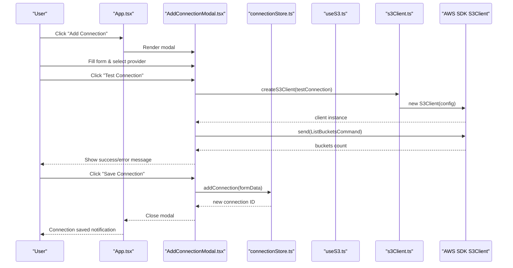
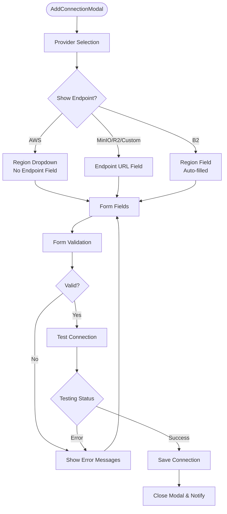
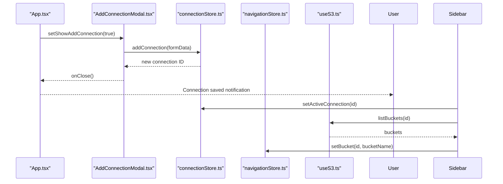
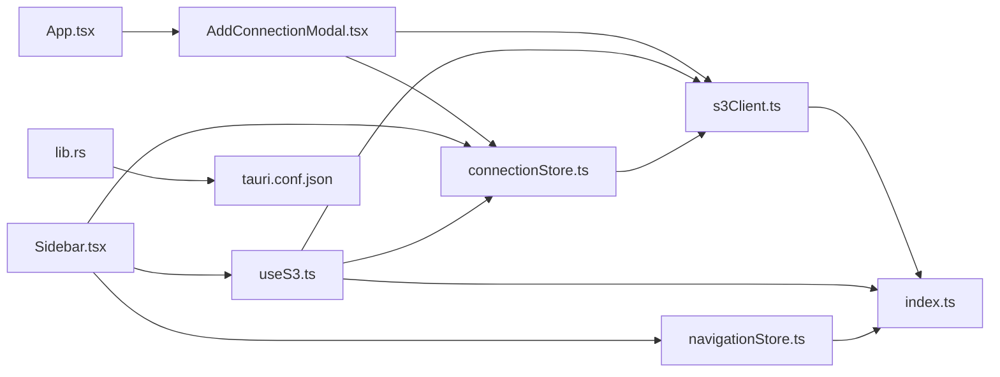

# Connection Management

<cite>
**Referenced Files in This Document**
- [AddConnectionModal.tsx](file://src/components/modals/AddConnectionModal.tsx)
- [connectionStore.ts](file://src/store/connectionStore.ts)
- [s3Client.ts](file://src/lib/s3Client.ts)
- [index.ts](file://src/types/index.ts)
- [useS3.ts](file://src/hooks/useS3.ts)
- [Sidebar.tsx](file://src/components/layout/Sidebar.tsx)
- [navigationStore.ts](file://src/store/navigationStore.ts)
- [App.tsx](file://src/App.tsx)
- [lib.rs](file://src-tauri/src/lib.rs)
- [tauri.conf.json](file://src-tauri/tauri.conf.json)
</cite>

## Update Summary
**Changes Made**
- Added comprehensive documentation for the new AddConnectionModal component
- Updated connection management workflows to include the new modal interface
- Enhanced provider-specific configuration documentation with multi-provider support
- Added detailed validation and testing procedures for connections
- Updated UI integration patterns with the new modal component

## Table of Contents
1. [Introduction](#introduction)
2. [Project Structure](#project-structure)
3. [Core Components](#core-components)
4. [Architecture Overview](#architecture-overview)
5. [Detailed Component Analysis](#detailed-component-analysis)
6. [Dependency Analysis](#dependency-analysis)
7. [Performance Considerations](#performance-considerations)
8. [Troubleshooting Guide](#troubleshooting-guide)
9. [Conclusion](#conclusion)
10. [Appendices](#appendices)

## Introduction
This document explains the connection management feature in S3 Explorer, focusing on the new AddConnectionModal component and enhanced multi-provider support. It covers how users add, configure, and manage S3 connections to multiple providers (AWS S3, MinIO, Cloudflare R2, Backblaze B2, and custom endpoints). The documentation includes the connection store architecture, credential handling, endpoint resolution, and authentication methods. It provides step-by-step guides for adding connections, testing connectivity, and managing multiple connections, along with error handling strategies and security considerations for credential storage.

## Project Structure
The connection management feature spans several layers with the new AddConnectionModal component:
- Modal layer: AddConnectionModal with comprehensive form validation and testing
- Store layer: connection persistence and selection
- Client layer: provider-aware S3 client creation and endpoint resolution
- Hooks layer: S3 operations orchestrated via TanStack Query
- UI layer: sidebar integration and bucket discovery
- Navigation layer: connection-to-bucket binding
- Application layer: modal integration and state management

```mermaid
graph TB
subgraph "Modal Layer"
AddModal["AddConnectionModal.tsx"]
End
subgraph "UI Layer"
Sidebar["Sidebar.tsx"]
App["App.tsx"]
end
subgraph "Store Layer"
ConnStore["connectionStore.ts"]
NavStore["navigationStore.ts"]
end
subgraph "Hooks Layer"
UseS3["useS3.ts"]
end
subgraph "Client Layer"
S3Client["s3Client.ts"]
end
subgraph "Runtime Layer"
TauriLib["lib.rs"]
TauriConf["tauri.conf.json"]
end
AddModal --> ConnStore
App --> AddModal
Sidebar --> ConnStore
Sidebar --> NavStore
Sidebar --> UseS3
UseS3 --> ConnStore
UseS3 --> S3Client
ConnStore --> S3Client
TauriLib --> TauriConf
```

**Diagram sources**
- [AddConnectionModal.tsx:56-354](file://src/components/modals/AddConnectionModal.tsx#L56-L354)
- [App.tsx:142-144](file://src/App.tsx#L142-L144)
- [Sidebar.tsx:117-184](file://src/components/layout/Sidebar.tsx#L117-L184)
- [connectionStore.ts:30-88](file://src/store/connectionStore.ts#L30-L88)
- [navigationStore.ts:36-86](file://src/store/navigationStore.ts#L36-L86)
- [useS3.ts:62-410](file://src/hooks/useS3.ts#L62-L410)
- [s3Client.ts:60-83](file://src/lib/s3Client.ts#L60-L83)
- [lib.rs:8-15](file://src-tauri/src/lib.rs#L8-L15)
- [tauri.conf.json:1-39](file://src-tauri/tauri.conf.json#L1-L39)

**Section sources**
- [AddConnectionModal.tsx:1-410](file://src/components/modals/AddConnectionModal.tsx#L1-L410)
- [App.tsx:142-144](file://src/App.tsx#L142-L144)
- [connectionStore.ts:1-88](file://src/store/connectionStore.ts#L1-L88)
- [s3Client.ts:1-83](file://src/lib/s3Client.ts#L1-L83)
- [index.ts:38-51](file://src/types/index.ts#L38-L51)
- [useS3.ts:62-410](file://src/hooks/useS3.ts#L62-L410)
- [Sidebar.tsx:117-184](file://src/components/layout/Sidebar.tsx#L117-L184)
- [navigationStore.ts:36-86](file://src/store/navigationStore.ts#L36-L86)
- [lib.rs:8-15](file://src-tauri/src/lib.rs#L8-L15)
- [tauri.conf.json:1-39](file://src-tauri/tauri.conf.json#L1-L39)

## Core Components
- **AddConnectionModal**: New modal component with comprehensive form validation, provider-specific field handling, and connection testing
- **Connection model and form data**: Define the shape of stored connections and data accepted for creation/update
- **Connection store**: Persists connections and active selection with selective persistence of state
- **S3 client factory**: Builds provider-aware clients with correct endpoints and credentials
- **useS3 hook**: Orchestrates S3 operations and uses the active connection to create clients
- **Sidebar integration**: Renders connections and triggers bucket loading with modal integration
- **Navigation store**: Binds a selected connection to a chosen bucket

Key responsibilities:
- **AddConnectionModal**: Multi-provider form handling, real-time validation, connection testing, and secure credential input
- **Connection model**: Identity, provider, endpoint, region, credentials, and timestamps
- **Connection store**: CRUD operations, active selection, and persistence
- **Endpoint resolution**: Provider-specific endpoint computation and validation
- **Authentication**: Access key and secret passed to the AWS SDK client
- **UI integration**: Modal-based connection management with sidebar rendering

**Section sources**
- [AddConnectionModal.tsx:11-17](file://src/components/modals/AddConnectionModal.tsx#L11-L17)
- [AddConnectionModal.tsx:97-110](file://src/components/modals/AddConnectionModal.tsx#L97-L110)
- [AddConnectionModal.tsx:127-143](file://src/components/modals/AddConnectionModal.tsx#L127-L143)
- [index.ts:38-51](file://src/types/index.ts#L38-L51)
- [connectionStore.ts:10-28](file://src/store/connectionStore.ts#L10-L28)
- [connectionStore.ts:30-88](file://src/store/connectionStore.ts#L30-L88)
- [s3Client.ts:12-49](file://src/lib/s3Client.ts#L12-L49)
- [s3Client.ts:60-83](file://src/lib/s3Client.ts#L60-L83)
- [useS3.ts:62-410](file://src/hooks/useS3.ts#L62-L410)
- [Sidebar.tsx:117-184](file://src/components/layout/Sidebar.tsx#L117-L184)
- [navigationStore.ts:36-86](file://src/store/navigationStore.ts#L36-L86)

## Architecture Overview
The connection management architecture now includes the new AddConnectionModal component:



**Diagram sources**
- [App.tsx:142-144](file://src/App.tsx#L142-L144)
- [AddConnectionModal.tsx:127-143](file://src/components/modals/AddConnectionModal.tsx#L127-L143)
- [AddConnectionModal.tsx:146-166](file://src/components/modals/AddConnectionModal.tsx#L146-L166)
- [connectionStore.ts:39-52](file://src/store/connectionStore.ts#L39-L52)
- [s3Client.ts:60-83](file://src/lib/s3Client.ts#L60-L83)

## Detailed Component Analysis

### AddConnectionModal Component
The new AddConnectionModal provides a comprehensive interface for managing S3 connections:

**Multi-Provider Support**: Supports AWS S3, MinIO, Cloudflare R2, Backblaze B2, and custom endpoints with provider-specific field handling
**Real-Time Validation**: Comprehensive form validation with immediate feedback for required fields
**Connection Testing**: Built-in connectivity testing using temporary S3Client instances
**Secure Input Handling**: Password masking with show/hide toggle and auto-completion prevention
**Provider-Specific Defaults**: Intelligent default values for regions and placeholders based on selected provider



**Diagram sources**
- [AddConnectionModal.tsx:11-17](file://src/components/modals/AddConnectionModal.tsx#L11-L17)
- [AddConnectionModal.tsx:72-85](file://src/components/modals/AddConnectionModal.tsx#L72-L85)
- [AddConnectionModal.tsx:97-110](file://src/components/modals/AddConnectionModal.tsx#L97-L110)
- [AddConnectionModal.tsx:127-143](file://src/components/modals/AddConnectionModal.tsx#L127-L143)
- [AddConnectionModal.tsx:146-166](file://src/components/modals/AddConnectionModal.tsx#L146-L166)

**Section sources**
- [AddConnectionModal.tsx:11-17](file://src/components/modals/AddConnectionModal.tsx#L11-L17)
- [AddConnectionModal.tsx:72-85](file://src/components/modals/AddConnectionModal.tsx#L72-L85)
- [AddConnectionModal.tsx:97-110](file://src/components/modals/AddConnectionModal.tsx#L97-L110)
- [AddConnectionModal.tsx:127-143](file://src/components/modals/AddConnectionModal.tsx#L127-L143)
- [AddConnectionModal.tsx:146-166](file://src/components/modals/AddConnectionModal.tsx#L146-L166)

### Connection Store
The connection store manages:
- **State**: List of connections and the active connection ID
- **Actions**: Add, update, remove, set active with proper validation
- **Persistence**: Selective persistence of state (connections and active ID)


**Diagram sources**
- [connectionStore.ts:39-52](file://src/store/connectionStore.ts#L39-L52)
- [connectionStore.ts:54-60](file://src/store/connectionStore.ts#L54-L60)
- [connectionStore.ts:62-69](file://src/store/connectionStore.ts#L62-L69)
- [connectionStore.ts:71-76](file://src/store/connectionStore.ts#L71-L76)

**Section sources**
- [connectionStore.ts:10-28](file://src/store/connectionStore.ts#L10-L28)
- [connectionStore.ts:30-88](file://src/store/connectionStore.ts#L30-L88)

### S3 Client Factory and Endpoint Resolution
The client factory creates provider-aware S3 clients:
- **Endpoint resolution**: Depends on provider and optional overrides
- **Credentials**: Passed directly to the SDK
- **Path-style addressing**: Enforced for non-AWS providers


**Diagram sources**
- [s3Client.ts:12-49](file://src/lib/s3Client.ts#L12-L49)

**Section sources**
- [s3Client.ts:12-49](file://src/lib/s3Client.ts#L12-L49)
- [s3Client.ts:60-83](file://src/lib/s3Client.ts#L60-L83)

### Provider-Specific Configuration Options
Supported providers and their configuration:
- **aws**: Default region used if none provided; endpoint not overridden
- **minio**: Requires endpoint URL
- **r2**: Requires endpoint URL (account-based)
- **b2**: Requires either endpoint URL or region to construct endpoint
- **custom**: Requires endpoint URL

Validation ensures required fields per provider are present before creating the client.

**Section sources**
- [s3Client.ts:15-48](file://src/lib/s3Client.ts#L15-L48)
- [index.ts:7-8](file://src/types/index.ts#L7-L8)

### Credential Handling and Security Considerations
- **Credentials**: Stored in the connection model as plain strings
- **Client factory**: Passes credentials directly to the AWS SDK
- **Persistence**: Uses selective state serialization to avoid storing actions
- **Security enhancements**: 
  - Password masking with show/hide toggle
  - Auto-completion prevention for sensitive fields
  - Temporary client instances for testing without permanent storage
  - Toast notifications for successful operations

**Section sources**
- [index.ts:45-46](file://src/types/index.ts#L45-L46)
- [connectionStore.ts:78-85](file://src/store/connectionStore.ts#L78-L85)
- [AddConnectionModal.tsx:272-291](file://src/components/modals/AddConnectionModal.tsx#L272-L291)

### UI Integration and Navigation Binding
- **Sidebar integration**: Displays connections and toggles expansion to show buckets
- **Modal integration**: Seamless integration with App.tsx for connection management
- **On selecting a connection**: Sets active connection and triggers bucket loading
- **Bucket lists**: Fetched via useS3 and bound to the active connection
- **Navigation store**: Associates a connection with a bucket



**Diagram sources**
- [App.tsx:142-144](file://src/App.tsx#L142-L144)
- [AddConnectionModal.tsx:146-166](file://src/components/modals/AddConnectionModal.tsx#L146-L166)
- [connectionStore.ts:71-76](file://src/store/connectionStore.ts#L71-L76)
- [useS3.ts:69-84](file://src/hooks/useS3.ts#L69-L84)
- [navigationStore.ts:42-52](file://src/store/navigationStore.ts#L42-L52)

**Section sources**
- [App.tsx:142-144](file://src/App.tsx#L142-L144)
- [Sidebar.tsx:117-184](file://src/components/layout/Sidebar.tsx#L117-L184)
- [useS3.ts:69-84](file://src/hooks/useS3.ts#L69-L84)
- [navigationStore.ts:42-52](file://src/store/navigationStore.ts#L42-L52)

## Dependency Analysis
The following diagram shows how components depend on each other with the new modal integration:



**Diagram sources**
- [App.tsx:142-144](file://src/App.tsx#L142-L144)
- [AddConnectionModal.tsx:5-7](file://src/components/modals/AddConnectionModal.tsx#L5-L7)
- [Sidebar.tsx:117-184](file://src/components/layout/Sidebar.tsx#L117-L184)
- [connectionStore.ts:30-88](file://src/store/connectionStore.ts#L30-L88)
- [navigationStore.ts:36-86](file://src/store/navigationStore.ts#L36-L86)
- [useS3.ts:62-410](file://src/hooks/useS3.ts#L62-L410)
- [s3Client.ts:60-83](file://src/lib/s3Client.ts#L60-L83)
- [index.ts:38-51](file://src/types/index.ts#L38-L51)
- [lib.rs:8-15](file://src-tauri/src/lib.rs#L8-L15)
- [tauri.conf.json:1-39](file://src-tauri/tauri.conf.json#L1-L39)

**Section sources**
- [index.ts:38-51](file://src/types/index.ts#L38-L51)
- [connectionStore.ts:30-88](file://src/store/connectionStore.ts#L30-L88)
- [s3Client.ts:60-83](file://src/lib/s3Client.ts#L60-L83)
- [useS3.ts:62-410](file://src/hooks/useS3.ts#L62-L410)
- [Sidebar.tsx:117-184](file://src/components/layout/Sidebar.tsx#L117-L184)
- [navigationStore.ts:36-86](file://src/store/navigationStore.ts#L36-L86)
- [App.tsx:142-144](file://src/App.tsx#L142-L144)
- [lib.rs:8-15](file://src-tauri/src/lib.rs#L8-L15)
- [tauri.conf.json:1-39](file://src-tauri/tauri.conf.json#L1-L39)

## Performance Considerations
- **Client reuse**: The client factory creates a new S3Client per operation; consider caching clients keyed by connection properties if repeated calls become frequent
- **Query defaults**: TanStack Query is configured with a short stale time and retries to balance freshness and resilience
- **Endpoint resolution**: Minimal overhead; ensure endpoint URLs are pre-validated to avoid runtime errors
- **Modal performance**: AddConnectionModal uses efficient state management and conditional rendering for provider-specific fields
- **Connection testing**: Temporary client instances are created only during testing to minimize resource usage

## Troubleshooting Guide
Common issues and resolutions:
- **Unsupported provider**: Ensure the provider is one of the supported values; otherwise, endpoint resolution throws an error
- **Missing endpoint or region**: Provider-specific validation enforces required fields; supply endpoint for MinIO/R2/Custom and region for Backblaze B2 when endpoint is not provided
- **Active connection mismatch**: If a connection disappears, attempting to use it throws an error; reselect a valid connection
- **Bucket loading failures**: Errors from bucket listing are surfaced in the UI; verify credentials and endpoint reachability
- **Modal validation errors**: Check that all required fields are filled according to the selected provider
- **Connection testing failures**: Verify network connectivity and credential validity before saving connections

**Section sources**
- [s3Client.ts:15-48](file://src/lib/s3Client.ts#L15-L48)
- [useS3.ts:21-34](file://src/hooks/useS3.ts#L21-L34)
- [Sidebar.tsx:68-75](file://src/components/layout/Sidebar.tsx#L68-L75)
- [AddConnectionModal.tsx:97-110](file://src/components/modals/AddConnectionModal.tsx#L97-L110)

## Conclusion
S3 Explorer's connection management provides a robust foundation for working with multiple S3-compatible providers through the new AddConnectionModal component. The modal offers comprehensive multi-provider support with real-time validation, connection testing, and secure credential handling. The store persists connections and tracks the active selection, the client factory handles provider-specific endpoint resolution and authentication, and the UI integrates seamlessly with TanStack Query for responsive operations. By following the enhanced workflows below, users can add, test, and manage connections effectively while adhering to security best practices.

## Appendices

### Step-by-Step: Adding a New Connection via AddConnectionModal
1. **Open the Add Connection modal**: Click the "+" button in the sidebar or welcome screen
2. **Select a provider**: Choose from AWS S3, MinIO, Cloudflare R2, Backblaze B2, or Custom
3. **Fill in required fields**:
   - **Connection Name**: Descriptive name for the connection
   - **Provider**: Selected from dropdown (determines required fields)
   - **Endpoint URL**: Required for MinIO, R2, B2, and Custom providers
   - **Region**: Required for all providers (auto-filled based on provider selection)
   - **Access Key ID**: Required for all providers
   - **Secret Access Key**: Required for all providers (masked input)
4. **Test the connection**: Click "Test Connection" to validate credentials and endpoint
5. **Save the connection**: Click "Save Connection" to add to the connection store
6. **Verify success**: Receive notification and see the new connection in the sidebar

**Section sources**
- [AddConnectionModal.tsx:11-17](file://src/components/modals/AddConnectionModal.tsx#L11-L17)
- [AddConnectionModal.tsx:97-110](file://src/components/modals/AddConnectionModal.tsx#L97-L110)
- [AddConnectionModal.tsx:127-143](file://src/components/modals/AddConnectionModal.tsx#L127-L143)
- [AddConnectionModal.tsx:146-166](file://src/components/modals/AddConnectionModal.tsx#L146-L166)

### Step-by-Step: Testing Connectivity
1. **Select an active connection**: Choose a connection from the sidebar
2. **Trigger bucket listing**: Use the UI to list buckets for the selected connection
3. **Observe results**:
   - **Success**: Buckets appear in the UI with count indicator
   - **Failure**: Error message is shown with specific error details; check provider configuration and credentials

**Section sources**
- [Sidebar.tsx:52-75](file://src/components/layout/Sidebar.tsx#L52-L75)
- [useS3.ts:69-84](file://src/hooks/useS3.ts#L69-L84)

### Managing Multiple Connections
- **Add multiple connections**: Use the AddConnectionModal to create connections with distinct names and providers
- **Switch between connections**: Click connections in the sidebar; the active connection drives subsequent operations
- **Remove unused connections**: Use the sidebar context menu to remove connections and free up resources
- **Monitor connection status**: Use the connection counter in the sidebar footer

**Section sources**
- [connectionStore.ts:62-69](file://src/store/connectionStore.ts#L62-L69)
- [connectionStore.ts:71-76](file://src/store/connectionStore.ts#L71-L76)
- [Sidebar.tsx:163-184](file://src/components/layout/Sidebar.tsx#L163-L184)

### Relationship to Other System Components
- **Modal layer**: AddConnectionModal coordinates with connection store and S3 client factory
- **Store layer**: connectionStore and navigationStore coordinate state management
- **Hooks layer**: useS3 orchestrates S3 operations using the active connection
- **Client layer**: s3Client constructs provider-aware clients with enhanced validation
- **UI layer**: Sidebar renders connections and triggers bucket queries with modal integration
- **Runtime layer**: Tauri initializes plugins and runs the application with modal support

**Section sources**
- [AddConnectionModal.tsx:5-7](file://src/components/modals/AddConnectionModal.tsx#L5-L7)
- [connectionStore.ts:30-88](file://src/store/connectionStore.ts#L30-L88)
- [navigationStore.ts:36-86](file://src/store/navigationStore.ts#L36-L86)
- [useS3.ts:62-410](file://src/hooks/useS3.ts#L62-L410)
- [s3Client.ts:60-83](file://src/lib/s3Client.ts#L60-L83)
- [Sidebar.tsx:117-184](file://src/components/layout/Sidebar.tsx#L117-L184)
- [lib.rs:8-15](file://src-tauri/src/lib.rs#L8-L15)
- [tauri.conf.json:1-39](file://src-tauri/tauri.conf.json#L1-L39)