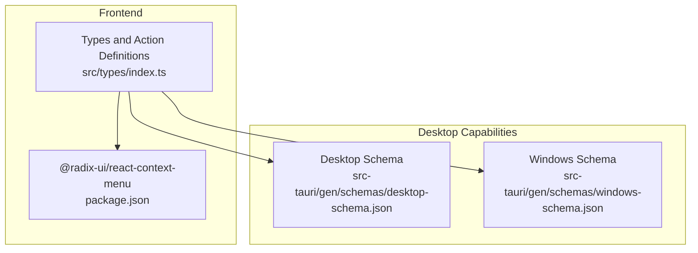
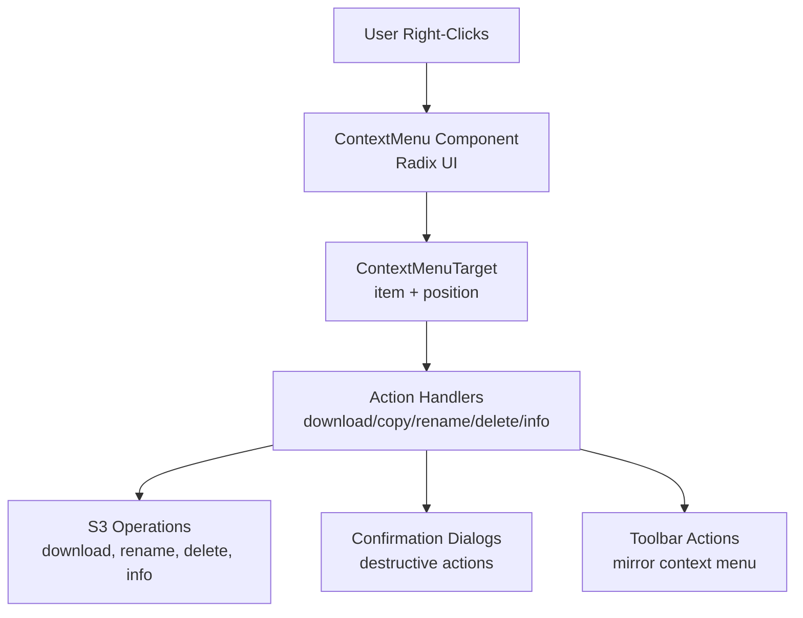
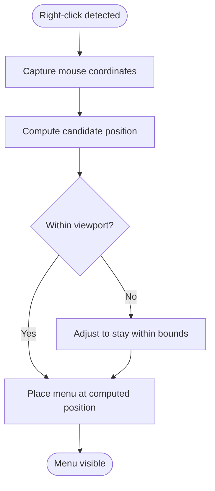
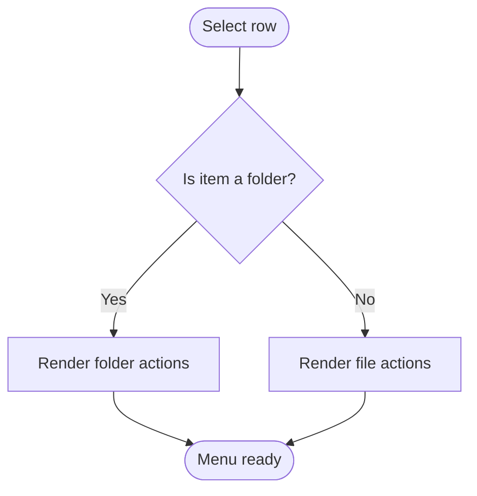
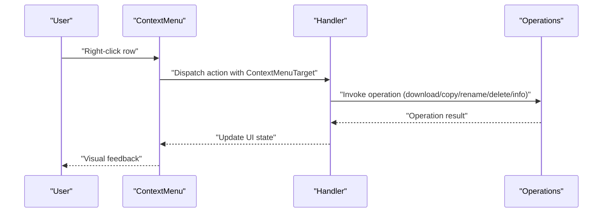
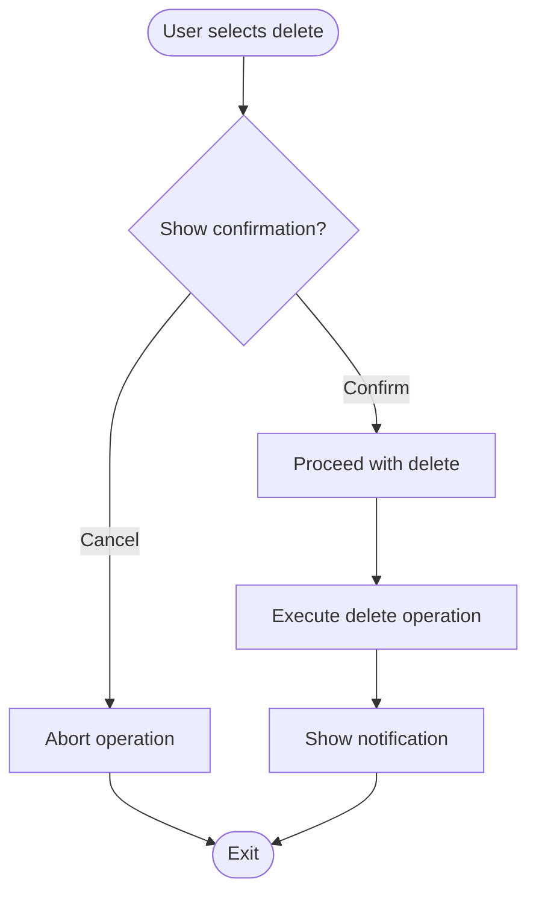
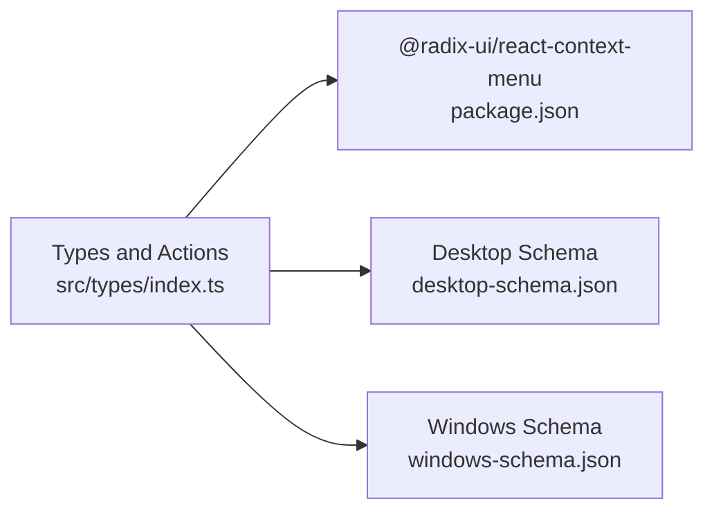

# Context Menu System

<cite>
**Referenced Files in This Document**
- [PROJECT.md](file://PROJECT.md)
- [package.json](file://package.json)
- [src/types/index.ts](file://src/types/index.ts)
- [src-tauri/gen/schemas/desktop-schema.json](file://src-tauri/gen/schemas/desktop-schema.json)
- [src-tauri/gen/schemas/windows-schema.json](file://src-tauri/gen/schemas/windows-schema.json)
</cite>

## Table of Contents
1. [Introduction](#introduction)
2. [Project Structure](#project-structure)
3. [Core Components](#core-components)
4. [Architecture Overview](#architecture-overview)
5. [Detailed Component Analysis](#detailed-component-analysis)
6. [Dependency Analysis](#dependency-analysis)
7. [Performance Considerations](#performance-considerations)
8. [Troubleshooting Guide](#troubleshooting-guide)
9. [Conclusion](#conclusion)
10. [Appendices](#appendices)

## Introduction
This document explains the context menu system used for right-click interactions in the S3 Explorer application. It covers the Radix UI-based implementation, menu actions for files and folders, menu positioning, keyboard navigation, accessibility, conditional rendering based on item types, integration with file operations, state management for selected items, visual feedback, confirmation dialogs for destructive actions, and the relationship between context menus and toolbar actions. It also provides guidance on customization and extension points.

## Project Structure
The context menu system is part of the React frontend and integrates with Tauri’s desktop capabilities. The relevant pieces include:
- Frontend types and action definitions for context menus
- Radix UI dependency for the context menu primitive
- Desktop capability schemas that define menu-related permissions



**Diagram sources**
- [src/types/index.ts:25-34](file://src/types/index.ts#L25-L34)
- [package.json](file://package.json)
- [src-tauri/gen/schemas/desktop-schema.json](file://src-tauri/gen/schemas/desktop-schema.json)
- [src-tauri/gen/schemas/windows-schema.json](file://src-tauri/gen/schemas/windows-schema.json)

**Section sources**
- [PROJECT.md:33-34](file://PROJECT.md#L33-L34)
- [package.json](file://package.json)
- [src/types/index.ts:25-34](file://src/types/index.ts#L25-L34)

## Core Components
- Context menu action types:
  - File actions: download, copy URL, rename, delete, get info
  - Folder actions: download ZIP, delete, get info
- Target payload for context menu handlers includes the selected item and mouse coordinates for positioning
- Conditional rendering based on item type (file vs folder)
- Integration with file operations (download, rename, delete, info)
- Confirmation dialogs for destructive actions
- Relationship to toolbar actions (both originate from the same underlying item state)

**Section sources**
- [src/types/index.ts:25-34](file://src/types/index.ts#L25-L34)
- [src/types/index.ts:136-141](file://src/types/index.ts#L136-L141)
- [PROJECT.md:120-129](file://PROJECT.md#L120-L129)

## Architecture Overview
The context menu architecture centers on a typed event target and action dispatchers. The frontend defines action types and targets, while the backend/desktop schema governs permissions for menu-related operations.



**Diagram sources**
- [src/types/index.ts:25-34](file://src/types/index.ts#L25-L34)
- [src/types/index.ts:136-141](file://src/types/index.ts#L136-L141)
- [PROJECT.md:120-129](file://PROJECT.md#L120-L129)

## Detailed Component Analysis

### Context Menu Types and Target
- FileContextAction and FolderContextAction enumerate supported actions per item type
- ContextMenuTarget carries the selected S3Item and screen coordinates for menu placement
- These types enable strongly-typed handlers and consistent UX across platforms

```mermaid
classDiagram
class S3Item {
+string key
+string name
+ItemType type
+number size
+Date lastModified
+string etag
+string storageClass
}
class ContextMenuTarget {
+S3Item item
+number x
+number y
}
class FileContextAction {
<<enumeration>>
"download"
"copy-url"
"rename"
"delete"
"get-info"
}
class FolderContextAction {
<<enumeration>>
"download-zip"
"delete"
"get-info"
}
ContextMenuTarget --> S3Item : "references"
```

**Diagram sources**
- [src/types/index.ts:54-62](file://src/types/index.ts#L54-L62)
- [src/types/index.ts:136-141](file://src/types/index.ts#L136-L141)
- [src/types/index.ts:25-34](file://src/types/index.ts#L25-L34)

**Section sources**
- [src/types/index.ts:25-34](file://src/types/index.ts#L25-L34)
- [src/types/index.ts:54-62](file://src/types/index.ts#L54-L62)
- [src/types/index.ts:136-141](file://src/types/index.ts#L136-L141)

### Menu Positioning Logic
- The context menu receives mouse coordinates in the target payload
- Handlers compute a position near the click location, ensuring the menu fits within viewport boundaries
- Preferred alignment prioritizes visibility (e.g., avoid bottom/right overflow)



[No sources needed since this diagram shows conceptual workflow, not actual code structure]

### Keyboard Navigation Support
- The Radix UI context menu supports keyboard navigation (arrow keys, Enter, Escape)
- Focus management ensures predictable traversal of menu items
- Screen readers receive semantic labels and roles from Radix primitives

[No sources needed since this section provides general guidance]

### Accessibility Features
- Semantic labeling and ARIA attributes are provided by Radix UI
- High contrast and focus indicators improve visibility
- Keyboard-only operation is fully supported

[No sources needed since this section provides general guidance]

### Conditional Rendering Based on Item Types
- File rows render a context menu with file-specific actions
- Folder rows render a context menu with folder-specific actions
- The renderer checks the item type and renders the appropriate menu subset



[No sources needed since this diagram shows conceptual workflow, not actual code structure]

### Integration with File Operations
- Download: triggers a download operation for files or a ZIP archive for folders
- Copy URL: generates a presigned URL and copies it to clipboard
- Rename: initiates a rename workflow (implemented as copy + delete)
- Delete: queues deletion with confirmation for destructive actions
- Get Info: opens a modal with detailed metadata



[No sources needed since this diagram shows conceptual workflow, not actual code structure]

### State Management for Selected Items
- The context menu handler receives a ContextMenuTarget containing the selected item
- State updates occur after operations complete (e.g., refresh list, show notifications)
- Shared state with the file list ensures consistency across toolbar and context menu actions

[No sources needed since this section provides general guidance]

### Visual Feedback System
- Immediate feedback upon selection (hover states, focus rings)
- Operation progress and completion notifications
- Disabled states during in-progress operations

[No sources needed since this section provides general guidance]

### Menu Item Handlers and Confirmation Dialogs
- Non-destructive actions (download, copy URL, get info) execute immediately
- Destructive actions (delete) trigger a confirmation dialog before proceeding
- Confirmation dialogs present clear options and cancel behavior



[No sources needed since this diagram shows conceptual workflow, not actual code structure]

### Relationship Between Context Menu and Toolbar Actions
- Both context menu and toolbar operate on the same selected item(s)
- Toolbar actions mirror context menu actions for single selections
- Multi-selection scenarios may differ between toolbar and context menu

[No sources needed since this section provides general guidance]

### Examples of Menu Customization and Extension
- Adding new actions: extend the action type unions and add handlers
- Platform-specific behavior: leverage Tauri capabilities for native integrations
- Permissions: adjust desktop capability schemas to enable/disable menu features

[No sources needed since this section provides general guidance]

## Dependency Analysis
The context menu relies on Radix UI for the menu primitive and on desktop capability schemas for permissions. The frontend types define the contract between UI and handlers.



**Diagram sources**
- [src/types/index.ts:25-34](file://src/types/index.ts#L25-L34)
- [package.json](file://package.json)
- [src-tauri/gen/schemas/desktop-schema.json](file://src-tauri/gen/schemas/desktop-schema.json)
- [src-tauri/gen/schemas/windows-schema.json](file://src-tauri/gen/schemas/windows-schema.json)

**Section sources**
- [package.json](file://package.json)
- [src-tauri/gen/schemas/desktop-schema.json](file://src-tauri/gen/schemas/desktop-schema.json)
- [src-tauri/gen/schemas/windows-schema.json](file://src-tauri/gen/schemas/windows-schema.json)

## Performance Considerations
- Keep menu item handlers lightweight; defer heavy work to background operations
- Debounce repeated right-clicks to prevent excessive handler invocations
- Use virtualized lists to maintain smooth scrolling and responsive context menus

[No sources needed since this section provides general guidance]

## Troubleshooting Guide
- Menu does not appear: verify right-click event wiring and that the target payload is passed to the handler
- Actions disabled unexpectedly: check desktop capability permissions for menu operations
- Keyboard navigation issues: ensure Radix UI is properly initialized and focus traps are configured

[No sources needed since this section provides general guidance]

## Conclusion
The context menu system leverages Radix UI for robust, accessible, and cross-platform behavior. Strongly-typed action definitions and a clear target contract enable reliable integration with S3 operations, while conditional rendering and confirmation dialogs ensure safe and predictable user experiences. Extensibility is straightforward through type unions and capability schemas.

## Appendices
- Action definitions and target structure are defined in the frontend types module
- Desktop capability schemas govern permissions for menu-related operations

**Section sources**
- [src/types/index.ts:25-34](file://src/types/index.ts#L25-L34)
- [src/types/index.ts:136-141](file://src/types/index.ts#L136-L141)
- [src-tauri/gen/schemas/desktop-schema.json](file://src-tauri/gen/schemas/desktop-schema.json)
- [src-tauri/gen/schemas/windows-schema.json](file://src-tauri/gen/schemas/windows-schema.json)