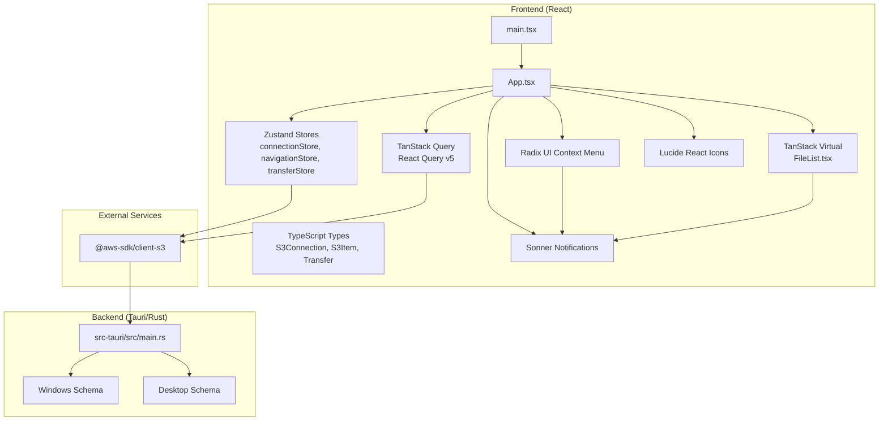
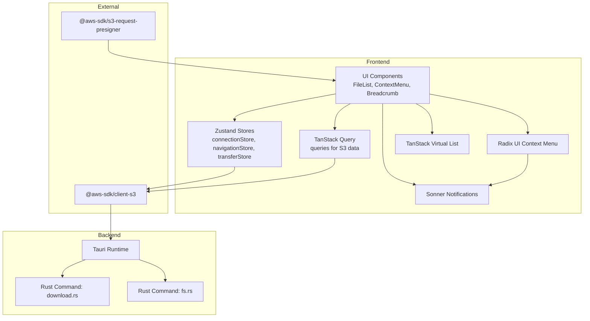
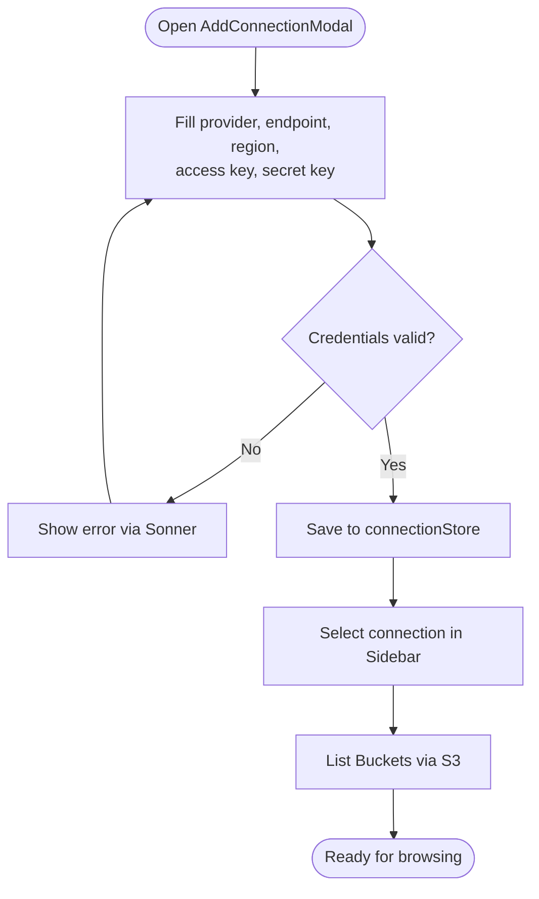
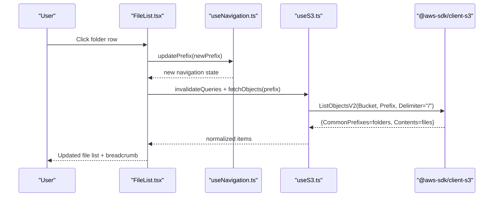
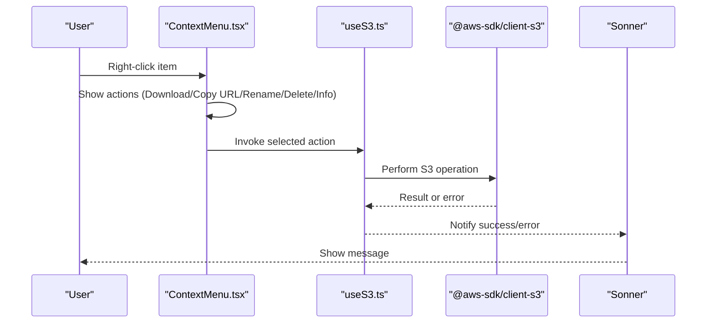
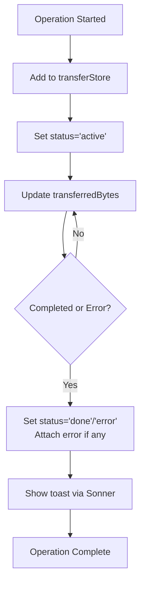
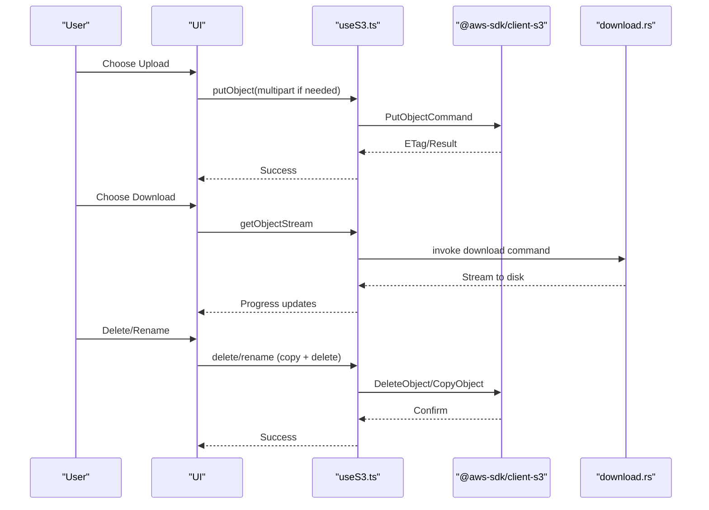
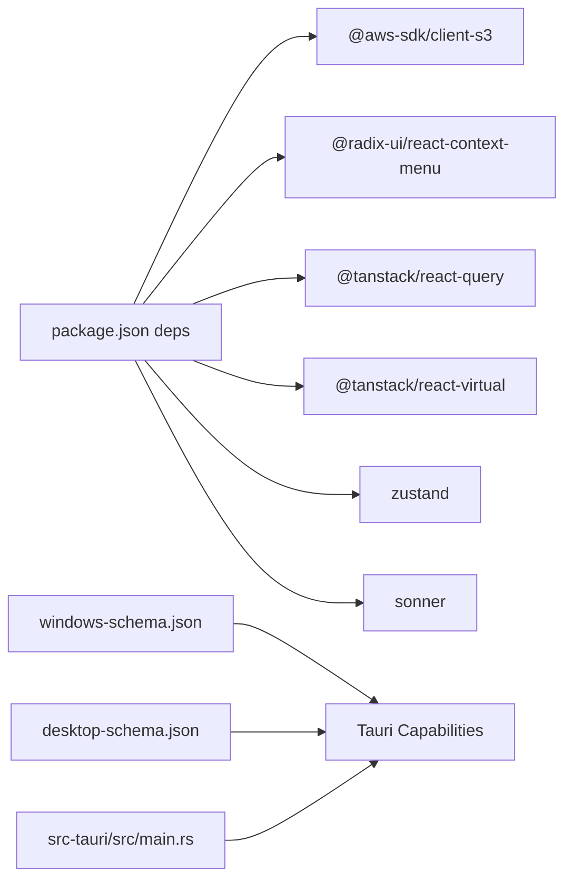

# Core Features

<cite>
**Referenced Files in This Document**
- [PROJECT.md](file://PROJECT.md)
- [package.json](file://package.json)
- [src-tauri/src/main.rs](file://src-tauri/src/main.rs)
- [src-tauri/gen/schemas/desktop-schema.json](file://src-tauri/gen/schemas/desktop-schema.json)
- [src-tauri/gen/schemas/windows-schema.json](file://src-tauri/gen/schemas/windows-schema.json)
- [src/App.tsx](file://src/App.tsx)
- [src/main.tsx](file://src/main.tsx)
</cite>

## Table of Contents
1. [Introduction](#introduction)
2. [Project Structure](#project-structure)
3. [Core Components](#core-components)
4. [Architecture Overview](#architecture-overview)
5. [Detailed Component Analysis](#detailed-component-analysis)
6. [Dependency Analysis](#dependency-analysis)
7. [Performance Considerations](#performance-considerations)
8. [Troubleshooting Guide](#troubleshooting-guide)
9. [Conclusion](#conclusion)

## Introduction
This document explains S3 Explorer’s core features and implementation patterns. The application is a desktop file manager for S3-compatible storage (AWS S3, MinIO, Cloudflare R2, Backblaze B2, and others) built with Tauri v2 (Rust backend) and React + TypeScript (frontend). It supports multi-provider connections, a virtualized file browser, robust file operations (upload, download, delete, rename), a context menu with quick actions, and transfer management with progress tracking. The frontend leverages AWS SDK JS v3, Zustand for state, TanStack Query for async data, Radix UI for context menus, TanStack Virtual for performance, and Sonner for notifications.

## Project Structure
The repository follows a clear separation of concerns:
- Frontend (React + TypeScript): located under src/
- Backend (Tauri + Rust): located under src-tauri/
- Documentation and type definitions: PROJECT.md and related type files

High-level structure and technology stack:
- Desktop framework: Tauri v2 (Rust)
- Frontend: React 18 + TypeScript + Tailwind CSS v4
- AWS SDK: @aws-sdk/client-s3 (JS v3)
- State management: Zustand
- Async data: TanStack Query (React Query v5)
- Context menu: Radix UI (@radix-ui/react-context-menu)
- Icons: Lucide React
- Virtualized list: TanStack Virtual
- Notifications: Sonner

**Diagram sources**
- [src/App.tsx](file://src/App.tsx)
- [src/main.tsx](file://src/main.tsx)
- [src-tauri/src/main.rs](file://src-tauri/src/main.rs)
- [src-tauri/gen/schemas/desktop-schema.json](file://src-tauri/gen/schemas/desktop-schema.json)
- [src-tauri/gen/schemas/windows-schema.json](file://src-tauri/gen/schemas/windows-schema.json)
- [package.json](file://package.json)

**Section sources**
- [PROJECT.md](file://PROJECT.md)
- [package.json](file://package.json)
- [src-tauri/src/main.rs](file://src-tauri/src/main.rs)
- [src-tauri/gen/schemas/desktop-schema.json](file://src-tauri/gen/schemas/desktop-schema.json)
- [src-tauri/gen/schemas/windows-schema.json](file://src-tauri/gen/schemas/windows-schema.json)
- [src/App.tsx](file://src/App.tsx)
- [src/main.tsx](file://src/main.tsx)

## Core Components
This section outlines the five primary feature areas and their implementation patterns.

### 1) Connection Management with Multi-Provider Support
- Purpose: Save, manage, and switch between S3-compatible connections with provider-specific endpoints and credentials.
- Types: S3Connection defines provider, endpoint, region, and credentials.
- Storage: Zustand store for persisted connection list.
- UX: Add/Edit/Delete via modal dialogs; selection updates active connection and drives navigation and S3 operations.
- Provider support: aws, minio, r2, b2, custom with optional endpoint override.

User workflows:
- Add connection: Open AddConnectionModal, fill provider and credentials, save.
- Switch connection: Select from sidebar; triggers bucket listing.
- Edit/delete: Right-click connection row or use dedicated actions.

Integration points:
- Frontend state: connectionStore.ts
- Types: index.ts
- UI: AddConnectionModal.tsx and Sidebar.tsx (referenced in project overview)

**Section sources**
- [PROJECT.md](file://PROJECT.md)

### 2) File Browser Interface with Virtualized Lists
- Purpose: Efficiently render large bucket listings with smooth scrolling and responsive UI.
- Implementation: TanStack Virtual powers FileList.tsx; FileRow.tsx/FolderRow.tsx represent individual rows.
- Navigation: BreadcrumbNav.tsx reflects current prefix; Toolbar.tsx provides actions.
- UX: Click folders to navigate deeper; click files to trigger context menu actions.

User workflows:
- Browse buckets: After selecting a connection, list buckets appear in sidebar.
- Navigate folders: Click a folder row to enter; breadcrumb updates.
- Scroll performance: Virtualization handles thousands of items efficiently.

Integration points:
- Virtualized list: FileList.tsx
- Rows: FileRow.tsx, FolderRow.tsx
- Navigation: BreadcrumbNav.tsx, useNavigation.ts
- Async data: useS3.ts (TanStack Query)

**Section sources**
- [PROJECT.md](file://PROJECT.md)

### 3) File Operations: Upload, Download, Delete, Rename
- Upload: Drag-and-drop or button action; uses PutObjectCommand or multipart uploads for large files.
- Download: GetObjectCommand streamed to disk via Tauri for reliability (especially large files).
- Delete: DeleteObjectCommand or batch DeleteObjectsCommand for folders.
- Rename: Implemented as CopyObjectCommand followed by DeleteObjectCommand.
- Presigned URLs: getSignedUrl + GetObjectCommand for shareable links.

User workflows:
- Upload: Select files or drag into main area; progress tracked in transfer queue.
- Download: Right-click file → Download; progress shown.
- Delete: Right-click → Delete; confirm dialog.
- Rename: Right-click → Rename; modal captures new name.

Integration points:
- S3 operations: useS3.ts
- Commands: download.rs (Rust) for downloads
- Transfers: transferStore.ts
- Modals: CreateFolderModal.tsx, RenameModal.tsx, DeleteConfirmModal.tsx

**Section sources**
- [PROJECT.md](file://PROJECT.md)

### 4) Context Menu System with Quick Actions
- Purpose: Provide per-item actions (file or folder) without cluttering the toolbar.
- Implementation: Radix UI Context Menu component; actions mapped to S3 operations.
- Actions (files): Download, Copy URL (presigned), Rename, Delete, Get Info.
- Actions (folders): Download folder (as ZIP), Delete folder, Get Info.

User workflows:
- Right-click item → choose action → confirm if needed → observe feedback.

Integration points:
- Context menu: ContextMenu.tsx
- Toast notifications: Sonner
- Presigned URL generation: @aws-sdk/s3-request-presigner

**Section sources**
- [PROJECT.md](file://PROJECT.md)
- [package.json](file://package.json)

### 5) Transfer Management with Progress Tracking
- Purpose: Queue and monitor upload/download progress with status transitions.
- Implementation: Transfer model tracks id, type, filename, sizes, status, and optional error.
- State: Zustand transferStore manages queue and updates.
- UX: Progress bars and notifications; errors surfaced with Sonner.

User workflows:
- Start operation → add to transfer queue → show progress → completion/error.

Integration points:
- Transfer model: types/index.ts
- Store: store/transferStore.ts
- Downloads: Rust download.rs command
- UI: ProgressBar.tsx, Sonner toasts

**Section sources**
- [PROJECT.md](file://PROJECT.md)

## Architecture Overview
The system combines a React frontend with Tauri commands for sensitive operations (like large downloads) and AWS SDK for S3 interactions. State is centralized via Zustand stores, and async data is managed with TanStack Query. Radix UI provides context menus, and TanStack Virtual ensures smooth rendering.

**Diagram sources**
- [PROJECT.md](file://PROJECT.md)
- [package.json](file://package.json)
- [src-tauri/src/main.rs](file://src-tauri/src/main.rs)

## Detailed Component Analysis

### Connection Management
- Responsibilities: Persist and switch active S3 connections; drive bucket and object listing.
- Patterns: Modal-driven creation/editing; Zustand store for persistence; provider-aware client initialization.
- Security: Credentials stored securely; avoid hardcoding.

**Diagram sources**
- [PROJECT.md](file://PROJECT.md)

**Section sources**
- [PROJECT.md](file://PROJECT.md)

### File Browser and Navigation
- Responsibilities: Render hierarchical file/folder listings; maintain navigation state; support breadcrumbs and back navigation.
- Patterns: Virtualized list for performance; TanStack Query for caching and refetching; delimiter-based listing for virtual folders.

**Diagram sources**
- [PROJECT.md](file://PROJECT.md)
- [package.json](file://package.json)

**Section sources**
- [PROJECT.md](file://PROJECT.md)

### Context Menu Actions
- Responsibilities: Provide per-item actions with immediate feedback.
- Patterns: Action handlers dispatch S3 operations; Radix UI ensures accessibility; Sonner displays outcomes.

**Diagram sources**
- [PROJECT.md](file://PROJECT.md)
- [package.json](file://package.json)

**Section sources**
- [PROJECT.md](file://PROJECT.md)

### Transfer Management and Progress
- Responsibilities: Track uploads/downloads; update progress; surface errors.
- Patterns: Transfer model with status lifecycle; Rust-backed downloads for large files; UI updates via Zustand.

**Diagram sources**
- [PROJECT.md](file://PROJECT.md)

**Section sources**
- [PROJECT.md](file://PROJECT.md)

### File Operations: Upload, Download, Delete, Rename
- Responsibilities: Implement CRUD-like operations on S3 objects with rename simulated via copy + delete.
- Patterns: Use PutObjectCommand for small files; multipart for large; GetObjectCommand streamed via Tauri for large downloads; batch deletes for folders.

**Diagram sources**
- [PROJECT.md](file://PROJECT.md)
- [package.json](file://package.json)

**Section sources**
- [PROJECT.md](file://PROJECT.md)

## Dependency Analysis
- Frontend dependencies include AWS SDK, Radix UI, TanStack Query/Virtual, Sonner, and Zustand.
- Tauri schemas define capability permissions for menus and opener plugins.
- Backend entry point initializes the Tauri runtime.

**Diagram sources**
- [package.json](file://package.json)
- [src-tauri/gen/schemas/windows-schema.json](file://src-tauri/gen/schemas/windows-schema.json)
- [src-tauri/gen/schemas/desktop-schema.json](file://src-tauri/gen/schemas/desktop-schema.json)
- [src-tauri/src/main.rs](file://src-tauri/src/main.rs)

**Section sources**
- [package.json](file://package.json)
- [src-tauri/gen/schemas/windows-schema.json](file://src-tauri/gen/schemas/windows-schema.json)
- [src-tauri/gen/schemas/desktop-schema.json](file://src-tauri/gen/schemas/desktop-schema.json)
- [src-tauri/src/main.rs](file://src-tauri/src/main.rs)

## Performance Considerations
- Virtualized lists: TanStack Virtual reduces DOM nodes and improves scroll performance for large directories.
- Caching and invalidation: TanStack Query caches S3 responses and invalidates on navigation changes.
- Streaming downloads: Rust-backed download command streams large files reliably.
- Debounced/focused refresh: Avoid rapid successive requests; implement exponential backoff for retries.
- Minimal re-renders: Zustand stores isolate state slices; memoized selectors prevent unnecessary updates.

## Troubleshooting Guide
- Authentication failures: Verify provider, region, and credentials; check secure storage configuration.
- Large download issues: Prefer Rust-backed download command for files larger than a threshold.
- Permission errors: Review Tauri capability schemas for required permissions (menus, opener).
- Network timeouts: Implement retry with exponential backoff; reduce concurrent operations.
- UI freezes: Confirm virtualization is enabled; avoid rendering non-virtualized lists for thousands of items.

## Conclusion
S3 Explorer integrates Tauri and React to deliver a performant, extensible desktop application for S3-compatible storage. Its modular architecture—multi-provider connections, virtualized browsing, robust file operations, context menu actions, and transfer management—relies on modern frontend libraries and a secure backend. By following the documented patterns and leveraging the referenced components, developers can extend functionality while maintaining reliability and usability.