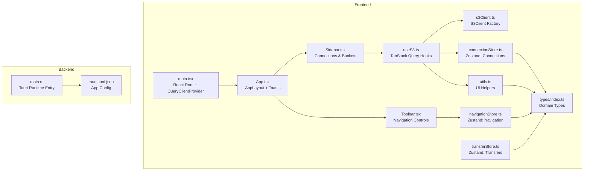
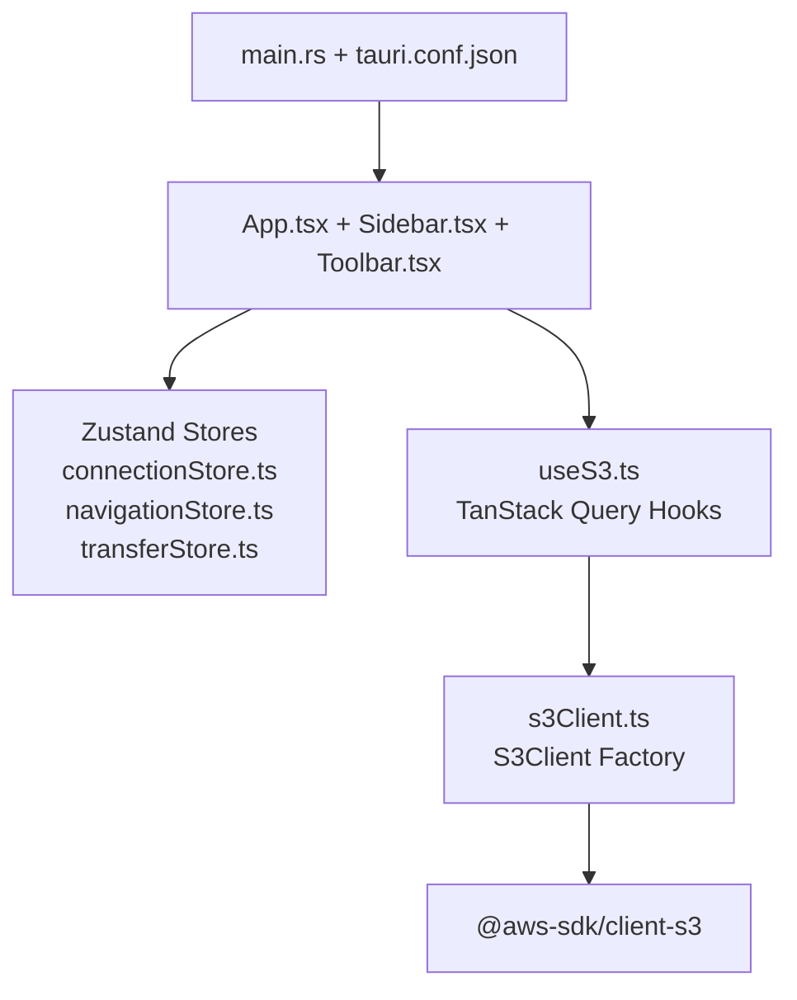
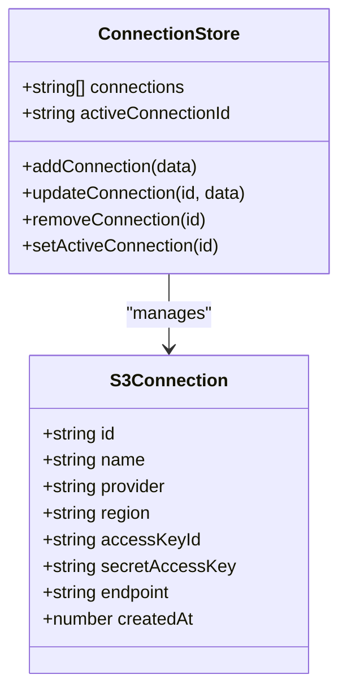
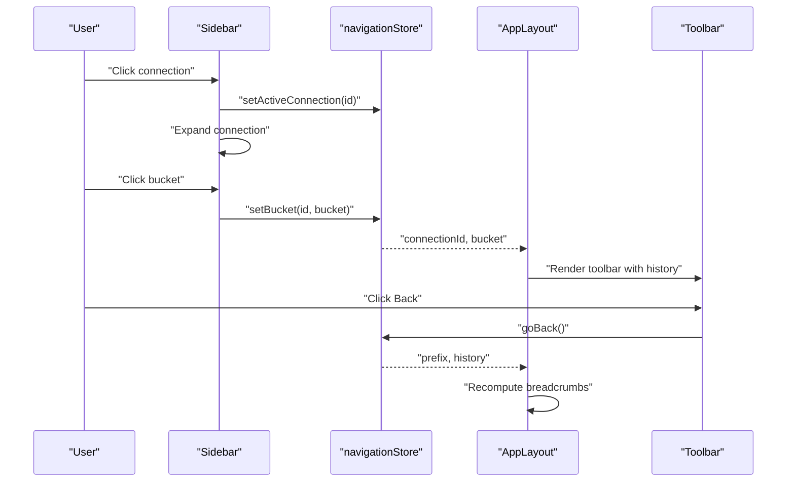
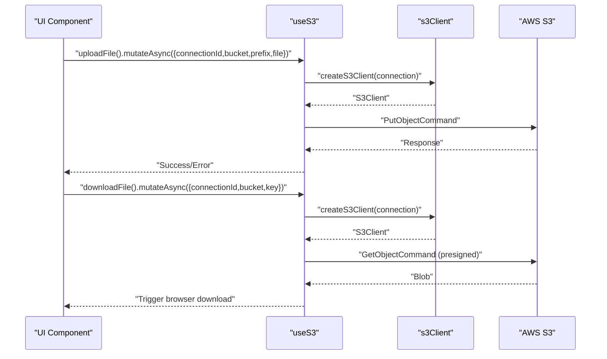
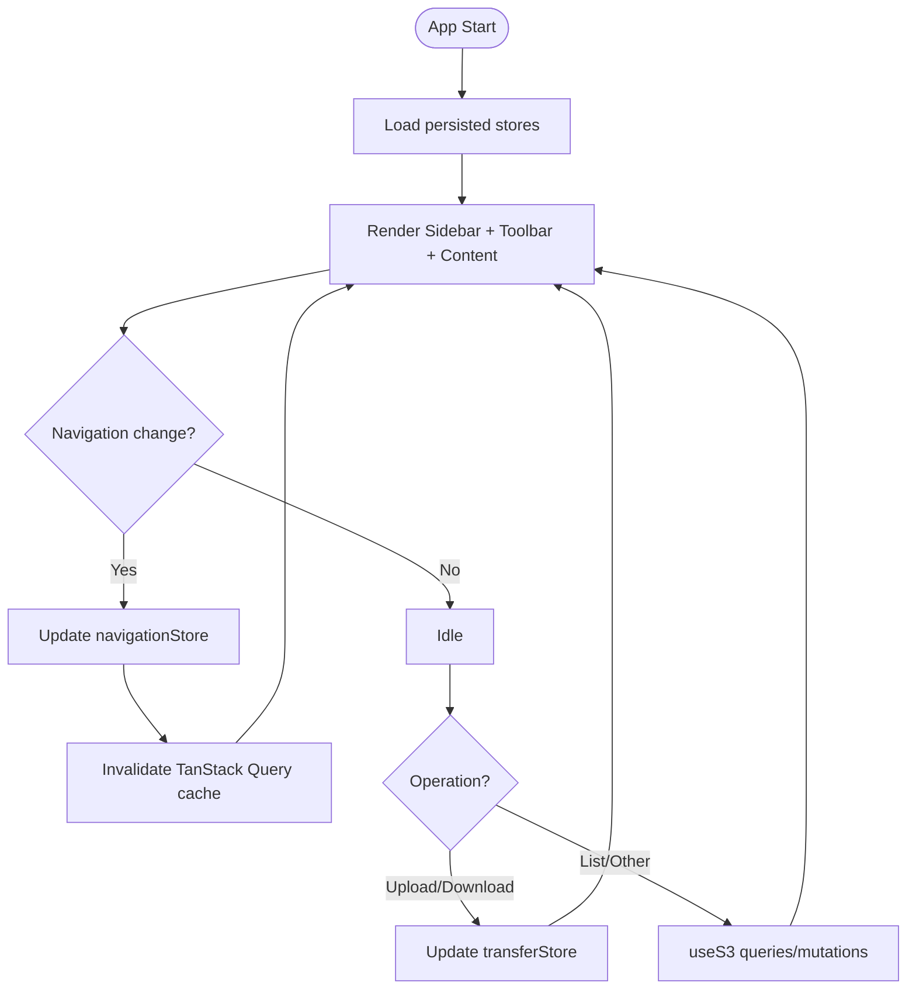
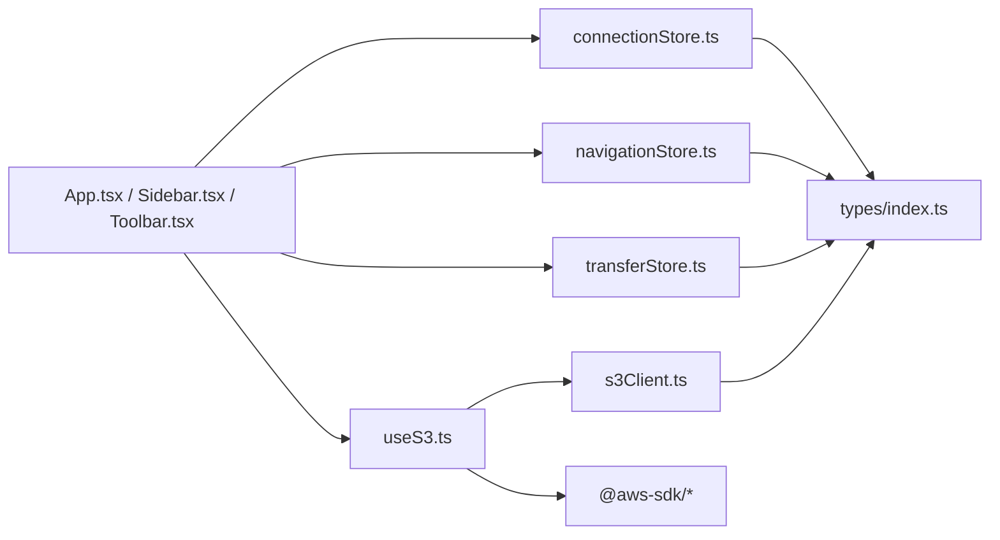

# Core Features

<cite>
**Referenced Files in This Document**
- [App.tsx](file://src/App.tsx)
- [main.tsx](file://src/main.tsx)
- [Sidebar.tsx](file://src/components/layout/Sidebar.tsx)
- [Toolbar.tsx](file://src/components/layout/Toolbar.tsx)
- [useS3.ts](file://src/hooks/useS3.ts)
- [s3Client.ts](file://src/lib/s3Client.ts)
- [utils.ts](file://src/lib/utils.ts)
- [connectionStore.ts](file://src/store/connectionStore.ts)
- [navigationStore.ts](file://src/store/navigationStore.ts)
- [transferStore.ts](file://src/store/transferStore.ts)
- [index.ts](file://src/types/index.ts)
- [main.rs](file://src-tauri/src/main.rs)
- [tauri.conf.json](file://src-tauri/tauri.conf.json)
</cite>

## Table of Contents
1. [Introduction](#introduction)
2. [Project Structure](#project-structure)
3. [Core Components](#core-components)
4. [Architecture Overview](#architecture-overview)
5. [Detailed Component Analysis](#detailed-component-analysis)
6. [Dependency Analysis](#dependency-analysis)
7. [Performance Considerations](#performance-considerations)
8. [Troubleshooting Guide](#troubleshooting-guide)
9. [Conclusion](#conclusion)

## Introduction
This document explains S3 Explorer’s core features with a focus on four pillars: Connection Management, File Browser Interface, File Operations, and State Management. It describes the purpose, key functionalities, user workflows, UI elements, interaction patterns, and data models. Practical examples illustrate how features integrate to deliver a cohesive user experience, balancing beginner-friendly guidance with technical implementation details.

## Project Structure
S3 Explorer is a Tauri desktop application built with React and TypeScript. The frontend uses TanStack Query for data fetching and caching, Zustand for local state, and TailwindCSS for styling. The backend entrypoint initializes the Tauri runtime. The main UI is composed of a left-hand Sidebar for connections and buckets, a top Toolbar for navigation controls, and a content area that currently displays an “empty” state until the FileList component is integrated.

**Diagram sources**
- [main.tsx:1-26](file://src/main.tsx#L1-L26)
- [App.tsx:11-124](file://src/App.tsx#L11-L124)
- [Sidebar.tsx:117-184](file://src/components/layout/Sidebar.tsx#L117-L184)
- [Toolbar.tsx](file://src/components/layout/Toolbar.tsx)
- [useS3.ts:62-410](file://src/hooks/useS3.ts#L62-L410)
- [s3Client.ts:60-83](file://src/lib/s3Client.ts#L60-L83)
- [connectionStore.ts:30-88](file://src/store/connectionStore.ts#L30-L88)
- [navigationStore.ts:36-86](file://src/store/navigationStore.ts#L36-L86)
- [transferStore.ts:28-62](file://src/store/transferStore.ts#L28-L62)
- [utils.ts:1-197](file://src/lib/utils.ts#L1-L197)
- [index.ts:1-166](file://src/types/index.ts#L1-L166)
- [main.rs:4-7](file://src-tauri/src/main.rs#L4-L7)
- [tauri.conf.json:1-36](file://src-tauri/tauri.conf.json#L1-L36)

**Section sources**
- [main.tsx:1-26](file://src/main.tsx#L1-L26)
- [App.tsx:11-124](file://src/App.tsx#L11-L124)
- [Sidebar.tsx:117-184](file://src/components/layout/Sidebar.tsx#L117-L184)
- [Toolbar.tsx](file://src/components/layout/Toolbar.tsx)
- [useS3.ts:62-410](file://src/hooks/useS3.ts#L62-L410)
- [s3Client.ts:60-83](file://src/lib/s3Client.ts#L60-L83)
- [connectionStore.ts:30-88](file://src/store/connectionStore.ts#L30-L88)
- [navigationStore.ts:36-86](file://src/store/navigationStore.ts#L36-L86)
- [transferStore.ts:28-62](file://src/store/transferStore.ts#L28-L62)
- [utils.ts:1-197](file://src/lib/utils.ts#L1-L197)
- [index.ts:1-166](file://src/types/index.ts#L1-L166)
- [main.rs:4-7](file://src-tauri/src/main.rs#L4-L7)
- [tauri.conf.json:1-36](file://src-tauri/tauri.conf.json#L1-L36)

## Core Components
- Connection Management: Persisted, selectable S3 connections with provider-specific endpoint resolution and active selection.
- File Browser Interface: Sidebar-driven connection and bucket selection, breadcrumb navigation, and toolbar controls.
- File Operations: TanStack Query-backed CRUD and metadata operations (list, upload, download, delete, rename, info).
- State Management: Centralized stores for connections, navigation, and transfers with persistence and typed models.

**Section sources**
- [connectionStore.ts:30-88](file://src/store/connectionStore.ts#L30-L88)
- [navigationStore.ts:36-86](file://src/store/navigationStore.ts#L36-L86)
- [transferStore.ts:28-62](file://src/store/transferStore.ts#L28-L62)
- [useS3.ts:62-410](file://src/hooks/useS3.ts#L62-L410)
- [s3Client.ts:60-83](file://src/lib/s3Client.ts#L60-L83)
- [Sidebar.tsx:117-184](file://src/components/layout/Sidebar.tsx#L117-L184)
- [App.tsx:11-124](file://src/App.tsx#L11-L124)

## Architecture Overview
The application follows a layered architecture:
- UI Layer: React components (Sidebar, Toolbar, AppLayout) orchestrate user interactions.
- State Layer: Zustand stores manage domain state (connections, navigation, transfers).
- Data Access Layer: useS3 exposes TanStack Query hooks wrapping AWS SDK commands.
- Client Layer: s3Client builds provider-aware S3Client instances.
- Backend Layer: Tauri runtime initializes the native host.

**Diagram sources**
- [App.tsx:11-124](file://src/App.tsx#L11-L124)
- [Sidebar.tsx:117-184](file://src/components/layout/Sidebar.tsx#L117-L184)
- [Toolbar.tsx](file://src/components/layout/Toolbar.tsx)
- [connectionStore.ts:30-88](file://src/store/connectionStore.ts#L30-L88)
- [navigationStore.ts:36-86](file://src/store/navigationStore.ts#L36-L86)
- [transferStore.ts:28-62](file://src/store/transferStore.ts#L28-L62)
- [useS3.ts:62-410](file://src/hooks/useS3.ts#L62-L410)
- [s3Client.ts:60-83](file://src/lib/s3Client.ts#L60-L83)
- [main.rs:4-7](file://src-tauri/src/main.rs#L4-L7)
- [tauri.conf.json:1-36](file://src-tauri/tauri.conf.json#L1-L36)

## Detailed Component Analysis

### Connection Management
Purpose
- Allow users to define, select, and persist multiple S3-compatible connections with provider-specific configuration.

Key Functionalities
- Add/update/remove connections with typed forms.
- Activate a single connection to drive downstream operations.
- Persist connections and active selection across sessions.

User Workflow
- Open the Add Connection action in the Sidebar header.
- Fill provider, region, credentials, and optional endpoint.
- Save; the new connection appears in the list and becomes active.
- Click a connection to expand and view buckets.

Integration
- Sidebar renders the list and triggers bucket loading via useS3.listBuckets.
- Active connection ID flows into navigation and file operations.

Data Model
- S3Connection and S3ConnectionFormData define the persisted model and form shape.

Implementation Notes
- Endpoint resolution depends on provider; non-AWS providers force path-style addressing.
- Active connection validation prevents invalid selections.

**Diagram sources**
- [connectionStore.ts:30-88](file://src/store/connectionStore.ts#L30-L88)
- [index.ts:38-48](file://src/types/index.ts#L38-L48)

**Section sources**
- [connectionStore.ts:30-88](file://src/store/connectionStore.ts#L30-L88)
- [s3Client.ts:60-83](file://src/lib/s3Client.ts#L60-L83)
- [Sidebar.tsx:117-184](file://src/components/layout/Sidebar.tsx#L117-L184)
- [index.ts:38-51](file://src/types/index.ts#L38-L51)

### File Browser Interface
Purpose
- Provide a hierarchical view of buckets and folders, enabling navigation and refresh.

Key Functionalities
- Expand/collapse connections to reveal buckets.
- Select a bucket to enter the root prefix.
- Navigate deeper into prefixes (folders).
- Back navigation using history.
- Refresh current folder contents.

User Workflow
- Choose an active connection; expand to see buckets.
- Select a bucket to initialize navigation state.
- Click breadcrumb segments or use Back to move up.
- Use Refresh to re-fetch current prefix.

Integration
- Sidebar lists buckets and invokes navigation actions.
- AppLayout coordinates navigation state and refresh triggers.
- Toolbar forwards navigation events to the layout.

**Diagram sources**
- [Sidebar.tsx:117-184](file://src/components/layout/Sidebar.tsx#L117-L184)
- [navigationStore.ts:36-86](file://src/store/navigationStore.ts#L36-L86)
- [App.tsx:11-124](file://src/App.tsx#L11-L124)
- [Toolbar.tsx](file://src/components/layout/Toolbar.tsx)

**Section sources**
- [Sidebar.tsx:117-184](file://src/components/layout/Sidebar.tsx#L117-L184)
- [navigationStore.ts:36-86](file://src/store/navigationStore.ts#L36-L86)
- [App.tsx:11-124](file://src/App.tsx#L11-L124)
- [Toolbar.tsx](file://src/components/layout/Toolbar.tsx)

### File Operations
Purpose
- Provide a unified, reactive API surface for S3 operations with robust error handling and metadata retrieval.

Key Functionalities
- List buckets and objects (files and virtual folders).
- Upload single files with automatic key composition.
- Download files via presigned URLs.
- Delete objects and create virtual folders.
- Rename/move objects and fetch object metadata.

User Workflow
- Upload a file from the current prefix.
- View metadata via “Get Info.”
- Download a file or copy a presigned URL.
- Delete or rename items as needed.

Integration
- useS3 composes TanStack Query hooks and mutations.
- s3Client constructs provider-aware clients.
- UI components trigger mutations and queries.

**Diagram sources**
- [useS3.ts:62-410](file://src/hooks/useS3.ts#L62-L410)
- [s3Client.ts:60-83](file://src/lib/s3Client.ts#L60-L83)

**Section sources**
- [useS3.ts:62-410](file://src/hooks/useS3.ts#L62-L410)
- [s3Client.ts:60-83](file://src/lib/s3Client.ts#L60-L83)
- [utils.ts:136-197](file://src/lib/utils.ts#L136-L197)

### State Management
Purpose
- Manage cross-component state consistently with minimal boilerplate and persistence.

Components
- Connection Store: holds connections and active selection.
- Navigation Store: tracks connectionId, bucket, prefix, and history.
- Transfer Store: tracks uploads/downloads with progress and status.

User Workflow
- Select a connection; navigate to a bucket and folder.
- Perform operations; observe updates in stores and UI.

**Diagram sources**
- [connectionStore.ts:30-88](file://src/store/connectionStore.ts#L30-L88)
- [navigationStore.ts:36-86](file://src/store/navigationStore.ts#L36-L86)
- [transferStore.ts:28-62](file://src/store/transferStore.ts#L28-L62)
- [useS3.ts:62-410](file://src/hooks/useS3.ts#L62-L410)

**Section sources**
- [connectionStore.ts:30-88](file://src/store/connectionStore.ts#L30-L88)
- [navigationStore.ts:36-86](file://src/store/navigationStore.ts#L36-L86)
- [transferStore.ts:28-62](file://src/store/transferStore.ts#L28-L62)

## Dependency Analysis
- UI depends on stores and useS3 hooks.
- useS3 depends on s3Client and AWS SDK commands.
- Stores depend on typed models from index.ts.
- Tauri runtime initializes the native host.

**Diagram sources**
- [App.tsx:11-124](file://src/App.tsx#L11-L124)
- [Sidebar.tsx:117-184](file://src/components/layout/Sidebar.tsx#L117-L184)
- [Toolbar.tsx](file://src/components/layout/Toolbar.tsx)
- [connectionStore.ts:30-88](file://src/store/connectionStore.ts#L30-L88)
- [navigationStore.ts:36-86](file://src/store/navigationStore.ts#L36-L86)
- [transferStore.ts:28-62](file://src/store/transferStore.ts#L28-L62)
- [useS3.ts:62-410](file://src/hooks/useS3.ts#L62-L410)
- [s3Client.ts:60-83](file://src/lib/s3Client.ts#L60-L83)
- [index.ts:1-166](file://src/types/index.ts#L1-L166)

**Section sources**
- [index.ts:1-166](file://src/types/index.ts#L1-L166)
- [useS3.ts:62-410](file://src/hooks/useS3.ts#L62-L410)
- [s3Client.ts:60-83](file://src/lib/s3Client.ts#L60-L83)

## Performance Considerations
- Query caching: TanStack Query is configured with a short stale time and retries to balance freshness and resilience.
- Provider-specific client behavior: Non-AWS providers use path-style addressing to avoid bucket endpoint rewriting overhead.
- UI responsiveness: Breadcrumb navigation and refresh invalidate targeted queries to keep views consistent without unnecessary reloads.
- Large downloads: The hook documents that very large files should use a dedicated Rust command rather than browser-based presigned URLs.

[No sources needed since this section provides general guidance]

## Troubleshooting Guide
Common Issues and Resolutions
- Missing endpoint for non-AWS providers: Ensure endpoint is provided for MinIO, R2, B2, or custom providers.
- Region requirement for B2: Provide a valid region when using B2 without a custom endpoint.
- Invalid folder name: Creating a folder requires a non-empty name without slashes.
- Rename failures: The rename operation copies then deletes; errors occur if copy fails or keys are identical.
- Upload/download errors: Inspect mutation error messages and HTTP status codes returned by the service.

Operational Tips
- Use “Refresh” to re-fetch current folder contents after external changes.
- Verify active connection and bucket selection before performing operations.
- For large downloads, prefer the Rust command pathway indicated by the code comments.

**Section sources**
- [s3Client.ts:12-49](file://src/lib/s3Client.ts#L12-L49)
- [useS3.ts:274-287](file://src/hooks/useS3.ts#L274-L287)
- [useS3.ts:332-359](file://src/hooks/useS3.ts#L332-L359)
- [useS3.ts:220-225](file://src/hooks/useS3.ts#L220-L225)
- [useS3.ts:170-187](file://src/hooks/useS3.ts#L170-L187)

## Conclusion
S3 Explorer’s core features are designed around a clean separation of concerns: UI orchestration, persistent state, reactive data access, and provider-aware client construction. Connection Management establishes the identity of operations; the File Browser Interface enables intuitive navigation; File Operations provide a robust, typed API surface; and State Management ensures consistency across components. Together, these pieces deliver a scalable foundation for future enhancements such as the FileList component, advanced filtering, and transfer progress tracking.