# File Browser Interface

<cite>
**Referenced Files in This Document**
- [App.tsx](file://src/App.tsx)
- [Sidebar.tsx](file://src/components/layout/Sidebar.tsx)
- [Toolbar.tsx](file://src/components/layout/Toolbar.tsx)
- [FileList.tsx](file://src/components/explorer/FileList.tsx)
- [FileRow.tsx](file://src/components/explorer/FileRow.tsx)
- [navigationStore.ts](file://src/store/navigationStore.ts)
- [connectionStore.ts](file://src/store/connectionStore.ts)
- [useS3.ts](file://src/hooks/useS3.ts)
- [s3Client.ts](file://src/lib/s3Client.ts)
- [utils.ts](file://src/lib/utils.ts)
- [index.ts](file://src/types/index.ts)
</cite>

## Table of Contents
1. [Introduction](#introduction)
2. [Project Structure](#project-structure)
3. [Core Components](#core-components)
4. [Architecture Overview](#architecture-overview)
5. [Detailed Component Analysis](#detailed-component-analysis)
6. [Dependency Analysis](#dependency-analysis)
7. [Performance Considerations](#performance-considerations)
8. [Troubleshooting Guide](#troubleshooting-guide)
9. [Conclusion](#conclusion)
10. [Appendices](#appendices)

## Introduction
This document describes the file browser interface of S3 Explorer, focusing on hierarchical navigation, breadcrumbs, sidebar, file listing, icons, and state management. It explains how the active connection determines displayed content, how navigation state is managed, and how UI components integrate with stores and the S3 service layer. Accessibility and responsive design considerations are included, along with common workflows and customization options.

## Project Structure
The file browser interface spans several UI components and state management modules:
- Application shell orchestrates layout, toolbar, sidebar, and content area
- Sidebar lists connections and buckets, enabling selection
- Toolbar renders breadcrumbs, navigation controls, and search
- FileList displays items in a virtualized grid with sorting and selection
- FileRow and FolderRow render individual items with icons and metadata
- Stores manage connection and navigation state
- Hooks and clients bridge UI to S3 APIs

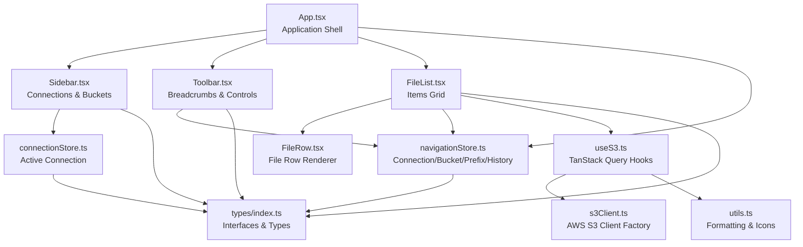

**Diagram sources**
- [App.tsx:13-94](file://src/App.tsx#L13-L94)
- [Sidebar.tsx:117-183](file://src/components/layout/Sidebar.tsx#L117-L183)
- [Toolbar.tsx:30-87](file://src/components/layout/Toolbar.tsx#L30-L87)
- [FileList.tsx:1-341](file://src/components/explorer/FileList.tsx#L1-L341)
- [FileRow.tsx:34-84](file://src/components/explorer/FileRow.tsx#L34-L84)
- [navigationStore.ts:36-85](file://src/store/navigationStore.ts#L36-L85)
- [connectionStore.ts:30-87](file://src/store/connectionStore.ts#L30-L87)
- [useS3.ts:62-409](file://src/hooks/useS3.ts#L62-L409)
- [s3Client.ts:60-82](file://src/lib/s3Client.ts#L60-L82)
- [utils.ts:13-197](file://src/lib/utils.ts#L13-L197)
- [index.ts:66-166](file://src/types/index.ts#L66-L166)

**Section sources**
- [App.tsx:13-94](file://src/App.tsx#L13-L94)
- [Sidebar.tsx:117-183](file://src/components/layout/Sidebar.tsx#L117-L183)
- [Toolbar.tsx:30-87](file://src/components/layout/Toolbar.tsx#L30-L87)
- [FileList.tsx:1-341](file://src/components/explorer/FileList.tsx#L1-L341)
- [navigationStore.ts:36-85](file://src/store/navigationStore.ts#L36-L85)
- [connectionStore.ts:30-87](file://src/store/connectionStore.ts#L30-L87)
- [useS3.ts:62-409](file://src/hooks/useS3.ts#L62-L409)
- [s3Client.ts:60-82](file://src/lib/s3Client.ts#L60-L82)
- [utils.ts:13-197](file://src/lib/utils.ts#L13-L197)
- [index.ts:66-166](file://src/types/index.ts#L66-L166)

## Core Components
- Application Shell (App.tsx): Renders layout, passes navigation props to Toolbar, and conditionally renders FileList or EmptyState based on active connection and bucket.
- Sidebar (Sidebar.tsx): Lists connections and expands to show buckets; triggers navigation actions.
- Toolbar (Toolbar.tsx): Provides Back/Home controls, breadcrumbs, refresh, upload/new folder placeholders, and search input with debounced updates.
- FileList (FileList.tsx): Virtualized grid displaying folders and files, supports sorting, selection, keyboard navigation, and context menus.
- FileRow (FileRow.tsx): Renders file rows with dynamic icons and metadata.
- Stores:
  - navigationStore.ts: Manages connectionId, bucket, prefix, and history for back navigation.
  - connectionStore.ts: Manages S3 connections and active connection selection.
- Hooks and Utilities:
  - useS3.ts: TanStack Query hooks for listing buckets and objects, plus mutations for uploads, downloads, deletes, and metadata.
  - s3Client.ts: Creates S3Client instances per provider with endpoint resolution and path-style addressing.
  - utils.ts: Formatting helpers and file icon mapping.

**Section sources**
- [App.tsx:13-94](file://src/App.tsx#L13-L94)
- [Sidebar.tsx:117-183](file://src/components/layout/Sidebar.tsx#L117-L183)
- [Toolbar.tsx:30-87](file://src/components/layout/Toolbar.tsx#L30-L87)
- [FileList.tsx:1-341](file://src/components/explorer/FileList.tsx#L1-L341)
- [FileRow.tsx:34-84](file://src/components/explorer/FileRow.tsx#L34-L84)
- [navigationStore.ts:36-85](file://src/store/navigationStore.ts#L36-L85)
- [connectionStore.ts:30-87](file://src/store/connectionStore.ts#L30-L87)
- [useS3.ts:62-409](file://src/hooks/useS3.ts#L62-L409)
- [s3Client.ts:60-82](file://src/lib/s3Client.ts#L60-L82)
- [utils.ts:13-197](file://src/lib/utils.ts#L13-L197)

## Architecture Overview
The file browser follows a unidirectional data flow:
- UI components read from Zustand stores and TanStack Query queries.
- Actions mutate state (navigation, connection) or trigger S3 operations.
- Queries invalidate and refetch when navigation or refresh occurs.
- Icons and formatting are computed via utility functions.

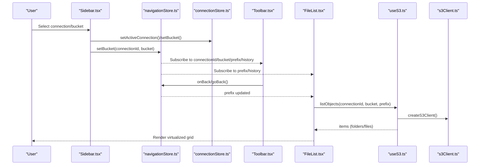

**Diagram sources**
- [Sidebar.tsx:117-183](file://src/components/layout/Sidebar.tsx#L117-L183)
- [navigationStore.ts:36-85](file://src/store/navigationStore.ts#L36-L85)
- [connectionStore.ts:30-87](file://src/store/connectionStore.ts#L30-L87)
- [Toolbar.tsx:30-87](file://src/components/layout/Toolbar.tsx#L30-L87)
- [FileList.tsx:1-341](file://src/components/explorer/FileList.tsx#L1-L341)
- [useS3.ts:62-409](file://src/hooks/useS3.ts#L62-L409)
- [s3Client.ts:60-82](file://src/lib/s3Client.ts#L60-L82)

## Detailed Component Analysis

### Hierarchical Navigation and Path Handling
- Navigation state consists of connectionId, bucket, prefix (current folder path), and history for back navigation.
- Changing bucket resets prefix to root and pushes the previous prefix to history.
- Navigating deeper pushes the current prefix onto history before updating prefix.
- Back navigation pops from history to restore previous prefix.

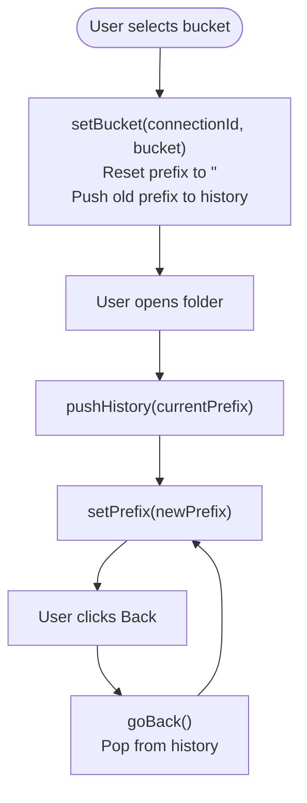

**Diagram sources**
- [navigationStore.ts:42-78](file://src/store/navigationStore.ts#L42-L78)

**Section sources**
- [navigationStore.ts:42-78](file://src/store/navigationStore.ts#L42-L78)
- [App.tsx:42-53](file://src/App.tsx#L42-L53)

### Breadcrumb Navigation
- Breadcrumb segments are derived from the current prefix by splitting on "/" and accumulating path segments.
- Each segment carries its full prefix up to that point, enabling direct navigation to any ancestor.
- The Toolbar renders the breadcrumb and disables actions when no bucket is selected.

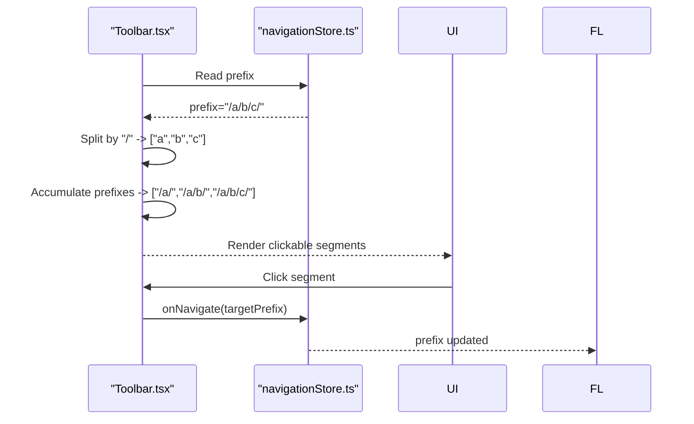

**Diagram sources**
- [Toolbar.tsx:52-67](file://src/components/layout/Toolbar.tsx#L52-L67)
- [App.tsx:42-53](file://src/App.tsx#L42-L53)
- [navigationStore.ts:54-61](file://src/store/navigationStore.ts#L54-L61)

**Section sources**
- [Toolbar.tsx:52-67](file://src/components/layout/Toolbar.tsx#L52-L67)
- [App.tsx:42-53](file://src/App.tsx#L42-L53)

### Sidebar Components: Connections and Buckets
- Sidebar lists saved connections and toggles expansion to show buckets for the selected connection.
- Clicking a connection sets it as active and toggles expanded state.
- Clicking a bucket invokes navigation to that bucket (root prefix) and clears history.

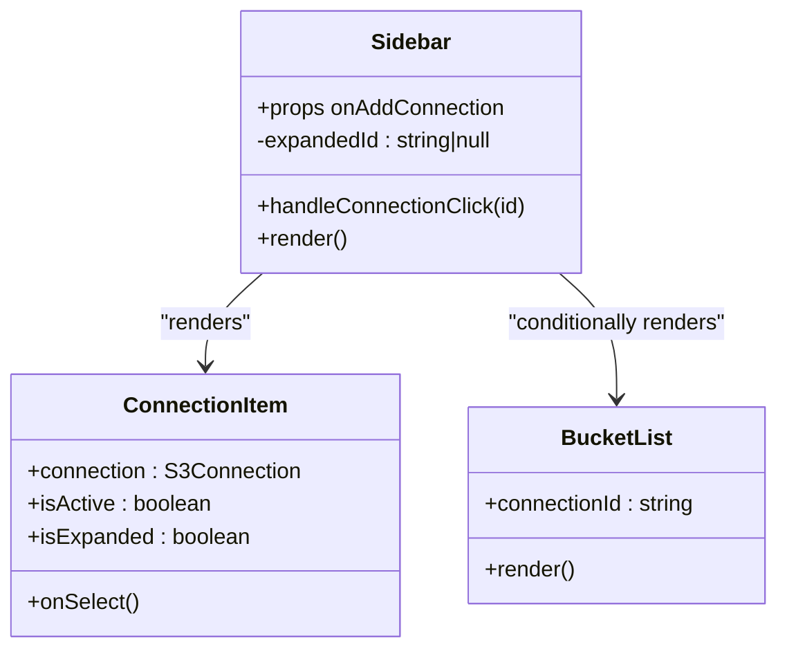

**Diagram sources**
- [Sidebar.tsx:117-183](file://src/components/layout/Sidebar.tsx#L117-L183)
- [connectionStore.ts:30-87](file://src/store/connectionStore.ts#L30-L87)
- [navigationStore.ts:42-52](file://src/store/navigationStore.ts#L42-L52)

**Section sources**
- [Sidebar.tsx:117-183](file://src/components/layout/Sidebar.tsx#L117-L183)
- [connectionStore.ts:30-87](file://src/store/connectionStore.ts#L30-L87)
- [navigationStore.ts:42-52](file://src/store/navigationStore.ts#L42-L52)

### File Listing Interface: Virtualization, Sorting, Selection
- FileList uses virtualization to efficiently render large folder contents.
- Supports sorting by name, size, lastModified, and storageClass with toggle indicators.
- Implements keyboard navigation and selection state for multiple items.
- Displays skeleton loaders during initial load and empty states for no results or filters.

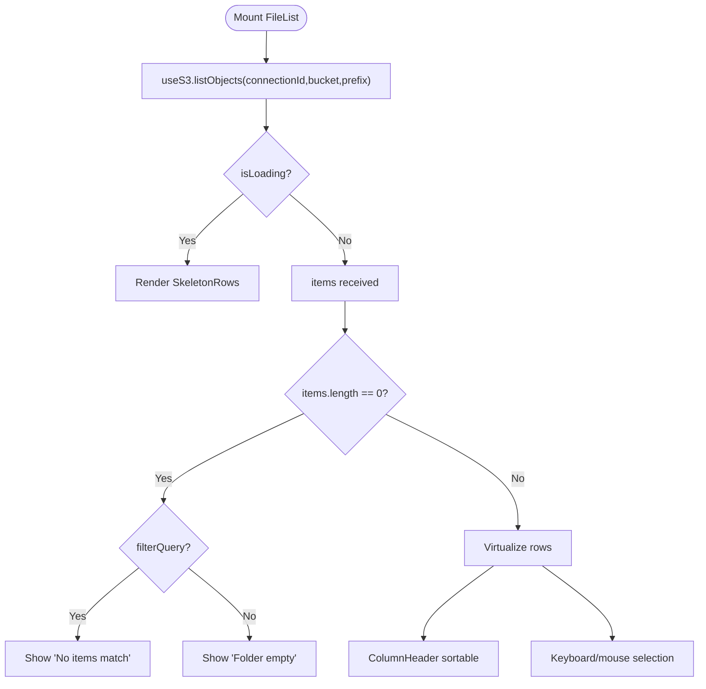

**Diagram sources**
- [FileList.tsx:1-341](file://src/components/explorer/FileList.tsx#L1-L341)
- [useS3.ts:91-144](file://src/hooks/useS3.ts#L91-L144)

**Section sources**
- [FileList.tsx:1-341](file://src/components/explorer/FileList.tsx#L1-L341)
- [useS3.ts:91-144](file://src/hooks/useS3.ts#L91-L144)

### Icon System and Visual Representation
- FileRow dynamically selects icons based on file extension using a mapping utility.
- Folders are represented as virtual folders derived from CommonPrefixes; files include metadata like size and lastModified.
- Icons are resolved at runtime and rendered consistently across rows.

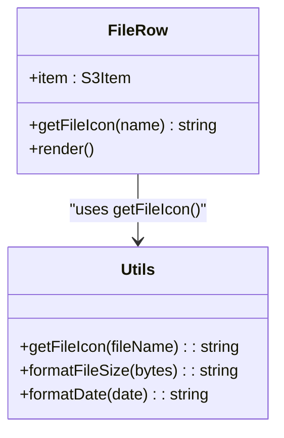

**Diagram sources**
- [FileRow.tsx:34-84](file://src/components/explorer/FileRow.tsx#L34-L84)
- [utils.ts:144-150](file://src/lib/utils.ts#L144-L150)

**Section sources**
- [FileRow.tsx:34-84](file://src/components/explorer/FileRow.tsx#L34-L84)
- [utils.ts:144-150](file://src/lib/utils.ts#L144-L150)

### Relationship Between Active Connection and Displayed Content
- The active connection drives S3 client creation and determines which buckets are listed.
- Selecting a bucket initializes navigation to root prefix and clears history.
- Without an active connection or bucket, the UI shows an EmptyState prompting selection.

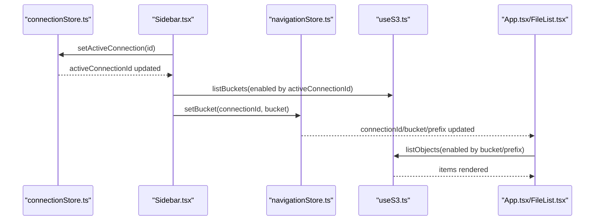

**Diagram sources**
- [connectionStore.ts:30-87](file://src/store/connectionStore.ts#L30-L87)
- [Sidebar.tsx:117-183](file://src/components/layout/Sidebar.tsx#L117-L183)
- [navigationStore.ts:42-52](file://src/store/navigationStore.ts#L42-L52)
- [useS3.ts:69-85](file://src/hooks/useS3.ts#L69-L85)
- [App.tsx:82-89](file://src/App.tsx#L82-L89)

**Section sources**
- [connectionStore.ts:30-87](file://src/store/connectionStore.ts#L30-L87)
- [Sidebar.tsx:117-183](file://src/components/layout/Sidebar.tsx#L117-L183)
- [navigationStore.ts:42-52](file://src/store/navigationStore.ts#L42-L52)
- [useS3.ts:69-85](file://src/hooks/useS3.ts#L69-L85)
- [App.tsx:82-89](file://src/App.tsx#L82-L89)

### User Interaction Patterns
- Browsing: Click breadcrumb segments or folder rows to navigate deeper; use Back to return.
- Filtering: Type in the Toolbar search box; input is debounced and forwarded to FileList.
- Organizing: Sorting is controlled via column headers; selection enables batch operations (placeholder handlers).
- Refresh: Invalidate current folder query to reload items.

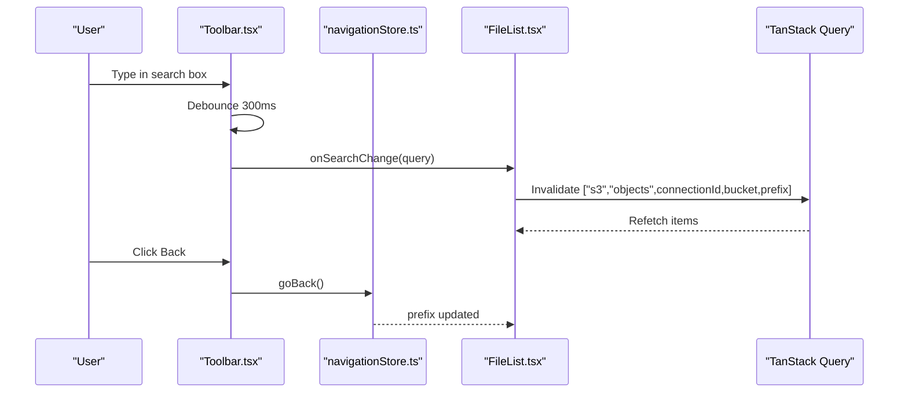

**Diagram sources**
- [Toolbar.tsx:44-50](file://src/components/layout/Toolbar.tsx#L44-L50)
- [App.tsx:55-58](file://src/App.tsx#L55-L58)
- [navigationStore.ts:63-74](file://src/store/navigationStore.ts#L63-L74)
- [useS3.ts:37-40](file://src/hooks/useS3.ts#L37-L40)

**Section sources**
- [Toolbar.tsx:44-50](file://src/components/layout/Toolbar.tsx#L44-L50)
- [App.tsx:55-58](file://src/App.tsx#L55-L58)
- [navigationStore.ts:63-74](file://src/store/navigationStore.ts#L63-L74)
- [useS3.ts:37-40](file://src/hooks/useS3.ts#L37-L40)

### Integration Between UI and State Management
- App.tsx subscribes to navigation state and passes callbacks to Toolbar and FileList.
- FileList subscribes to navigation state and uses TanStack Query for data fetching.
- Sidebar updates connection and navigation state, which cascades to Toolbar and FileList.

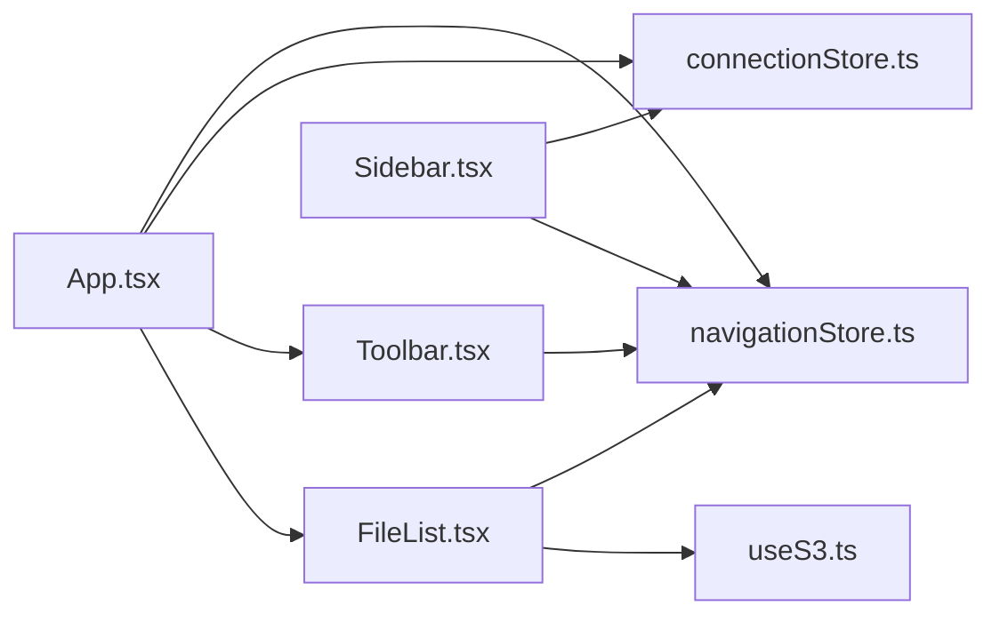

**Diagram sources**
- [App.tsx:13-94](file://src/App.tsx#L13-L94)
- [navigationStore.ts:36-85](file://src/store/navigationStore.ts#L36-L85)
- [connectionStore.ts:30-87](file://src/store/connectionStore.ts#L30-L87)
- [Toolbar.tsx:30-87](file://src/components/layout/Toolbar.tsx#L30-L87)
- [FileList.tsx:1-341](file://src/components/explorer/FileList.tsx#L1-L341)
- [Sidebar.tsx:117-183](file://src/components/layout/Sidebar.tsx#L117-L183)

**Section sources**
- [App.tsx:13-94](file://src/App.tsx#L13-L94)
- [navigationStore.ts:36-85](file://src/store/navigationStore.ts#L36-L85)
- [connectionStore.ts:30-87](file://src/store/connectionStore.ts#L30-L87)
- [Toolbar.tsx:30-87](file://src/components/layout/Toolbar.tsx#L30-L87)
- [FileList.tsx:1-341](file://src/components/explorer/FileList.tsx#L1-L341)
- [Sidebar.tsx:117-183](file://src/components/layout/Sidebar.tsx#L117-L183)

### Responsive Design and Accessibility
- Layout uses flexbox with overflow-hidden containers to adapt to viewport.
- FileList grid uses a fixed row height and responsive columns; virtualization ensures smooth scrolling on large datasets.
- Keyboard navigation is supported in FileList; rows are focusable and selectable.
- Icons and labels are accessible; interactive elements include hover/focus states.

**Section sources**
- [App.tsx:61-93](file://src/App.tsx#L61-L93)
- [FileList.tsx:260-339](file://src/components/explorer/FileList.tsx#L260-L339)
- [FileRow.tsx:48-84](file://src/components/explorer/FileRow.tsx#L48-L84)

### Common Navigation Workflows
- Open a bucket: Select connection, expand to show buckets, choose a bucket.
- Navigate deeper: Click a folder row to update prefix; breadcrumb reflects current location.
- Move up: Click parent breadcrumb segment or use Back button.
- Refresh current folder: Click Refresh to invalidate and reload items.
- Search within folder: Type in Toolbar search; results update after debounce.

**Section sources**
- [Sidebar.tsx:87-107](file://src/components/layout/Sidebar.tsx#L87-L107)
- [Toolbar.tsx:52-67](file://src/components/layout/Toolbar.tsx#L52-L67)
- [App.tsx:35-40](file://src/App.tsx#L35-L40)
- [FileList.tsx:234-258](file://src/components/explorer/FileList.tsx#L234-L258)

### Interface Customization Options
- Providers: S3-compatible providers (AWS, MinIO, R2, B2, custom) with endpoint resolution and path-style addressing.
- Icons: Extensible icon mapping by file extension; new extensions can be added to the mapping.
- Sorting: Configurable sort fields and directions; UI updates sort indicators accordingly.
- Empty states: Distinct messages for empty folders versus filtered results.

**Section sources**
- [s3Client.ts:12-49](file://src/lib/s3Client.ts#L12-L49)
- [utils.ts:46-134](file://src/lib/utils.ts#L46-L134)
- [FileList.tsx:268-273](file://src/components/explorer/FileList.tsx#L268-L273)
- [FileList.tsx:234-258](file://src/components/explorer/FileList.tsx#L234-L258)

## Dependency Analysis
- UI components depend on Zustand stores for state and TanStack Query for data.
- useS3 depends on connectionStore to resolve credentials and on s3Client to construct clients per provider.
- File rendering depends on utils for icon and formatting functions.
- Types define shared interfaces for navigation, items, and transfers.

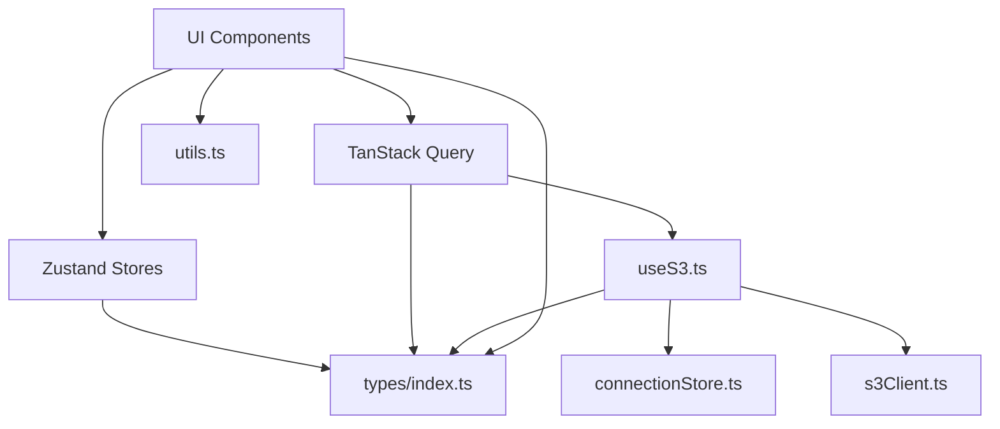

**Diagram sources**
- [App.tsx:13-94](file://src/App.tsx#L13-L94)
- [navigationStore.ts:36-85](file://src/store/navigationStore.ts#L36-L85)
- [connectionStore.ts:30-87](file://src/store/connectionStore.ts#L30-L87)
- [useS3.ts:62-409](file://src/hooks/useS3.ts#L62-L409)
- [s3Client.ts:60-82](file://src/lib/s3Client.ts#L60-L82)
- [utils.ts:13-197](file://src/lib/utils.ts#L13-L197)
- [index.ts:66-166](file://src/types/index.ts#L66-L166)

**Section sources**
- [App.tsx:13-94](file://src/App.tsx#L13-L94)
- [navigationStore.ts:36-85](file://src/store/navigationStore.ts#L36-L85)
- [connectionStore.ts:30-87](file://src/store/connectionStore.ts#L30-L87)
- [useS3.ts:62-409](file://src/hooks/useS3.ts#L62-L409)
- [s3Client.ts:60-82](file://src/lib/s3Client.ts#L60-L82)
- [utils.ts:13-197](file://src/lib/utils.ts#L13-L197)
- [index.ts:66-166](file://src/types/index.ts#L66-L166)

## Performance Considerations
- Virtualization: FileList uses virtualization to render only visible rows, minimizing DOM and improving scroll performance.
- Query invalidation: Refresh and navigation invalidate current folder queries to avoid stale data while preventing unnecessary re-fetches.
- Debounced search: Toolbar debounces input to reduce frequent re-renders and network calls.
- Endpoint configuration: Non-AWS providers use path-style addressing to prevent bucket endpoint rewriting overhead.

**Section sources**
- [FileList.tsx:1-341](file://src/components/explorer/FileList.tsx#L1-L341)
- [Toolbar.tsx:44-50](file://src/components/layout/Toolbar.tsx#L44-L50)
- [useS3.ts:37-40](file://src/hooks/useS3.ts#L37-L40)
- [s3Client.ts:71-79](file://src/lib/s3Client.ts#L71-L79)

## Troubleshooting Guide
- No buckets displayed: Verify active connection is set and provider endpoint is valid; check for errors in bucket listing.
- Cannot navigate to subfolders: Ensure prefix updates propagate to navigation store and queries re-run.
- Empty folder state: Confirm delimiter and prefix handling; verify that folder placeholders end with "/".
- Download failures: Check signed URL generation and HTTP status; large files should use native download mechanisms.
- Icon mismatches: Extend the extension-to-icon mapping in utils for new file types.

**Section sources**
- [Sidebar.tsx:52-83](file://src/components/layout/Sidebar.tsx#L52-L83)
- [useS3.ts:91-144](file://src/hooks/useS3.ts#L91-L144)
- [utils.ts:144-150](file://src/lib/utils.ts#L144-L150)

## Conclusion
The file browser integrates a clean separation of concerns: UI components manage presentation and interactions, stores manage navigation and connection state, and hooks encapsulate S3 operations. The breadcrumb and history-driven navigation provide intuitive hierarchical browsing, while virtualization and debounced search deliver responsive performance. Extensibility is built into provider configuration, icon mapping, and sorting controls.

## Appendices
- Types and interfaces define the contract for navigation, items, and transfers.
- Example operations: list buckets, list objects, upload, download, delete, create folder, rename, and get info.

**Section sources**
- [index.ts:66-166](file://src/types/index.ts#L66-L166)
- [useS3.ts:69-409](file://src/hooks/useS3.ts#L69-L409)