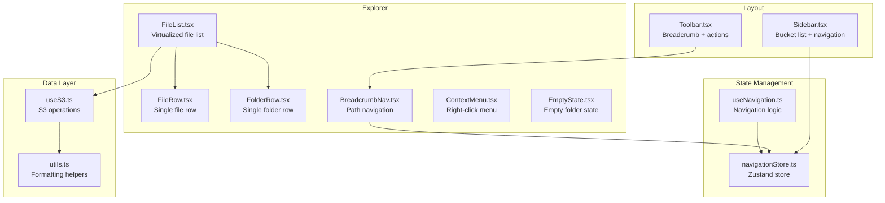
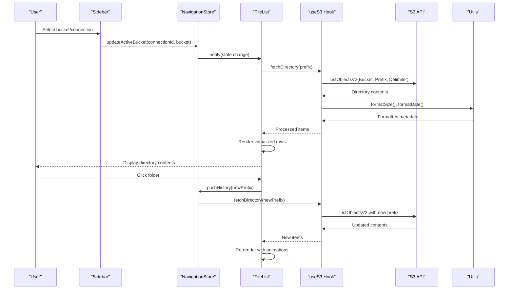
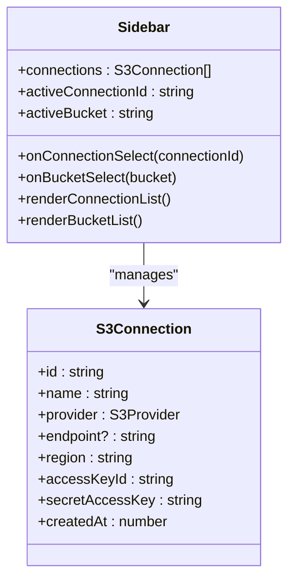
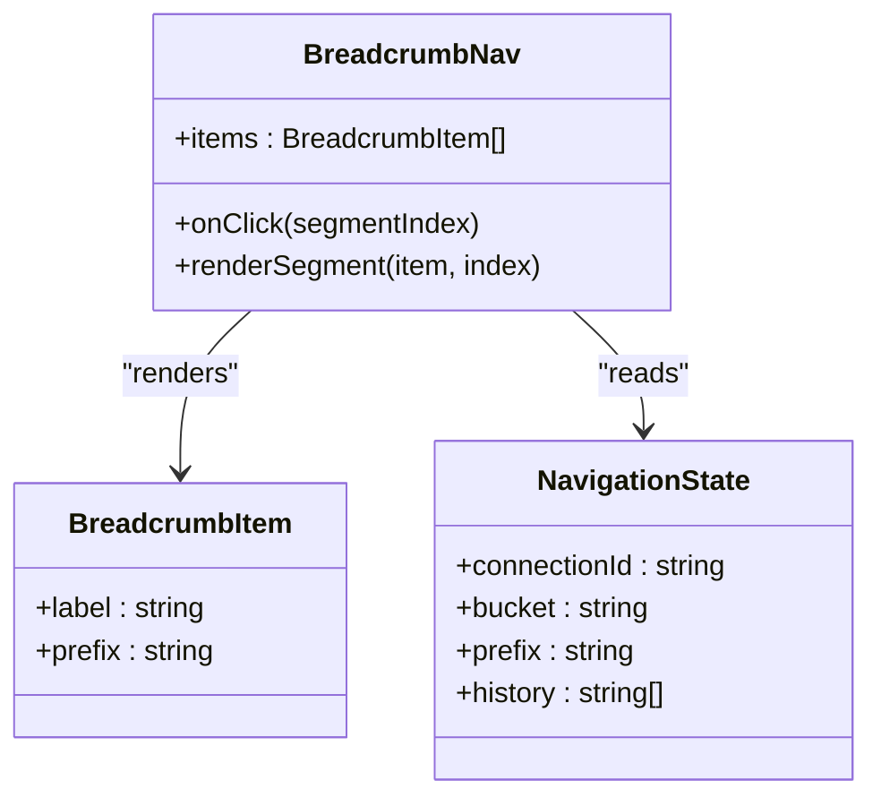
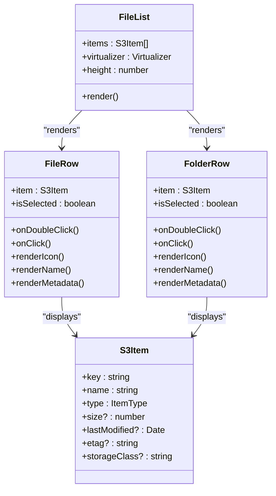
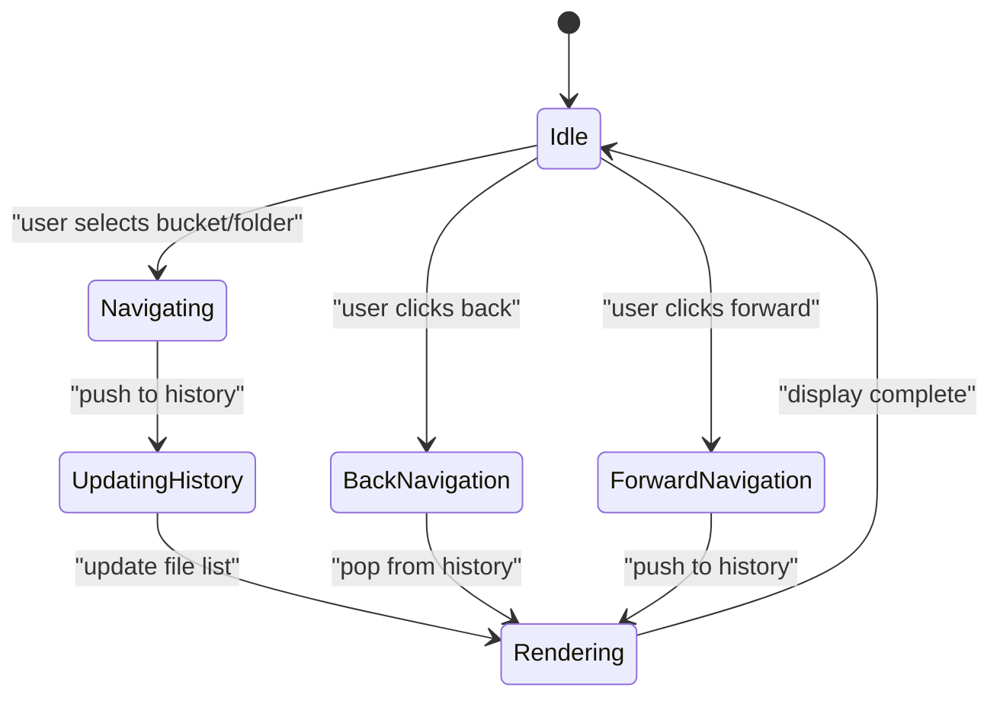
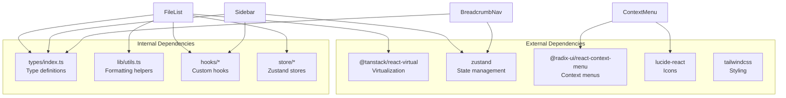

# File Browser Interface

<cite>
**Referenced Files in This Document**
- [PROJECT.md](file://PROJECT.md)
- [types/index.ts](file://src/types/index.ts)
- [hooks/useNavigation.ts](file://src/hooks/useNavigation.ts)
- [store/navigationStore.ts](file://src/store/navigationStore.ts)
- [layout/Sidebar.tsx](file://src/components/layout/Sidebar.tsx)
- [explorer/BreadcrumbNav.tsx](file://src/components/explorer/BreadcrumbNav.tsx)
- [explorer/FileList.tsx](file://src/components/explorer/FileList.tsx)
- [explorer/FileRow.tsx](file://src/components/explorer/FileRow.tsx)
- [explorer/FolderRow.tsx](file://src/components/explorer/FolderRow.tsx)
- [hooks/useS3.ts](file://src/hooks/useS3.ts)
- [lib/utils.ts](file://src/lib/utils.ts)
</cite>

## Table of Contents
1. [Introduction](#introduction)
2. [Project Structure](#project-structure)
3. [Core Components](#core-components)
4. [Architecture Overview](#architecture-overview)
5. [Detailed Component Analysis](#detailed-component-analysis)
6. [Dependency Analysis](#dependency-analysis)
7. [Performance Considerations](#performance-considerations)
8. [Troubleshooting Guide](#troubleshooting-guide)
9. [Conclusion](#conclusion)

## Introduction
This document provides comprehensive technical documentation for the file browser interface component of the S3 Explorer application. It explains the dual-panel layout with sidebar navigation and main content area, covering bucket listing, folder navigation, and breadcrumb system. It documents the virtualized file list implementation using TanStack Virtual for performance optimization with large directories, the file and folder display logic, icon rendering, and metadata presentation. The navigation state management with Zustand, history tracking, and back/forward navigation are covered, along with responsive design patterns, keyboard navigation support, and accessibility features. Examples of different view modes and performance considerations for thousands of files are included.

## Project Structure
The file browser interface follows a modular React component architecture with clear separation of concerns:
- Layout components handle the dual-panel structure (sidebar + main content)
- Explorer components manage file/folder listing, breadcrumbs, and context menus
- Hooks encapsulate S3 operations and navigation state
- Store modules manage global state using Zustand
- Utility functions provide formatting and helper operations

**Diagram sources**
- [PROJECT.md:20-68](file://PROJECT.md#L20-L68)
- [hooks/useNavigation.ts](file://src/hooks/useNavigation.ts)
- [store/navigationStore.ts](file://src/store/navigationStore.ts)
- [layout/Sidebar.tsx](file://src/components/layout/Sidebar.tsx)
- [explorer/BreadcrumbNav.tsx](file://src/components/explorer/BreadcrumbNav.tsx)
- [explorer/FileList.tsx](file://src/components/explorer/FileList.tsx)
- [explorer/FileRow.tsx](file://src/components/explorer/FileRow.tsx)
- [explorer/FolderRow.tsx](file://src/components/explorer/FolderRow.tsx)
- [hooks/useS3.ts](file://src/hooks/useS3.ts)
- [lib/utils.ts](file://src/lib/utils.ts)

**Section sources**
- [PROJECT.md:20-68](file://PROJECT.md#L20-L68)

## Core Components
The file browser interface consists of several interconnected components that work together to provide a seamless user experience:

### Navigation State Management
The navigation system uses a centralized Zustand store to manage the current connection, active bucket, working prefix, and navigation history. The state structure supports back/forward navigation and maintains breadcrumb segments.

### Dual-Panel Layout
The interface implements a 2-panel design with a collapsible sidebar for bucket selection and a main content area for file listings. The sidebar displays available S3 connections and allows users to select active buckets.

### Virtualized File Listing
The main content area uses TanStack Virtual to render large directory listings efficiently, supporting thousands of files without performance degradation.

**Section sources**
- [PROJECT.md:64-101](file://PROJECT.md#L64-L101)
- [PROJECT.md:17-17](file://PROJECT.md#L17-L17)
- [PROJECT.md:173-173](file://PROJECT.md#L173-L173)

## Architecture Overview
The file browser architecture follows a unidirectional data flow pattern with clear separation between UI components, state management, and data access layers.

**Diagram sources**
- [store/navigationStore.ts](file://src/store/navigationStore.ts)
- [hooks/useNavigation.ts](file://src/hooks/useNavigation.ts)
- [hooks/useS3.ts](file://src/hooks/useS3.ts)
- [explorer/FileList.tsx](file://src/components/explorer/FileList.tsx)
- [lib/utils.ts](file://src/lib/utils.ts)

## Detailed Component Analysis

### Sidebar Component
The sidebar component manages bucket listing and connection selection. It displays available S3 connections and allows users to navigate between different buckets and prefixes.

**Diagram sources**
- [types/index.ts:38-48](file://src/types/index.ts#L38-L48)
- [layout/Sidebar.tsx](file://src/components/layout/Sidebar.tsx)

### Breadcrumb Navigation
The breadcrumb navigation system provides hierarchical path traversal with clickable segments and preserves navigation history.

**Diagram sources**
- [types/index.ts:74-79](file://src/types/index.ts#L74-L79)
- [types/index.ts:66-72](file://src/types/index.ts#L66-L72)
- [explorer/BreadcrumbNav.tsx](file://src/components/explorer/BreadcrumbNav.tsx)

### Virtualized File List Implementation
The file list uses TanStack Virtual for efficient rendering of large directory contents. The implementation separates file and folder rendering logic while maintaining consistent UI patterns.

**Diagram sources**
- [explorer/FileList.tsx](file://src/components/explorer/FileList.tsx)
- [explorer/FileRow.tsx](file://src/components/explorer/FileRow.tsx)
- [explorer/FolderRow.tsx](file://src/components/explorer/FolderRow.tsx)
- [types/index.ts:53-62](file://src/types/index.ts#L53-L62)

### Navigation State Management with Zustand
The navigation state is managed using Zustand stores with automatic persistence and reactive updates throughout the component tree.

**Diagram sources**
- [store/navigationStore.ts](file://src/store/navigationStore.ts)
- [hooks/useNavigation.ts](file://src/hooks/useNavigation.ts)

**Section sources**
- [layout/Sidebar.tsx](file://src/components/layout/Sidebar.tsx)
- [explorer/BreadcrumbNav.tsx](file://src/components/explorer/BreadcrumbNav.tsx)
- [explorer/FileList.tsx](file://src/components/explorer/FileList.tsx)
- [explorer/FileRow.tsx](file://src/components/explorer/FileRow.tsx)
- [explorer/FolderRow.tsx](file://src/components/explorer/FolderRow.tsx)
- [store/navigationStore.ts](file://src/store/navigationStore.ts)
- [hooks/useNavigation.ts](file://src/hooks/useNavigation.ts)

### File and Folder Display Logic
Both file and folder rows implement consistent display patterns with specialized handling for different item types:

- **File Row**: Displays file-specific metadata including size, last modified date, and storage class
- **Folder Row**: Renders folder indicators and handles directory traversal
- **Shared Logic**: Both implement selection states, hover effects, and click handlers

### Icon Rendering and Metadata Presentation
The interface uses Lucide React icons for consistent visual representation:
- File-specific icons for different file types
- Folder icons with appropriate styling for depth levels
- Status indicators for special file attributes
- Formatted metadata using utility functions for human-readable sizes and dates

### Responsive Design Patterns
The layout adapts to different screen sizes:
- Sidebar collapses to icon-only mode on smaller screens
- File list adjusts column widths based on available space
- Touch-friendly interaction targets for mobile devices
- Flexible grid layouts for metadata display

### Accessibility Features
Keyboard navigation support includes:
- Tab navigation for focus management
- Arrow keys for item selection
- Enter/Space for activation
- Escape for context menu dismissal
- Screen reader compatibility with proper ARIA labels

**Section sources**
- [PROJECT.md:16-16](file://PROJECT.md#L16-L16)
- [PROJECT.md:170-176](file://PROJECT.md#L170-L176)

## Dependency Analysis
The file browser interface has well-defined dependencies that support maintainability and testability:

**Diagram sources**
- [PROJECT.md:13-18](file://PROJECT.md#L13-L18)
- [types/index.ts](file://src/types/index.ts)
- [lib/utils.ts](file://src/lib/utils.ts)

**Section sources**
- [PROJECT.md:13-18](file://PROJECT.md#L13-L18)
- [types/index.ts](file://src/types/index.ts)

## Performance Considerations
The file browser implements several performance optimizations for handling large directory structures:

### Virtualization Strategy
TanStack Virtual provides efficient rendering by:
- Only rendering visible items plus a buffer zone
- Using dynamic item sizes for variable-height rows
- Implementing smooth scrolling with momentum
- Managing memory usage through item pooling

### Data Fetching Optimizations
- Pagination with continuation tokens for large result sets
- Debounced search/filter operations
- Efficient S3 API calls with delimiter-based queries
- Caching mechanisms for frequently accessed directories

### Rendering Optimizations
- Memoized components to prevent unnecessary re-renders
- Lazy loading of images and thumbnails
- Efficient DOM manipulation through virtualization
- Minimal reflows during scroll operations

### Scalability Guidelines
For directories with thousands of files:
- Monitor virtualization buffer sizes
- Implement progressive loading for deep hierarchies
- Optimize metadata formatting operations
- Consider implementing server-side filtering

**Section sources**
- [PROJECT.md:17-17](file://PROJECT.md#L17-L17)
- [PROJECT.md:204-204](file://PROJECT.md#L204-L204)

## Troubleshooting Guide
Common issues and their solutions:

### Navigation Issues
- **Problem**: Back/forward buttons not working
  - **Solution**: Verify history stack management in navigation store
  - **Check**: History array length and current prefix synchronization

### Performance Issues
- **Problem**: Slow scrolling in large directories
  - **Solution**: Adjust virtualization buffer sizes and item heights
  - **Check**: Memory usage and DOM element count

### Display Problems
- **Problem**: Incorrect file/folder icons
  - **Solution**: Verify MIME type detection and icon mapping
  - **Check**: File extension handling and fallback icons

### State Synchronization
- **Problem**: UI not reflecting current directory
  - **Solution**: Ensure proper subscription to navigation store
  - **Check**: Component lifecycle and cleanup functions

**Section sources**
- [store/navigationStore.ts](file://src/store/navigationStore.ts)
- [hooks/useNavigation.ts](file://src/hooks/useNavigation.ts)
- [explorer/FileList.tsx](file://src/components/explorer/FileList.tsx)

## Conclusion
The file browser interface provides a robust, performant, and accessible solution for navigating S3-compatible storage systems. Its modular architecture, combined with virtualization and state management best practices, ensures smooth operation even with large directory structures. The dual-panel design, comprehensive navigation controls, and thoughtful accessibility features create an intuitive user experience that rivals traditional desktop file managers.