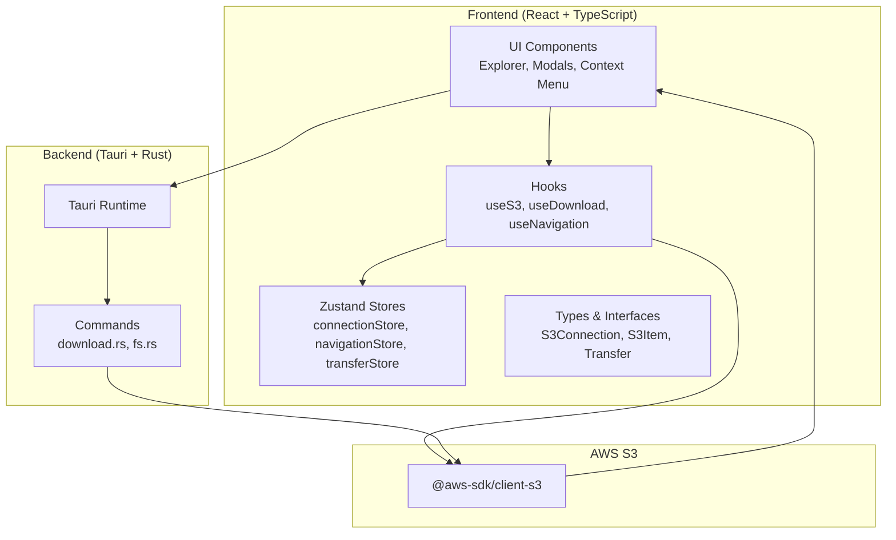
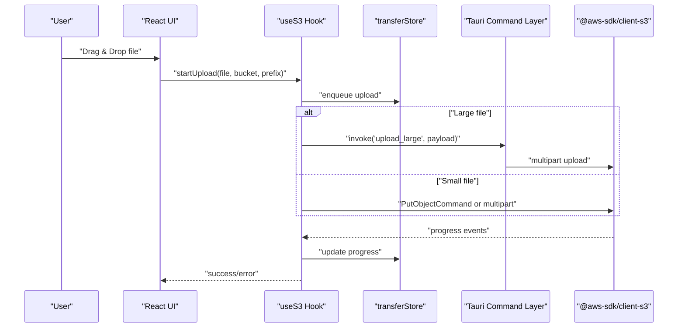
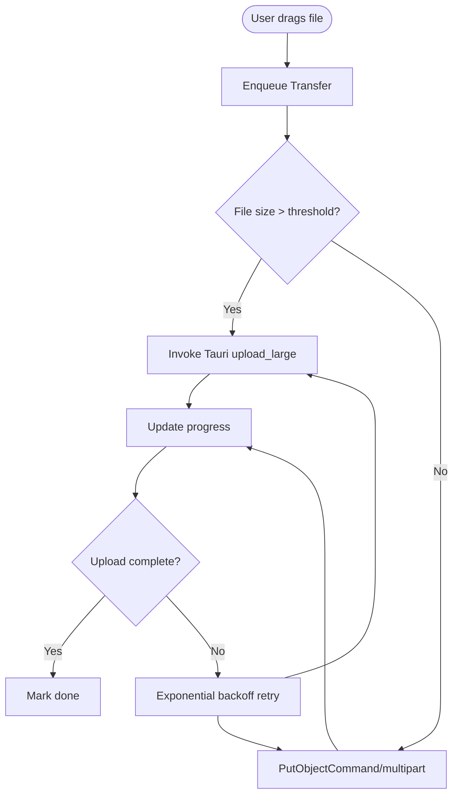
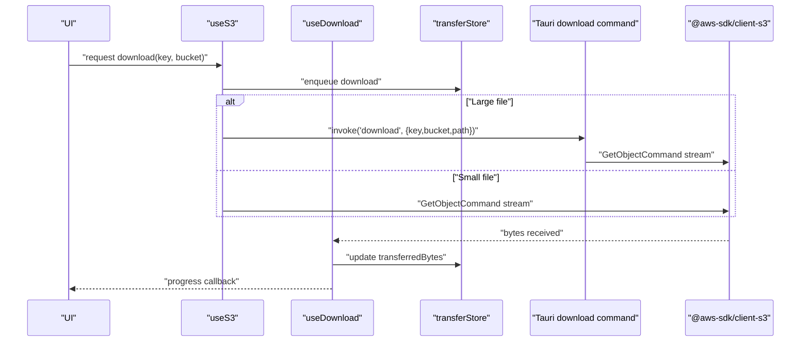
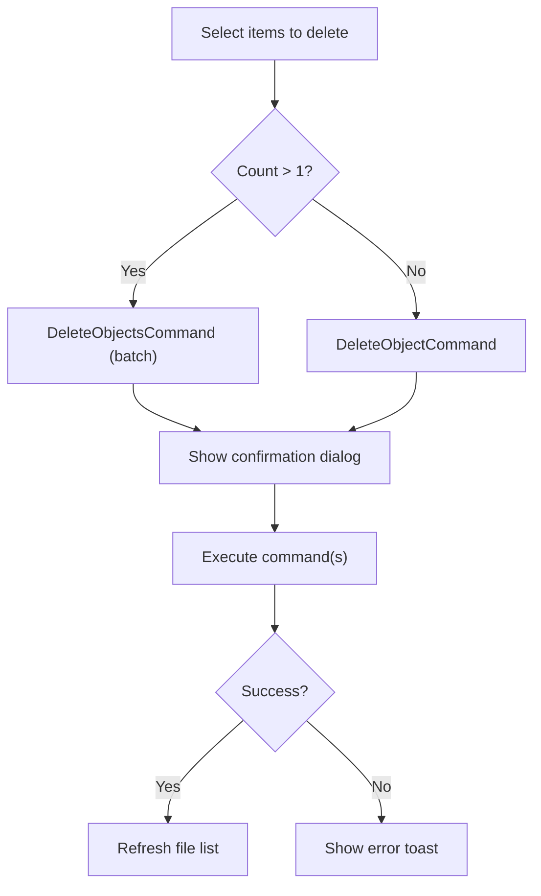
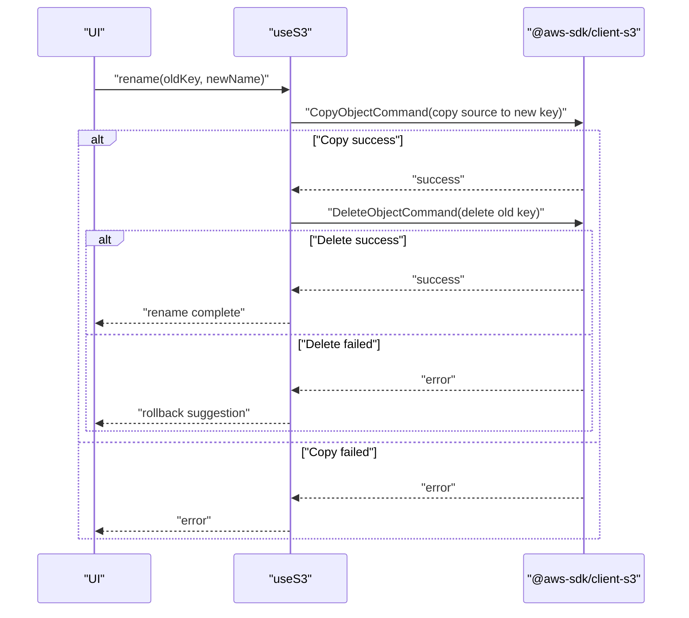
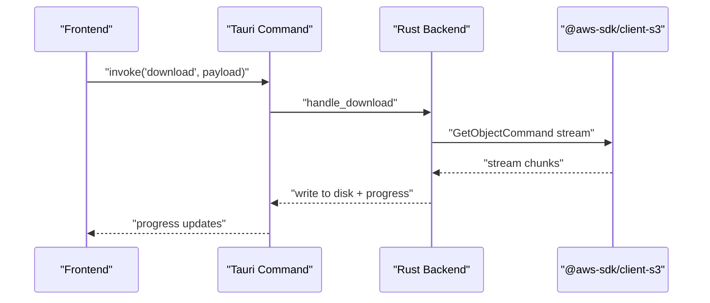
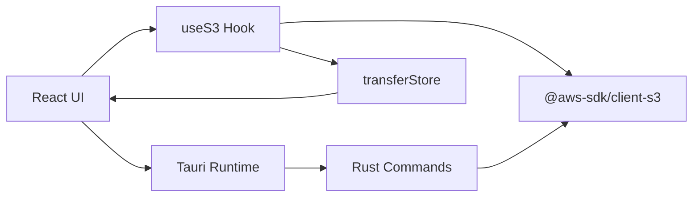

# File Operations

<cite>
**Referenced Files in This Document**
- [PROJECT.md](file://PROJECT.md)
- [src/types/index.ts](file://src/types/index.ts)
- [src-tauri/src/lib.rs](file://src-tauri/src/lib.rs)
- [src-tauri/src/main.rs](file://src-tauri/src/main.rs)
</cite>

## Table of Contents
1. [Introduction](#introduction)
2. [Project Structure](#project-structure)
3. [Core Components](#core-components)
4. [Architecture Overview](#architecture-overview)
5. [Detailed Component Analysis](#detailed-component-analysis)
6. [Dependency Analysis](#dependency-analysis)
7. [Performance Considerations](#performance-considerations)
8. [Troubleshooting Guide](#troubleshooting-guide)
9. [Conclusion](#conclusion)

## Introduction
This document explains the file operations functionality for the S3 Explorer application. It covers supported operations—upload files (including drag-and-drop), download files with progress tracking, delete files and folders, create new folders, and rename—and documents how rename is implemented as a copy-delete operation due to S3’s lack of native rename support. It also describes AWS SDK integration for each operation, multipart uploads for large files, presigned URL generation for sharing, and batch operations for multiple items. Error handling strategies, retry mechanisms, and progress reporting are included, along with the file upload workflow, download queue management, and Tauri command integration for reliable large file transfers.

## Project Structure
The project follows a Tauri v2 desktop architecture with a React + TypeScript frontend and a Rust backend. The frontend manages UI, state, and user interactions, while the backend exposes Tauri commands for operations requiring reliability (such as large downloads). The project documentation enumerates the primary S3 operations and the intended components that implement them.

**Diagram sources**
- [PROJECT.md:20-68](file://PROJECT.md#L20-L68)
- [src/types/index.ts:1-165](file://src/types/index.ts#L1-L165)
- [src-tauri/src/lib.rs:1-15](file://src-tauri/src/lib.rs#L1-L15)
- [src-tauri/src/main.rs:1-7](file://src-tauri/src/main.rs#L1-L7)

**Section sources**
- [PROJECT.md:20-68](file://PROJECT.md#L20-L68)
- [src/types/index.ts:1-165](file://src/types/index.ts#L1-L165)
- [src-tauri/src/lib.rs:1-15](file://src-tauri/src/lib.rs#L1-L15)
- [src-tauri/src/main.rs:1-7](file://src-tauri/src/main.rs#L1-L7)

## Core Components
- S3Connection and S3Item define the domain model for providers, credentials, and items (files, folders, buckets).
- Transfer encapsulates upload/download progress with status tracking.
- useS3 is the primary hook orchestrating S3 operations.
- useDownload tracks download progress.
- transferStore maintains a queue of transfers.
- Tauri commands expose Rust-backed operations for reliability (e.g., large downloads).

Key types and roles:
- S3Connection: provider, endpoint, region, credentials.
- S3Item: key, name, type, size, timestamps, etag, storageClass.
- Transfer: id, type, fileName, sizes, status, optional error and S3 identifiers.
- useS3: centralizes S3 operations (list, upload, download, delete, rename, create folder).
- useDownload: progress tracking for downloads.
- transferStore: queue and state of transfers.

**Section sources**
- [src/types/index.ts:38-98](file://src/types/index.ts#L38-L98)
- [PROJECT.md:48-56](file://PROJECT.md#L48-L56)

## Architecture Overview
The system integrates a React frontend with Tauri commands and the @aws-sdk/client-s3 library. Drag-and-drop uploads and context menu actions trigger S3 operations. Large downloads are routed through Rust commands for reliability. Progress is tracked via stores and UI components.

**Diagram sources**
- [PROJECT.md:143-168](file://PROJECT.md#L143-L168)
- [src/types/index.ts:81-98](file://src/types/index.ts#L81-L98)
- [src-tauri/src/lib.rs:1-15](file://src-tauri/src/lib.rs#L1-L15)

## Detailed Component Analysis

### Upload Files (Including Drag-and-Drop)
- Supported via PutObjectCommand or multipart uploads for large files.
- Frontend handles drag-and-drop and invokes the upload pipeline.
- For large files, Tauri commands provide a more reliable transfer mechanism.
- Progress tracking updates the transfer queue.

Implementation highlights:
- Enqueue a new upload in transferStore.
- Choose PutObjectCommand for small files; initiate multipart upload for larger files.
- Stream progress and update Transfer.status accordingly.

**Diagram sources**
- [PROJECT.md:143-168](file://PROJECT.md#L143-L168)
- [src/types/index.ts:81-98](file://src/types/index.ts#L81-L98)

**Section sources**
- [PROJECT.md:143-168](file://PROJECT.md#L143-L168)
- [src/types/index.ts:81-98](file://src/types/index.ts#L81-L98)

### Download Files with Progress Tracking
- Download via GetObjectCommand streams to disk.
- For large files, use Tauri commands to avoid browser limitations and improve reliability.
- useDownload and transferStore track progress and status.

**Diagram sources**
- [PROJECT.md:143-168](file://PROJECT.md#L143-L168)
- [src/types/index.ts:81-98](file://src/types/index.ts#L81-L98)
- [src-tauri/src/lib.rs:1-15](file://src-tauri/src/lib.rs#L1-L15)

**Section sources**
- [PROJECT.md:143-168](file://PROJECT.md#L143-L168)
- [src/types/index.ts:81-98](file://src/types/index.ts#L81-L98)
- [src-tauri/src/lib.rs:1-15](file://src-tauri/src/lib.rs#L1-L15)

### Delete Files and Folders
- Single item deletion uses DeleteObjectCommand.
- Batch deletion uses DeleteObjectsCommand for multiple items.
- Folders are virtual; deleting a “folder” deletes all objects with the matching prefix.

**Diagram sources**
- [PROJECT.md:143-168](file://PROJECT.md#L143-L168)

**Section sources**
- [PROJECT.md:143-168](file://PROJECT.md#L143-L168)

### Create New Folders
- Implemented by creating an object with a trailing slash as the key (virtual folder).
- Uses PutObjectCommand with an empty body and a key ending in "/".
- The folder appears in ListObjectsV2 results under CommonPrefixes.

**Section sources**
- [PROJECT.md:143-168](file://PROJECT.md#L143-L168)

### Rename Operation (Copy + Delete)
- S3 does not support native rename; rename is implemented as a copy followed by a delete.
- CopyObjectCommand duplicates the object; DeleteObjectCommand removes the original.
- Preserve metadata and ETag considerations during copy; handle errors and roll back if needed.

**Diagram sources**
- [PROJECT.md:143-168](file://PROJECT.md#L143-L168)

**Section sources**
- [PROJECT.md:143-168](file://PROJECT.md#L143-L168)

### Presigned URL Generation for Sharing
- Generate a presigned URL using getSignedUrl with GetObjectCommand.
- Returns a URL and expiration timestamp for sharing.

**Section sources**
- [PROJECT.md:143-168](file://PROJECT.md#L143-L168)

### Batch Operations for Multiple Items
- Use DeleteObjectsCommand for batch deletions.
- Combine multiple operations per transaction to reduce round trips.

**Section sources**
- [PROJECT.md:143-168](file://PROJECT.md#L143-L168)

### Error Handling Strategies and Retry Mechanisms
- Wrap all S3 calls in try/catch blocks.
- Use exponential backoff for transient failures.
- Surface errors via toast notifications and set Transfer.error when applicable.
- For rename, suggest rollback if delete fails after successful copy.

**Section sources**
- [PROJECT.md:183-205](file://PROJECT.md#L183-L205)
- [src/types/index.ts:81-98](file://src/types/index.ts#L81-L98)

### Progress Reporting
- Use Transfer objects to track totalBytes and transferredBytes.
- Update progress in stores and propagate to UI components.
- For multipart uploads, aggregate part progress.

**Section sources**
- [src/types/index.ts:81-98](file://src/types/index.ts#L81-L98)

### Tauri Command Integration for Reliable Large Transfers
- Expose commands in Rust for large downloads and uploads.
- Use Tauri invoke to call Rust functions from the frontend.
- Backend streams data to disk and reports progress.

**Diagram sources**
- [src-tauri/src/lib.rs:1-15](file://src-tauri/src/lib.rs#L1-L15)
- [PROJECT.md:202](file://PROJECT.md#L202)

**Section sources**
- [src-tauri/src/lib.rs:1-15](file://src-tauri/src/lib.rs#L1-L15)
- [src-tauri/src/main.rs:1-7](file://src-tauri/src/main.rs#L1-L7)
- [PROJECT.md:202](file://PROJECT.md#L202)

## Dependency Analysis
- Frontend depends on @aws-sdk/client-s3 for S3 operations and Tauri commands for large transfers.
- useS3 coordinates operations and interacts with Zustand stores.
- transferStore persists transfer state and progress.
- Tauri runtime registers commands and routes invocations to Rust handlers.

**Diagram sources**
- [PROJECT.md:48-56](file://PROJECT.md#L48-L56)
- [src-tauri/src/lib.rs:1-15](file://src-tauri/src/lib.rs#L1-L15)
- [src/types/index.ts:81-98](file://src/types/index.ts#L81-L98)

**Section sources**
- [PROJECT.md:48-56](file://PROJECT.md#L48-L56)
- [src-tauri/src/lib.rs:1-15](file://src-tauri/src/lib.rs#L1-L15)
- [src/types/index.ts:81-98](file://src/types/index.ts#L81-L98)

## Performance Considerations
- Prefer multipart uploads for large files to improve reliability and throughput.
- Use batch operations (DeleteObjectsCommand) to minimize API calls.
- Apply exponential backoff for retries to respect rate limits.
- Stream downloads to disk via Tauri for large files to avoid memory pressure.
- Virtual folders (keys ending with "/") reduce object count overhead.

**Section sources**
- [PROJECT.md:200-205](file://PROJECT.md#L200-L205)
- [PROJECT.md:143-168](file://PROJECT.md#L143-L168)

## Troubleshooting Guide
- Authentication failures: Verify provider, endpoint, region, and credentials in S3Connection.
- Permission errors: Ensure IAM policies allow ListBucket, GetObject, PutObject, DeleteObject, CopyObject.
- Rename failures: If delete fails after copy, manually delete the new object and reattempt rename.
- Large file issues: Use Tauri download command; check network stability and retry with exponential backoff.
- Rate limiting: Implement exponential backoff and throttle concurrent requests.
- Progress stalls: Validate Transfer status and confirm S3 connectivity.

**Section sources**
- [PROJECT.md:183-205](file://PROJECT.md#L183-L205)
- [src/types/index.ts:81-98](file://src/types/index.ts#L81-L98)

## Conclusion
The S3 Explorer implements a comprehensive file operations suite leveraging @aws-sdk/client-s3 and Tauri commands. Drag-and-drop uploads, reliable large-file downloads, batch deletions, virtual folder creation, and rename-as-copy-delete are supported. Progress tracking, error handling with retries, and presigned URL generation provide a robust user experience. Adhering to the documented patterns ensures scalability and maintainability across S3-compatible providers.