# File Operations

<cite>
**Referenced Files in This Document**
- [useS3.ts](file://src/hooks/useS3.ts)
- [useDownload.ts](file://src/hooks/useDownload.ts)
- [transferStore.ts](file://src/store/transferStore.ts)
- [TransferPanel.tsx](file://src/components/layout/TransferPanel.tsx)
- [s3Client.ts](file://src/lib/s3Client.ts)
- [utils.ts](file://src/lib/utils.ts)
- [index.ts](file://src/types/index.ts)
- [FileList.tsx](file://src/components/explorer/FileList.tsx)
- [Sidebar.tsx](file://src/components/layout/Sidebar.tsx)
- [App.tsx](file://src/App.tsx)
- [main.rs](file://src-tauri/src/main.rs)
</cite>

## Update Summary
**Changes Made**
- Added comprehensive documentation for the new persistent transfer panel system
- Documented enhanced download progress tracking with real-time speed calculation
- Updated transfer store architecture with persistent state management
- Added new useDownload hook for advanced download workflows
- Enhanced file operation workflows with progress tracking and cancellation support

## Table of Contents
1. [Introduction](#introduction)
2. [Project Structure](#project-structure)
3. [Core Components](#core-components)
4. [Architecture Overview](#architecture-overview)
5. [Detailed Component Analysis](#detailed-component-analysis)
6. [Transfer Management System](#transfer-management-system)
7. [Enhanced Download Workflows](#enhanced-download-workflows)
8. [Dependency Analysis](#dependency-analysis)
9. [Performance Considerations](#performance-considerations)
10. [Troubleshooting Guide](#troubleshooting-guide)
11. [Conclusion](#conclusion)
12. [Appendices](#appendices)

## Introduction
This document explains S3 Explorer's comprehensive file operation capabilities with a focus on upload, download, delete, rename, and create folder functionality. The system now features a sophisticated transfer management system with persistent transfer panels, real-time progress tracking, and enhanced file operation workflows. It documents the useS3 hook architecture, React Query integration, the transfer store used to manage concurrent operations, progress tracking, and user feedback. It also covers upload and download workflows, large file handling, chunked transfers, error recovery, batch processing, and integration with S3 client utilities. Practical examples and performance considerations are included to help developers implement robust file management experiences.

## Project Structure
The file operation subsystem is organized around a central React hook that encapsulates all S3 operations, a client factory for provider-specific S3 clients, a transfer store for progress tracking, and UI components that orchestrate actions and display results. The new transfer management system introduces persistent panels and real-time progress monitoring.

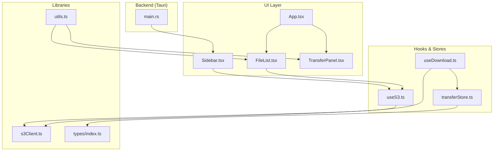

**Diagram sources**
- [Sidebar.tsx:1-184](file://src/components/layout/Sidebar.tsx#L1-L184)
- [FileList.tsx:1-402](file://src/components/explorer/FileList.tsx#L1-L402)
- [App.tsx:1-270](file://src/App.tsx#L1-L270)
- [TransferPanel.tsx:1-208](file://src/components/layout/TransferPanel.tsx#L1-L208)
- [useS3.ts:1-410](file://src/hooks/useS3.ts#L1-L410)
- [useDownload.ts:1-202](file://src/hooks/useDownload.ts#L1-L202)
- [transferStore.ts:1-62](file://src/store/transferStore.ts#L1-L62)
- [s3Client.ts:1-83](file://src/lib/s3Client.ts#L1-L83)
- [utils.ts:1-197](file://src/lib/utils.ts#L1-L197)
- [index.ts:1-166](file://src/types/index.ts#L1-L166)
- [main.rs:1-7](file://src-tauri/src/main.rs#L1-L7)

**Section sources**
- [Sidebar.tsx:1-184](file://src/components/layout/Sidebar.tsx#L1-L184)
- [FileList.tsx:1-402](file://src/components/explorer/FileList.tsx#L1-L402)
- [App.tsx:1-270](file://src/App.tsx#L1-L270)
- [TransferPanel.tsx:1-208](file://src/components/layout/TransferPanel.tsx#L1-L208)
- [useS3.ts:1-410](file://src/hooks/useS3.ts#L1-L410)
- [useDownload.ts:1-202](file://src/hooks/useDownload.ts#L1-L202)
- [transferStore.ts:1-62](file://src/store/transferStore.ts#L1-L62)
- [s3Client.ts:1-83](file://src/lib/s3Client.ts#L1-L83)
- [utils.ts:1-197](file://src/lib/utils.ts#L1-L197)
- [index.ts:1-166](file://src/types/index.ts#L1-L166)
- [main.rs:1-7](file://src-tauri/src/main.rs#L1-L7)

## Core Components
- useS3 hook: Central orchestrator for S3 operations using TanStack Query. Provides queries for listing buckets and objects, and mutations for upload, download, delete, create folder, rename, presigned URL generation, and HEAD metadata retrieval.
- useDownload hook: Advanced download manager with real-time progress tracking, speed calculation, and cancellation support via the transfer store.
- S3 client factory: Creates provider-aware S3Client instances with endpoint resolution and path-style addressing for non-AWS providers.
- Transfer store: Persistent state management for concurrent uploads/downloads with progress tracking, status updates, speed calculation, and cleanup of completed transfers.
- Transfer panel: Persistent UI component that displays active transfers, progress bars, real-time speeds, and provides cancellation controls.
- Utilities: Formatting helpers for file sizes and dates, and S3 key/name utilities for folder detection and display name extraction.
- Types: Strongly typed domain models for transfers, items, connections, and operation states.

**Section sources**
- [useS3.ts:47-410](file://src/hooks/useS3.ts#L47-L410)
- [useDownload.ts:31-202](file://src/hooks/useDownload.ts#L31-L202)
- [s3Client.ts:51-83](file://src/lib/s3Client.ts#L51-L83)
- [transferStore.ts:1-62](file://src/store/transferStore.ts#L1-L62)
- [TransferPanel.tsx:1-208](file://src/components/layout/TransferPanel.tsx#L1-L208)
- [utils.ts:13-197](file://src/lib/utils.ts#L13-L197)
- [index.ts:38-166](file://src/types/index.ts#L38-L166)

## Architecture Overview
The file operation architecture follows a layered pattern with enhanced transfer management:
- UI components trigger actions via useS3 and useDownload hooks.
- Mutations use React Query to manage loading, caching, and error states.
- The S3 client factory ensures proper endpoint configuration per provider.
- For large downloads, the backend (Rust/Tauri) can be used to offload heavy workloads.
- Progress and status are tracked in the transfer store for user feedback through the persistent transfer panel.
- Real-time speed calculation and cancellation support enhance user experience.

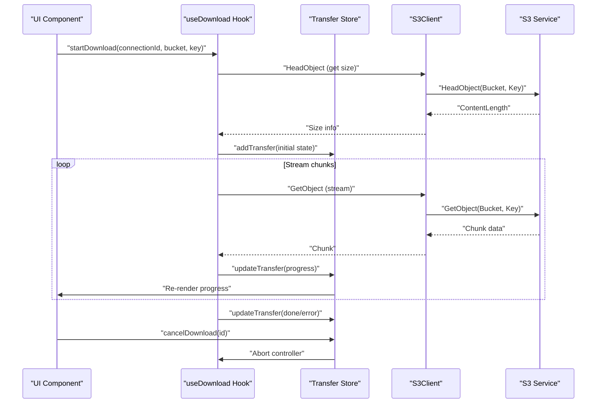

**Diagram sources**
- [useDownload.ts:52-177](file://src/hooks/useDownload.ts#L52-L177)
- [transferStore.ts:28-61](file://src/store/transferStore.ts#L28-L61)
- [s3Client.ts:60-83](file://src/lib/s3Client.ts#L60-L83)

**Section sources**
- [useS3.ts:62-410](file://src/hooks/useS3.ts#L62-L410)
- [useDownload.ts:31-202](file://src/hooks/useDownload.ts#L31-L202)
- [s3Client.ts:51-83](file://src/lib/s3Client.ts#L51-L83)

## Detailed Component Analysis

### useS3 Hook: Queries and Mutations
The useS3 hook exposes:
- Queries:
  - listBuckets(connectionId): Lists buckets for a connection.
  - listObjects(connectionId, bucket, prefix): Lists objects and virtual folders with pagination support.
- Mutations:
  - uploadFile(): Uploads a File to S3 with automatic key composition from prefix and filename.
  - downloadFile(): Downloads via presigned URL for browser-based small files.
  - deleteItem(): Deletes an object or folder placeholder.
  - createFolder(): Creates a virtual folder by placing an empty object ending with "/".
  - renameItem(): Renames by copying then deleting; works for files; folders require recursive renaming.
  - getPresignedUrl(): Generates a long-lived presigned URL for sharing.
  - headObject(): Retrieves metadata without downloading the body.

Implementation highlights:
- Connection lookup and validation via a Zustand-backed connection store.
- Provider-aware endpoint resolution and path-style addressing for non-AWS providers.
- Error handling with descriptive messages and HTTP status checks.
- Presigned URLs for secure, time-limited access.

**Diagram sources**
- [useS3.ts:21-34](file://src/hooks/useS3.ts#L21-L34)
- [useS3.ts:195-227](file://src/hooks/useS3.ts#L195-L227)
- [s3Client.ts:60-83](file://src/lib/s3Client.ts#L60-L83)

**Section sources**
- [useS3.ts:69-144](file://src/hooks/useS3.ts#L69-L144)
- [useS3.ts:152-189](file://src/hooks/useS3.ts#L152-L189)
- [useS3.ts:195-227](file://src/hooks/useS3.ts#L195-L227)
- [useS3.ts:232-256](file://src/hooks/useS3.ts#L232-L256)
- [useS3.ts:261-288](file://src/hooks/useS3.ts#L261-L288)
- [useS3.ts:293-312](file://src/hooks/useS3.ts#L293-L312)
- [useS3.ts:319-360](file://src/hooks/useS3.ts#L319-L360)
- [useS3.ts:366-391](file://src/hooks/useS3.ts#L366-L391)

### S3 Client Factory
The client factory:
- Resolves provider-specific endpoints and validates required fields.
- Configures path-style addressing for non-AWS providers to ensure compatibility.
- Returns a configured S3Client instance ready to send AWS SDK commands.

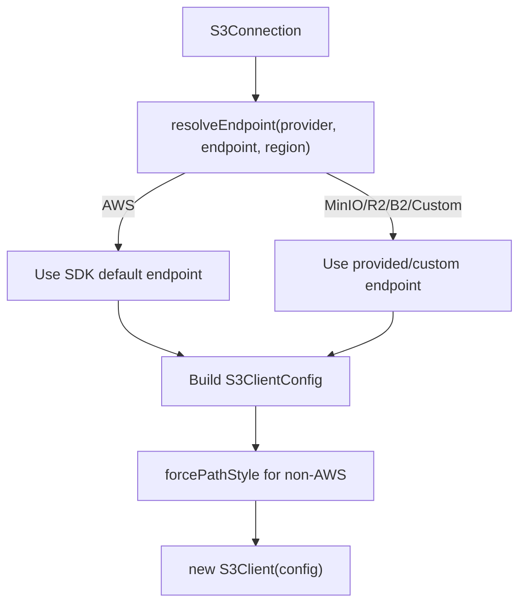

**Diagram sources**
- [s3Client.ts:12-49](file://src/lib/s3Client.ts#L12-L49)
- [s3Client.ts:60-83](file://src/lib/s3Client.ts#L60-L83)

**Section sources**
- [s3Client.ts:12-49](file://src/lib/s3Client.ts#L12-L49)
- [s3Client.ts:60-83](file://src/lib/s3Client.ts#L60-L83)

### UI Integration: FileList and Sidebar
- FileList integrates with useS3 to list objects, apply filters and sorting, and render virtualized rows.
- Sidebar lists buckets for the active connection and coordinates navigation state.
- App coordinates refresh triggers and invalidates queries to keep UI in sync.
- App renders the persistent TransferPanel component for continuous transfer monitoring.

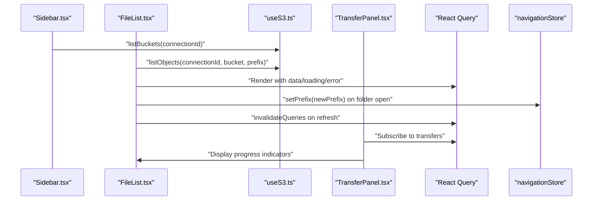

**Diagram sources**
- [Sidebar.tsx:50-108](file://src/components/layout/Sidebar.tsx#L50-L108)
- [FileList.tsx:44-72](file://src/components/explorer/FileList.tsx#L44-L72)
- [App.tsx:256-270](file://src/App.tsx#L256-L270)
- [TransferPanel.tsx:151-208](file://src/components/layout/TransferPanel.tsx#L151-L208)

**Section sources**
- [Sidebar.tsx:1-184](file://src/components/layout/Sidebar.tsx#L1-L184)
- [FileList.tsx:1-402](file://src/components/explorer/FileList.tsx#L1-L402)
- [App.tsx:1-270](file://src/App.tsx#L1-L270)
- [TransferPanel.tsx:1-208](file://src/components/layout/TransferPanel.tsx#L1-L208)

## Transfer Management System

### Transfer Store Architecture
The transfer store manages persistent state for all file operations with comprehensive tracking capabilities:

- **Persistent State**: Maintains transfers across component unmounts and re-mounts
- **Real-time Updates**: Instant UI updates for progress, speed, and status changes
- **Transfer Lifecycle**: Handles creation, progress updates, completion, and error states
- **Batch Operations**: Supports multiple concurrent transfers with individual tracking
- **Cleanup Management**: Automatic removal of completed transfers and manual clearing

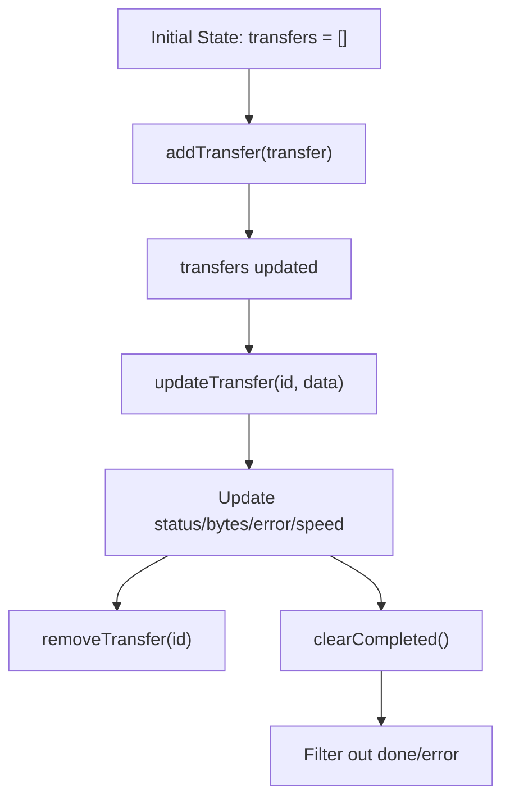

**Diagram sources**
- [transferStore.ts:28-61](file://src/store/transferStore.ts#L28-L61)

**Section sources**
- [transferStore.ts:1-62](file://src/store/transferStore.ts#L1-L62)
- [index.ts:83-98](file://src/types/index.ts#L83-L98)

### Transfer Panel: Persistent User Interface
The TransferPanel provides a persistent, always-visible interface for monitoring all file operations:

- **Fixed Positioning**: Positioned in the bottom-right corner for constant visibility
- **Collapsible Design**: Can be collapsed to save screen space while retaining functionality
- **Real-time Progress**: Live progress bars with percentage and byte counters
- **Speed Calculation**: Dynamic speed display using byte deltas over time intervals
- **Visual Feedback**: Color-coded progress bars (blue active, green done, red error)
- **Action Controls**: Cancel buttons for active transfers, remove buttons for completed ones
- **Batch Management**: Clear completed button to remove finished transfers

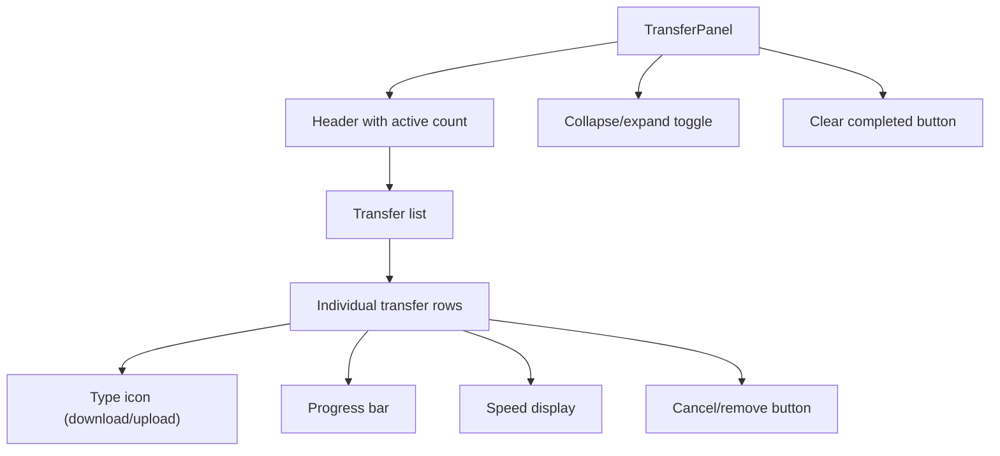

**Diagram sources**
- [TransferPanel.tsx:151-208](file://src/components/layout/TransferPanel.tsx#L151-L208)
- [TransferPanel.tsx:30-147](file://src/components/layout/TransferPanel.tsx#L30-L147)

**Section sources**
- [TransferPanel.tsx:1-208](file://src/components/layout/TransferPanel.tsx#L1-L208)
- [utils.ts:13-27](file://src/lib/utils.ts#L13-L27)

## Enhanced Download Workflows

### useDownload Hook: Advanced Download Management
The useDownload hook provides sophisticated download capabilities with real-time progress tracking:

- **Automatic Size Detection**: Uses HeadObject to determine file size before download
- **Progress Streaming**: Real-time progress updates during chunked downloads
- **Speed Calculation**: Computes instantaneous download speed using byte deltas
- **Cancellation Support**: AbortController-based cancellation with proper cleanup
- **Large File Handling**: Threshold-based decision between browser and backend downloads
- **Error Handling**: Comprehensive error reporting with user-friendly messages
- **Integration**: Seamless integration with transfer store for persistent tracking

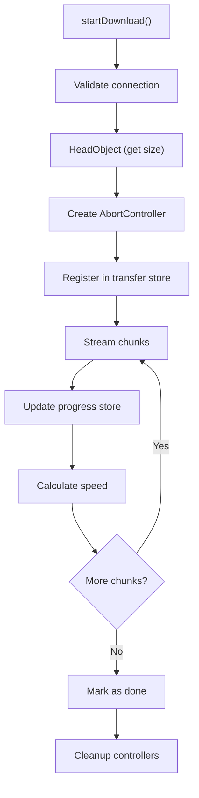

**Diagram sources**
- [useDownload.ts:52-177](file://src/hooks/useDownload.ts#L52-L177)

**Section sources**
- [useDownload.ts:1-202](file://src/hooks/useDownload.ts#L1-L202)
- [useDownload.ts:139-153](file://src/hooks/useDownload.ts#L139-L153)

### Download Progress Tracking
The download system provides comprehensive progress tracking with multiple visualization modes:

- **Indeterminate Mode**: When file size is unknown, shows animated progress indicator
- **Determinante Mode**: When size is known, displays precise percentage and byte counters
- **Live Speed**: Real-time speed calculation using 400ms intervals for smooth updates
- **Visual Indicators**: Different progress bar styles for active, completed, and errored states
- **User Feedback**: Toast notifications for success, cancellation, and error events

**Section sources**
- [useDownload.ts:68-77](file://src/hooks/useDownload.ts#L68-L77)
- [useDownload.ts:139-153](file://src/hooks/useDownload.ts#L139-L153)
- [TransferPanel.tsx:38-48](file://src/components/layout/TransferPanel.tsx#L38-L48)

### Large File Handling and Backend Integration
- The downloadFile mutation uses presigned URLs suitable for small-to-medium files.
- For large downloads (>10MB threshold), the system prepares for backend streaming integration.
- The transfer store supports progress updates and status transitions for large transfers.
- Future backend integration will leverage Rust/Tauri for improved reliability and performance.

**Section sources**
- [useDownload.ts:13-14](file://src/hooks/useDownload.ts#L13-L14)
- [useS3.ts:148-189](file://src/hooks/useS3.ts#L148-L189)
- [transferStore.ts:1-62](file://src/store/transferStore.ts#L1-L62)

### Batch Processing and Bulk Operations
- The current implementation focuses on single-item operations with enhanced progress tracking.
- Batch operations can be built by composing multiple useDownload/useS3 operations.
- The transfer store's persistent nature allows monitoring of multiple concurrent operations.
- Shared metadata coordination reduces redundant client initialization and network round trips.

**Section sources**
- [useS3.ts:195-288](file://src/hooks/useS3.ts#L195-L288)
- [transferStore.ts:28-61](file://src/store/transferStore.ts#L28-L61)

### Practical Examples of Common File Operations
- Upload a file:
  - Call uploadFile mutation with connectionId, bucket, prefix, and File.
  - Observe status transitions in the transfer store and refetch listObjects after completion.
- Download a file:
  - Use downloadFile mutation for small files via presigned URL.
  - For large files, integrate backend streaming and update the transfer store accordingly.
  - Monitor progress in the persistent transfer panel with real-time speed display.
- Delete a file or folder placeholder:
  - Call deleteItem with connectionId, bucket, and key.
- Create a folder:
  - Call createFolder with connectionId, bucket, prefix, and folderName.
- Rename a file:
  - Call renameItem with connectionId, bucket, oldKey, and newKey.
- Get info:
  - Call headObject to retrieve metadata without downloading.

**Section sources**
- [useS3.ts:152-189](file://src/hooks/useS3.ts#L152-L189)
- [useS3.ts:195-227](file://src/hooks/useS3.ts#L195-L227)
- [useS3.ts:232-256](file://src/hooks/useS3.ts#L232-L256)
- [useS3.ts:261-288](file://src/hooks/useS3.ts#L261-L288)
- [useS3.ts:319-360](file://src/hooks/useS3.ts#L319-L360)
- [useS3.ts:366-391](file://src/hooks/useS3.ts#L366-L391)

## Dependency Analysis
The file operation stack exhibits low coupling and high cohesion with enhanced transfer management:
- UI components depend on useS3/useDownload for data and actions.
- useS3/useDownload depend on s3Client for provider-aware client creation.
- transferStore is independent and provides persistent state management.
- TransferPanel subscribes to transferStore for real-time updates.
- Utilities support formatting and S3 key/name handling.

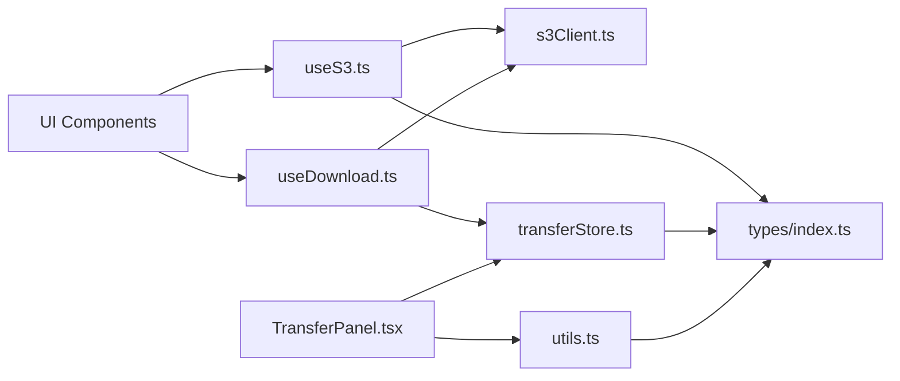

**Diagram sources**
- [useS3.ts:1-16](file://src/hooks/useS3.ts#L1-L16)
- [useDownload.ts:1-11](file://src/hooks/useDownload.ts#L1-L11)
- [s3Client.ts:1-2](file://src/lib/s3Client.ts#L1-L2)
- [utils.ts:1-3](file://src/lib/utils.ts#L1-L3)
- [index.ts:1-3](file://src/types/index.ts#L1-L3)
- [transferStore.ts:1-2](file://src/store/transferStore.ts#L1-L2)
- [TransferPanel.tsx:1-16](file://src/components/layout/TransferPanel.tsx#L1-L16)

**Section sources**
- [useS3.ts:1-16](file://src/hooks/useS3.ts#L1-L16)
- [useDownload.ts:1-11](file://src/hooks/useDownload.ts#L1-L11)
- [s3Client.ts:1-2](file://src/lib/s3Client.ts#L1-L2)
- [utils.ts:1-3](file://src/lib/utils.ts#L1-L3)
- [index.ts:1-3](file://src/types/index.ts#L1-L3)
- [transferStore.ts:1-2](file://src/store/transferStore.ts#L1-L2)
- [TransferPanel.tsx:1-16](file://src/components/layout/TransferPanel.tsx#L1-L16)

## Performance Considerations
- Prefer presigned URLs for small downloads to avoid heavy backend overhead.
- For large downloads, leverage backend streaming to improve reliability and enable progress reporting.
- Use virtualization in FileList to render large directory listings efficiently.
- Invalidate only the affected query keys to minimize unnecessary refetches.
- Disable bucket endpoint rewriting only for non-AWS providers requiring path-style addressing.
- Batch similar operations to reduce repeated client initialization and network round trips.
- **Transfer Store Optimization**: Leverage persistent state to avoid re-initializing transfers on component re-mount.
- **Real-time Updates**: Use efficient state updates to minimize re-renders during high-frequency progress updates.
- **Memory Management**: Implement proper cleanup of AbortControllers and transfer references to prevent memory leaks.

## Troubleshooting Guide
Common issues and resolutions:
- Connection not found:
  - Ensure the connection exists in the connection store and is active.
  - Verify provider configuration and required endpoint/region fields.
- Endpoint errors for non-AWS providers:
  - Confirm forcePathStyle is enabled for MinIO/R2/B2/custom endpoints.
- Upload failures:
  - Check HTTP status codes and content type; ensure bucket permissions allow PutObject.
- Download failures:
  - Validate presigned URL expiration and network connectivity; consider backend streaming for large files.
  - Check transfer store state for error messages and status updates.
- Rename failures:
  - Ensure oldKey differs from newKey and that CopyObject and DeleteObject succeed.
- Transfer progress not updating:
  - Verify transfer store actions are invoked and that status transitions occur.
  - Check for proper subscription in TransferPanel component.
- Transfer panel not visible:
  - Ensure TransferPanel is rendered in the main App component.
  - Verify transfer store has active transfers to trigger rendering.
- Speed calculation issues:
  - Check that progress updates occur frequently enough for accurate speed calculations.
  - Verify proper cleanup of AbortControllers to prevent conflicts.

**Section sources**
- [useS3.ts:21-34](file://src/hooks/useS3.ts#L21-L34)
- [s3Client.ts:12-49](file://src/lib/s3Client.ts#L12-L49)
- [useDownload.ts:58-60](file://src/hooks/useDownload.ts#L58-L60)
- [useS3.ts:210-225](file://src/hooks/useS3.ts#L210-L225)
- [useS3.ts:162-187](file://src/hooks/useS3.ts#L162-L187)
- [useDownload.ts:154-170](file://src/hooks/useDownload.ts#L154-L170)
- [transferStore.ts:34-60](file://src/store/transferStore.ts#L34-L60)
- [TransferPanel.tsx:156-157](file://src/components/layout/TransferPanel.tsx#L156-L157)

## Conclusion
S3 Explorer's file operations are centered on a robust useS3 hook integrated with React Query, a provider-aware S3 client factory, and a sophisticated transfer management system with persistent transfer panels and real-time progress tracking. The new useDownload hook enhances download workflows with advanced features like speed calculation, cancellation support, and seamless integration with the transfer store. While the current implementation emphasizes single-item operations with enhanced progress tracking, the architecture supports building batch processing and integrating backend streaming for large files. The persistent transfer panel provides users with continuous visibility into all file operations, improving the overall user experience. By following the patterns and guidelines outlined here, developers can implement reliable, performant, and user-friendly file management experiences with comprehensive progress monitoring and user feedback.

## Appendices

### Data Model: Transfer and S3Item
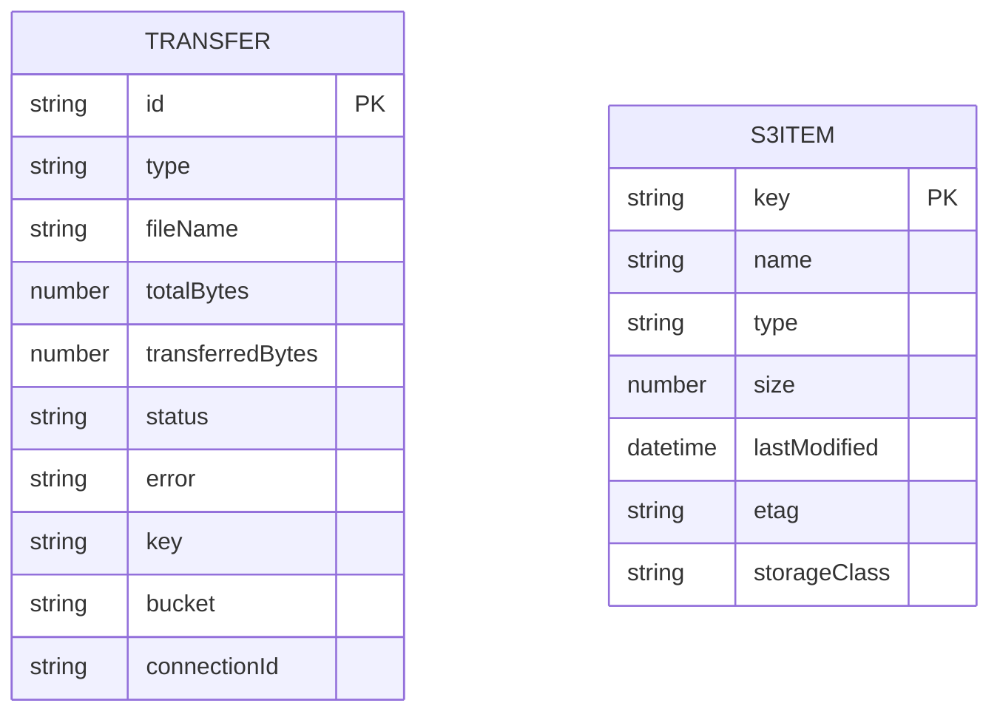

**Diagram sources**
- [index.ts:83-98](file://src/types/index.ts#L83-L98)
- [index.ts:54-62](file://src/types/index.ts#L54-L62)

### Example: Enhanced Upload Workflow
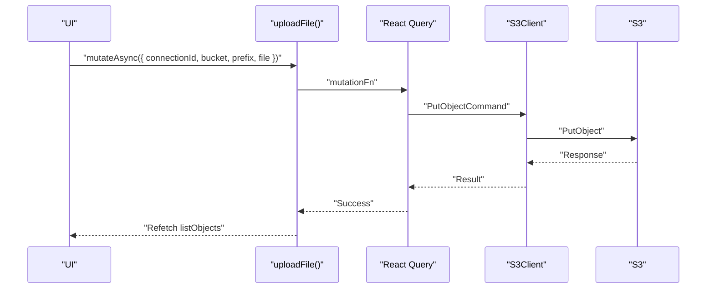

**Diagram sources**
- [useS3.ts:195-227](file://src/hooks/useS3.ts#L195-L227)

### Example: Real-time Download Workflow
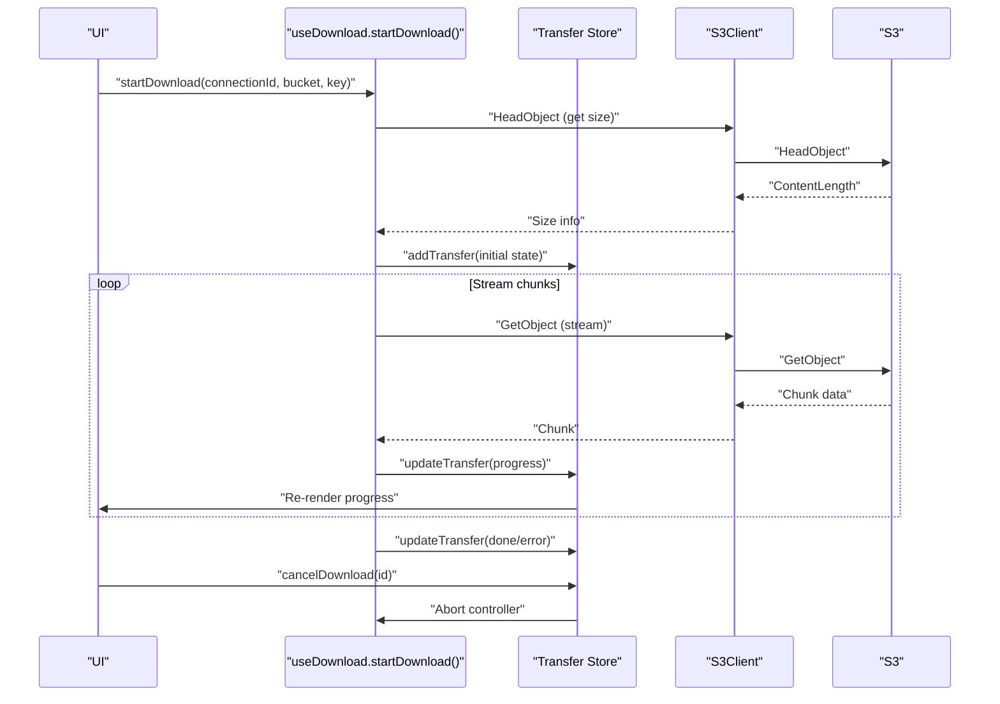

**Diagram sources**
- [useDownload.ts:52-177](file://src/hooks/useDownload.ts#L52-L177)
- [transferStore.ts:28-61](file://src/store/transferStore.ts#L28-L61)