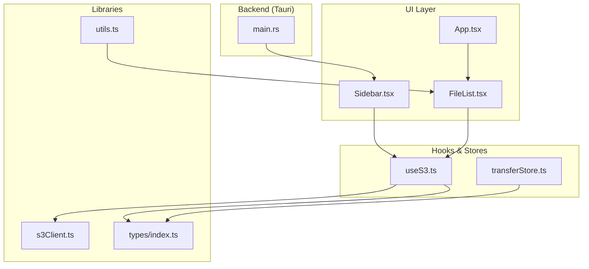
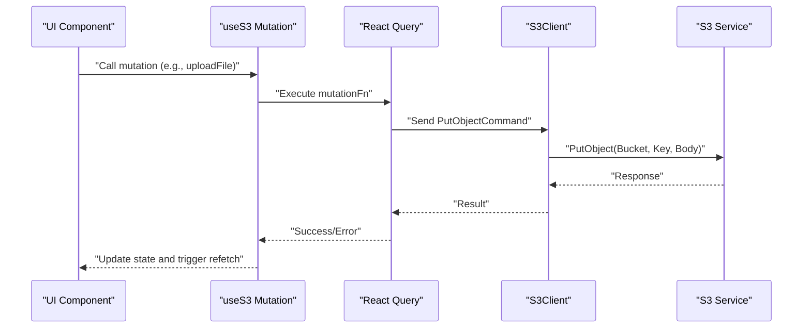
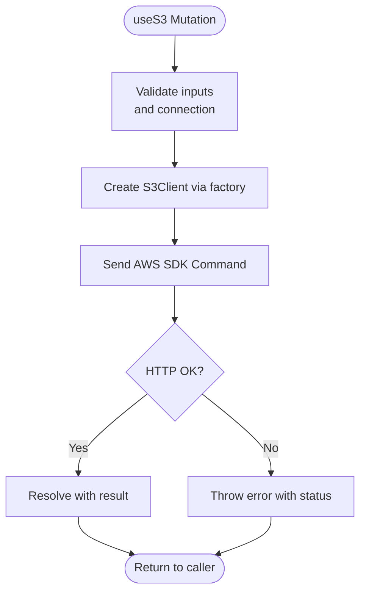
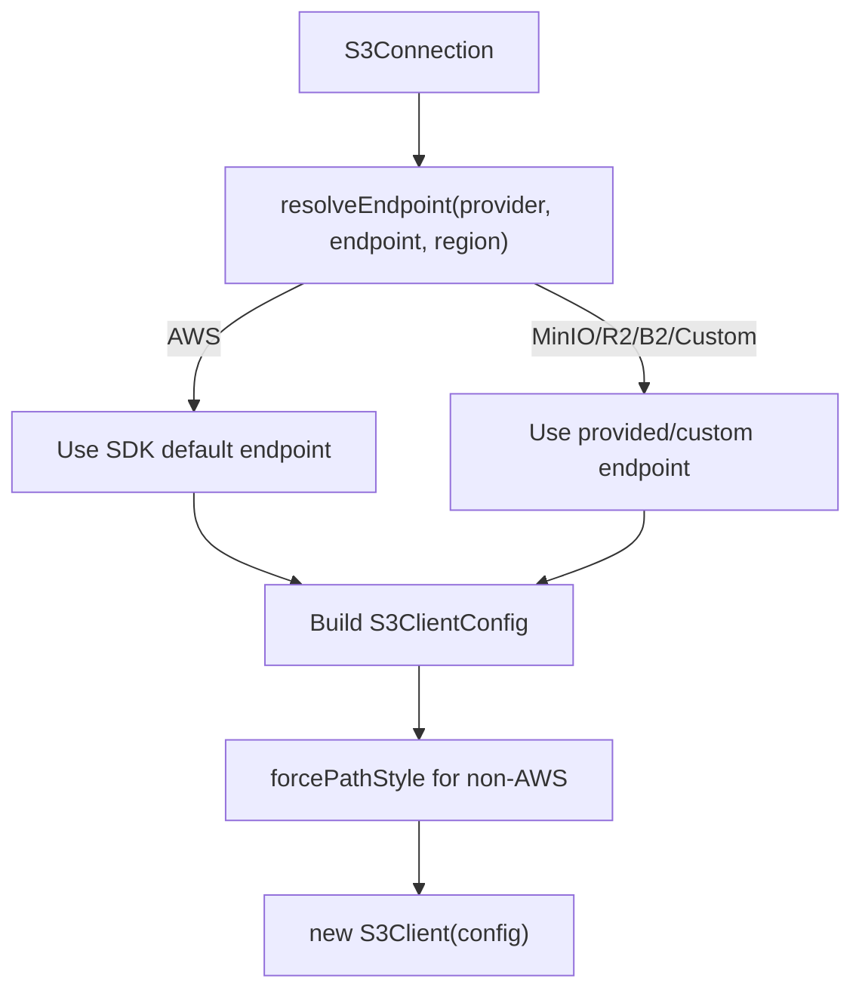
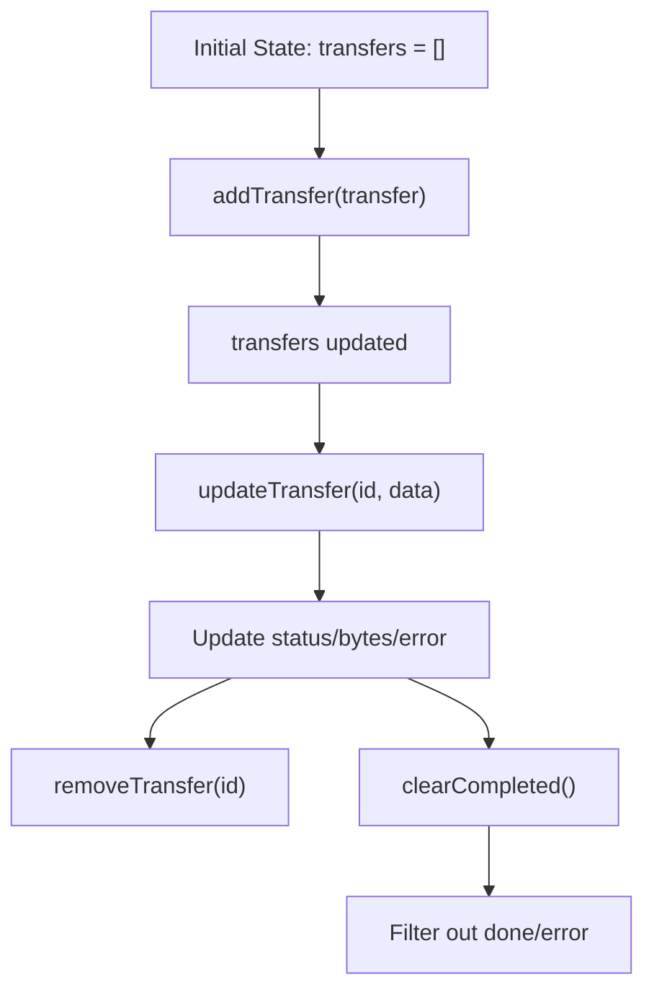
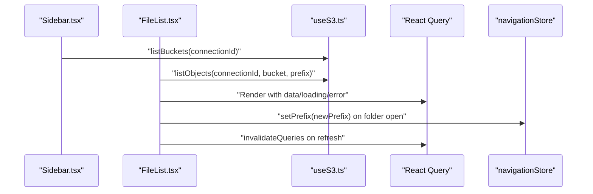
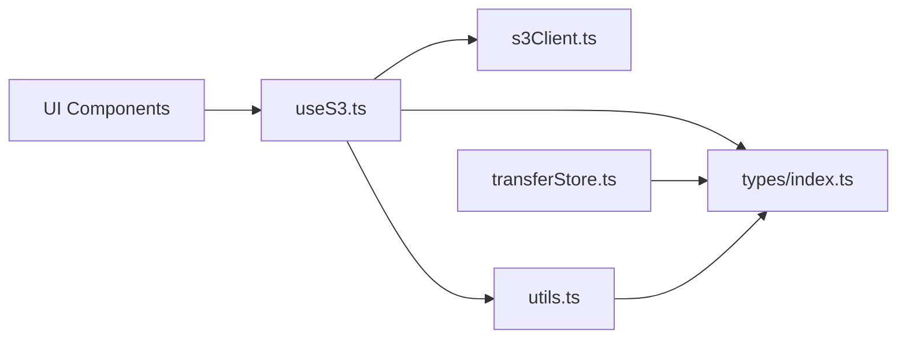
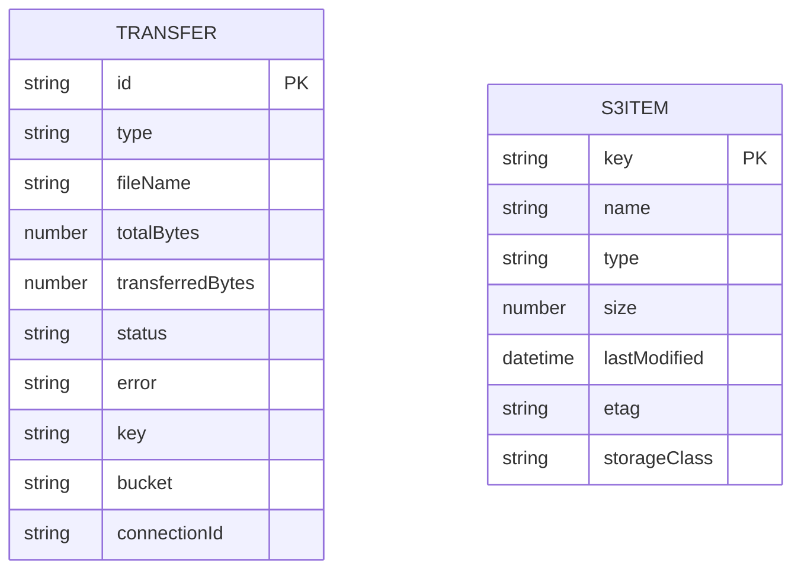
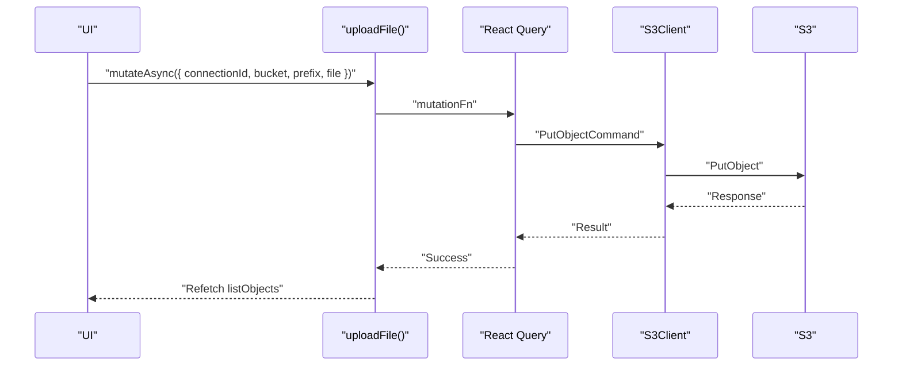

# File Operations

<cite>
**Referenced Files in This Document**
- [useS3.ts](file://src/hooks/useS3.ts)
- [transferStore.ts](file://src/store/transferStore.ts)
- [s3Client.ts](file://src/lib/s3Client.ts)
- [utils.ts](file://src/lib/utils.ts)
- [index.ts](file://src/types/index.ts)
- [FileList.tsx](file://src/components/explorer/FileList.tsx)
- [Sidebar.tsx](file://src/components/layout/Sidebar.tsx)
- [App.tsx](file://src/App.tsx)
- [main.rs](file://src-tauri/src/main.rs)
</cite>

## Table of Contents
1. [Introduction](#introduction)
2. [Project Structure](#project-structure)
3. [Core Components](#core-components)
4. [Architecture Overview](#architecture-overview)
5. [Detailed Component Analysis](#detailed-component-analysis)
6. [Dependency Analysis](#dependency-analysis)
7. [Performance Considerations](#performance-considerations)
8. [Troubleshooting Guide](#troubleshooting-guide)
9. [Conclusion](#conclusion)
10. [Appendices](#appendices)

## Introduction
This document explains S3 Explorer’s file operation capabilities with a focus on upload, download, delete, rename, and create folder. It documents the useS3 hook architecture, React Query integration, and the transfer store used to manage concurrent operations, progress tracking, and user feedback. It also covers upload and download workflows, large file handling, chunked transfers, error recovery, batch processing, and integration with S3 client utilities. Practical examples and performance considerations are included to help developers implement robust file management experiences.

## Project Structure
The file operation subsystem is organized around a central React hook that encapsulates all S3 operations, a client factory for provider-specific S3 clients, a transfer store for progress tracking, and UI components that orchestrate actions and display results.

**Diagram sources**
- [Sidebar.tsx:1-184](file://src/components/layout/Sidebar.tsx#L1-L184)
- [FileList.tsx:1-402](file://src/components/explorer/FileList.tsx#L1-L402)
- [App.tsx:1-136](file://src/App.tsx#L1-L136)
- [useS3.ts:1-410](file://src/hooks/useS3.ts#L1-L410)
- [transferStore.ts:1-62](file://src/store/transferStore.ts#L1-L62)
- [s3Client.ts:1-83](file://src/lib/s3Client.ts#L1-L83)
- [utils.ts:1-197](file://src/lib/utils.ts#L1-L197)
- [index.ts:1-166](file://src/types/index.ts#L1-L166)
- [main.rs:1-7](file://src-tauri/src/main.rs#L1-L7)

**Section sources**
- [Sidebar.tsx:1-184](file://src/components/layout/Sidebar.tsx#L1-L184)
- [FileList.tsx:1-402](file://src/components/explorer/FileList.tsx#L1-L402)
- [App.tsx:1-136](file://src/App.tsx#L1-L136)
- [useS3.ts:1-410](file://src/hooks/useS3.ts#L1-L410)
- [transferStore.ts:1-62](file://src/store/transferStore.ts#L1-L62)
- [s3Client.ts:1-83](file://src/lib/s3Client.ts#L1-L83)
- [utils.ts:1-197](file://src/lib/utils.ts#L1-L197)
- [index.ts:1-166](file://src/types/index.ts#L1-L166)
- [main.rs:1-7](file://src-tauri/src/main.rs#L1-L7)

## Core Components
- useS3 hook: Central orchestrator for S3 operations using TanStack Query. Provides queries for listing buckets and objects, and mutations for upload, download, delete, create folder, rename, presigned URL generation, and HEAD metadata retrieval.
- S3 client factory: Creates provider-aware S3Client instances with endpoint resolution and path-style addressing for non-AWS providers.
- Transfer store: Manages concurrent uploads/downloads with progress tracking, status updates, and cleanup of completed transfers.
- Utilities: Formatting helpers for file sizes and dates, and S3 key/name utilities for folder detection and display name extraction.
- Types: Strongly typed domain models for transfers, items, connections, and operation states.

**Section sources**
- [useS3.ts:47-410](file://src/hooks/useS3.ts#L47-L410)
- [s3Client.ts:51-83](file://src/lib/s3Client.ts#L51-L83)
- [transferStore.ts:1-62](file://src/store/transferStore.ts#L1-L62)
- [utils.ts:13-197](file://src/lib/utils.ts#L13-L197)
- [index.ts:38-166](file://src/types/index.ts#L38-L166)

## Architecture Overview
The file operation architecture follows a layered pattern:
- UI components trigger actions via useS3 mutations.
- Mutations use React Query to manage loading, caching, and error states.
- The S3 client factory ensures proper endpoint configuration per provider.
- For large downloads, the backend (Rust/Tauri) can be used to offload heavy workloads.
- Progress and status are tracked in the transfer store for user feedback.

**Diagram sources**
- [useS3.ts:195-227](file://src/hooks/useS3.ts#L195-L227)
- [s3Client.ts:60-83](file://src/lib/s3Client.ts#L60-L83)

**Section sources**
- [useS3.ts:62-410](file://src/hooks/useS3.ts#L62-L410)
- [s3Client.ts:51-83](file://src/lib/s3Client.ts#L51-L83)

## Detailed Component Analysis

### useS3 Hook: Queries and Mutations
The useS3 hook exposes:
- Queries:
  - listBuckets(connectionId): Lists buckets for a connection.
  - listObjects(connectionId, bucket, prefix): Lists objects and virtual folders with pagination support.
- Mutations:
  - uploadFile(): Uploads a File to S3 with automatic key composition from prefix and filename.
  - downloadFile(): Downloads via presigned URL for browser-based small files.
  - deleteItem(): Deletes an object or folder placeholder.
  - createFolder(): Creates a virtual folder by placing an empty object ending with "/".
  - renameItem(): Renames by copying then deleting; works for files; folders require recursive renaming.
  - getPresignedUrl(): Generates a long-lived presigned URL for sharing.
  - headObject(): Retrieves metadata without downloading the body.

Implementation highlights:
- Connection lookup and validation via a Zustand-backed connection store.
- Provider-aware endpoint resolution and path-style addressing for non-AWS providers.
- Error handling with descriptive messages and HTTP status checks.
- Presigned URLs for secure, time-limited access.

**Diagram sources**
- [useS3.ts:21-34](file://src/hooks/useS3.ts#L21-L34)
- [useS3.ts:195-227](file://src/hooks/useS3.ts#L195-L227)
- [s3Client.ts:60-83](file://src/lib/s3Client.ts#L60-L83)

**Section sources**
- [useS3.ts:69-144](file://src/hooks/useS3.ts#L69-L144)
- [useS3.ts:152-189](file://src/hooks/useS3.ts#L152-L189)
- [useS3.ts:195-227](file://src/hooks/useS3.ts#L195-L227)
- [useS3.ts:232-256](file://src/hooks/useS3.ts#L232-L256)
- [useS3.ts:261-288](file://src/hooks/useS3.ts#L261-L288)
- [useS3.ts:293-312](file://src/hooks/useS3.ts#L293-L312)
- [useS3.ts:319-360](file://src/hooks/useS3.ts#L319-L360)
- [useS3.ts:366-391](file://src/hooks/useS3.ts#L366-L391)

### S3 Client Factory
The client factory:
- Resolves provider-specific endpoints and validates required fields.
- Configures path-style addressing for non-AWS providers to ensure compatibility.
- Returns a configured S3Client instance ready to send AWS SDK commands.

**Diagram sources**
- [s3Client.ts:12-49](file://src/lib/s3Client.ts#L12-L49)
- [s3Client.ts:60-83](file://src/lib/s3Client.ts#L60-L83)

**Section sources**
- [s3Client.ts:12-49](file://src/lib/s3Client.ts#L12-L49)
- [s3Client.ts:60-83](file://src/lib/s3Client.ts#L60-L83)

### Transfer Store: Progress Tracking and Concurrent Operations
The transfer store manages:
- Adding transfers with initial status pending.
- Updating progress (transferredBytes), status (active/done/error), and errors.
- Removing individual transfers and clearing completed ones.

**Diagram sources**
- [transferStore.ts:28-61](file://src/store/transferStore.ts#L28-L61)

**Section sources**
- [transferStore.ts:1-62](file://src/store/transferStore.ts#L1-L62)
- [index.ts:83-98](file://src/types/index.ts#L83-L98)

### UI Integration: FileList and Sidebar
- FileList integrates with useS3 to list objects, apply filters and sorting, and render virtualized rows.
- Sidebar lists buckets for the active connection and coordinates navigation state.
- App coordinates refresh triggers and invalidates queries to keep UI in sync.

**Diagram sources**
- [Sidebar.tsx:50-108](file://src/components/layout/Sidebar.tsx#L50-L108)
- [FileList.tsx:44-72](file://src/components/explorer/FileList.tsx#L44-L72)
- [App.tsx:34-40](file://src/App.tsx#L34-L40)

**Section sources**
- [Sidebar.tsx:1-184](file://src/components/layout/Sidebar.tsx#L1-L184)
- [FileList.tsx:1-402](file://src/components/explorer/FileList.tsx#L1-L402)
- [App.tsx:1-136](file://src/App.tsx#L1-L136)

### Large File Handling and Backend Offloading
- The downloadFile mutation uses presigned URLs suitable for small-to-medium files.
- For large downloads, the backend (Rust/Tauri) can be leveraged to stream reliably and report progress.
- The transfer store supports progress updates and status transitions for large transfers.

Note: The backend command files were not found in the workspace snapshot; however, the project structure indicates their presence and intended role for large file operations.

**Section sources**
- [useS3.ts:148-189](file://src/hooks/useS3.ts#L148-L189)
- [transferStore.ts:1-62](file://src/store/transferStore.ts#L1-L62)
- [PROJECT.md:65-68](file://PROJECT.md#L65-L68)

### Batch Processing and Bulk Operations
- The current implementation focuses on single-item operations (upload, delete, rename, create folder).
- Batch operations can be built by composing multiple mutations and coordinating state in the transfer store.
- Consider grouping operations with shared metadata (e.g., same connectionId, bucket, prefix) to reduce redundant client initialization.

**Section sources**
- [useS3.ts:195-288](file://src/hooks/useS3.ts#L195-L288)
- [transferStore.ts:28-61](file://src/store/transferStore.ts#L28-L61)

### Practical Examples of Common File Operations
- Upload a file:
  - Call uploadFile mutation with connectionId, bucket, prefix, and File.
  - Observe status transitions in the transfer store and refetch listObjects after completion.
- Download a file:
  - Use downloadFile mutation for small files via presigned URL.
  - For large files, integrate backend streaming and update the transfer store accordingly.
- Delete a file or folder placeholder:
  - Call deleteItem with connectionId, bucket, and key.
- Create a folder:
  - Call createFolder with connectionId, bucket, prefix, and folderName.
- Rename a file:
  - Call renameItem with connectionId, bucket, oldKey, and newKey.
- Get info:
  - Call headObject to retrieve metadata without downloading.

**Section sources**
- [useS3.ts:152-189](file://src/hooks/useS3.ts#L152-L189)
- [useS3.ts:195-227](file://src/hooks/useS3.ts#L195-L227)
- [useS3.ts:232-256](file://src/hooks/useS3.ts#L232-L256)
- [useS3.ts:261-288](file://src/hooks/useS3.ts#L261-L288)
- [useS3.ts:319-360](file://src/hooks/useS3.ts#L319-L360)
- [useS3.ts:366-391](file://src/hooks/useS3.ts#L366-L391)

## Dependency Analysis
The file operation stack exhibits low coupling and high cohesion:
- UI components depend on useS3 for data and actions.
- useS3 depends on s3Client for provider-aware client creation.
- transferStore is independent and can be reused across operations.
- Utilities support formatting and S3 key/name handling.

**Diagram sources**
- [useS3.ts:1-16](file://src/hooks/useS3.ts#L1-L16)
- [s3Client.ts:1-2](file://src/lib/s3Client.ts#L1-L2)
- [utils.ts:1-3](file://src/lib/utils.ts#L1-L3)
- [index.ts:1-3](file://src/types/index.ts#L1-L3)
- [transferStore.ts:1-2](file://src/store/transferStore.ts#L1-L2)

**Section sources**
- [useS3.ts:1-16](file://src/hooks/useS3.ts#L1-L16)
- [s3Client.ts:1-2](file://src/lib/s3Client.ts#L1-L2)
- [utils.ts:1-3](file://src/lib/utils.ts#L1-L3)
- [index.ts:1-3](file://src/types/index.ts#L1-L3)
- [transferStore.ts:1-2](file://src/store/transferStore.ts#L1-L2)

## Performance Considerations
- Prefer presigned URLs for small downloads to avoid heavy backend overhead.
- For large downloads, leverage backend streaming to improve reliability and enable progress reporting.
- Use virtualization in FileList to render large directory listings efficiently.
- Invalidate only the affected query keys to minimize unnecessary refetches.
- Disable bucket endpoint rewriting only for non-AWS providers requiring path-style addressing.
- Batch similar operations to reduce repeated client initialization and network round trips.

[No sources needed since this section provides general guidance]

## Troubleshooting Guide
Common issues and resolutions:
- Connection not found:
  - Ensure the connection exists in the connection store and is active.
  - Verify provider configuration and required endpoint/region fields.
- Endpoint errors for non-AWS providers:
  - Confirm forcePathStyle is enabled for MinIO/R2/B2/custom endpoints.
- Upload failures:
  - Check HTTP status codes and content type; ensure bucket permissions allow PutObject.
- Download failures:
  - Validate presigned URL expiration and network connectivity; consider backend streaming for large files.
- Rename failures:
  - Ensure oldKey differs from newKey and that CopyObject and DeleteObject succeed.
- Transfer progress not updating:
  - Verify transfer store actions are invoked and that status transitions occur.

**Section sources**
- [useS3.ts:21-34](file://src/hooks/useS3.ts#L21-L34)
- [s3Client.ts:12-49](file://src/lib/s3Client.ts#L12-L49)
- [useS3.ts:210-225](file://src/hooks/useS3.ts#L210-L225)
- [useS3.ts:162-187](file://src/hooks/useS3.ts#L162-L187)
- [useS3.ts:332-358](file://src/hooks/useS3.ts#L332-L358)
- [transferStore.ts:34-60](file://src/store/transferStore.ts#L34-L60)

## Conclusion
S3 Explorer’s file operations are centered on a robust useS3 hook integrated with React Query, a provider-aware S3 client factory, and a transfer store for progress tracking. While the current implementation emphasizes single-item operations, the architecture supports building batch processing and integrating backend streaming for large files. By following the patterns and guidelines outlined here, developers can implement reliable, performant, and user-friendly file management experiences.

[No sources needed since this section summarizes without analyzing specific files]

## Appendices

### Data Model: Transfer and S3Item

**Diagram sources**
- [index.ts:83-98](file://src/types/index.ts#L83-L98)
- [index.ts:54-62](file://src/types/index.ts#L54-L62)

### Example: Upload Workflow

**Diagram sources**
- [useS3.ts:195-227](file://src/hooks/useS3.ts#L195-L227)