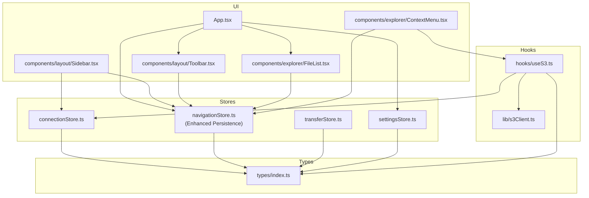
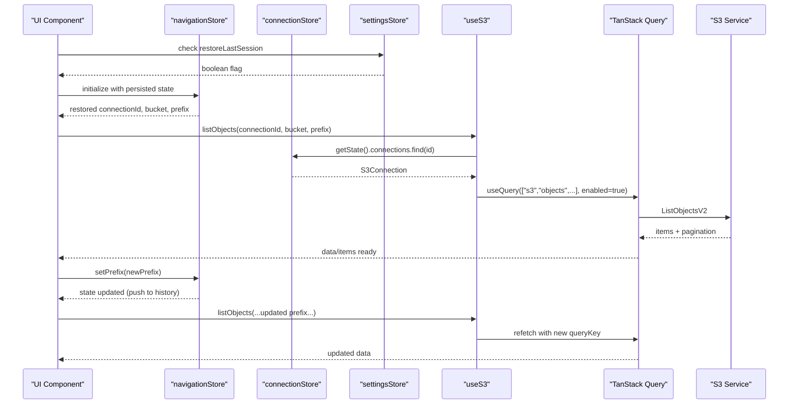
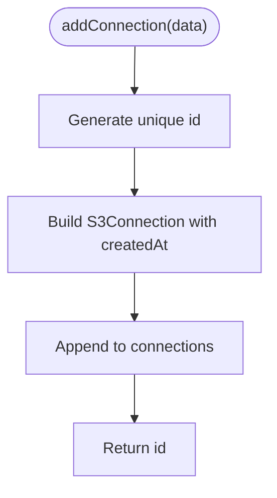
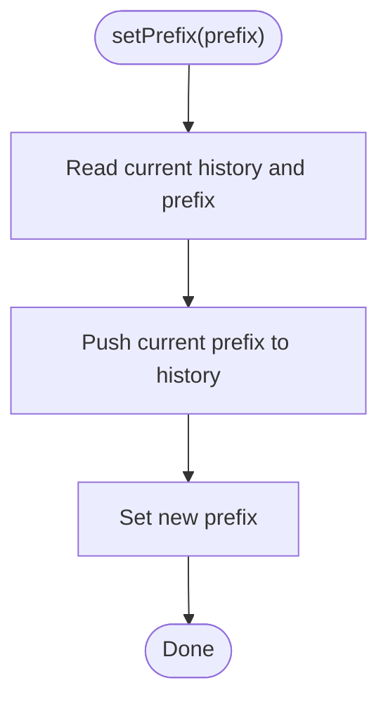
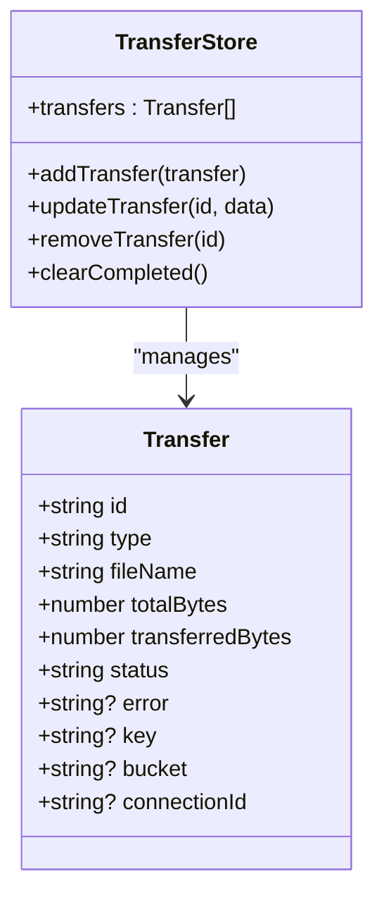
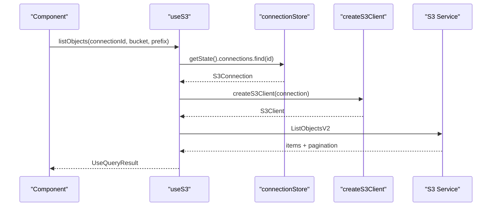
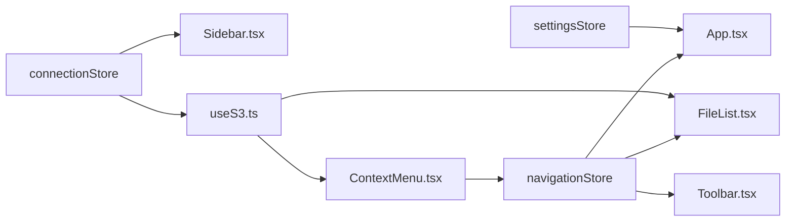
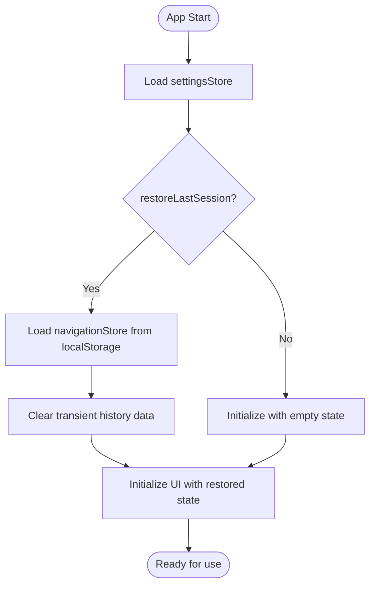
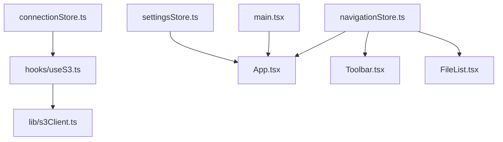

# State Management

<cite>
**Referenced Files in This Document**
- [connectionStore.ts](file://src/store/connectionStore.ts)
- [navigationStore.ts](file://src/store/navigationStore.ts)
- [transferStore.ts](file://src/store/transferStore.ts)
- [settingsStore.ts](file://src/store/settingsStore.ts)
- [useS3.ts](file://src/hooks/useS3.ts)
- [s3Client.ts](file://src/lib/s3Client.ts)
- [index.ts](file://src/types/index.ts)
- [Sidebar.tsx](file://src/components/layout/Sidebar.tsx)
- [Toolbar.tsx](file://src/components/layout/Toolbar.tsx)
- [FileList.tsx](file://src/components/explorer/FileList.tsx)
- [ContextMenu.tsx](file://src/components/explorer/ContextMenu.tsx)
- [App.tsx](file://src/App.tsx)
- [main.tsx](file://src/main.tsx)
</cite>

## Update Summary
**Changes Made**
- Enhanced navigation store documentation to reflect new persistence capabilities
- Added detailed explanation of Zustand middleware integration for session restoration
- Updated persistence strategy documentation to clarify transient vs persistent data handling
- Added new section covering session restoration workflow and user experience

## Table of Contents
1. [Introduction](#introduction)
2. [Project Structure](#project-structure)
3. [Core Components](#core-components)
4. [Architecture Overview](#architecture-overview)
5. [Detailed Component Analysis](#detailed-component-analysis)
6. [Persistence and Session Restoration](#persistence-and-session-restoration)
7. [Dependency Analysis](#dependency-analysis)
8. [Performance Considerations](#performance-considerations)
9. [Troubleshooting Guide](#troubleshooting-guide)
10. [Conclusion](#conclusion)

## Introduction
This document explains S3 Explorer's state management architecture built around four Zustand stores:
- connectionStore: manages S3 connections and the active connection selection
- navigationStore: tracks browsing state (connectionId, bucket, prefix, history) with enhanced persistence capabilities
- transferStore: tracks ongoing and completed uploads/downloads
- settingsStore: manages application preferences including session restoration

The architecture now features sophisticated persistence through Zustand middleware, enabling seamless session restoration across application restarts while maintaining optimal performance and user experience.

## Project Structure
The state management spans the store layer, typed domain models, and UI components:
- Store layer: four standalone Zustand stores with selective persistence
- Types: shared domain models and enums
- Hooks: centralized S3 operations backed by TanStack Query
- UI: components subscribe to stores and drive navigation and transfers

**Diagram sources**
- [connectionStore.ts:1-88](file://src/store/connectionStore.ts#L1-L88)
- [navigationStore.ts:1-100](file://src/store/navigationStore.ts#L1-L100)
- [transferStore.ts:1-62](file://src/store/transferStore.ts#L1-L62)
- [settingsStore.ts:1-29](file://src/store/settingsStore.ts#L1-L29)
- [index.ts:1-168](file://src/types/index.ts#L1-L168)
- [useS3.ts:1-410](file://src/hooks/useS3.ts#L1-L410)
- [s3Client.ts:1-83](file://src/lib/s3Client.ts#L1-L83)
- [App.tsx:1-341](file://src/App.tsx#L1-L341)
- [Sidebar.tsx:1-184](file://src/components/layout/Sidebar.tsx#L1-L184)
- [Toolbar.tsx:1-212](file://src/components/layout/Toolbar.tsx#L1-L212)
- [FileList.tsx:1-401](file://src/components/explorer/FileList.tsx#L1-L401)
- [ContextMenu.tsx:1-272](file://src/components/explorer/ContextMenu.tsx#L1-L272)

**Section sources**
- [connectionStore.ts:1-88](file://src/store/connectionStore.ts#L1-L88)
- [navigationStore.ts:1-100](file://src/store/navigationStore.ts#L1-L100)
- [transferStore.ts:1-62](file://src/store/transferStore.ts#L1-L62)
- [settingsStore.ts:1-29](file://src/store/settingsStore.ts#L1-L29)
- [index.ts:1-168](file://src/types/index.ts#L1-L168)
- [useS3.ts:1-410](file://src/hooks/useS3.ts#L1-L410)
- [s3Client.ts:1-83](file://src/lib/s3Client.ts#L1-L83)
- [App.tsx:1-341](file://src/App.tsx#L1-L341)
- [Sidebar.tsx:1-184](file://src/components/layout/Sidebar.tsx#L1-L184)
- [Toolbar.tsx:1-212](file://src/components/layout/Toolbar.tsx#L1-L212)
- [FileList.tsx:1-401](file://src/components/explorer/FileList.tsx#L1-L401)
- [ContextMenu.tsx:1-272](file://src/components/explorer/ContextMenu.tsx#L1-L272)

## Core Components
- connectionStore
  - State: connections array and activeConnectionId
  - Actions: addConnection, updateConnection, removeConnection, setActiveConnection
  - Persistence: localStorage via Zustand persist middleware
- navigationStore
  - State: connectionId, bucket, prefix, history
  - Actions: setBucket, setPrefix, goBack, goHome, pushHistory
  - Persistence: localStorage with selective persistence through custom partialize function
- transferStore
  - State: transfers array
  - Actions: addTransfer, updateTransfer, removeTransfer, clearCompleted
- settingsStore
  - State: restoreLastSession flag
  - Actions: setRestoreLastSession
  - Persistence: localStorage via Zustand persist middleware

These stores are independent but coordinated by UI components and hooks to keep the app responsive and consistent.

**Section sources**
- [connectionStore.ts:10-88](file://src/store/connectionStore.ts#L10-L88)
- [navigationStore.ts:4-100](file://src/store/navigationStore.ts#L4-L100)
- [transferStore.ts:4-62](file://src/store/transferStore.ts#L4-L62)
- [settingsStore.ts:4-29](file://src/store/settingsStore.ts#L4-L29)

## Architecture Overview
The stores are consumed by UI components and the useS3 hook. The hook builds S3 clients from the active connection and orchestrates TanStack Query queries and mutations. Navigation changes trigger data refreshes, and context menu actions invalidate queries to synchronize UI with backend state. The enhanced navigation store now provides seamless session restoration through persistent state management.

**Diagram sources**
- [navigationStore.ts:37-99](file://src/store/navigationStore.ts#L37-L99)
- [useS3.ts:69-144](file://src/hooks/useS3.ts#L69-L144)
- [connectionStore.ts:22-34](file://src/store/connectionStore.ts#L22-L34)
- [settingsStore.ts:15-28](file://src/store/settingsStore.ts#L15-L28)

## Detailed Component Analysis

### connectionStore
- Responsibilities
  - Persist and manage multiple S3 connections
  - Track the active connection
  - Enforce validity when setting active connection
- State structure
  - connections: array of S3Connection
  - activeConnectionId: string | null
- Actions
  - addConnection(data): generates unique id, adds new connection, returns id
  - updateConnection(id, data): partial update
  - removeConnection(id): removes connection and clears active if matched
  - setActiveConnection(id): validates id against stored connections or allows null
- Persistence
  - Uses Zustand persist with a partialize function to persist only state fields (not actions)
- Selector patterns
  - Subscribe to connections and activeConnectionId in Sidebar and other components
- Error handling
  - Validation in setActiveConnection prevents invalid ids
- Performance
  - O(n) lookup for find/update/remove; acceptable given small number of connections

**Diagram sources**
- [connectionStore.ts:39-52](file://src/store/connectionStore.ts#L39-L52)

**Section sources**
- [connectionStore.ts:10-88](file://src/store/connectionStore.ts#L10-L88)
- [index.ts:38-48](file://src/types/index.ts#L38-L48)

### navigationStore
- Responsibilities
  - Track current browsing session: connectionId, bucket, prefix, navigation history
  - Provide navigation actions to move between buckets and prefixes
  - Enable seamless session restoration through persistent state management
- State structure
  - connectionId: string | null (persistent)
  - bucket: string | null (persistent)
  - prefix: string (persistent)
  - history: string[] (transient - not persisted)
- Actions
  - setBucket(connectionId, bucket): sets connectionId/bucket, resets prefix to "", initializes history with previous prefix if applicable
  - setPrefix(prefix): pushes current prefix to history, then updates prefix
  - goBack(): pops from history and restores previous prefix
  - goHome(): resets to initial state
  - pushHistory(prefix): internal helper to append to history
- Persistence Strategy
  - Enhanced with Zustand persist middleware featuring custom partialize function
  - Persists connectionId, bucket, and prefix (persistent state)
  - Excludes history array from persistence (transient state)
- Inter-store communication
  - Used by Sidebar to list buckets and by FileList/Toolbar to render breadcrumbs and drive navigation
- Selector patterns
  - Components subscribe to subsets of state (e.g., bucket, prefix) to minimize re-renders

**Diagram sources**
- [navigationStore.ts:57-64](file://src/store/navigationStore.ts#L57-L64)

**Section sources**
- [navigationStore.ts:4-100](file://src/store/navigationStore.ts#L4-L100)
- [index.ts:66-74](file://src/types/index.ts#L66-L74)

### transferStore
- Responsibilities
  - Track transfers (uploads/downloads) with progress and status
- State structure
  - transfers: array of Transfer
- Actions
  - addTransfer(transfer): append new transfer
  - updateTransfer(id, data): partial update (commonly status, transferredBytes, error)
  - removeTransfer(id): remove a single transfer
  - clearCompleted(): remove transfers with status "done" or "error"
- Integration
  - Intended to be used alongside UI to show progress; actual upload/download orchestration is handled by useS3 mutations and S3 service calls

**Diagram sources**
- [transferStore.ts:4-62](file://src/store/transferStore.ts#L4-L62)
- [index.ts:83-100](file://src/types/index.ts#L83-L100)

**Section sources**
- [transferStore.ts:4-62](file://src/store/transferStore.ts#L4-L62)
- [index.ts:83-100](file://src/types/index.ts#L83-L100)

### settingsStore
- Responsibilities
  - Manage application preferences including session restoration behavior
- State structure
  - restoreLastSession: boolean flag controlling session restoration
- Actions
  - setRestoreLastSession(value): toggle session restoration preference
- Persistence
  - Uses Zustand persist middleware to save user preferences
- Integration
  - Controls whether navigation store should restore previous session on startup

**Section sources**
- [settingsStore.ts:4-29](file://src/store/settingsStore.ts#L4-L29)

### useS3 Hook and S3 Client
- Responsibilities
  - Centralized S3 operations exposed as TanStack Query hooks and mutations
  - Builds S3Client per connection using provider-specific endpoint resolution
- Key operations
  - listBuckets(connectionId)
  - listObjects(connectionId, bucket, prefix)
  - downloadFile(), uploadFile(), deleteItem(), createFolder(), getPresignedUrl(), renameItem(), headObject()
- Integration with stores
  - Reads active connection from connectionStore via getState()
  - Drives UI updates via query/mutation results and error handling
- Error handling
  - Throws descriptive errors for missing connections and HTTP failures
- Client configuration
  - Endpoint resolution varies by provider; forcePathStyle enabled for non-AWS providers

**Diagram sources**
- [useS3.ts:69-144](file://src/hooks/useS3.ts#L69-L144)
- [connectionStore.ts:22-34](file://src/store/connectionStore.ts#L22-L34)
- [s3Client.ts:60-82](file://src/lib/s3Client.ts#L60-L82)

**Section sources**
- [useS3.ts:1-410](file://src/hooks/useS3.ts#L1-L410)
- [s3Client.ts:1-83](file://src/lib/s3Client.ts#L1-L83)
- [index.ts:38-48](file://src/types/index.ts#L38-L48)

### UI Integration and Cross-Component Coordination
- App layout
  - Subscribes to navigationStore for connectionId, bucket, prefix, history
  - Provides refresh and navigation helpers to Toolbar and FileList
  - Integrates with settingsStore for session restoration control
- Sidebar
  - Lists connections and buckets; sets active connection and triggers bucket selection
- Toolbar
  - Renders breadcrumbs and action buttons; invokes navigation actions
- FileList
  - Subscribes to navigationStore for current context; renders items via virtualization
- ContextMenu
  - Performs mutations via useS3; invalidates current folder query to synchronize UI

**Diagram sources**
- [App.tsx:12-83](file://src/App.tsx#L12-L83)
- [Sidebar.tsx:117-184](file://src/components/layout/Sidebar.tsx#L117-L184)
- [Toolbar.tsx:30-212](file://src/components/layout/Toolbar.tsx#L30-L212)
- [FileList.tsx:43-339](file://src/components/explorer/FileList.tsx#L43-L339)
- [ContextMenu.tsx:37-272](file://src/components/explorer/ContextMenu.tsx#L37-L272)

**Section sources**
- [App.tsx:1-341](file://src/App.tsx#L1-L341)
- [Sidebar.tsx:1-184](file://src/components/layout/Sidebar.tsx#L1-L184)
- [Toolbar.tsx:1-212](file://src/components/layout/Toolbar.tsx#L1-L212)
- [FileList.tsx:1-401](file://src/components/explorer/FileList.tsx#L1-L401)
- [ContextMenu.tsx:1-272](file://src/components/explorer/ContextMenu.tsx#L1-L272)

## Persistence and Session Restoration

### Enhanced Navigation Store Persistence
The navigation store has been significantly enhanced with sophisticated persistence capabilities through Zustand middleware. This enhancement enables seamless session restoration across application restarts while maintaining optimal performance.

#### Persistence Strategy
- **Selective Persistence**: Uses a custom `partialize` function to persist only specific state fields
- **Persistent Data**: connectionId, bucket, prefix (restored on application startup)
- **Transient Data**: history array (cleared on restart, providing clean navigation state)
- **Storage Key**: "s3-explorer-navigation" for organized local storage management

#### Session Restoration Workflow
1. **Application Startup**: Navigation store loads persisted state from localStorage
2. **Settings Check**: Application checks settingsStore for restoreLastSession flag
3. **State Initialization**: If enabled, navigation state (connectionId, bucket, prefix) is restored
4. **Clean History**: Transient history data is cleared to prevent navigation inconsistencies
5. **UI Update**: Components automatically subscribe to the restored state and update accordingly

#### Benefits of Selective Persistence
- **Performance**: Reduces localStorage footprint by excluding transient data
- **Consistency**: Prevents corrupted navigation history from persisting across sessions
- **User Experience**: Provides fresh navigation context while preserving essential browsing context
- **Memory Efficiency**: Keeps the store lean by excluding unnecessary data

**Diagram sources**
- [navigationStore.ts:37-99](file://src/store/navigationStore.ts#L37-L99)
- [settingsStore.ts:15-28](file://src/store/settingsStore.ts#L15-L28)
- [App.tsx:45-54](file://src/App.tsx#L45-L54)

**Section sources**
- [navigationStore.ts:37-99](file://src/store/navigationStore.ts#L37-L99)
- [settingsStore.ts:15-28](file://src/store/settingsStore.ts#L15-L28)
- [App.tsx:45-54](file://src/App.tsx#L45-L54)

## Dependency Analysis
- Store-to-store dependencies
  - None; stores are independent
- Store-to-hook dependencies
  - useS3 reads connectionStore to construct S3Client
- Store-to-component dependencies
  - UI components subscribe to store selectors for rendering and driving actions
  - App.tsx coordinates navigation restoration based on settingsStore
- Hook-to-service dependencies
  - useS3 depends on s3Client.ts for client creation and provider-specific endpoint resolution
- Query-client integration
  - main.tsx wraps the app with QueryClientProvider and defines default query behavior

**Diagram sources**
- [connectionStore.ts:13](file://src/store/connectionStore.ts#L13)
- [useS3.ts:13](file://src/hooks/useS3.ts#L13)
- [s3Client.ts:60-82](file://src/lib/s3Client.ts#L60-L82)
- [main.tsx:6-25](file://src/main.tsx#L6-L25)

**Section sources**
- [main.tsx:1-30](file://src/main.tsx#L1-L30)
- [useS3.ts:1-410](file://src/hooks/useS3.ts#L1-L410)
- [s3Client.ts:1-83](file://src/lib/s3Client.ts#L1-L83)

## Performance Considerations
- Virtualization
  - FileList uses TanStack Virtual to render large lists efficiently
- Query caching and retries
  - QueryClient defaults include staleTime and retry to reduce network churn
- Selective subscriptions
  - Components subscribe to minimal state slices to avoid unnecessary re-renders
- Pagination
  - listObjects returns isTruncated and continuationToken for incremental loading
- Large dataset strategies
  - Prefer filtering/sorting in memory after fetching truncated pages
  - Debounced search input to limit frequent re-computation
- Transfer progress
  - transferStore supports incremental updates; integrate with real-time progress streams if available
- Persistence optimization
  - Selective persistence reduces localStorage overhead and improves startup performance
  - Transient data exclusion prevents unnecessary data serialization/deserialization

## Troubleshooting Guide
- Active connection not found
  - Symptom: Error thrown when resolving connection by id
  - Cause: connection deleted or not yet loaded
  - Resolution: Ensure setActiveConnection is called with a valid id; check connectionStore persistence
- Navigation inconsistencies
  - Symptom: Back button does nothing or incorrect breadcrumb
  - Cause: history stack empty or mismatched prefix
  - Resolution: Use goBack/setPrefix appropriately; ensure setBucket resets prefix and initializes history
- Session restoration issues
  - Symptom: Previous session not restored despite settings enabled
  - Cause: Settings store not properly configured or localStorage access blocked
  - Resolution: Verify settingsStore persistence and localStorage availability; check browser privacy settings
- Query not refreshing
  - Symptom: UI shows stale items after mutation
  - Cause: Missing query invalidation
  - Resolution: Invalidate ["s3","objects",connectionId,bucket,prefix] after mutations
- Provider endpoint errors
  - Symptom: Client creation fails for non-AWS providers
  - Cause: Missing endpoint/region
  - Resolution: Provide endpoint or region according to provider rules

**Section sources**
- [useS3.ts:21-34](file://src/hooks/useS3.ts#L21-L34)
- [navigationStore.ts:66-77](file://src/store/navigationStore.ts#L66-L77)
- [ContextMenu.tsx:50-56](file://src/components/explorer/ContextMenu.tsx#L50-L56)
- [s3Client.ts:12-49](file://src/lib/s3Client.ts#L12-L49)

## Conclusion
S3 Explorer's state management cleanly separates concerns across four Zustand stores, enabling predictable updates and efficient UI synchronization. The enhanced navigation store with selective persistence provides seamless session restoration while maintaining optimal performance. The stores are coordinated by UI components and the useS3 hook, which integrates TanStack Query for data fetching and mutations. 

Persistence strategies, selective subscriptions, and virtualization contribute to a responsive experience, while explicit query invalidation ensures consistency after S3 operations. The new selective persistence approach in the navigation store optimizes storage usage and prevents navigation history corruption across application restarts. For large datasets, adopt pagination, debounced filtering, and virtualization to maintain performance while leveraging the enhanced session restoration capabilities.