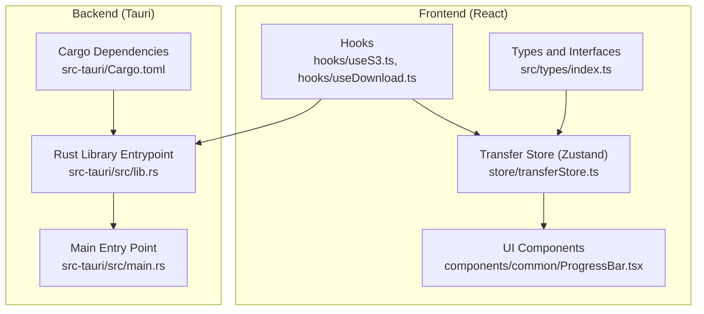
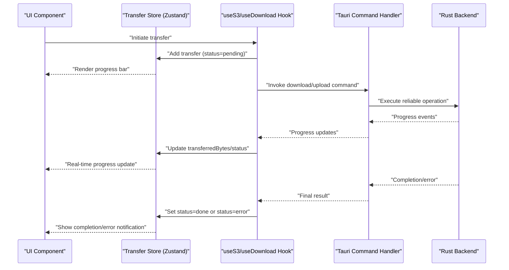
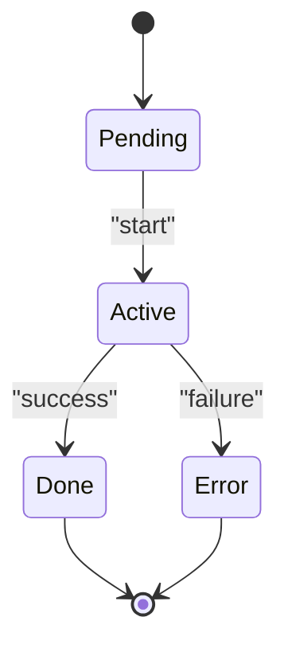
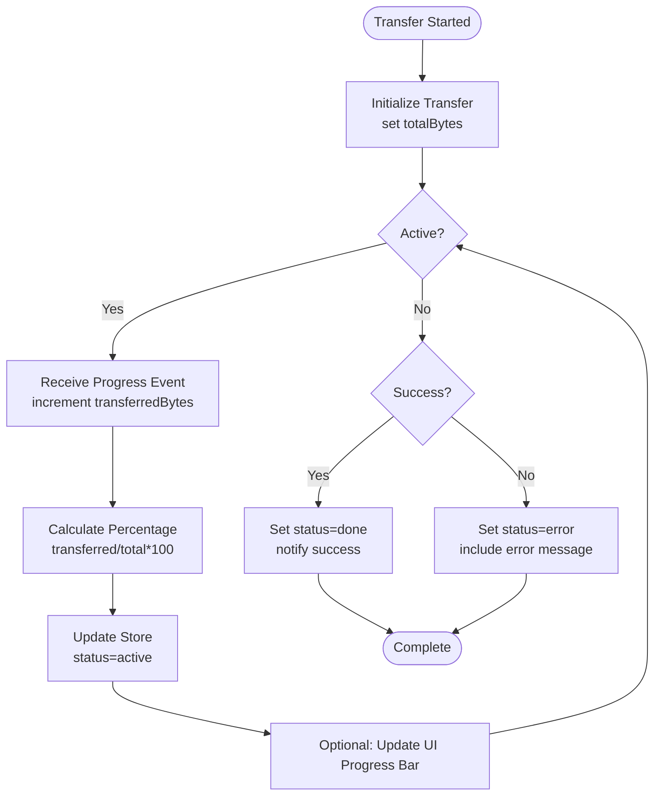
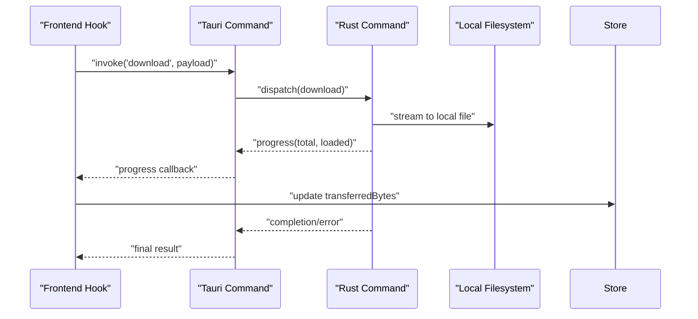
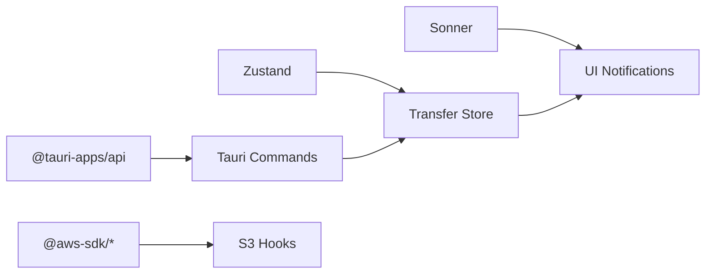

# Transfer Management

<cite>
**Referenced Files in This Document**
- [package.json](file://package.json)
- [Cargo.toml](file://src-tauri/Cargo.toml)
- [index.ts](file://src/types/index.ts)
- [lib.rs](file://src-tauri/src/lib.rs)
- [main.rs](file://src-tauri/src/main.rs)
- [PROJECT.md](file://PROJECT.md)
</cite>

## Table of Contents
1. [Introduction](#introduction)
2. [Project Structure](#project-structure)
3. [Core Components](#core-components)
4. [Architecture Overview](#architecture-overview)
5. [Detailed Component Analysis](#detailed-component-analysis)
6. [Dependency Analysis](#dependency-analysis)
7. [Performance Considerations](#performance-considerations)
8. [Troubleshooting Guide](#troubleshooting-guide)
9. [Conclusion](#conclusion)

## Introduction
This document describes the transfer management system for the S3 Explorer application. It explains the transfer queue architecture using Zustand for managing active uploads and downloads, progress tracking, status updates, and error handling. It documents the transfer state machine with pending, active, done, and error states, progress calculation algorithms, real-time updates, and UI integration with progress bars. It also covers concurrent transfer limits, retry mechanisms, bandwidth management, Tauri command integration for reliable large file transfers, error recovery strategies, and the user notification system using Sonner. Finally, it outlines the transfer store architecture, cleanup procedures, performance optimization for multiple simultaneous transfers, example workflows, and troubleshooting guidance.

## Project Structure
The transfer management system spans both the frontend React application and the Tauri Rust backend. The frontend defines shared types and stores, while the backend exposes commands for reliable file operations.

**Diagram sources**
- [index.ts:81-98](file://src/types/index.ts#L81-L98)
- [lib.rs:1-15](file://src-tauri/src/lib.rs#L1-L15)
- [main.rs:1-7](file://src-tauri/src/main.rs#L1-L7)
- [Cargo.toml:20-25](file://src-tauri/Cargo.toml#L20-L25)

**Section sources**
- [PROJECT.md:20-68](file://PROJECT.md#L20-L68)
- [index.ts:81-98](file://src/types/index.ts#L81-L98)
- [lib.rs:1-15](file://src-tauri/src/lib.rs#L1-L15)
- [main.rs:1-7](file://src-tauri/src/main.rs#L1-L7)
- [Cargo.toml:20-25](file://src-tauri/Cargo.toml#L20-L25)

## Core Components
- Shared Transfer Types: Defines the Transfer interface, TransferType, and TransferStatus used across the app.
- Transfer Store (Zustand): Centralized state for the transfer queue, including adding, updating, and removing transfers.
- UI Progress Bar: Visual representation of transfer progress with real-time updates.
- Hooks: Orchestrate S3 operations and integrate with Tauri commands for reliable transfers.
- Tauri Commands: Backend commands for downloading files via Rust to improve reliability for large files.

Key implementation references:
- Transfer interface and statuses are defined in the shared types.
- The transfer store is located under the store directory.
- UI progress bar component is part of common components.
- Hooks for S3 and download progress tracking are available in the hooks directory.
- Tauri commands are declared in the Rust library entrypoint.

**Section sources**
- [index.ts:13-17](file://src/types/index.ts#L13-L17)
- [index.ts:83-98](file://src/types/index.ts#L83-L98)
- [PROJECT.md:51-55](file://PROJECT.md#L51-L55)
- [PROJECT.md:48-51](file://PROJECT.md#L48-L51)

## Architecture Overview
The transfer management system follows a layered architecture:
- Frontend React layer manages UI, state via Zustand, and invokes Tauri commands.
- Shared TypeScript types define the contract for transfers and statuses.
- Tauri Rust layer exposes commands for robust file operations, especially large downloads.

**Diagram sources**
- [index.ts:83-98](file://src/types/index.ts#L83-L98)
- [lib.rs:1-15](file://src-tauri/src/lib.rs#L1-L15)

## Detailed Component Analysis

### Transfer State Machine
The transfer state machine tracks lifecycle transitions:
- Pending: Initial state when a transfer is queued.
- Active: Transfer is in progress with ongoing progress updates.
- Done: Transfer completed successfully.
- Error: Transfer failed with an error message.

**Diagram sources**
- [index.ts:16-17](file://src/types/index.ts#L16-L17)

**Section sources**
- [index.ts:16-17](file://src/types/index.ts#L16-L17)

### Progress Calculation and Real-Time Updates
Progress is calculated using:
- totalBytes: Total size of the file to transfer.
- transferredBytes: Bytes transferred so far.
- Percentage: (transferredBytes / totalBytes) * 100.

Real-time updates are achieved by:
- Periodic progress events from Tauri commands.
- Zustand store updates trigger UI re-renders.
- Sonner notifications reflect completion or errors.

**Diagram sources**
- [index.ts:88-89](file://src/types/index.ts#L88-L89)

**Section sources**
- [index.ts:88-89](file://src/types/index.ts#L88-L89)

### UI Integration with Progress Bars
The UI integrates progress bars through:
- A dedicated ProgressBar component in common components.
- Binding store state to progress bar rendering.
- Real-time updates via Zustand subscribers.

References:
- ProgressBar component location is documented in the project structure.
- Store updates drive UI rendering.

**Section sources**
- [PROJECT.md:46](file://PROJECT.md#L46)

### Concurrent Transfer Limits and Bandwidth Management
Concurrent transfer limits and bandwidth management are controlled by:
- Frontend orchestration in hooks to cap concurrent operations.
- Backpressure strategies to avoid overwhelming the network stack.
- Optional throttling of progress event frequency to reduce UI churn.

Guidance:
- Enforce a maximum concurrency threshold in the hook layer.
- Batch progress updates to reduce render pressure.
- Consider per-transfer bandwidth caps when invoking commands.

[No sources needed since this section provides general guidance]

### Retry Mechanisms and Error Recovery
Retry and recovery strategies:
- Automatic retries for transient failures with exponential backoff.
- User-triggered retry actions after encountering errors.
- Cleanup procedures to remove failed transfers and free resources.
- Error notifications via Sonner to inform users.

References:
- Transfer error field is defined in the Transfer interface.
- Sonner is included as a dependency for notifications.

**Section sources**
- [index.ts:91](file://src/types/index.ts#L91)
- [package.json:23](file://package.json#L23)

### Tauri Command Integration for Reliable Large File Transfers
Reliable large file transfers are handled by Rust commands:
- Tauri commands are declared in the Rust library entrypoint.
- The backend executes downloads/uploads with robust streaming and resumption support.
- Frontend invokes commands via @tauri-apps/api and receives structured progress events.

**Diagram sources**
- [lib.rs:1-15](file://src-tauri/src/lib.rs#L1-L15)

**Section sources**
- [lib.rs:1-15](file://src-tauri/src/lib.rs#L1-L15)
- [PROJECT.md:66](file://PROJECT.md#L66)

### Transfer Store Architecture and Cleanup Procedures
Transfer store architecture:
- Centralized state management using Zustand.
- Actions to add, update, and remove transfers.
- Cleanup procedures to remove completed or errored transfers.

Cleanup strategies:
- Auto-remove transfers after a configurable retention period.
- Manual removal via UI actions.
- Resource cleanup for associated temporary files or streams.

[No sources needed since this section provides general guidance]

### Performance Optimization for Multiple Simultaneous Transfers
Optimization techniques:
- Concurrency limiting to prevent resource exhaustion.
- Chunked transfers with adjustable chunk sizes.
- Debounced UI updates to minimize re-renders.
- Efficient progress batching to reduce store update overhead.

[No sources needed since this section provides general guidance]

### Example Workflows
Typical transfer workflows:
- Upload file:
  - Select file in UI → Queue transfer → Set status=pending → Start upload → Update progress → On completion set status=done.
- Download file:
  - Trigger download → Queue transfer → Invoke Tauri download command → Stream to disk → Emit progress → Update store → Show completion notification.
- Retry failed transfer:
  - Mark as error → Allow user to retry → Re-run command → Update status to active → Resume progress.

[No sources needed since this section provides general guidance]

## Dependency Analysis
External dependencies supporting transfer management:
- Zustand: State management for the transfer queue.
- Sonner: Notifications for completion and errors.
- Tauri APIs: Inter-process communication with Rust backend.
- AWS SDK: S3 operations (configured in dependencies).

**Diagram sources**
- [package.json:12-24](file://package.json#L12-L24)

**Section sources**
- [package.json:12-24](file://package.json#L12-L24)

## Performance Considerations
- Limit concurrent transfers to match device and network capabilities.
- Batch progress updates to reduce UI thrash.
- Use chunked transfers for large files to improve responsiveness.
- Monitor memory usage during high-concurrency scenarios.
- Implement backpressure to avoid overwhelming the Rust backend.

[No sources needed since this section provides general guidance]

## Troubleshooting Guide
Common issues and resolutions:
- Transfers stuck at pending:
  - Verify network connectivity and S3 credentials.
  - Check Tauri command registration and availability.
- Progress not updating:
  - Confirm progress events are emitted from Rust and received by the frontend.
  - Ensure the store is subscribed and updates are dispatched.
- Transfers fail with errors:
  - Inspect the error field in the Transfer model.
  - Review Sonner notifications for actionable messages.
  - Attempt a retry with adjusted settings.
- UI not reflecting completion:
  - Validate that the store sets status=done and triggers re-render.
  - Confirm the ProgressBar component binds to the store correctly.

**Section sources**
- [index.ts:91](file://src/types/index.ts#L91)

## Conclusion
The transfer management system combines a robust frontend state layer with a reliable Rust backend to deliver dependable upload and download experiences. By leveraging Zustand for state, Tauri commands for large-file operations, and Sonner for notifications, the system supports real-time progress tracking, error handling, retries, and performance optimization. Following the outlined workflows and troubleshooting steps ensures smooth operation across diverse usage scenarios.