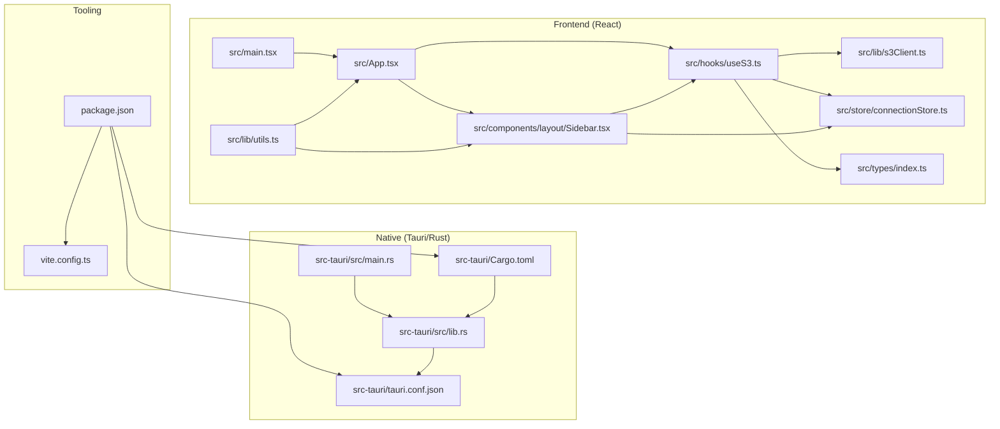
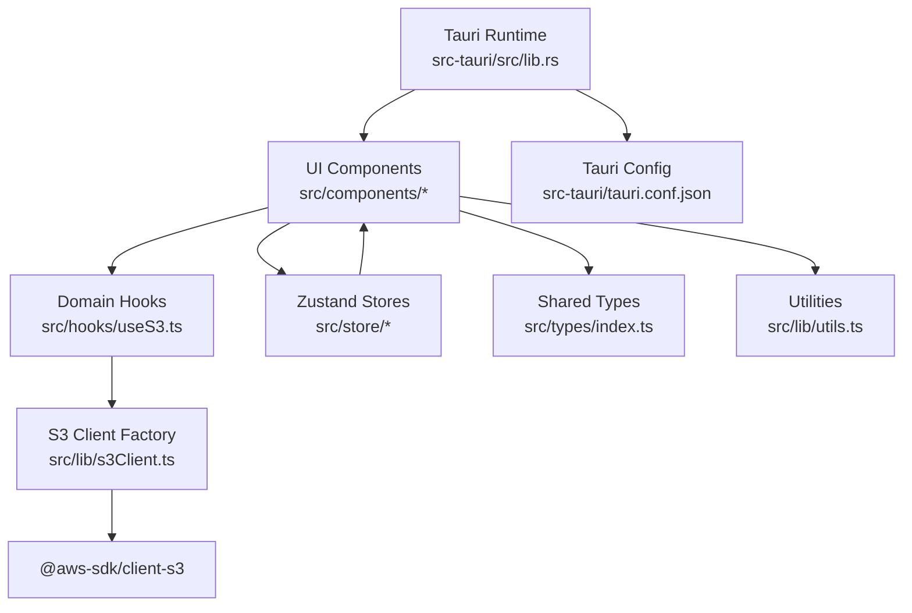
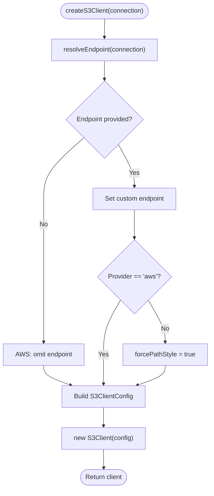
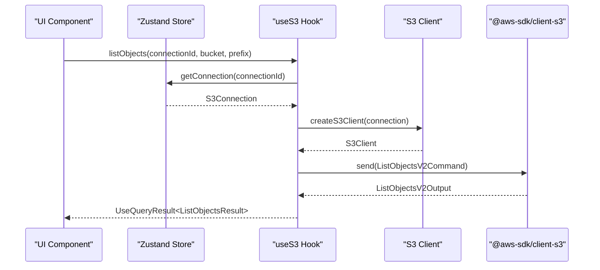
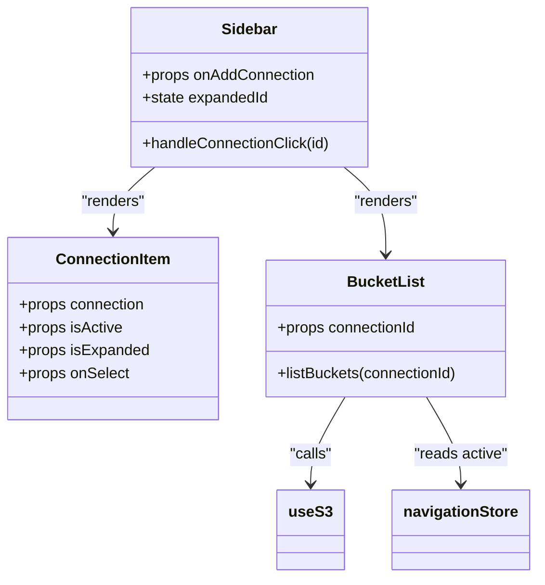
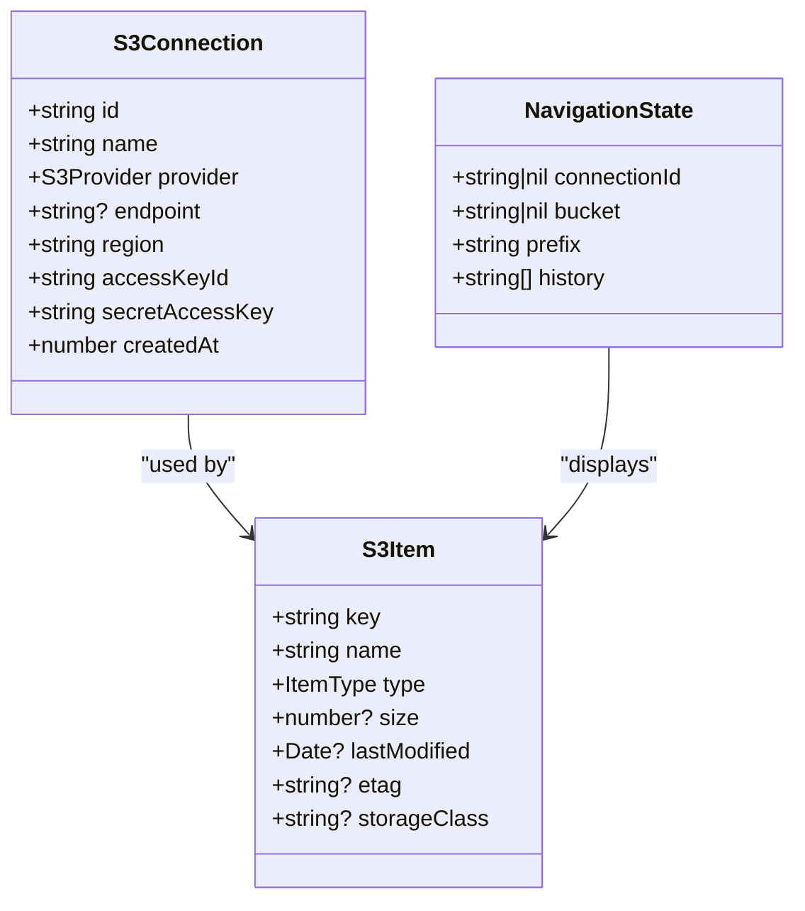
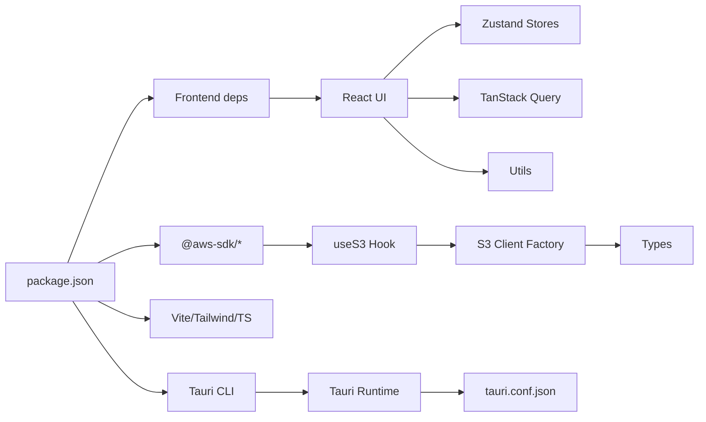

# Development Guide

<cite>
**Referenced Files in This Document**
- [package.json](file://package.json)
- [vite.config.ts](file://vite.config.ts)
- [Cargo.toml](file://src-tauri/Cargo.toml)
- [tauri.conf.json](file://src-tauri/tauri.conf.json)
- [README.md](file://README.md)
- [src/main.tsx](file://src/main.tsx)
- [src/App.tsx](file://src/App.tsx)
- [src/lib/s3Client.ts](file://src/lib/s3Client.ts)
- [src/hooks/useS3.ts](file://src/hooks/useS3.ts)
- [src/store/connectionStore.ts](file://src/store/connectionStore.ts)
- [src/types/index.ts](file://src/types/index.ts)
- [src/components/layout/Sidebar.tsx](file://src/components/layout/Sidebar.tsx)
- [src/lib/utils.ts](file://src/lib/utils.ts)
- [src-tauri/src/main.rs](file://src-tauri/src/main.rs)
- [src-tauri/src/lib.rs](file://src-tauri/src/lib.rs)
</cite>

## Table of Contents
1. [Introduction](#introduction)
2. [Project Structure](#project-structure)
3. [Core Components](#core-components)
4. [Architecture Overview](#architecture-overview)
5. [Detailed Component Analysis](#detailed-component-analysis)
6. [Dependency Analysis](#dependency-analysis)
7. [Development Environment Setup](#development-environment-setup)
8. [Build and Deployment](#build-and-deployment)
9. [Testing Procedures](#testing-procedures)
10. [Debugging Techniques](#debugging-techniques)
11. [Performance Considerations](#performance-considerations)
12. [Contribution Guidelines](#contribution-guidelines)
13. [Extending the Application](#extending-the-application)
14. [Version Management and Releases](#version-management-and-releases)
15. [Maintenance Practices](#maintenance-practices)
16. [Troubleshooting Guide](#troubleshooting-guide)
17. [Conclusion](#conclusion)

## Introduction
This guide provides a comprehensive development workflow for contributors and maintainers of S3 Explorer. It covers environment setup, project structure, coding standards, build/deployment processes, testing, debugging, performance optimization, and extension guidelines for adding new S3 providers, UI components, and features. The application is a Tauri desktop app built with React, TypeScript, Vite, TailwindCSS, and integrates AWS SDK v3 for S3 operations.

## Project Structure
The repository follows a hybrid frontend/backend structure:
- Frontend (React + TypeScript): resides under src/
- Native runtime (Rust/Tauri): resides under src-tauri/

Key areas:
- src/main.tsx initializes the React root and React Query client
- src/App.tsx defines the top-level layout and integrates stores and UI
- src/lib/s3Client.ts builds S3 clients per provider
- src/hooks/useS3.ts encapsulates S3 operations via TanStack Query
- src/store/* manages application state (connections, navigation, transfers)
- src/types/index.ts defines shared domain models and UI types
- src/components/layout/Sidebar.tsx renders the left navigation panel
- src/lib/utils.ts provides UI helpers (formatting, icon mapping)
- src-tauri/Cargo.toml and src-tauri/tauri.conf.json configure the native bundle
- vite.config.ts configures Vite with HMR and Tauri integration

**Diagram sources**
- [src/main.tsx](file://src/main.tsx)
- [src/App.tsx](file://src/App.tsx)
- [src/lib/s3Client.ts](file://src/lib/s3Client.ts)
- [src/hooks/useS3.ts](file://src/hooks/useS3.ts)
- [src/store/connectionStore.ts](file://src/store/connectionStore.ts)
- [src/types/index.ts](file://src/types/index.ts)
- [src/components/layout/Sidebar.tsx](file://src/components/layout/Sidebar.tsx)
- [src/lib/utils.ts](file://src/lib/utils.ts)
- [src-tauri/Cargo.toml](file://src-tauri/Cargo.toml)
- [src-tauri/tauri.conf.json](file://src-tauri/tauri.conf.json)
- [src-tauri/src/main.rs](file://src-tauri/src/main.rs)
- [src-tauri/src/lib.rs](file://src-tauri/src/lib.rs)
- [package.json](file://package.json)
- [vite.config.ts](file://vite.config.ts)

**Section sources**
- [package.json](file://package.json)
- [vite.config.ts](file://vite.config.ts)
- [src-tauri/Cargo.toml](file://src-tauri/Cargo.toml)
- [src-tauri/tauri.conf.json](file://src-tauri/tauri.conf.json)
- [src/main.tsx](file://src/main.tsx)
- [src/App.tsx](file://src/App.tsx)
- [src/lib/s3Client.ts](file://src/lib/s3Client.ts)
- [src/hooks/useS3.ts](file://src/hooks/useS3.ts)
- [src/store/connectionStore.ts](file://src/store/connectionStore.ts)
- [src/types/index.ts](file://src/types/index.ts)
- [src/components/layout/Sidebar.tsx](file://src/components/layout/Sidebar.tsx)
- [src/lib/utils.ts](file://src/lib/utils.ts)
- [src-tauri/src/main.rs](file://src-tauri/src/main.rs)
- [src-tauri/src/lib.rs](file://src-tauri/src/lib.rs)

## Core Components
- State Management: Zustand-backed stores for connections and navigation
- S3 Operations: Centralized hooks for list, upload, download, delete, rename, and metadata retrieval
- UI Layout: App shell with Sidebar and Toolbar; placeholder content area
- Utilities: Formatting helpers and icon mapping for file types
- Native Integration: Tauri commands and plugins for desktop features

Key implementation references:
- [React Query initialization:6-17](file://src/main.tsx#L6-L17)
- [App layout and toolbar integration:11-82](file://src/App.tsx#L11-L82)
- [S3 client factory and endpoint resolution:60-82](file://src/lib/s3Client.ts#L60-L82)
- [useS3 hook exports and operations:62-409](file://src/hooks/useS3.ts#L62-L409)
- [Connection store actions and persistence:30-87](file://src/store/connectionStore.ts#L30-L87)
- [Shared types and enums:7-166](file://src/types/index.ts#L7-L166)
- [Sidebar rendering and bucket loading:17-108](file://src/components/layout/Sidebar.tsx#L17-L108)
- [Utility helpers:13-196](file://src/lib/utils.ts#L13-L196)

**Section sources**
- [src/main.tsx:6-17](file://src/main.tsx#L6-L17)
- [src/App.tsx:11-82](file://src/App.tsx#L11-L82)
- [src/lib/s3Client.ts:60-82](file://src/lib/s3Client.ts#L60-L82)
- [src/hooks/useS3.ts:62-409](file://src/hooks/useS3.ts#L62-L409)
- [src/store/connectionStore.ts:30-87](file://src/store/connectionStore.ts#L30-L87)
- [src/types/index.ts:7-166](file://src/types/index.ts#L7-L166)
- [src/components/layout/Sidebar.tsx:17-108](file://src/components/layout/Sidebar.tsx#L17-L108)
- [src/lib/utils.ts:13-196](file://src/lib/utils.ts#L13-L196)

## Architecture Overview
The app uses a layered architecture:
- UI Layer: React components and stores
- Domain Layer: S3 operations via useS3 hook
- Infrastructure Layer: AWS SDK client creation and configuration
- Native Layer: Tauri runtime and commands

**Diagram sources**
- [src/hooks/useS3.ts:62-409](file://src/hooks/useS3.ts#L62-L409)
- [src/lib/s3Client.ts:60-82](file://src/lib/s3Client.ts#L60-L82)
- [src/store/connectionStore.ts:30-87](file://src/store/connectionStore.ts#L30-L87)
- [src/types/index.ts:7-166](file://src/types/index.ts#L7-L166)
- [src/lib/utils.ts:13-196](file://src/lib/utils.ts#L13-L196)
- [src-tauri/src/lib.rs:8-14](file://src-tauri/src/lib.rs#L8-L14)
- [src-tauri/tauri.conf.json:1-36](file://src-tauri/tauri.conf.json#L1-L36)

## Detailed Component Analysis

### S3 Client Factory
The S3 client factory creates provider-aware clients with endpoint overrides and path-style addressing for non-AWS providers.

**Diagram sources**
- [src/lib/s3Client.ts:60-82](file://src/lib/s3Client.ts#L60-L82)

**Section sources**
- [src/lib/s3Client.ts:60-82](file://src/lib/s3Client.ts#L60-L82)

### useS3 Hook Operations
The hook exposes TanStack Query-powered queries and mutations for S3 operations, including pagination and error handling.

**Diagram sources**
- [src/hooks/useS3.ts:69-144](file://src/hooks/useS3.ts#L69-L144)
- [src/lib/s3Client.ts:60-82](file://src/lib/s3Client.ts#L60-L82)
- [src/store/connectionStore.ts:22-34](file://src/store/connectionStore.ts#L22-L34)

**Section sources**
- [src/hooks/useS3.ts:69-144](file://src/hooks/useS3.ts#L69-L144)
- [src/lib/s3Client.ts:60-82](file://src/lib/s3Client.ts#L60-L82)
- [src/store/connectionStore.ts:22-34](file://src/store/connectionStore.ts#L22-L34)

### Sidebar Component
The Sidebar renders connections and lazy-loads buckets, integrating with the S3 hook and navigation store.

**Diagram sources**
- [src/components/layout/Sidebar.tsx:18-108](file://src/components/layout/Sidebar.tsx#L18-L108)

**Section sources**
- [src/components/layout/Sidebar.tsx:18-108](file://src/components/layout/Sidebar.tsx#L18-L108)

### Data Models
The types module defines providers, item types, navigation state, transfers, and UI-related interfaces.

**Diagram sources**
- [src/types/index.ts:38-72](file://src/types/index.ts#L38-L72)

**Section sources**
- [src/types/index.ts:38-72](file://src/types/index.ts#L38-L72)

## Dependency Analysis
External dependencies and their roles:
- Frontend: React, React DOM, TanStack React Query, Zustand, Radix UI, Sonner, Lucide React
- AWS SDK: client-s3 and s3-request-presigner
- Tooling: Vite, TailwindCSS, TypeScript, Tauri CLI

Internal dependencies:
- UI components depend on stores and hooks
- Hooks depend on the S3 client factory and types
- Native layer depends on Tauri runtime and plugins

**Diagram sources**
- [package.json:12-35](file://package.json#L12-L35)
- [src/hooks/useS3.ts:1-15](file://src/hooks/useS3.ts#L1-L15)
- [src/lib/s3Client.ts:1-2](file://src/lib/s3Client.ts#L1-L2)
- [src-tauri/tauri.conf.json:1-36](file://src-tauri/tauri.conf.json#L1-L36)

**Section sources**
- [package.json:12-35](file://package.json#L12-L35)
- [src/hooks/useS3.ts:1-15](file://src/hooks/useS3.ts#L1-L15)
- [src/lib/s3Client.ts:1-2](file://src/lib/s3Client.ts#L1-L2)
- [src-tauri/tauri.conf.json:1-36](file://src-tauri/tauri.conf.json#L1-L36)

## Development Environment Setup
Prerequisites:
- Node.js and pnpm (as indicated by lock file and scripts)
- Rust toolchain (required by Tauri)
- Platform-specific prerequisites (Windows/macOS/Linux) as per Tauri docs

Recommended IDE extensions:
- VS Code with Tauri and rust-analyzer extensions

Environment variables:
- Optional TAURI_DEV_HOST for remote HMR host support

Scripts:
- dev: runs Vite dev server
- build: compiles TypeScript then builds frontend
- preview: serves built assets locally
- tauri: invokes Tauri CLI

Vite configuration highlights:
- Fixed port 1420 with strictPort
- HMR configuration supports remote host via TAURI_DEV_HOST
- Ignores src-tauri during watch

Tauri configuration highlights:
- Dev URL points to Vite dev server
- Bundling targets all platforms with specified icons

**Section sources**
- [README.md:5-8](file://README.md#L5-L8)
- [package.json:6-11](file://package.json#L6-L11)
- [vite.config.ts:9-33](file://vite.config.ts#L9-L33)
- [src-tauri/tauri.conf.json:6-11](file://src-tauri/tauri.conf.json#L6-L11)

## Build and Deployment
Development build:
- Run frontend dev server via Vite
- Tauri launches the dev URL and proxies frontend assets

Production build:
- Frontend: TypeScript compilation followed by Vite build
- Native: Tauri bundler packages the app with configured icons and targets

Bundle configuration:
- Targets all platforms
- Icons included for multiple formats

**Section sources**
- [package.json:6-11](file://package.json#L6-L11)
- [src-tauri/tauri.conf.json:24-34](file://src-tauri/tauri.conf.json#L24-L34)

## Testing Procedures
Current state:
- No dedicated test files are present in the repository snapshot

Recommended approach:
- Unit tests for hooks and utilities using React Testing Library and Vitest
- Mock AWS SDK for S3 operations
- Snapshot tests for UI components
- Integration tests for navigation and store interactions

Testing references:
- [src/hooks/useS3.ts:62-409](file://src/hooks/useS3.ts#L62-L409)
- [src/lib/utils.ts:13-196](file://src/lib/utils.ts#L13-L196)

**Section sources**
- [src/hooks/useS3.ts:62-409](file://src/hooks/useS3.ts#L62-L409)
- [src/lib/utils.ts:13-196](file://src/lib/utils.ts#L13-L196)

## Debugging Techniques
Common debugging strategies:
- React DevTools for component inspection
- React Query Devtools for query state and caching behavior
- Browser network tab for S3 API calls
- Console logging in hooks and components
- Tauri devtools and logs for native integration

Relevant code locations:
- QueryClient defaults in main.tsx
- S3 operations in useS3 hook
- UI feedback via Sonner toasts

**Section sources**
- [src/main.tsx:6-17](file://src/main.tsx#L6-L17)
- [src/hooks/useS3.ts:152-188](file://src/hooks/useS3.ts#L152-L188)
- [src/App.tsx:115-121](file://src/App.tsx#L115-L121)

## Performance Considerations
Optimization strategies:
- Use TanStack Query’s staleTime to avoid unnecessary refetches
- Enable retry with bounded attempts for transient failures
- Disable window focus refetch for desktop apps
- Use virtualization for large lists (react-virtual is available)
- Prefer presigned URLs for large downloads
- Lazy-load bucket lists and only enable queries when identifiers are present

References:
- [QueryClient defaults:6-17](file://src/main.tsx#L6-L17)
- [listObjects query enabled condition:96-98](file://src/hooks/useS3.ts#L96-L98)
- [downloadFile presigned URL generation:164-168](file://src/hooks/useS3.ts#L164-L168)

**Section sources**
- [src/main.tsx:6-17](file://src/main.tsx#L6-L17)
- [src/hooks/useS3.ts:96-98](file://src/hooks/useS3.ts#L96-L98)
- [src/hooks/useS3.ts:164-168](file://src/hooks/useS3.ts#L164-L168)

## Contribution Guidelines
Coding standards:
- TypeScript strict mode enforced by project configuration
- Consistent naming for hooks (useX), stores (useXStore), and components (PascalCase)
- Centralized S3 operations in useS3 hook
- Shared types in types/index.ts

Branching and PR workflow:
- Feature branches per task
- Clear commit messages and PR descriptions
- Review and approval before merging

Documentation:
- Update README if major setup changes occur
- Add inline comments for complex logic

**Section sources**
- [src/types/index.ts:1-10](file://src/types/index.ts#L1-L10)
- [src/hooks/useS3.ts:62-61](file://src/hooks/useS3.ts#L62-L61)

## Extending the Application

### Adding a New S3 Provider
Steps:
- Extend provider union in types
- Add a new case in resolveEndpoint with endpoint logic and validation
- Ensure forcePathStyle for non-AWS providers when needed
- Test with real endpoints

References:
- [S3Provider union:7-8](file://src/types/index.ts#L7-L8)
- [resolveEndpoint switch:12-48](file://src/lib/s3Client.ts#L12-L48)
- [forcePathStyle usage:74-78](file://src/lib/s3Client.ts#L74-L78)

**Section sources**
- [src/types/index.ts:7-8](file://src/types/index.ts#L7-L8)
- [src/lib/s3Client.ts:12-48](file://src/lib/s3Client.ts#L12-L48)
- [src/lib/s3Client.ts:74-78](file://src/lib/s3Client.ts#L74-L78)

### Extending UI Components
Guidelines:
- Place new components under src/components
- Use consistent props and event handlers
- Integrate with existing stores and hooks
- Respect Tailwind utility classes and theme tokens

Example references:
- [Sidebar component structure:117-183](file://src/components/layout/Sidebar.tsx#L117-L183)
- [App layout composition:49-81](file://src/App.tsx#L49-L81)

**Section sources**
- [src/components/layout/Sidebar.tsx:117-183](file://src/components/layout/Sidebar.tsx#L117-L183)
- [src/App.tsx:49-81](file://src/App.tsx#L49-L81)

### Implementing New Features
Recommendations:
- Define types in types/index.ts
- Implement operations in useS3 hook
- Wire UI via stores and components
- Add utilities in lib/utils.ts if reusable

References:
- [Types module:38-166](file://src/types/index.ts#L38-L166)
- [useS3 hook:62-409](file://src/hooks/useS3.ts#L62-L409)
- [utils helpers:13-196](file://src/lib/utils.ts#L13-L196)

**Section sources**
- [src/types/index.ts:38-166](file://src/types/index.ts#L38-L166)
- [src/hooks/useS3.ts:62-409](file://src/hooks/useS3.ts#L62-L409)
- [src/lib/utils.ts:13-196](file://src/lib/utils.ts#L13-L196)

## Version Management and Releases
Version fields:
- Frontend and Tauri share version 0.1.0

Release procedure:
- Update version in package.json and src-tauri/Cargo.toml
- Tag git commits appropriately
- Build production bundles and publish artifacts

References:
- [package.json version](file://package.json#L4)
- [Cargo.toml version](file://src-tauri/Cargo.toml#L3)
- [tauri.conf.json version](file://src-tauri/tauri.conf.json#L4)

**Section sources**
- [package.json](file://package.json#L4)
- [src-tauri/Cargo.toml](file://src-tauri/Cargo.toml#L3)
- [src-tauri/tauri.conf.json](file://src-tauri/tauri.conf.json#L4)

## Maintenance Practices
- Keep dependencies updated (check package.json and Cargo.toml)
- Monitor AWS SDK updates and compatibility
- Review Tauri CLI and plugin versions regularly
- Audit security policies and CSP settings
- Validate bundling targets and icons

References:
- [package.json dependencies:12-25](file://package.json#L12-L25)
- [src-tauri/Cargo.toml dependencies:20-25](file://src-tauri/Cargo.toml#L20-L25)
- [tauri.conf.json security:20-22](file://src-tauri/tauri.conf.json#L20-L22)

**Section sources**
- [package.json:12-25](file://package.json#L12-L25)
- [src-tauri/Cargo.toml:20-25](file://src-tauri/Cargo.toml#L20-L25)
- [src-tauri/tauri.conf.json:20-22](file://src-tauri/tauri.conf.json#L20-L22)

## Troubleshooting Guide
Common issues and resolutions:
- Vite HMR not working remotely: ensure TAURI_DEV_HOST is set and matches host configuration
- Port conflicts: Vite enforces strictPort 1420; change or free the port
- S3 endpoint errors: verify provider-specific endpoint requirements and region for non-AWS
- Bucket listing fails: confirm credentials and permissions; check query enabled conditions
- Native bundling issues: validate tauri.conf.json build and bundle settings

References:
- [Vite server config:17-32](file://vite.config.ts#L17-L32)
- [resolveEndpoint validations:21-47](file://src/lib/s3Client.ts#L21-L47)
- [listBuckets enabled:69-85](file://src/hooks/useS3.ts#L69-L85)

**Section sources**
- [vite.config.ts:17-32](file://vite.config.ts#L17-L32)
- [src/lib/s3Client.ts:21-47](file://src/lib/s3Client.ts#L21-L47)
- [src/hooks/useS3.ts:69-85](file://src/hooks/useS3.ts#L69-L85)

## Conclusion
This guide outlines the development workflow, architecture, and extension practices for S3 Explorer. By following the setup, build, testing, and contribution guidelines, contributors can efficiently add new S3 providers, enhance UI components, and implement robust features while maintaining performance and reliability.