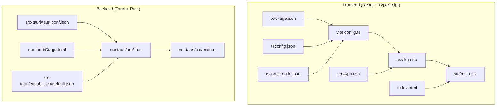
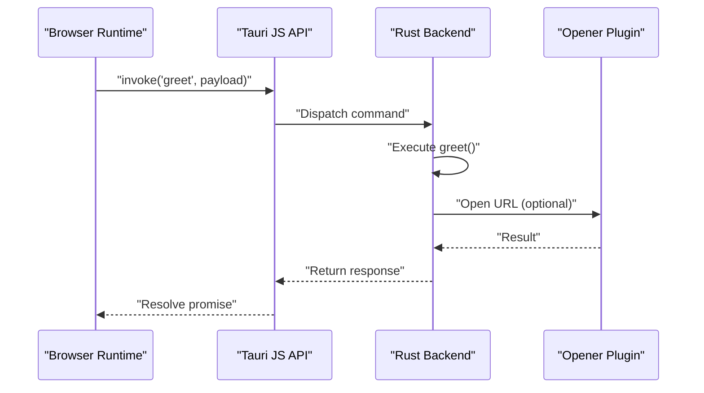

# Development Guide

<cite>
**Referenced Files in This Document**
- [package.json](file://package.json)
- [vite.config.ts](file://vite.config.ts)
- [tsconfig.json](file://tsconfig.json)
- [tsconfig.node.json](file://tsconfig.node.json)
- [src-tauri/Cargo.toml](file://src-tauri/Cargo.toml)
- [src-tauri/tauri.conf.json](file://src-tauri/tauri.conf.json)
- [src-tauri/src/lib.rs](file://src-tauri/src/lib.rs)
- [src-tauri/src/main.rs](file://src-tauri/src/main.rs)
- [src-tauri/capabilities/default.json](file://src-tauri/capabilities/default.json)
- [src/App.tsx](file://src/App.tsx)
- [src/main.tsx](file://src/main.tsx)
- [src/App.css](file://src/App.css)
- [index.html](file://index.html)
- [README.md](file://README.md)
- [PROJECT.md](file://PROJECT.md)
</cite>

## Table of Contents
1. [Introduction](#introduction)
2. [Project Structure](#project-structure)
3. [Core Components](#core-components)
4. [Architecture Overview](#architecture-overview)
5. [Development Environment Setup](#development-environment-setup)
6. [Build Process](#build-process)
7. [Contribution Workflow](#contribution-workflow)
8. [Code Standards](#code-standards)
9. [Testing Procedures](#testing-procedures)
10. [Release Process](#release-process)
11. [Extending Functionality](#extending-functionality)
12. [Adding New S3 Providers](#adding-new-s3-providers)
13. [Backward Compatibility Guidelines](#backward-compatibility-guidelines)
14. [Troubleshooting Guide](#troubleshooting-guide)
15. [Performance Considerations](#performance-considerations)
16. [Conclusion](#conclusion)

## Introduction
This development guide provides comprehensive instructions for contributors and maintainers working on S3 Explorer. It covers environment setup, development workflows, build processes, contribution standards, testing, releases, extension strategies, and troubleshooting. The project is a Tauri v2 desktop application with a React + TypeScript frontend and a Rust backend, designed to manage S3-compatible object storage systems.

## Project Structure
The repository follows a hybrid frontend/backend structure:
- Frontend: React + TypeScript with Vite for development and bundling
- Backend: Tauri v2 (Rust) for native capabilities and system integration
- Shared configuration: TypeScript compiler options, Vite configuration, and Tauri app configuration

**Diagram sources**
- [src/main.tsx:1-10](file://src/main.tsx#L1-L10)
- [src/App.tsx:1-56](file://src/App.tsx#L1-L56)
- [src/App.css:1-118](file://src/App.css#L1-L118)
- [index.html:1-15](file://index.html#L1-L15)
- [tsconfig.json:1-26](file://tsconfig.json#L1-L26)
- [tsconfig.node.json:1-11](file://tsconfig.node.json#L1-L11)
- [vite.config.ts:1-34](file://vite.config.ts#L1-L34)
- [package.json:1-37](file://package.json#L1-L37)
- [src-tauri/tauri.conf.json:1-36](file://src-tauri/tauri.conf.json#L1-L36)
- [src-tauri/Cargo.toml:1-26](file://src-tauri/Cargo.toml#L1-L26)
- [src-tauri/src/lib.rs:1-15](file://src-tauri/src/lib.rs#L1-L15)
- [src-tauri/src/main.rs:1-7](file://src-tauri/src/main.rs#L1-L7)
- [src-tauri/capabilities/default.json:1-11](file://src-tauri/capabilities/default.json#L1-L11)

**Section sources**
- [PROJECT.md:20-68](file://PROJECT.md#L20-L68)
- [package.json:1-37](file://package.json#L1-L37)
- [vite.config.ts:1-34](file://vite.config.ts#L1-L34)
- [tsconfig.json:1-26](file://tsconfig.json#L1-L26)
- [tsconfig.node.json:1-11](file://tsconfig.node.json#L1-L11)
- [src-tauri/Cargo.toml:1-26](file://src-tauri/Cargo.toml#L1-L26)
- [src-tauri/tauri.conf.json:1-36](file://src-tauri/tauri.conf.json#L1-L36)
- [src-tauri/src/lib.rs:1-15](file://src-tauri/src/lib.rs#L1-L15)
- [src-tauri/src/main.rs:1-7](file://src-tauri/src/main.rs#L1-L7)
- [src-tauri/capabilities/default.json:1-11](file://src-tauri/capabilities/default.json#L1-L11)
- [src/App.tsx:1-56](file://src/App.tsx#L1-L56)
- [src/main.tsx:1-10](file://src/main.tsx#L1-L10)
- [src/App.css:1-118](file://src/App.css#L1-L118)
- [index.html:1-15](file://index.html#L1-L15)

## Core Components
- Frontend entry point initializes React and mounts the root component.
- The main App component demonstrates Tauri command invocation via the invoke API.
- Tauri backend exposes a greet command and integrates with the opener plugin.
- Capabilities define permissions for the main window, including core and opener defaults.

Key implementation references:
- Frontend initialization and root mounting
  - [src/main.tsx:1-10](file://src/main.tsx#L1-L10)
  - [index.html:10-12](file://index.html#L10-L12)
- App component with Tauri invoke usage
  - [src/App.tsx:10-12](file://src/App.tsx#L10-L12)
- Tauri command definition and application runner
  - [src-tauri/src/lib.rs:2-5](file://src-tauri/src/lib.rs#L2-L5)
  - [src-tauri/src/lib.rs:8-14](file://src-tauri/src/lib.rs#L8-L14)
- Capability permissions
  - [src-tauri/capabilities/default.json:6-9](file://src-tauri/capabilities/default.json#L6-L9)

**Section sources**
- [src/main.tsx:1-10](file://src/main.tsx#L1-L10)
- [index.html:10-12](file://index.html#L10-L12)
- [src/App.tsx:10-12](file://src/App.tsx#L10-L12)
- [src-tauri/src/lib.rs:1-15](file://src-tauri/src/lib.rs#L1-L15)
- [src-tauri/capabilities/default.json:1-11](file://src-tauri/capabilities/default.json#L1-L11)

## Architecture Overview
The application uses a classic Tauri architecture pattern:
- Frontend runs in a web engine controlled by Tauri
- Tauri bridges JavaScript and Rust via a command handler
- Plugins enable additional native capabilities (e.g., opening URLs)

**Diagram sources**
- [src/App.tsx:10-12](file://src/App.tsx#L10-L12)
- [src-tauri/src/lib.rs:2-5](file://src-tauri/src/lib.rs#L2-L5)
- [src-tauri/src/lib.rs:10-11](file://src-tauri/src/lib.rs#L10-L11)

**Section sources**
- [src/App.tsx:10-12](file://src/App.tsx#L10-L12)
- [src-tauri/src/lib.rs:1-15](file://src-tauri/src/lib.rs#L1-L15)

## Development Environment Setup
Required tools and prerequisites:
- Node.js LTS (as referenced in project documentation)
- Rust stable (as referenced in project documentation)
- pnpm (as referenced in project documentation)
- IDE extensions recommended by the project documentation

IDE configuration recommendations:
- VS Code with Tauri and rust-analyzer extensions (as recommended by the project documentation)

Environment variables:
- TAURI_DEV_HOST enables remote HMR when set during development

**Section sources**
- [README.md:5-8](file://README.md#L5-L8)
- [PROJECT.md:194-198](file://PROJECT.md#L194-L198)
- [vite.config.ts:5-6](file://vite.config.ts#L5-L6)

## Build Process
Development and production build scripts:
- Development: Vite dev server with hot module replacement
- Production: TypeScript compile followed by Vite build
- Preview: Local static preview of built assets

Cross-platform bundling:
- Tauri bundle targets all platforms configured in the Tauri configuration

Build pipeline references:
- Scripts and dependencies
  - [package.json:6-11](file://package.json#L6-L11)
  - [package.json:26-35](file://package.json#L26-L35)
- Vite configuration for Tauri development
  - [vite.config.ts:9-33](file://vite.config.ts#L9-L33)
- Tauri build configuration and frontend distribution
  - [src-tauri/tauri.conf.json:6-11](file://src-tauri/tauri.conf.json#L6-L11)
- Cargo crate configuration for Rust backend
  - [src-tauri/Cargo.toml:10-15](file://src-tauri/Cargo.toml#L10-L15)

Hot reload and development server:
- Fixed port 1420 for Vite
- Optional HMR configuration when TAURI_DEV_HOST is set
- Ignored watch patterns for Rust sources

**Section sources**
- [package.json:6-11](file://package.json#L6-L11)
- [vite.config.ts:17-32](file://vite.config.ts#L17-L32)
- [src-tauri/tauri.conf.json:6-11](file://src-tauri/tauri.conf.json#L6-L11)
- [src-tauri/Cargo.toml:10-15](file://src-tauri/Cargo.toml#L10-L15)

## Contribution Workflow
Recommended workflow aligned with project documentation:
- Fork and branch from the main branch
- Follow code conventions (functional components, strict TypeScript, PascalCase for components)
- Run installation and development commands as documented
- Submit pull requests with clear descriptions

Reference:
- [PROJECT.md:187-192](file://PROJECT.md#L187-L192)

**Section sources**
- [PROJECT.md:187-192](file://PROJECT.md#L187-L192)

## Code Standards
Coding conventions and linting:
- Functional React components with hooks
- Strict TypeScript mode enabled
- Naming conventions: PascalCase for components, camelCase for hooks/utilities
- Error handling with try/catch and user-visible notifications
- Loading states with spinners/skeletons
- Avoid using the any type

Compiler options:
- ES2020 target with DOM libraries
- Bundler module resolution
- Strict mode with unused variable and parameter checks

References:
- Conventions and guidelines
  - [PROJECT.md:178-186](file://PROJECT.md#L178-L186)
- TypeScript configuration
  - [tsconfig.json:2-22](file://tsconfig.json#L2-L22)
  - [tsconfig.node.json:2-8](file://tsconfig.node.json#L2-L8)

**Section sources**
- [PROJECT.md:178-186](file://PROJECT.md#L178-L186)
- [tsconfig.json:1-26](file://tsconfig.json#L1-L26)
- [tsconfig.node.json:1-11](file://tsconfig.node.json#L1-L11)

## Testing Procedures
Testing strategy:
- Unit tests for TypeScript utilities and hooks
- Integration tests for Tauri commands and S3 operations
- Manual verification of UI interactions and context menus
- Cross-platform validation on Windows, macOS, and Linux

Note: Specific test files are not present in the current repository snapshot. Implement tests alongside new features and ensure coverage for critical paths.

[No sources needed since this section provides general guidance]

## Release Process
Release steps:
- Ensure all changes are merged to the main branch
- Verify builds for all target platforms
- Tag releases and publish installers via Tauri bundler

Bundle configuration:
- Targets all platforms
- Includes multiple icon sizes and formats

References:
- Bundle configuration
  - [src-tauri/tauri.conf.json:24-34](file://src-tauri/tauri.conf.json#L24-L34)
- Build scripts
  - [package.json:6-11](file://package.json#L6-L11)

**Section sources**
- [src-tauri/tauri.conf.json:24-34](file://src-tauri/tauri.conf.json#L24-L34)
- [package.json:6-11](file://package.json#L6-L11)

## Extending Functionality
Extension points:
- Add new Tauri commands in the Rust backend
- Extend React components in the frontend
- Integrate additional plugins via Tauri capabilities

Command registration:
- Define commands in the Rust library and register handlers

References:
- Command definition and handler registration
  - [src-tauri/src/lib.rs:2-5](file://src-tauri/src/lib.rs#L2-L5)
  - [src-tauri/src/lib.rs:11-12](file://src-tauri/src/lib.rs#L11-L12)

**Section sources**
- [src-tauri/src/lib.rs:1-15](file://src-tauri/src/lib.rs#L1-L15)

## Adding New S3 Providers
Provider support:
- Define provider types and endpoints in shared TypeScript types
- Configure S3 client initialization per provider
- Implement provider-specific authentication and endpoint handling

References:
- Provider types and S3 operations
  - [PROJECT.md:76-168](file://PROJECT.md#L76-L168)

**Section sources**
- [PROJECT.md:76-168](file://PROJECT.md#L76-L168)

## Backward Compatibility Guidelines
Guidelines:
- Maintain stable APIs for Tauri commands
- Version dependencies carefully and document breaking changes
- Keep configuration files compatible across Tauri versions

References:
- Tauri configuration and capability schema
  - [src-tauri/tauri.conf.json:1-36](file://src-tauri/tauri.conf.json#L1-L36)
  - [src-tauri/capabilities/default.json:1-11](file://src-tauri/capabilities/default.json#L1-L11)

**Section sources**
- [src-tauri/tauri.conf.json:1-36](file://src-tauri/tauri.conf.json#L1-L36)
- [src-tauri/capabilities/default.json:1-11](file://src-tauri/capabilities/default.json#L1-L11)

## Troubleshooting Guide
Common development issues and resolutions:
- Port conflicts during development
  - Vite uses a fixed port; ensure port 1420 is available or adjust configuration
  - References:
    - [vite.config.ts:17-19](file://vite.config.ts#L17-L19)
- Hot module replacement not working
  - Set TAURI_DEV_HOST to enable remote HMR
  - References:
    - [vite.config.ts:5-6](file://vite.config.ts#L5-L6)
- Tauri dev/build URL mismatch
  - Confirm dev URL matches Vite configuration
  - References:
    - [src-tauri/tauri.conf.json:7-9](file://src-tauri/tauri.conf.json#L7-L9)
- Rust compilation errors
  - Clear screen is disabled to show Rust errors clearly
  - References:
    - [vite.config.ts:14-15](file://vite.config.ts#L14-L15)
- Missing dependencies
  - Install with pnpm as per project documentation
  - References:
    - [PROJECT.md](file://PROJECT.md#L189)

**Section sources**
- [vite.config.ts:5-6](file://vite.config.ts#L5-L6)
- [vite.config.ts:14-19](file://vite.config.ts#L14-L19)
- [src-tauri/tauri.conf.json:7-9](file://src-tauri/tauri.conf.json#L7-L9)
- [PROJECT.md](file://PROJECT.md#L189)

## Performance Considerations
Optimization techniques:
- Use virtualized lists for large datasets
- Implement efficient S3 operations with pagination and delimiter-based folder traversal
- Leverage caching and background synchronization
- Minimize unnecessary re-renders with proper state management

References:
- UI virtualization and async data handling
  - [PROJECT.md:17-18](file://PROJECT.md#L17-L18)
- S3 operations and rate limiting
  - [PROJECT.md:143-205](file://PROJECT.md#L143-L205)

**Section sources**
- [PROJECT.md:17-18](file://PROJECT.md#L17-L18)
- [PROJECT.md:143-205](file://PROJECT.md#L143-L205)

## Conclusion
This guide consolidates essential development practices for S3 Explorer, covering environment setup, build processes, contribution workflows, code standards, testing, releases, extensibility, and troubleshooting. By following these guidelines and leveraging the provided references, contributors can efficiently develop and maintain the application across platforms.