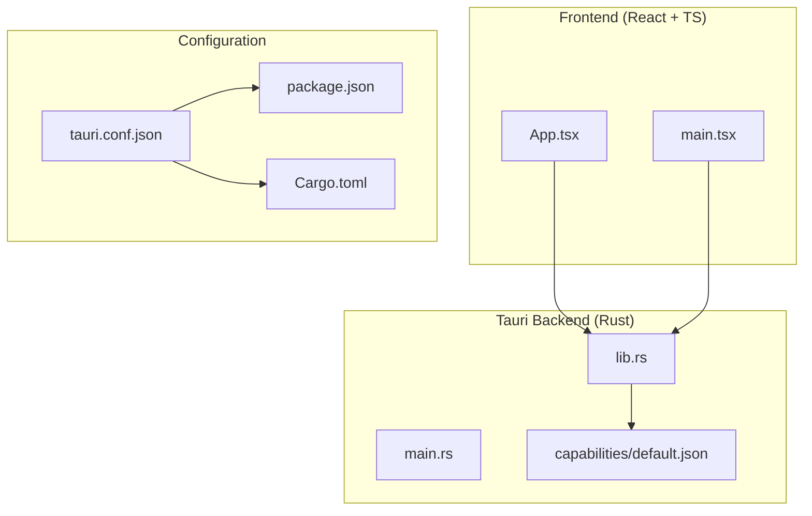
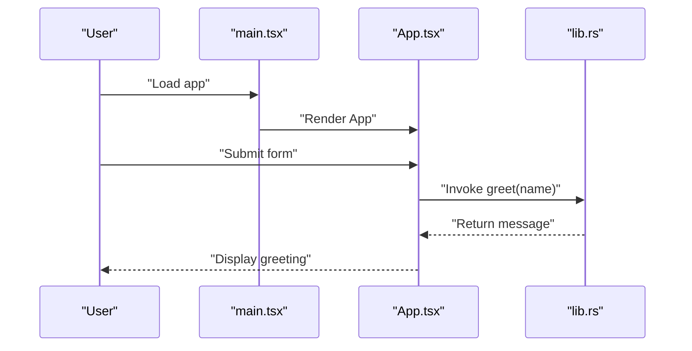
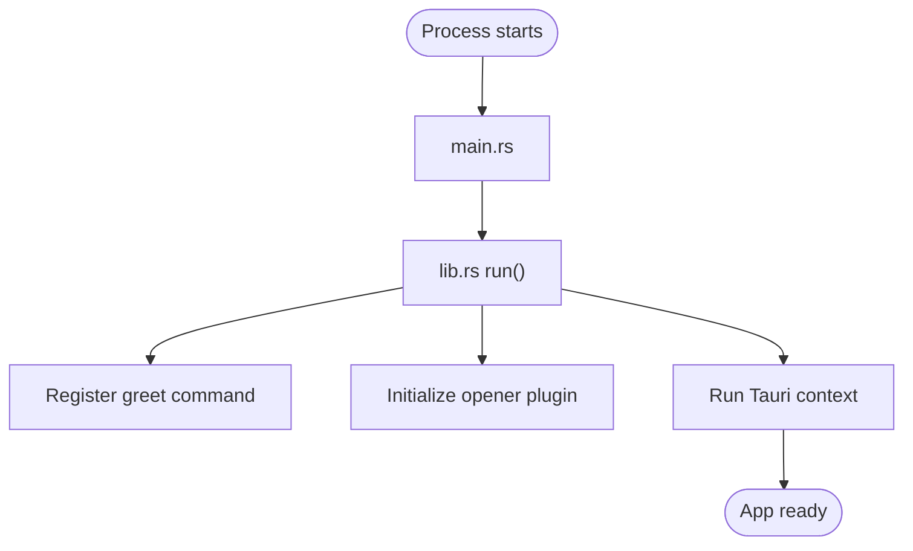

# Getting Started

<cite>
**Referenced Files in This Document**
- [README.md](file://README.md)
- [PROJECT.md](file://PROJECT.md)
- [package.json](file://package.json)
- [pnpm-workspace.yaml](file://pnpm-workspace.yaml)
- [src-tauri/tauri.conf.json](file://src-tauri/tauri.conf.json)
- [src-tauri/Cargo.toml](file://src-tauri/Cargo.toml)
- [src-tauri/src/lib.rs](file://src-tauri/src/lib.rs)
- [src-tauri/src/main.rs](file://src-tauri/src/main.rs)
- [src/App.tsx](file://src/App.tsx)
- [src/main.tsx](file://src/main.tsx)
- [src-tauri/capabilities/default.json](file://src-tauri/capabilities/default.json)
</cite>

## Table of Contents
1. [Introduction](#introduction)
2. [Prerequisites](#prerequisites)
3. [Installation](#installation)
4. [Initial Setup](#initial-setup)
5. [First-Time User Workflow](#first-time-user-workflow)
6. [Architecture Overview](#architecture-overview)
7. [Detailed Component Analysis](#detailed-component-analysis)
8. [Dependency Analysis](#dependency-analysis)
9. [Troubleshooting Guide](#troubleshooting-guide)
10. [Conclusion](#conclusion)

## Introduction
This guide helps you install, configure, and use S3 Explorer, a desktop application for managing S3-compatible object storage. It supports AWS S3, MinIO, Cloudflare R2, Backblaze B2, and other compatible providers. You will set up the development environment, connect to S3 providers, and navigate your buckets and folders.

## Prerequisites
Before installing S3 Explorer, ensure your system meets the following requirements:

- Operating systems
  - Windows (primary), macOS, Linux
- Node.js
  - Use Node.js LTS as recommended by the project
- Rust
  - Install Rust stable toolchain
- Package manager
  - pnpm (project uses pnpm workspaces)
- Optional IDE extensions
  - VS Code with Tauri and rust-analyzer extensions (recommended)

Notes:
- The project uses Tauri v2 with a Rust backend and React + TypeScript frontend.
- The AWS SDK for JavaScript requires Node.js version 20 or newer.

**Section sources**
- [PROJECT.md:194-199](file://PROJECT.md#L194-L199)
- [README.md:5-8](file://README.md#L5-L8)
- [package.json:12-25](file://package.json#L12-L25)

## Installation
Follow these steps to clone the repository, install dependencies, and build the application:

1. Clone the repository
   - Use your preferred Git client to clone the repository to your local machine.
2. Install dependencies
   - Open a terminal in the project root and run:
     - pnpm install
3. Build the application
   - To build the frontend and bundle the app for distribution:
     - pnpm tauri build
   - To run in development mode with hot reload:
     - pnpm tauri dev

Notes:
- The project uses pnpm workspaces. The workspace configuration allows builds with esbuild.
- The Tauri configuration defines the development server URL and pre-dev/build commands.

**Section sources**
- [PROJECT.md:187-192](file://PROJECT.md#L187-L192)
- [pnpm-workspace.yaml:1-3](file://pnpm-workspace.yaml#L1-L3)
- [src-tauri/tauri.conf.json:6-11](file://src-tauri/tauri.conf.json#L6-L11)

## Initial Setup
After installation, configure S3 connections and credentials:

1. Launch the app
   - Run the development server:
     - pnpm tauri dev
   - The app opens at the configured dev URL.
2. Add an S3 connection
   - Use the Add Connection modal to define:
     - Provider: aws, minio, r2, b2, or custom
     - Endpoint: required for non-AWS providers (e.g., MinIO, R2)
     - Region
     - Access key ID and Secret access key
   - Save the connection; credentials are stored securely per project guidance.
3. Connect to a provider
   - Select the saved connection to list buckets.
   - Choose a bucket to browse its contents.
4. Configure permissions
   - The default capability grants core permissions and opener plugin access to the main window.

Notes:
- Supported providers include AWS S3, MinIO, Cloudflare R2, Backblaze B2, and custom endpoints.
- For large downloads, the backend uses Rust commands for reliability.

**Section sources**
- [PROJECT.md:70-82](file://PROJECT.md#L70-L82)
- [PROJECT.md:115-134](file://PROJECT.md#L115-L134)
- [PROJECT.md:200-205](file://PROJECT.md#L200-L205)
- [src-tauri/capabilities/default.json:1-10](file://src-tauri/capabilities/default.json#L1-L10)

## First-Time User Workflow
Complete these steps to browse S3 buckets after setup:

1. Start the app
   - pnpm tauri dev
2. Add a new connection
   - Open the Add Connection modal and enter provider details.
3. List buckets
   - After saving, select the connection to list buckets.
4. Navigate folders
   - Click a folder to enter it; breadcrumbs update automatically.
5. Perform actions
   - Right-click files/folders to download, copy URLs, rename, delete, or get info.
6. Upload and manage
   - Use the toolbar to upload files, create folders, and refresh.

Notes:
- The UI follows a two-panel layout: left sidebar for connections/buckets, main area for file listings.
- Virtual folders are represented by keys ending with "/" in S3.

**Section sources**
- [PROJECT.md:170-177](file://PROJECT.md#L170-L177)
- [PROJECT.md:143-168](file://PROJECT.md#L143-L168)

## Architecture Overview
High-level architecture of S3 Explorer:

**Diagram sources**
- [src/App.tsx:1-56](file://src/App.tsx#L1-L56)
- [src/main.tsx:1-10](file://src/main.tsx#L1-L10)
- [src-tauri/src/lib.rs:1-15](file://src-tauri/src/lib.rs#L1-L15)
- [src-tauri/src/main.rs:1-7](file://src-tauri/src/main.rs#L1-L7)
- [src-tauri/capabilities/default.json:1-10](file://src-tauri/capabilities/default.json#L1-L10)
- [src-tauri/tauri.conf.json:1-36](file://src-tauri/tauri.conf.json#L1-L36)
- [package.json:1-37](file://package.json#L1-L37)
- [src-tauri/Cargo.toml:1-26](file://src-tauri/Cargo.toml#L1-L26)

## Detailed Component Analysis
This section explains key components and their roles in the application.

### Frontend Entry Points
- main.tsx initializes the React root and renders App.tsx.
- App.tsx demonstrates invoking a Tauri command and rendering UI elements.

**Diagram sources**
- [src/main.tsx:1-10](file://src/main.tsx#L1-L10)
- [src/App.tsx:10-12](file://src/App.tsx#L10-L12)
- [src-tauri/src/lib.rs:2-5](file://src-tauri/src/lib.rs#L2-L5)

**Section sources**
- [src/main.tsx:1-10](file://src/main.tsx#L1-L10)
- [src/App.tsx:10-12](file://src/App.tsx#L10-L12)

### Tauri Backend Initialization
- main.rs delegates to s3_explorer_lib::run().
- lib.rs registers the greet command and plugins, then runs the Tauri context.

**Diagram sources**
- [src-tauri/src/main.rs:4-6](file://src-tauri/src/main.rs#L4-L6)
- [src-tauri/src/lib.rs:8-14](file://src-tauri/src/lib.rs#L8-L14)

**Section sources**
- [src-tauri/src/main.rs:1-7](file://src-tauri/src/main.rs#L1-L7)
- [src-tauri/src/lib.rs:1-15](file://src-tauri/src/lib.rs#L1-L15)

### Capabilities and Permissions
- The default capability grants core permissions and the opener plugin to the main window.

**Section sources**
- [src-tauri/capabilities/default.json:1-10](file://src-tauri/capabilities/default.json#L1-L10)

## Dependency Analysis
This section outlines external dependencies and their roles.

- Frontend dependencies
  - @aws-sdk/client-s3 and @aws-sdk/s3-request-presigner for S3 operations
  - @tauri-apps/api and @tauri-apps/plugin-opener for Tauri integration
  - @tanstack/react-query for asynchronous data fetching
  - @radix-ui/react-context-menu, lucide-react, sonner, zustand for UI and state
- Backend dependencies
  - tauri, serde, serde_json for Tauri runtime and serialization
- Dev dependencies
  - @tauri-apps/cli, TypeScript, Vite, Tailwind CSS, React plugins

Notes:
- The AWS SDK requires Node.js 20 or newer.
- The project targets Tauri v2 with Rust stable.

**Section sources**
- [package.json:12-35](file://package.json#L12-L35)
- [src-tauri/Cargo.toml:20-25](file://src-tauri/Cargo.toml#L20-L25)
- [PROJECT.md:7-18](file://PROJECT.md#L7-L18)

## Troubleshooting Guide
Common setup and development issues:

- Node.js version mismatch
  - The AWS SDK requires Node.js 20 or newer. Use Node.js LTS to avoid compatibility issues.
- pnpm workspace build errors
  - Ensure pnpm is installed and run pnpm install before building or developing.
- Tauri dev URL not loading
  - Confirm the dev URL in tauri.conf.json matches your local environment.
- Rust toolchain issues
  - Install Rust stable and ensure cargo is available in PATH.
- Missing capabilities or permissions
  - Verify the default capability includes required permissions for the main window.
- Large download failures
  - Use Rust-backed download commands for files larger than 100 MB.

**Section sources**
- [package.json:13-14](file://package.json#L13-L14)
- [PROJECT.md:194-199](file://PROJECT.md#L194-L199)
- [src-tauri/tauri.conf.json:7-8](file://src-tauri/tauri.conf.json#L7-L8)
- [PROJECT.md:200-205](file://PROJECT.md#L200-L205)
- [src-tauri/capabilities/default.json:6-9](file://src-tauri/capabilities/default.json#L6-L9)

## Conclusion
You now have the prerequisites, installation steps, and initial setup instructions to run S3 Explorer locally. Add S3 connections for AWS S3, MinIO, Cloudflare R2, Backblaze B2, or custom endpoints, then browse and manage your buckets and files. For production builds, use the provided Tauri build script and review the troubleshooting section for common issues.