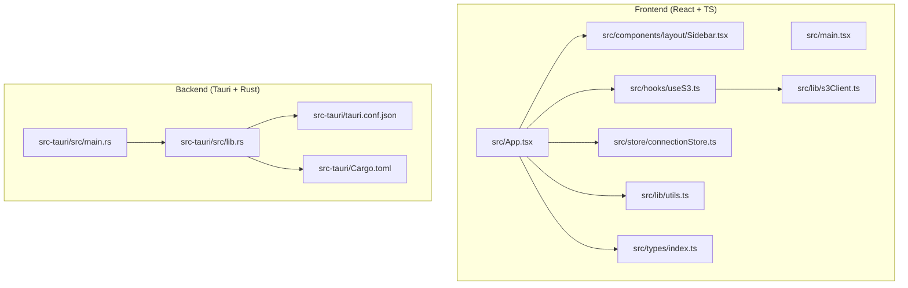
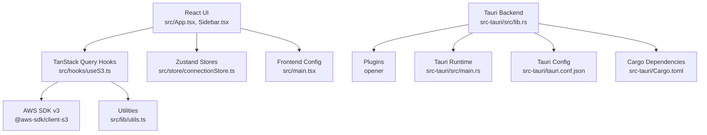
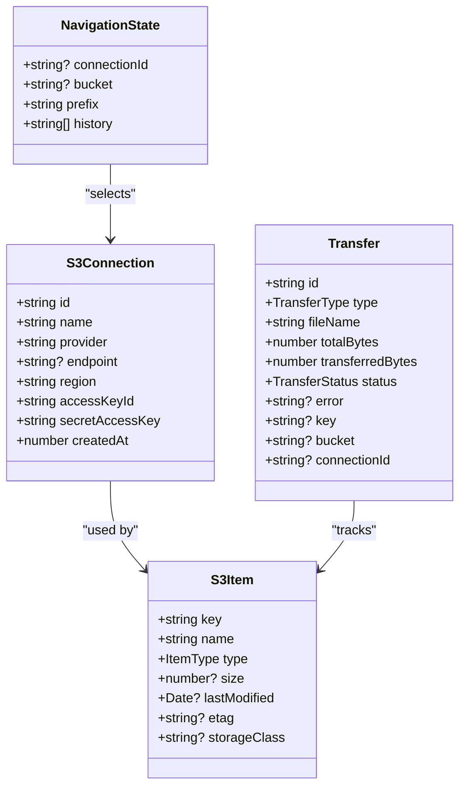
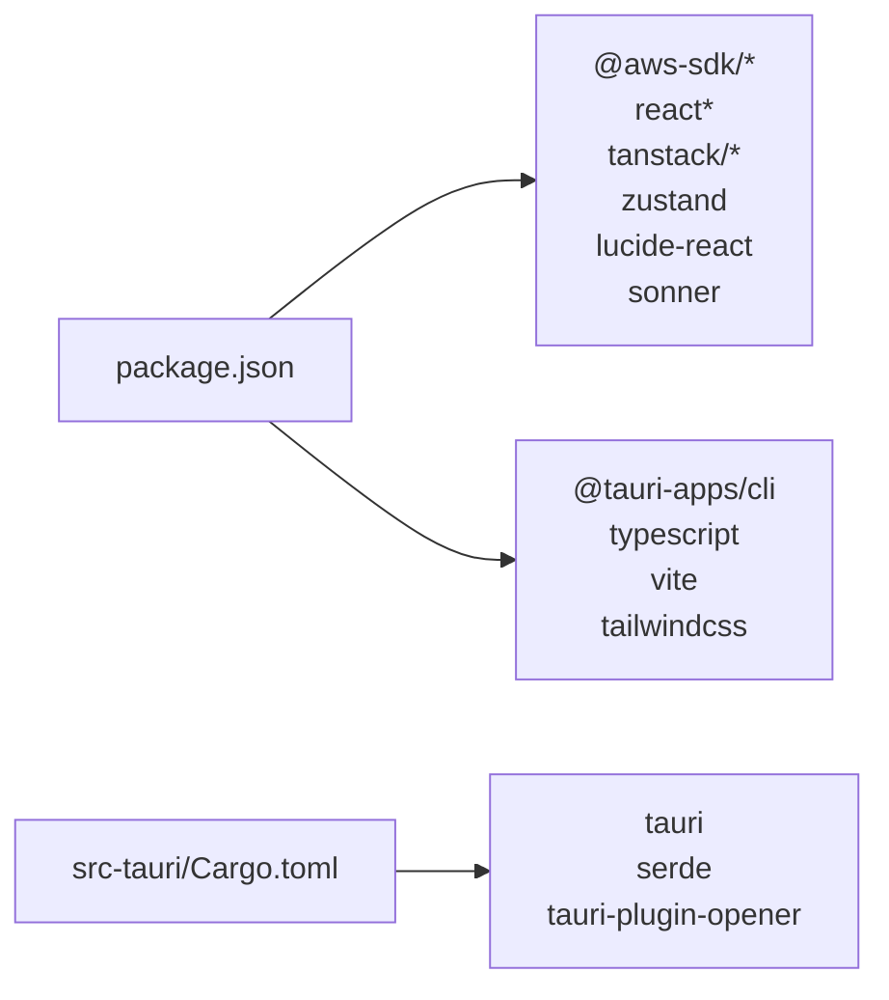

# Getting Started

<cite>
**Referenced Files in This Document**
- [README.md](file://README.md)
- [PROJECT.md](file://PROJECT.md)
- [package.json](file://package.json)
- [Cargo.toml](file://src-tauri/Cargo.toml)
- [tauri.conf.json](file://src-tauri/tauri.conf.json)
- [main.tsx](file://src/main.tsx)
- [App.tsx](file://src/App.tsx)
- [Sidebar.tsx](file://src/components/layout/Sidebar.tsx)
- [useS3.ts](file://src/hooks/useS3.ts)
- [s3Client.ts](file://src/lib/s3Client.ts)
- [connectionStore.ts](file://src/store/connectionStore.ts)
- [utils.ts](file://src/lib/utils.ts)
- [index.ts](file://src/types/index.ts)
- [main.rs](file://src-tauri/src/main.rs)
- [lib.rs](file://src-tauri/src/lib.rs)
</cite>

## Table of Contents
1. [Introduction](#introduction)
2. [Project Structure](#project-structure)
3. [Core Components](#core-components)
4. [Architecture Overview](#architecture-overview)
5. [Detailed Component Analysis](#detailed-component-analysis)
6. [Dependency Analysis](#dependency-analysis)
7. [Performance Considerations](#performance-considerations)
8. [Troubleshooting Guide](#troubleshooting-guide)
9. [Conclusion](#conclusion)
10. [Appendices](#appendices)

## Introduction
S3 Explorer is a desktop application for managing S3-compatible object storage. Built with Tauri v2 (Rust backend) and React + TypeScript (frontend), it provides a familiar file-explorer-like interface to browse buckets, navigate folders, and perform file operations such as upload, download, rename, delete, and generating shareable URLs. The project emphasizes reliability, performance, and a clean UI with dark-themed panels and intuitive interactions.

## Project Structure
The repository follows a clear separation between the frontend (React + TypeScript) and the Tauri backend (Rust). The frontend handles UI, state management, and S3 operations via AWS SDK, while the backend provides native capabilities and integrates with the frontend through Tauri commands and plugins.

**Diagram sources**
- [main.tsx:1-26](file://src/main.tsx#L1-L26)
- [App.tsx:1-124](file://src/App.tsx#L1-L124)
- [Sidebar.tsx:1-184](file://src/components/layout/Sidebar.tsx#L1-L184)
- [useS3.ts:1-410](file://src/hooks/useS3.ts#L1-L410)
- [s3Client.ts:1-83](file://src/lib/s3Client.ts#L1-L83)
- [connectionStore.ts:1-88](file://src/store/connectionStore.ts#L1-L88)
- [utils.ts:1-197](file://src/lib/utils.ts#L1-L197)
- [index.ts:1-166](file://src/types/index.ts#L1-L166)
- [main.rs:1-7](file://src-tauri/src/main.rs#L1-L7)
- [lib.rs:1-15](file://src-tauri/src/lib.rs#L1-L15)
- [tauri.conf.json:1-36](file://src-tauri/tauri.conf.json#L1-L36)
- [Cargo.toml:1-26](file://src-tauri/Cargo.toml#L1-L26)

**Section sources**
- [PROJECT.md:20-68](file://PROJECT.md#L20-L68)
- [tauri.conf.json:1-36](file://src-tauri/tauri.conf.json#L1-L36)

## Core Components
- Frontend initialization sets up TanStack Query for asynchronous data fetching and Sonner for notifications.
- App layout composes the sidebar, toolbar, and content area, coordinating navigation state and refresh behavior.
- Sidebar lists saved S3 connections and expands to show buckets for the selected connection.
- useS3 hook encapsulates all S3 operations (list buckets/objects, upload, download, rename, delete, presigned URL generation) using AWS SDK v3 and exposes them as TanStack Query queries and mutations.
- s3Client factory builds properly configured S3 clients per provider, including endpoint resolution and path-style addressing for non-AWS providers.
- Zustand stores manage persistent connections and navigation state.
- Utilities provide file size formatting, date formatting, icon mapping, and helper checks for folder detection and display name extraction.

**Section sources**
- [main.tsx:1-26](file://src/main.tsx#L1-L26)
- [App.tsx:1-124](file://src/App.tsx#L1-L124)
- [Sidebar.tsx:1-184](file://src/components/layout/Sidebar.tsx#L1-L184)
- [useS3.ts:1-410](file://src/hooks/useS3.ts#L1-L410)
- [s3Client.ts:1-83](file://src/lib/s3Client.ts#L1-L83)
- [connectionStore.ts:1-88](file://src/store/connectionStore.ts#L1-L88)
- [utils.ts:1-197](file://src/lib/utils.ts#L1-L197)
- [index.ts:1-166](file://src/types/index.ts#L1-L166)

## Architecture Overview
The application uses a hybrid architecture:
- Frontend (React + TypeScript) manages UI and state, performs S3 operations via AWS SDK, and coordinates with backend via Tauri commands/plugins.
- Backend (Tauri + Rust) initializes the app, registers plugins (e.g., opener), and can expose additional commands for advanced operations (e.g., reliable downloads).
- Configuration ties frontend build artifacts to the Tauri runtime and defines bundling targets.

**Diagram sources**
- [App.tsx:1-124](file://src/App.tsx#L1-L124)
- [Sidebar.tsx:1-184](file://src/components/layout/Sidebar.tsx#L1-L184)
- [useS3.ts:1-410](file://src/hooks/useS3.ts#L1-L410)
- [utils.ts:1-197](file://src/lib/utils.ts#L1-L197)
- [connectionStore.ts:1-88](file://src/store/connectionStore.ts#L1-L88)
- [main.tsx:1-26](file://src/main.tsx#L1-L26)
- [lib.rs:1-15](file://src-tauri/src/lib.rs#L1-L15)
- [main.rs:1-7](file://src-tauri/src/main.rs#L1-L7)
- [tauri.conf.json:1-36](file://src-tauri/tauri.conf.json#L1-L36)
- [Cargo.toml:1-26](file://src-tauri/Cargo.toml#L1-L26)

## Detailed Component Analysis

### Prerequisites
- Node.js: The project targets Node.js LTS as recommended by the project documentation.
- Rust toolchain: The backend is built with Tauri v2 and Rust stable, as indicated by the project documentation and Cargo manifest.
- Package manager: The project uses pnpm as the package manager.
- Platform support: Windows (primary), macOS, and Linux are supported targets.

Verification steps:
- Confirm Node.js version meets LTS requirements.
- Confirm Rust stable toolchain is installed and up to date.
- Verify pnpm is installed and working.

**Section sources**
- [PROJECT.md:194-198](file://PROJECT.md#L194-L198)
- [Cargo.toml:1-26](file://src-tauri/Cargo.toml#L1-L26)
- [package.json:1-37](file://package.json#L1-L37)

### Installation and Setup

#### Development Environment
- Install dependencies:
  - Run the package manager install script defined in the project scripts.
- Launch development mode:
  - Use the Tauri CLI to run the app in development mode with hot reload.
- Preview:
  - Optionally preview the built frontend locally.

Notes:
- The frontend build pipeline uses TypeScript compilation and Vite.
- Tauri CLI is included as a dev dependency.

**Section sources**
- [package.json:6-11](file://package.json#L6-L11)
- [PROJECT.md:187-192](file://PROJECT.md#L187-L192)

#### Production Environment
- Build the frontend:
  - Compile TypeScript and build the Vite bundle.
- Build the Tauri app:
  - Use the Tauri CLI to produce platform-specific installers. The configuration enables bundling for all targets.

**Section sources**
- [package.json:6-11](file://package.json#L6-L11)
- [tauri.conf.json:24-34](file://src-tauri/tauri.conf.json#L24-L34)

### Initial Setup Process
- Dependency installation:
  - Use the package manager to install all frontend and backend dependencies.
- Environment configuration:
  - The frontend uses TanStack Query defaults suitable for desktop apps (no refetch on window focus, retry policy).
  - Tauri configuration defines the dev URL, frontend dist path, and bundling icons.
- First-time application launch:
  - Start the development server via the Tauri CLI.
  - The app initializes the React root, wraps the app with TanStack Query, and displays the main layout with the sidebar and toolbar.

Verification:
- Confirm the app loads without errors and the sidebar shows “No connections yet” initially.
- Ensure the backend plugin is registered and the Tauri runtime starts successfully.

**Section sources**
- [main.tsx:1-26](file://src/main.tsx#L1-L26)
- [tauri.conf.json:6-11](file://src-tauri/tauri.conf.json#L6-L11)
- [lib.rs:8-14](file://src-tauri/src/lib.rs#L8-L14)

### Quick Start Tutorial

#### Add an S3 Connection
- Open the Add Connection modal (placeholder action in the current UI).
- Enter connection details:
  - Provider selection (AWS, MinIO, R2, B2, or custom).
  - Endpoint (required for non-AWS providers).
  - Region (required for some providers).
  - Access key ID and Secret Access Key.
- Save the connection:
  - The connection is persisted in the Zustand store and becomes selectable in the sidebar.

Verification:
- After saving, the connection appears in the sidebar list.
- Clicking the connection expands to reveal buckets.

**Section sources**
- [Sidebar.tsx:117-184](file://src/components/layout/Sidebar.tsx#L117-L184)
- [connectionStore.ts:30-88](file://src/store/connectionStore.ts#L30-L88)
- [index.ts:38-48](file://src/types/index.ts#L38-L48)

#### Browse Buckets
- Select a connection in the sidebar to load its buckets.
- The sidebar renders a list of buckets for the chosen connection.
- Click a bucket to activate it and enter the bucket’s contents.

Verification:
- Bucket list appears after selecting a connection.
- Active bucket highlights in the sidebar.

**Section sources**
- [Sidebar.tsx:51-108](file://src/components/layout/Sidebar.tsx#L51-L108)
- [useS3.ts:69-85](file://src/hooks/useS3.ts#L69-L85)

#### Perform Basic File Operations
- Upload a file:
  - Trigger the upload action and select a file; the hook uploads to the current prefix.
- Download a file:
  - Generate a presigned URL and trigger browser download.
- Create a folder:
  - Use the create folder mutation to create a virtual folder by placing an empty object ending with "/".
- Rename a file:
  - Use the rename mutation to copy to a new key then delete the original.
- Delete a file:
  - Use the delete mutation to remove the object.
- Get info:
  - Use the head object mutation to fetch metadata without downloading.

Note:
- For large files, prefer backend-driven downloads via Tauri commands as suggested in the project documentation.

**Section sources**
- [useS3.ts:152-189](file://src/hooks/useS3.ts#L152-L189)
- [useS3.ts:195-227](file://src/hooks/useS3.ts#L195-L227)
- [useS3.ts:261-288](file://src/hooks/useS3.ts#L261-L288)
- [useS3.ts:320-360](file://src/hooks/useS3.ts#L320-L360)
- [useS3.ts:242-255](file://src/hooks/useS3.ts#L242-L255)
- [useS3.ts:367-391](file://src/hooks/useS3.ts#L367-L391)
- [PROJECT.md:200-205](file://PROJECT.md#L200-L205)

### Data Model Overview
The application models S3 connections, items (files, folders, buckets), navigation state, transfers, and UI-related types. These types guide the UI and ensure consistent behavior across components.

**Diagram sources**
- [index.ts:38-48](file://src/types/index.ts#L38-L48)
- [index.ts:54-62](file://src/types/index.ts#L54-L62)
- [index.ts:67-72](file://src/types/index.ts#L67-L72)
- [index.ts:84-98](file://src/types/index.ts#L84-L98)

## Dependency Analysis
- Frontend dependencies include React, TanStack Query, Zustand, AWS SDK for JavaScript, and UI libraries.
- Backend dependencies include Tauri v2, serde, and optional plugins (e.g., opener).
- Scripts orchestrate development, building, and Tauri commands.

**Diagram sources**
- [package.json:12-35](file://package.json#L12-L35)
- [Cargo.toml:20-25](file://src-tauri/Cargo.toml#L20-L25)

**Section sources**
- [package.json:12-35](file://package.json#L12-L35)
- [Cargo.toml:20-25](file://src-tauri/Cargo.toml#L20-L25)

## Performance Considerations
- Use TanStack Query’s retry and staleTime configurations to balance responsiveness and network usage.
- Prefer backend-driven downloads for large files to improve reliability.
- Use path-style addressing for non-AWS providers to avoid bucket endpoint rewrites.
- Virtualize large file lists to maintain smooth scrolling.

[No sources needed since this section provides general guidance]

## Troubleshooting Guide
- Node.js or pnpm issues:
  - Ensure Node.js LTS is installed and pnpm is available globally.
- Rust toolchain issues:
  - Confirm Rust stable is installed and up to date; rebuild if necessary.
- Tauri build failures:
  - Verify Tauri CLI is installed and the frontend dist path matches the configuration.
- AWS SDK errors:
  - Validate credentials and region; confirm endpoint resolution for non-AWS providers.
- Large file downloads:
  - Use backend commands for reliable downloads as recommended in the project documentation.

**Section sources**
- [PROJECT.md:194-198](file://PROJECT.md#L194-L198)
- [PROJECT.md:200-205](file://PROJECT.md#L200-L205)
- [s3Client.ts:12-49](file://src/lib/s3Client.ts#L12-L49)
- [tauri.conf.json:6-11](file://src-tauri/tauri.conf.json#L6-L11)

## Conclusion
S3 Explorer provides a robust, cross-platform desktop application for managing S3-compatible storage. By following the prerequisites, installation steps, and quick start tutorial, you can add connections, browse buckets, and perform essential file operations. Use the troubleshooting tips to resolve common issues and rely on the documented performance recommendations for optimal behavior.

[No sources needed since this section summarizes without analyzing specific files]

## Appendices

### Verification Checklist
- Node.js LTS and pnpm are installed.
- Rust stable toolchain is installed.
- Dependencies are installed via the package manager.
- Development server launches successfully with Tauri CLI.
- Sidebar shows “No connections yet” and allows adding a connection.
- After adding a connection, buckets appear and can be selected.
- Basic operations (upload, download, create folder, rename, delete) work as expected.

**Section sources**
- [PROJECT.md:187-192](file://PROJECT.md#L187-L192)
- [Sidebar.tsx:150-161](file://src/components/layout/Sidebar.tsx#L150-L161)
- [useS3.ts:152-189](file://src/hooks/useS3.ts#L152-L189)
- [useS3.ts:195-227](file://src/hooks/useS3.ts#L195-L227)
- [useS3.ts:261-288](file://src/hooks/useS3.ts#L261-L288)
- [useS3.ts:320-360](file://src/hooks/useS3.ts#L320-L360)
- [useS3.ts:242-255](file://src/hooks/useS3.ts#L242-L255)