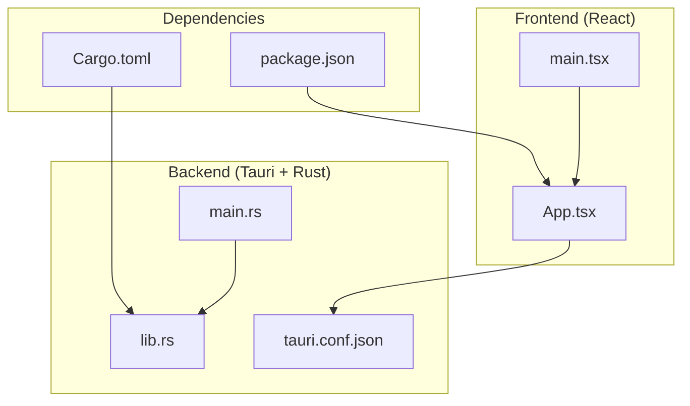
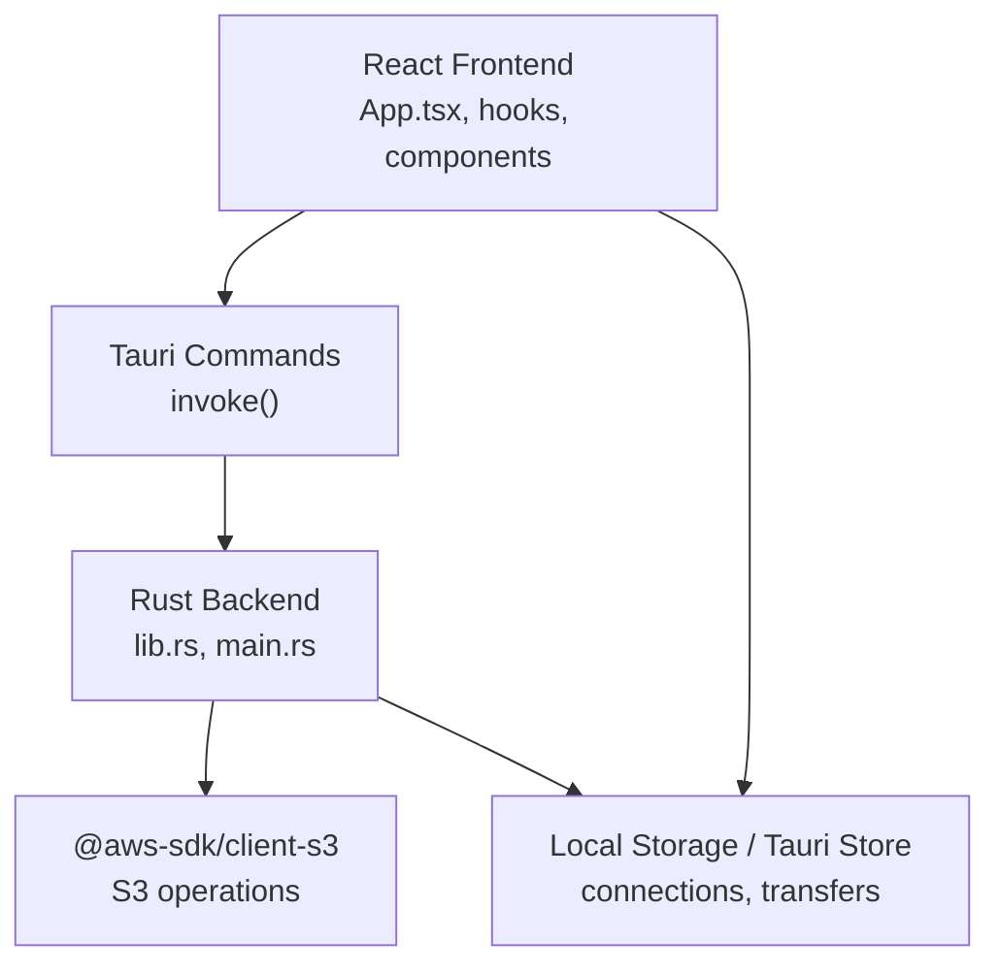
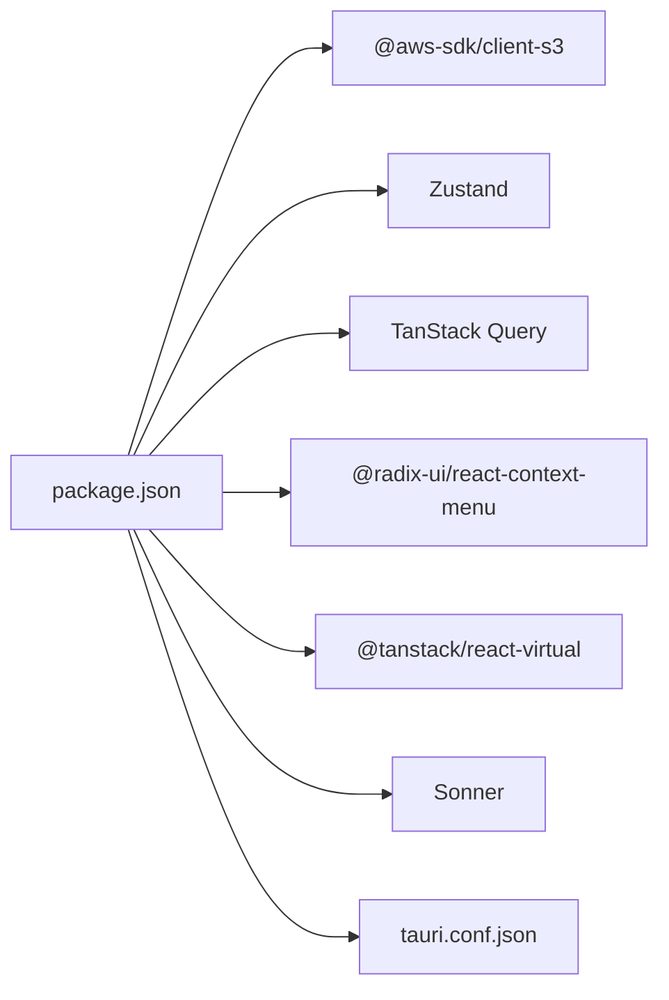

# Project Overview

<cite>
**Referenced Files in This Document**
- [README.md](file://README.md)
- [PROJECT.md](file://PROJECT.md)
- [package.json](file://package.json)
- [Cargo.toml](file://src-tauri/Cargo.toml)
- [tauri.conf.json](file://src-tauri/tauri.conf.json)
- [src/main.tsx](file://src/main.tsx)
- [src/App.tsx](file://src/App.tsx)
- [src-tauri/src/main.rs](file://src-tauri/src/main.rs)
- [src-tauri/src/lib.rs](file://src-tauri/src/lib.rs)
</cite>

## Table of Contents
1. [Introduction](#introduction)
2. [Project Structure](#project-structure)
3. [Core Components](#core-components)
4. [Architecture Overview](#architecture-overview)
5. [Detailed Component Analysis](#detailed-component-analysis)
6. [Dependency Analysis](#dependency-analysis)
7. [Performance Considerations](#performance-considerations)
8. [Troubleshooting Guide](#troubleshooting-guide)
9. [Conclusion](#conclusion)

## Introduction
S3 Explorer is a desktop application designed to manage S3-compatible object storage systems such as AWS S3, MinIO, Cloudflare R2, and Backblaze B2. It provides a familiar file explorer-like interface for browsing buckets and folders, performing file operations, and managing connections securely. The application targets developers, system administrators, and cloud storage managers who need a fast, reliable, and feature-rich desktop client for S3 operations.

Why a desktop solution?
- Local execution ensures sensitive credentials remain on the device and are not transmitted to external servers.
- Native performance for large file transfers and batch operations.
- Consistent offline experience with local state management.
- Tight OS integration for file associations and native dialogs.

## Project Structure
The project follows a hybrid desktop architecture:
- Frontend: React 18 with TypeScript handles UI rendering, state management, and asynchronous data fetching.
- Backend: Tauri v2 with Rust powers native commands, secure credential storage, and file system operations.
- Build and packaging: Vite orchestrates the frontend build, while Tauri CLI manages cross-platform distribution.

**Diagram sources**
- [src/main.tsx:1-10](file://src/main.tsx#L1-L10)
- [src/App.tsx:1-56](file://src/App.tsx#L1-L56)
- [src-tauri/src/main.rs:1-7](file://src-tauri/src/main.rs#L1-L7)
- [src-tauri/src/lib.rs:1-15](file://src-tauri/src/lib.rs#L1-L15)
- [package.json:1-37](file://package.json#L1-L37)
- [Cargo.toml:1-26](file://src-tauri/Cargo.toml#L1-L26)
- [tauri.conf.json:1-36](file://src-tauri/tauri.conf.json#L1-L36)

**Section sources**
- [README.md:1-8](file://README.md#L1-L8)
- [PROJECT.md:20-68](file://PROJECT.md#L20-L68)
- [package.json:1-37](file://package.json#L1-L37)
- [Cargo.toml:1-26](file://src-tauri/Cargo.toml#L1-L26)
- [tauri.conf.json:1-36](file://src-tauri/tauri.conf.json#L1-L36)

## Core Components
- Desktop framework: Tauri v2 with Rust backend for secure, native execution.
- Frontend: React 18 with TypeScript for component-driven UI and type safety.
- Styling: Tailwind CSS v4 for rapid UI iteration and responsive design.
- State management: Zustand for lightweight, scalable state containers.
- Async data: TanStack Query (React Query v5) for caching, invalidation, and background updates.
- UI primitives: Radix UI for accessible context menus and other components.
- Icons: Lucide React for consistent iconography.
- Virtualization: TanStack Virtual for efficient rendering of large file lists.
- Notifications: Sonner for unobtrusive, user-friendly toasts.

**Section sources**
- [PROJECT.md:7-19](file://PROJECT.md#L7-L19)
- [package.json:12-25](file://package.json#L12-L25)

## Architecture Overview
S3 Explorer combines a React frontend with a Tauri-powered Rust backend. The frontend renders the UI and orchestrates S3 operations, while Tauri exposes safe commands to Rust for tasks requiring native reliability (such as large downloads) and secure credential handling. The build pipeline integrates Vite for development and Tauri for bundling cross-platform installers.

**Diagram sources**
- [src/App.tsx:1-56](file://src/App.tsx#L1-L56)
- [src-tauri/src/lib.rs:1-15](file://src-tauri/src/lib.rs#L1-L15)
- [src-tauri/src/main.rs:1-7](file://src-tauri/src/main.rs#L1-L7)
- [package.json:12-25](file://package.json#L12-L25)

## Detailed Component Analysis

### Technology Stack Summary
- Desktop framework: Tauri v2 (Rust backend)
- Frontend: React 18 + TypeScript
- Styling: Tailwind CSS v4
- Package manager: pnpm
- AWS SDK: @aws-sdk/client-s3 (JS v3)
- State management: Zustand
- Async data: TanStack Query (React Query v5)
- Context menu: Radix UI (@radix-ui/react-context-menu)
- Icons: Lucide React
- Virtualized list: TanStack Virtual
- Notifications: Sonner

**Section sources**
- [PROJECT.md:7-19](file://PROJECT.md#L7-L19)
- [package.json:12-25](file://package.json#L12-L25)

### Key Features Overview
- Connection management: Add, edit, and remove S3-compatible connections with secure local storage.
- Bucket and folder browsing: Click-to-navigate with breadcrumbs and back navigation.
- Right-click actions: Download single files, download folders as ZIP, copy presigned URLs, rename, delete, and view metadata.
- Upload and organize: Drag-and-drop uploads, create folders, and refresh views.
- Progress tracking: Real-time upload/download progress indicators.
- Search and filter: Filter items by name within the current folder.
- Additional post-MVP features: Multi-select, cut/copy/paste, preview, dark mode, keyboard shortcuts, and local ↔ S3 sync.

**Section sources**
- [PROJECT.md:115-142](file://PROJECT.md#L115-L142)

### Use Cases by User Type
- Developers:
  - Rapidly iterate on S3-backed applications by inspecting buckets, validating folder structures, and sharing presigned URLs.
  - Verify uploads/downloads and troubleshoot storage class or metadata issues.
- System Administrators:
  - Manage multiple S3-compatible environments (production, staging) with secure local credential storage.
  - Perform bulk deletions, folder renames (via copy+delete), and audit folder sizes.
- Cloud Storage Managers:
  - Organize large datasets with virtual folders, search/filter, and progress monitoring.
  - Coordinate team access via shared connections and presigned links.

**Section sources**
- [PROJECT.md:115-142](file://PROJECT.md#L115-L142)

### Why Desktop Over Web
- Security: Credentials stay on the device; no transmission to third-party servers.
- Reliability: Native Rust commands handle large downloads and batch operations more consistently.
- Performance: Reduced latency for frequent operations and better responsiveness with virtualized lists.
- Integration: OS-native file associations, open-with dialogs, and secure stores.

**Section sources**
- [PROJECT.md:200-205](file://PROJECT.md#L200-L205)

## Dependency Analysis
The frontend depends on Tauri’s APIs and the AWS SDK for JavaScript to communicate with S3-compatible services. The Rust backend exposes commands for secure operations and integrates with Tauri plugins for OS-level integrations.

**Diagram sources**
- [package.json:12-25](file://package.json#L12-L25)
- [tauri.conf.json:1-36](file://src-tauri/tauri.conf.json#L1-L36)

**Section sources**
- [package.json:12-25](file://package.json#L12-L25)
- [tauri.conf.json:1-36](file://src-tauri/tauri.conf.json#L1-L36)

## Performance Considerations
- Large downloads: Prefer Rust-based commands for stability and progress reporting.
- Virtualized lists: Use TanStack Virtual to render thousands of files efficiently.
- Request throttling: Avoid excessive polling; implement exponential backoff for retries against rate-limited endpoints.
- Local caching: Leverage TanStack Query for intelligent caching and background synchronization.

**Section sources**
- [PROJECT.md:200-205](file://PROJECT.md#L200-L205)

## Troubleshooting Guide
- Credential storage: Do not hardcode secrets; use Tauri’s secure store or OS keychain.
- Download reliability: For large files, rely on Rust commands rather than browser fetch streams.
- S3 semantics: Remember that S3 folders are virtual; folder creation is simulated by placing objects ending with "/".
- Rate limits: Apply exponential backoff to avoid throttling from AWS or compatible services.

**Section sources**
- [PROJECT.md:200-205](file://PROJECT.md#L200-L205)

## Conclusion
S3 Explorer delivers a modern, secure, and powerful desktop client for S3-compatible storage. Its hybrid architecture leverages React for a responsive UI, Tauri for native reliability, and Rust for secure operations. By focusing on practical workflows—connection management, folder navigation, and robust file operations—it serves developers, administrators, and cloud storage managers with a desktop experience superior to typical web-based tools.