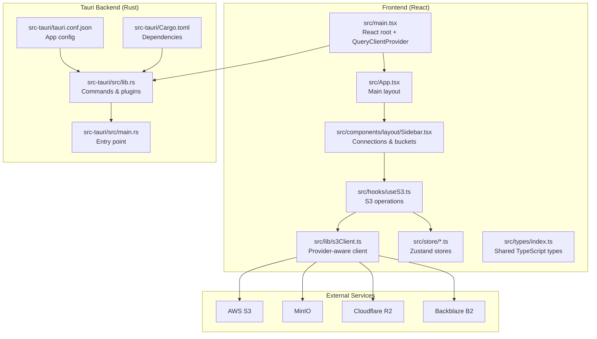
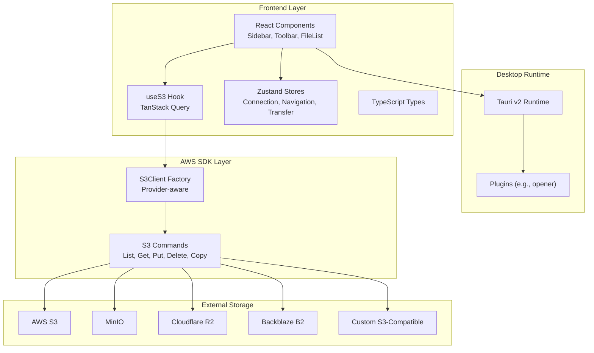
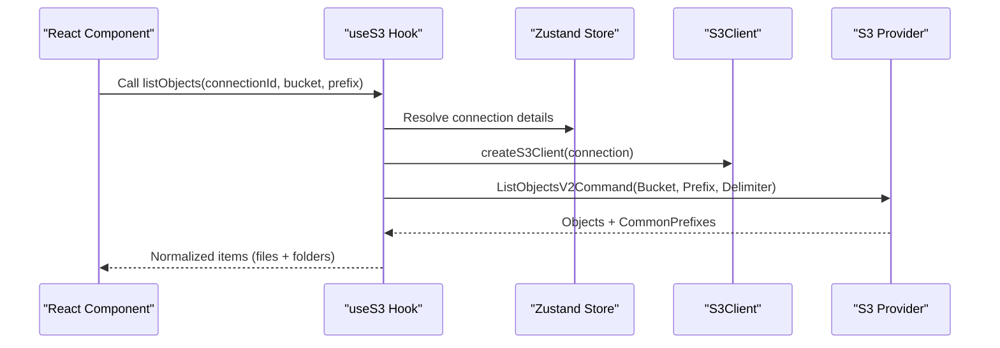
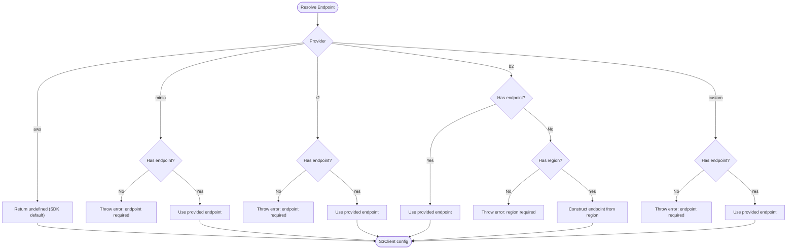
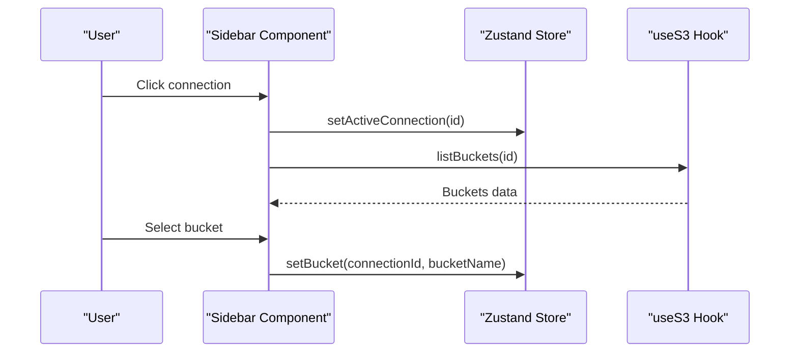
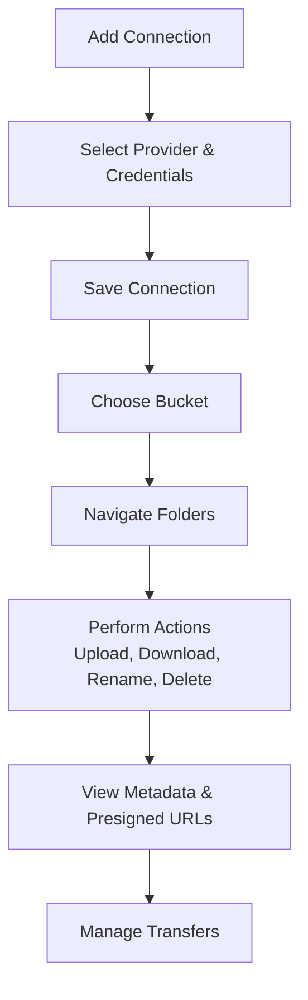
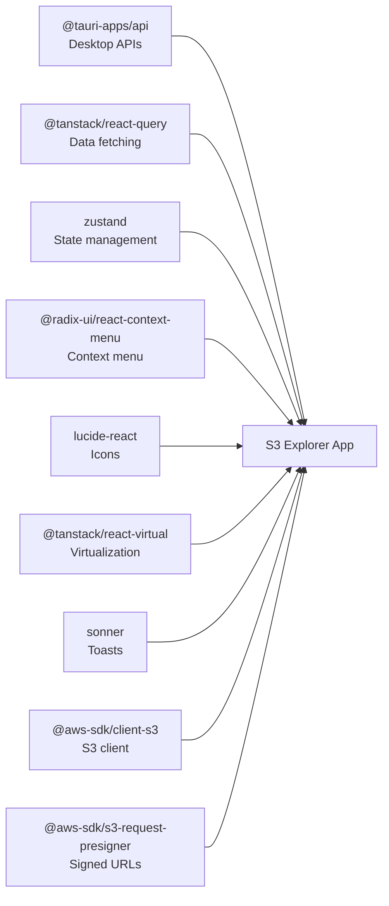

# Project Overview

<cite>
**Referenced Files in This Document**
- [README.md](file://README.md)
- [PROJECT.md](file://PROJECT.md)
- [package.json](file://package.json)
- [src-tauri/Cargo.toml](file://src-tauri/Cargo.toml)
- [src-tauri/tauri.conf.json](file://src-tauri/tauri.conf.json)
- [src/main.tsx](file://src/main.tsx)
- [src/App.tsx](file://src/App.tsx)
- [src/components/layout/Sidebar.tsx](file://src/components/layout/Sidebar.tsx)
- [src/hooks/useS3.ts](file://src/hooks/useS3.ts)
- [src/lib/s3Client.ts](file://src/lib/s3Client.ts)
- [src/store/connectionStore.ts](file://src/store/connectionStore.ts)
- [src/types/index.ts](file://src/types/index.ts)
</cite>

## Table of Contents
1. [Introduction](#introduction)
2. [Project Structure](#project-structure)
3. [Core Components](#core-components)
4. [Architecture Overview](#architecture-overview)
5. [Detailed Component Analysis](#detailed-component-analysis)
6. [Dependency Analysis](#dependency-analysis)
7. [Performance Considerations](#performance-considerations)
8. [Troubleshooting Guide](#troubleshooting-guide)
9. [Conclusion](#conclusion)

## Introduction
S3 Explorer is a desktop application designed to manage S3-compatible object storage services with a familiar file-explorer-like interface. It supports major providers including AWS S3, MinIO, Cloudflare R2, and Backblaze B2, enabling users to browse, upload, download, rename, delete, and share objects stored in S3-compatible buckets. The application combines a modern React/TypeScript frontend with a Tauri v2 Rust backend to deliver a native desktop experience with reliable cross-platform support.

Key benefits for users:
- Native desktop performance and reliability
- Familiar file-explorer navigation with breadcrumbs and context menus
- Secure credential handling and local storage
- Efficient handling of large files and virtual folders
- Extensible architecture supporting future enhancements

Target audience:
- Developers and DevOps engineers who frequently manage S3-compatible storage
- Teams requiring a reliable, offline-capable desktop tool for object storage administration
- Users migrating from traditional file managers to cloud storage workflows

Supported S3 providers:
- AWS S3
- MinIO
- Cloudflare R2
- Backblaze B2
- Custom S3-compatible services

Core value propositions:
- Hybrid desktop architecture for optimal UX and performance
- Provider-aware S3 client configuration with endpoint resolution
- Centralized S3 operations via React Query for caching, retries, and optimistic updates
- Zustand-based state management for connections, navigation, and transfers
- Context menu-driven actions for efficient file management

System requirements and platform compatibility:
- Windows (primary), macOS, and Linux
- Tauri v2 runtime
- Node.js LTS and Rust stable toolchain

Comparison with web-based S3 management tools:
- Desktop-native performance and reliability for large-scale operations
- Local credential storage and OS integration
- Consistent UI across platforms without browser limitations
- Enhanced control over downloads and uploads with background processing

**Section sources**
- [PROJECT.md:3-205](file://PROJECT.md#L3-L205)
- [README.md:1-8](file://README.md#L1-L8)

## Project Structure
The project follows a clear separation of concerns:
- Frontend (React + TypeScript) in the src directory
- Tauri backend (Rust) in the src-tauri directory
- Shared types and utilities bridging both layers

High-level structure:
- src/main.tsx initializes React Query and renders the root application
- src/App.tsx defines the main layout with sidebar and content areas
- src/components/layout/Sidebar.tsx manages connections and bucket selection
- src/hooks/useS3.ts encapsulates all S3 operations using AWS SDK JS v3
- src/lib/s3Client.ts builds provider-specific S3 clients
- src/store/* manages application state with Zustand
- src-tauri/* contains Tauri configuration and Rust backend

**Diagram sources**
- [src/main.tsx:1-26](file://src/main.tsx#L1-L26)
- [src/App.tsx:1-124](file://src/App.tsx#L1-L124)
- [src/components/layout/Sidebar.tsx:1-184](file://src/components/layout/Sidebar.tsx#L1-L184)
- [src/hooks/useS3.ts:1-410](file://src/hooks/useS3.ts#L1-L410)
- [src/lib/s3Client.ts:1-83](file://src/lib/s3Client.ts#L1-L83)
- [src-tauri/src/lib.rs:1-15](file://src-tauri/src/lib.rs#L1-L15)
- [src-tauri/src/main.rs:1-7](file://src-tauri/src/main.rs#L1-L7)
- [src-tauri/tauri.conf.json:1-36](file://src-tauri/tauri.conf.json#L1-L36)
- [src-tauri/Cargo.toml:1-26](file://src-tauri/Cargo.toml#L1-L26)

**Section sources**
- [PROJECT.md:20-68](file://PROJECT.md#L20-L68)
- [src/main.tsx:1-26](file://src/main.tsx#L1-L26)
- [src-tauri/tauri.conf.json:1-36](file://src-tauri/tauri.conf.json#L1-L36)

## Core Components
This section highlights the primary building blocks that enable S3 Explorer’s functionality.

- React Query initialization and caching:
  - Configured with custom defaults for desktop usage, including retry behavior and stale-time settings
  - Provides centralized caching for S3 operations and invalidation on refresh

- Application layout and navigation:
  - Main layout separates sidebar (connections and buckets) from content area
  - Toolbar integrates breadcrumb navigation, refresh, upload, and search controls
  - Empty state guidance for unselected connections or buckets

- Sidebar and connection management:
  - Renders saved S3 connections and expands to show associated buckets
  - Integrates with Zustand store for active connection and bucket selection
  - Displays loading states, errors, and empty states for bucket lists

- S3 operations abstraction:
  - Centralized hook exposing typed queries and mutations for all S3 operations
  - Uses AWS SDK JS v3 commands for list, upload, download, delete, rename, and metadata retrieval
  - Handles provider-specific endpoint resolution and path-style addressing

- Provider-aware client configuration:
  - Resolves endpoints per provider (AWS, MinIO, R2, B2, custom)
  - Enforces path-style addressing for non-AWS providers
  - Validates required fields per provider (e.g., region for B2, endpoint for MinIO/R2)

- State management:
  - Zustand stores for connections, navigation, and transfers
  - Persistent storage for connection configurations
  - Active connection and bucket tracking for UI state

- Shared types:
  - Strongly typed domain models for connections, items, navigation, transfers, and context actions
  - Supports sorting, filtering, and context menu actions

**Section sources**
- [src/main.tsx:6-17](file://src/main.tsx#L6-L17)
- [src/App.tsx:11-82](file://src/App.tsx#L11-L82)
- [src/components/layout/Sidebar.tsx:117-184](file://src/components/layout/Sidebar.tsx#L117-L184)
- [src/hooks/useS3.ts:62-409](file://src/hooks/useS3.ts#L62-L409)
- [src/lib/s3Client.ts:60-82](file://src/lib/s3Client.ts#L60-L82)
- [src/store/connectionStore.ts:30-87](file://src/store/connectionStore.ts#L30-L87)
- [src/types/index.ts:38-166](file://src/types/index.ts#L38-L166)

## Architecture Overview
S3 Explorer employs a hybrid desktop architecture:
- Frontend: React/TypeScript with functional components, hooks, and state management
- Backend: Tauri v2 Rust runtime providing system-level capabilities and secure command invocation
- Data layer: AWS SDK JS v3 for S3 operations with provider-aware configuration
- State management: React Query for caching and synchronization, Zustand for local application state

**Diagram sources**
- [src-tauri/src/lib.rs:8-14](file://src-tauri/src/lib.rs#L8-L14)
- [src/hooks/useS3.ts:10-11](file://src/hooks/useS3.ts#L10-L11)
- [src/lib/s3Client.ts:60-82](file://src/lib/s3Client.ts#L60-L82)
- [src/components/layout/Sidebar.tsx:52-53](file://src/components/layout/Sidebar.tsx#L52-L53)

## Detailed Component Analysis

### S3 Operations Abstraction (useS3)
The useS3 hook centralizes all S3 interactions:
- Queries: listBuckets, listObjects
- Mutations: downloadFile, uploadFile, deleteItem, createFolder, getPresignedUrl, renameItem, headObject

**Diagram sources**
- [src/hooks/useS3.ts:91-144](file://src/hooks/useS3.ts#L91-L144)
- [src/lib/s3Client.ts:60-82](file://src/lib/s3Client.ts#L60-L82)

**Section sources**
- [src/hooks/useS3.ts:62-409](file://src/hooks/useS3.ts#L62-L409)

### Provider Endpoint Resolution
The S3 client factory handles provider-specific endpoint configuration:
- AWS: uses SDK-default endpoint resolution
- MinIO: requires explicit endpoint URL
- Cloudflare R2: requires account-specific endpoint URL
- Backblaze B2: constructs endpoint from region if not provided
- Custom: requires user-provided endpoint

**Diagram sources**
- [src/lib/s3Client.ts:12-49](file://src/lib/s3Client.ts#L12-L49)

**Section sources**
- [src/lib/s3Client.ts:12-49](file://src/lib/s3Client.ts#L12-L49)

### Sidebar and Connection Management
The sidebar component:
- Lists saved connections and toggles expansion to show buckets
- Integrates with useS3 to fetch bucket lists
- Updates navigation state when a bucket is selected

**Diagram sources**
- [src/components/layout/Sidebar.tsx:117-184](file://src/components/layout/Sidebar.tsx#L117-L184)
- [src/hooks/useS3.ts:69-85](file://src/hooks/useS3.ts#L69-L85)
- [src/store/connectionStore.ts:30-87](file://src/store/connectionStore.ts#L30-L87)

**Section sources**
- [src/components/layout/Sidebar.tsx:117-184](file://src/components/layout/Sidebar.tsx#L117-L184)
- [src/store/connectionStore.ts:30-87](file://src/store/connectionStore.ts#L30-L87)

### Conceptual Overview
The application’s workflow emphasizes a file-explorer-like experience:
- Connect to S3-compatible storage
- Browse buckets and folders
- Perform actions via context menus and toolbar
- Track progress and receive notifications

[No sources needed since this diagram shows conceptual workflow, not actual code structure]

## Dependency Analysis
External dependencies and their roles:
- AWS SDK JS v3: S3 operations (client creation, commands, signing)
- TanStack Query: asynchronous data fetching, caching, and synchronization
- Zustand: lightweight state management for connections, navigation, and transfers
- Radix UI: context menu primitives
- Lucide React: UI icons
- React Virtual: virtualized rendering for large folder listings
- Sonner: toast notifications
- Tauri APIs: desktop integration and command invocation

**Diagram sources**
- [package.json:12-25](file://package.json#L12-L25)

**Section sources**
- [package.json:12-25](file://package.json#L12-L25)
- [src-tauri/Cargo.toml:20-25](file://src-tauri/Cargo.toml#L20-L25)

## Performance Considerations
- Virtualized lists for large folder contents to minimize DOM overhead
- Provider-aware path-style addressing to avoid bucket DNS conflicts
- Stale-time and retry configuration for efficient background synchronization
- Large-file downloads recommended via Rust-backed commands for reliability
- Exponential backoff strategies for rate-limited providers (recommended pattern)

[No sources needed since this section provides general guidance]

## Troubleshooting Guide
Common issues and resolutions:
- Missing endpoint for non-AWS providers: ensure endpoint is configured during connection setup
- Region requirement for Backblaze B2: specify a valid region if not using a custom endpoint
- Authentication failures: verify access key and secret key; confirm provider-specific requirements
- Slow browsing in large folders: rely on virtualization and pagination; avoid excessive polling
- Download failures: use signed URLs for browser-based downloads; prefer Rust-backed downloads for large files

**Section sources**
- [src/lib/s3Client.ts:20-48](file://src/lib/s3Client.ts#L20-L48)
- [src/hooks/useS3.ts:152-189](file://src/hooks/useS3.ts#L152-L189)

## Conclusion
S3 Explorer delivers a robust, native desktop solution for managing S3-compatible storage with a focus on usability, reliability, and extensibility. Its hybrid architecture leverages React for a responsive UI, Tauri for desktop integration, and AWS SDK JS v3 for provider-agnostic S3 operations. By combining strong typing, centralized state management, and thoughtful UX patterns, it serves as an efficient alternative to browser-based tools for daily object storage tasks.

[No sources needed since this section summarizes without analyzing specific files]