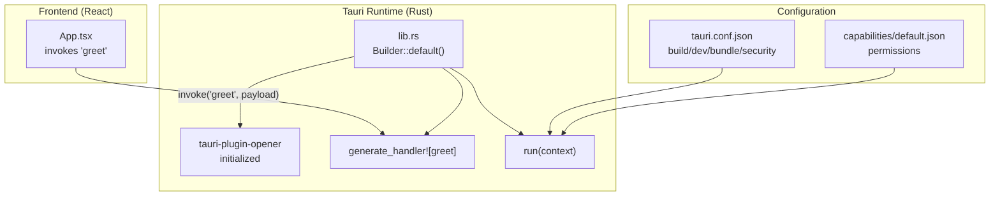
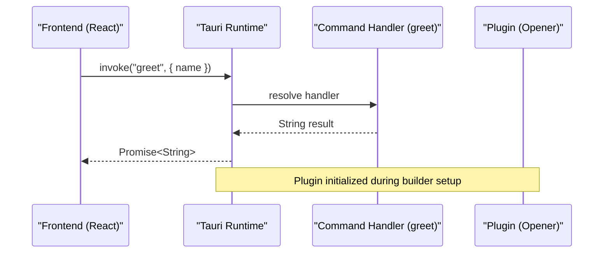
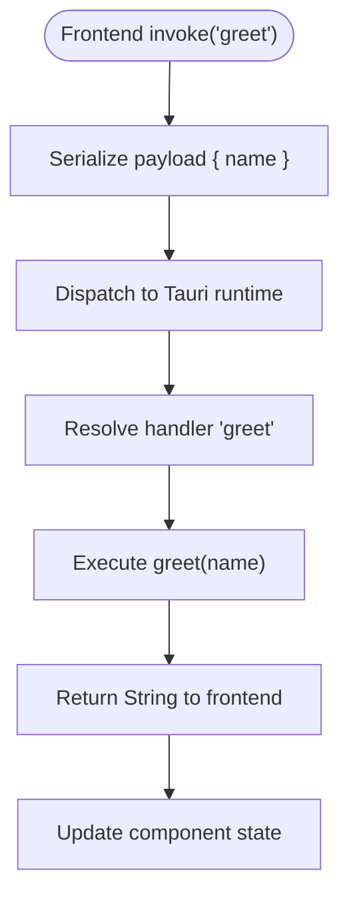
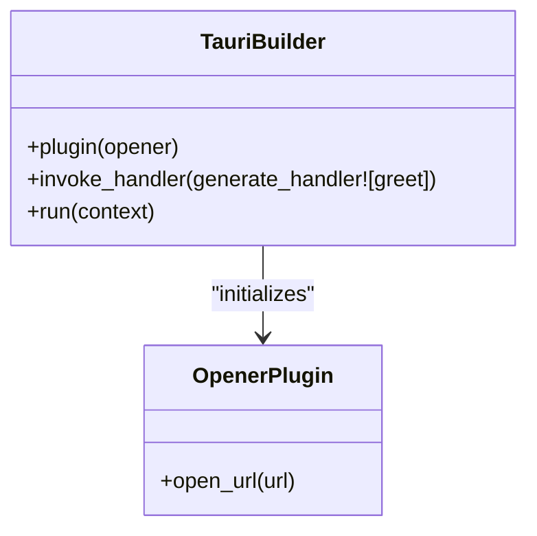
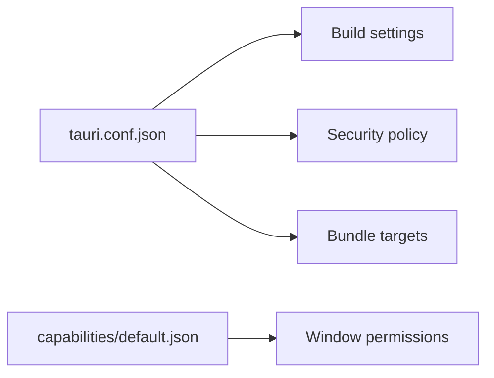
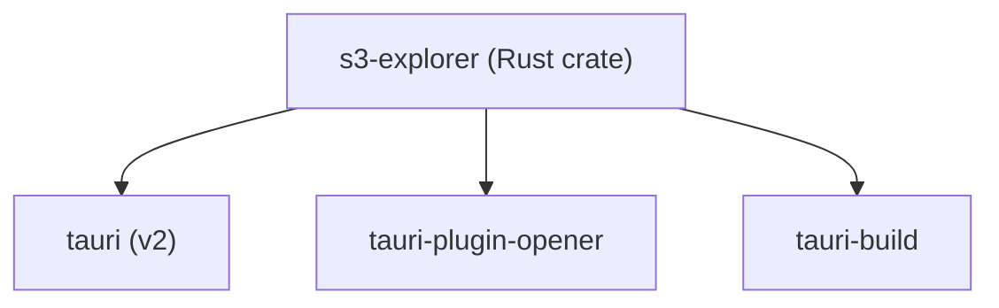

# Backend Integration

<cite>
**Referenced Files in This Document**
- [Cargo.toml](file://src-tauri/Cargo.toml)
- [main.rs](file://src-tauri/src/main.rs)
- [lib.rs](file://src-tauri/src/lib.rs)
- [tauri.conf.json](file://src-tauri/tauri.conf.json)
- [default.json](file://src-tauri/capabilities/default.json)
- [build.rs](file://src-tauri/build.rs)
- [App.tsx](file://src/App.tsx)
- [index.ts](file://src/types/index.ts)
- [PROJECT.md](file://PROJECT.md)
</cite>

## Table of Contents
1. [Introduction](#introduction)
2. [Project Structure](#project-structure)
3. [Core Components](#core-components)
4. [Architecture Overview](#architecture-overview)
5. [Detailed Component Analysis](#detailed-component-analysis)
6. [Dependency Analysis](#dependency-analysis)
7. [Performance Considerations](#performance-considerations)
8. [Troubleshooting Guide](#troubleshooting-guide)
9. [Conclusion](#conclusion)

## Introduction
This document explains the backend integration for S3 Explorer’s Tauri v2 Rust implementation. It covers the Tauri command system, IPC communication patterns between the frontend and backend, and how the Rust backend initializes plugins and exposes commands. It also outlines the Tauri configuration, capability permissions, and how the backend prepares the runtime for system-level operations. While the current repository snapshot focuses on a minimal greeting command and basic configuration, this guide provides the architectural foundation and extension points required to integrate AWS SDK-based S3 operations in the future.

## Project Structure
The backend is organized under src-tauri with a minimal Rust crate exposing a single greeting command and initializing Tauri with a plugin. The frontend is a React application that invokes Tauri commands via @tauri-apps/api. The Tauri configuration defines build, app, and bundling settings, while capabilities define permission sets for windows.

**Diagram sources**
- [lib.rs:8-14](file://src-tauri/src/lib.rs#L8-L14)
- [tauri.conf.json:6-35](file://src-tauri/tauri.conf.json#L6-L35)
- [default.json:6-9](file://src-tauri/capabilities/default.json#L6-L9)

**Section sources**
- [Cargo.toml:1-26](file://src-tauri/Cargo.toml#L1-L26)
- [main.rs:4-6](file://src-tauri/src/main.rs#L4-L6)
- [lib.rs:8-14](file://src-tauri/src/lib.rs#L8-L14)
- [tauri.conf.json:6-35](file://src-tauri/tauri.conf.json#L6-L35)
- [default.json:6-9](file://src-tauri/capabilities/default.json#L6-L9)

## Core Components
- Tauri Builder and Plugin Initialization
  - The backend initializes Tauri with a plugin for opening URLs and registers the greeting command handler.
  - The builder pattern configures the application runtime and runs it with generated context.

- Command System
  - A single command is exposed: greet(name: &str) -> String. The command signature and return type are defined in Rust and callable from the frontend via Tauri’s invoke mechanism.

- IPC Communication Pattern
  - The frontend uses @tauri-apps/api to invoke commands by name and pass JSON-serializable payloads. The greeting example demonstrates passing a name string and receiving a formatted response.

- Capability Permissions
  - Capabilities define the permission set for the main window, including core permissions and opener defaults. These permissions govern what the frontend can request from the backend.

**Section sources**
- [lib.rs:2-5](file://src-tauri/src/lib.rs#L2-L5)
- [lib.rs:10-12](file://src-tauri/src/lib.rs#L10-L12)
- [App.tsx:10-12](file://src/App.tsx#L10-L12)
- [default.json:6-9](file://src-tauri/capabilities/default.json#L6-L9)

## Architecture Overview
The backend architecture centers on Tauri’s command invocation model. The frontend sends an invoke request with a command name and payload. Tauri resolves the command in the Rust backend, executes the handler, and returns a structured result to the frontend. Plugins are initialized during builder setup to extend capabilities (e.g., opening external links).

**Diagram sources**
- [App.tsx:10-12](file://src/App.tsx#L10-L12)
- [lib.rs:10-12](file://src-tauri/src/lib.rs#L10-L12)

## Detailed Component Analysis

### Tauri Command System
- Command Declaration
  - The greet command is declared with #[tauri::command] and returns a String. This signature is registered with the Tauri handler generator.

- Handler Registration
  - The command is included in generate_handler!([...]) so Tauri can route invoke("greet", ...) to the Rust function.

- Frontend Invocation
  - The frontend calls invoke("greet", { name }) and awaits the returned string, updating UI state accordingly.

**Diagram sources**
- [App.tsx:10-12](file://src/App.tsx#L10-L12)
- [lib.rs:2-5](file://src-tauri/src/lib.rs#L2-L5)
- [lib.rs:11](file://src-tauri/src/lib.rs#L11)

**Section sources**
- [lib.rs:2-5](file://src-tauri/src/lib.rs#L2-L5)
- [lib.rs:11](file://src-tauri/src/lib.rs#L11)
- [App.tsx:10-12](file://src/App.tsx#L10-L12)

### Plugin System and Initialization
- Plugin Initialization
  - The opener plugin is initialized during builder setup, enabling the backend to support opening external resources when needed.

- Builder Lifecycle
  - The builder is configured with default settings, plugin registration, command handlers, and finally run with generated context.

**Diagram sources**
- [lib.rs:10-12](file://src-tauri/src/lib.rs#L10-L12)

**Section sources**
- [lib.rs:10-12](file://src-tauri/src/lib.rs#L10-L12)

### Tauri Configuration and Capabilities
- Application Configuration
  - tauri.conf.json defines build scripts, dev URL, frontend distribution path, window properties, security policy, and bundling targets.

- Capability Definition
  - capabilities/default.json assigns permissions to the main window, including core permissions and opener defaults.

**Diagram sources**
- [tauri.conf.json:6-35](file://src-tauri/tauri.conf.json#L6-L35)
- [default.json:6-9](file://src-tauri/capabilities/default.json#L6-L9)

**Section sources**
- [tauri.conf.json:6-35](file://src-tauri/tauri.conf.json#L6-L35)
- [default.json:6-9](file://src-tauri/capabilities/default.json#L6-L9)

### Extension Point: Adding S3 Commands
While the current backend exposes only a greeting command, the Tauri command system supports adding S3-related commands. Based on the project’s documented S3 operations, typical command categories include:

- Connection Management
  - List connections, add/update/delete connections, and validate credentials.

- Bucket and Object Operations
  - List buckets, list objects with delimiter handling, get object info, copy/rename/delete objects, and create folders.

- Transfer Operations
  - Upload (single/multipart), download (streamed), and progress tracking.

- Presigned URLs
  - Generate signed URLs for sharing.

- Local Filesystem Access
  - Read/write temporary files, open directories, and manage downloads.

These would be implemented as additional #[tauri::command] functions, registered via generate_handler!, and invoked from the frontend using @tauri-apps/api. The frontend types and stores (from the project overview) provide the data contracts and state management scaffolding for these features.

Note: The above describes intended extensions and does not reflect existing code in the repository snapshot.

**Section sources**
- [PROJECT.md:143-168](file://PROJECT.md#L143-L168)
- [index.ts:38-98](file://src/types/index.ts#L38-L98)

## Dependency Analysis
The backend crate depends on Tauri core and the opener plugin. The build process is driven by tauri-build. The frontend depends on @tauri-apps/api for invoking commands and @aws-sdk/client-s3 for S3 operations.

**Diagram sources**
- [Cargo.toml:20-25](file://src-tauri/Cargo.toml#L20-L25)

**Section sources**
- [Cargo.toml:20-25](file://src-tauri/Cargo.toml#L20-L25)

## Performance Considerations
- Command Execution Overhead
  - Each invoke triggers serialization/deserialization and cross-language boundaries. Batch operations and coalescing requests can reduce overhead.

- Streaming Large Transfers
  - For large downloads/uploads, streaming via Rust-backed streams minimizes memory pressure compared to JavaScript-based fetch.

- Concurrency and Backpressure
  - Limit concurrent transfers and use backpressure to avoid overwhelming the network stack or local disk.

- Caching and Pagination
  - Cache frequently accessed metadata and paginate listings to reduce latency and bandwidth usage.

[No sources needed since this section provides general guidance]

## Troubleshooting Guide
- Command Not Found
  - Ensure the command is declared with #[tauri::command] and included in generate_handler!. Verify the command name matches the frontend invoke call.

- Permission Denied
  - Confirm the capability set grants the required permissions for the window. Adjust capabilities/default.json if new features require additional permissions.

- Plugin Initialization Issues
  - Verify plugin initialization occurs during builder setup. Misplaced plugin registration can prevent features from working.

- Frontend Invoke Errors
  - Check that payloads are serializable and match expected types. Validate return types on the Rust side and handle errors gracefully.

**Section sources**
- [lib.rs:10-12](file://src-tauri/src/lib.rs#L10-L12)
- [default.json:6-9](file://src-tauri/capabilities/default.json#L6-L9)

## Conclusion
The S3 Explorer backend currently demonstrates Tauri v2’s minimal command exposure and plugin initialization. The architecture cleanly separates frontend IPC via @tauri-apps/api from backend command handlers written in Rust. With the established builder pattern, capability permissions, and configuration, the system is ready to expand into full S3 operations. Future work should focus on implementing S3 commands, integrating AWS SDK abstractions, and securing credential handling per the project’s guidance.