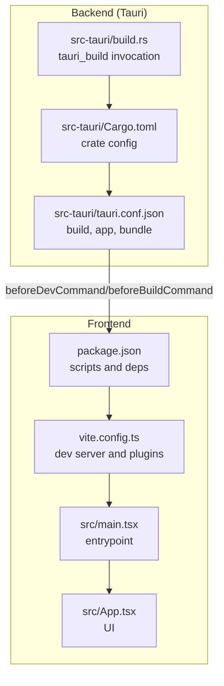
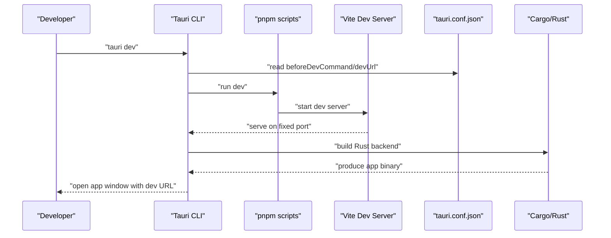
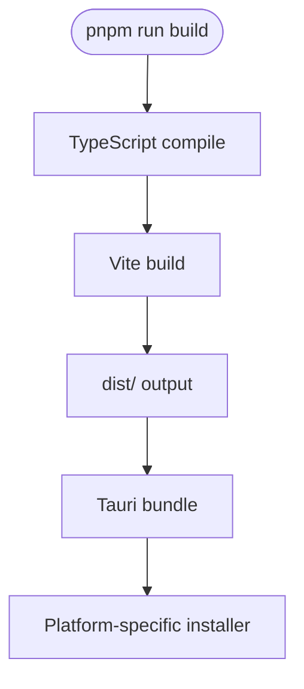
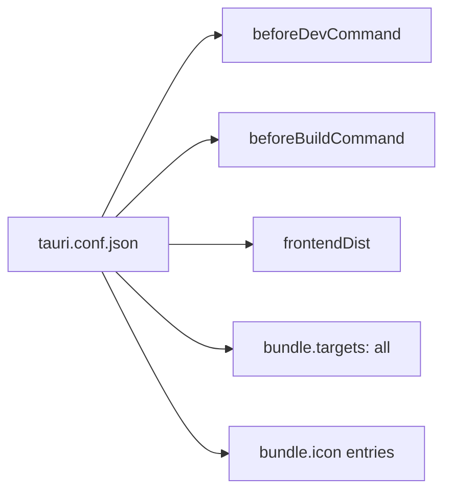
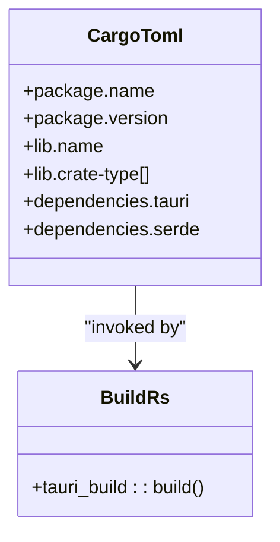
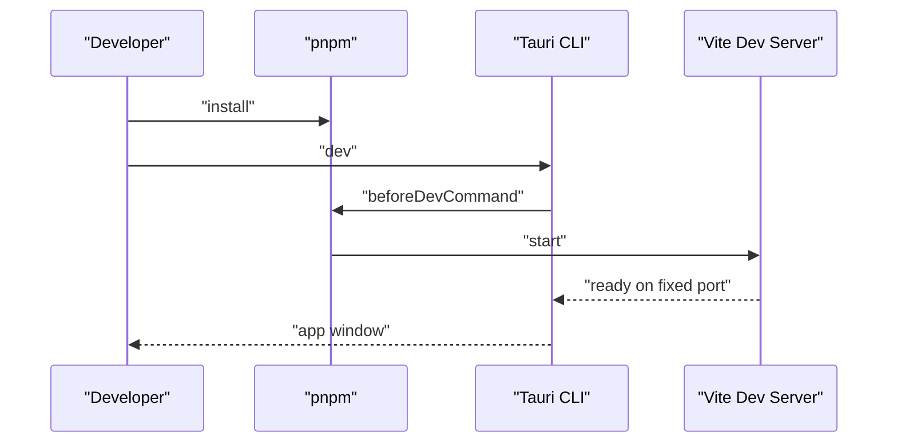
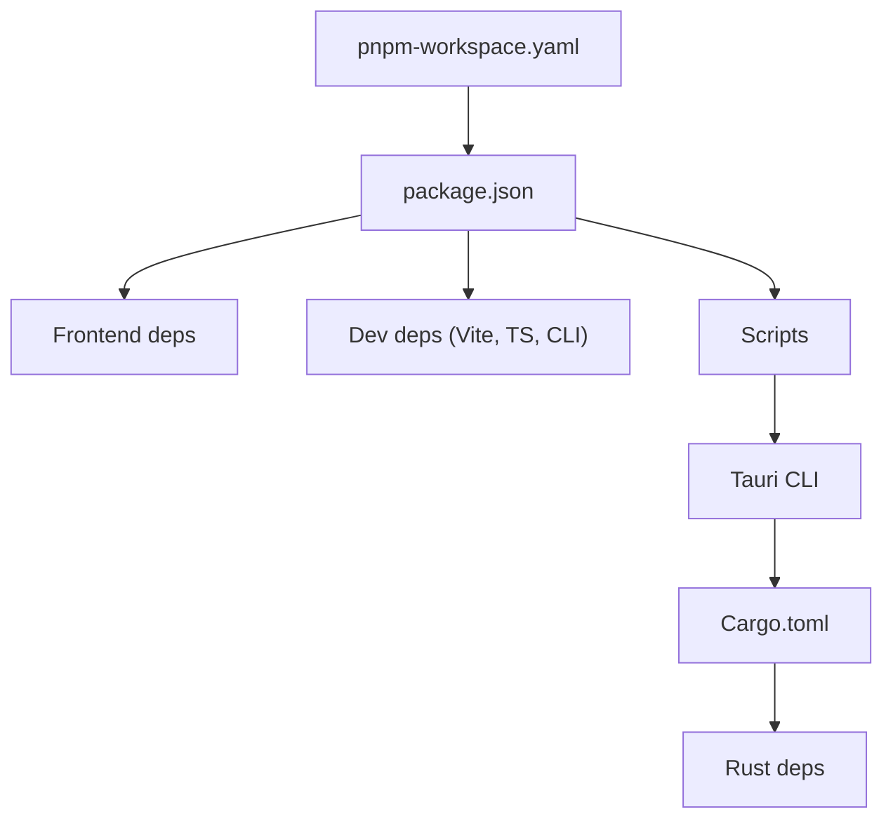
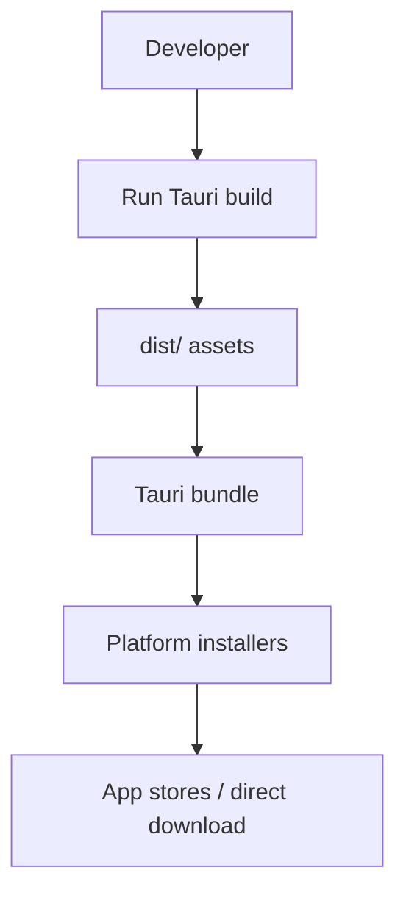

# Build & Deployment

<cite>
**Referenced Files in This Document**
- [package.json](file://package.json)
- [vite.config.ts](file://vite.config.ts)
- [tsconfig.json](file://tsconfig.json)
- [tsconfig.node.json](file://tsconfig.node.json)
- [pnpm-workspace.yaml](file://pnpm-workspace.yaml)
- [src-tauri/Cargo.toml](file://src-tauri/Cargo.toml)
- [src-tauri/build.rs](file://src-tauri/build.rs)
- [src-tauri/tauri.conf.json](file://src-tauri/tauri.conf.json)
- [src/main.tsx](file://src/main.tsx)
- [src/App.tsx](file://src/App.tsx)
- [README.md](file://README.md)
- [PROJECT.md](file://PROJECT.md)
</cite>

## Table of Contents
1. [Introduction](#introduction)
2. [Project Structure](#project-structure)
3. [Core Components](#core-components)
4. [Architecture Overview](#architecture-overview)
5. [Detailed Component Analysis](#detailed-component-analysis)
6. [Dependency Analysis](#dependency-analysis)
7. [Performance Considerations](#performance-considerations)
8. [Troubleshooting Guide](#troubleshooting-guide)
9. [Release and Distribution](#release-and-distribution)
10. [Conclusion](#conclusion)

## Introduction
This document explains how to build and deploy S3 Explorer, a Tauri v2 desktop application with a React + TypeScript frontend and a Rust backend. It covers the development workflow, production builds, bundling and distribution targets, configuration options, environment variables, and troubleshooting common build issues. It also outlines the release process and distribution methods for Windows, macOS, and Linux.

## Project Structure
The project follows a dual-repo-like structure:
- Frontend: React + TypeScript configured with Vite and Tailwind CSS.
- Backend: Tauri v2 Rust crate with Cargo configuration and Tauri app configuration.

Key build-related files:
- Frontend build and scripts are defined in the root package manifest.
- Vite configuration sets up the dev server, HMR, and ignores backend directories.
- Tauri configuration orchestrates frontend build, dev URL, and bundling targets.
- Rust crate configuration defines dependencies and build artifacts.

**Diagram sources**
- [package.json:1-37](file://package.json#L1-L37)
- [vite.config.ts:1-34](file://vite.config.ts#L1-L34)
- [src/main.tsx:1-10](file://src/main.tsx#L1-L10)
- [src/App.tsx:1-56](file://src/App.tsx#L1-L56)
- [src-tauri/Cargo.toml:1-26](file://src-tauri/Cargo.toml#L1-L26)
- [src-tauri/build.rs:1-4](file://src-tauri/build.rs#L1-L4)
- [src-tauri/tauri.conf.json:1-36](file://src-tauri/tauri.conf.json#L1-L36)

**Section sources**
- [package.json:1-37](file://package.json#L1-L37)
- [vite.config.ts:1-34](file://vite.config.ts#L1-L34)
- [src-tauri/tauri.conf.json:1-36](file://src-tauri/tauri.conf.json#L1-L36)
- [src-tauri/Cargo.toml:1-26](file://src-tauri/Cargo.toml#L1-L26)
- [src/main.tsx:1-10](file://src/main.tsx#L1-L10)
- [src/App.tsx:1-56](file://src/App.tsx#L1-L56)

## Core Components
- Frontend build pipeline:
  - Scripts orchestrate TypeScript compilation and Vite build.
  - Vite runs on a fixed port during Tauri development and previews the built app.
  - Tailwind CSS plugin is integrated for styling.
- Tauri configuration:
  - Dev command starts the frontend dev server; dev URL points to the Vite server.
  - Build command compiles the frontend and bundles it into the Tauri app.
  - Bundle targets all supported platforms and includes icons for each OS.
- Rust backend:
  - Cargo crate supports multiple library types for Tauri integration.
  - Build script delegates to Tauri’s build helpers.

**Section sources**
- [package.json:6-11](file://package.json#L6-L11)
- [vite.config.ts:9-33](file://vite.config.ts#L9-L33)
- [src-tauri/tauri.conf.json:6-11](file://src-tauri/tauri.conf.json#L6-L11)
- [src-tauri/Cargo.toml:10-15](file://src-tauri/Cargo.toml#L10-L15)
- [src-tauri/build.rs:1-4](file://src-tauri/build.rs#L1-L4)

## Architecture Overview
The build and run flow connects the frontend and backend as follows:
- Development: Tauri CLI invokes the frontend dev script, Vite serves the UI, and Tauri injects it into the window.
- Production: Tauri builds the frontend, embeds it, and packages native installers per platform.

**Diagram sources**
- [src-tauri/tauri.conf.json:7-9](file://src-tauri/tauri.conf.json#L7-L9)
- [package.json:7](file://package.json#L7)
- [vite.config.ts:17-21](file://vite.config.ts#L17-L21)
- [src-tauri/Cargo.toml:1-26](file://src-tauri/Cargo.toml#L1-L26)

## Detailed Component Analysis

### Frontend Build Pipeline
- Scripts:
  - Development: starts Vite dev server.
  - Build: compiles TypeScript then runs Vite build to produce static assets.
  - Preview: serves the built assets locally.
  - Tauri: invokes Tauri CLI.
- Vite configuration:
  - Fixed port and strict port enforcement for Tauri compatibility.
  - Optional host binding for remote HMR.
  - Ignores backend directories to avoid unnecessary rebuilds.
- TypeScript configuration:
  - Bundler module resolution and JSX runtime for Vite.
  - Strict TypeScript settings for safety.

**Diagram sources**
- [package.json:8](file://package.json#L8)
- [vite.config.ts:9-33](file://vite.config.ts#L9-L33)
- [tsconfig.json:10-15](file://tsconfig.json#L10-L15)

**Section sources**
- [package.json:6-11](file://package.json#L6-L11)
- [vite.config.ts:9-33](file://vite.config.ts#L9-L33)
- [tsconfig.json:1-26](file://tsconfig.json#L1-26)
- [tsconfig.node.json:1-11](file://tsconfig.node.json#L1-L11)

### Tauri Configuration and Bundling
- Build integration:
  - beforeDevCommand triggers the frontend dev server.
  - beforeBuildCommand triggers the frontend build.
  - frontendDist points to the built frontend assets.
- App configuration:
  - Single window with default size.
  - Security policy set to allow unrestricted CSP for development.
- Bundling:
  - Active bundling targeting all platforms.
  - Icons included for Windows, macOS, and Linux.

**Diagram sources**
- [src-tauri/tauri.conf.json:6-11](file://src-tauri/tauri.conf.json#L6-L11)
- [src-tauri/tauri.conf.json:24-34](file://src-tauri/tauri.conf.json#L24-L34)

**Section sources**
- [src-tauri/tauri.conf.json:1-36](file://src-tauri/tauri.conf.json#L1-L36)

### Rust Backend and Cargo Configuration
- Crate metadata and edition.
- Library types enable integration with Tauri frontends.
- Dependencies include Tauri core, optional opener plugin, and serialization crates.
- Build script integrates Tauri build helpers.

**Diagram sources**
- [src-tauri/Cargo.toml:1-26](file://src-tauri/Cargo.toml#L1-L26)
- [src-tauri/build.rs:1-4](file://src-tauri/build.rs#L1-L4)

**Section sources**
- [src-tauri/Cargo.toml:1-26](file://src-tauri/Cargo.toml#L1-L26)
- [src-tauri/build.rs:1-4](file://src-tauri/build.rs#L1-L4)

### Development Workflow
- Install dependencies with pnpm.
- Run Tauri in development mode to launch the Vite dev server and the Tauri window.
- The Vite dev server listens on a fixed port and supports hot module replacement.
- Remote HMR can be enabled by setting an environment variable for the host.

**Diagram sources**
- [PROJECT.md:187-192](file://PROJECT.md#L187-L192)
- [src-tauri/tauri.conf.json:7-9](file://src-tauri/tauri.conf.json#L7-L9)
- [vite.config.ts:17-21](file://vite.config.ts#L17-L21)

**Section sources**
- [PROJECT.md:187-192](file://PROJECT.md#L187-L192)
- [vite.config.ts:6-33](file://vite.config.ts#L6-L33)
- [pnpm-workspace.yaml:1-3](file://pnpm-workspace.yaml#L1-L3)

## Dependency Analysis
- Frontend dependencies include React, Tauri APIs, AWS SDK clients, state management, and UI libraries.
- Vite and TypeScript toolchains are dev dependencies.
- Tauri CLI is required for building and bundling the desktop app.
- pnpm workspace allows controlled builds and tooling.

**Diagram sources**
- [pnpm-workspace.yaml:1-3](file://pnpm-workspace.yaml#L1-L3)
- [package.json:12-35](file://package.json#L12-L35)
- [src-tauri/Cargo.toml:20-25](file://src-tauri/Cargo.toml#L20-L25)

**Section sources**
- [pnpm-workspace.yaml:1-3](file://pnpm-workspace.yaml#L1-L3)
- [package.json:12-35](file://package.json#L12-L35)
- [src-tauri/Cargo.toml:20-25](file://src-tauri/Cargo.toml#L20-L25)

## Performance Considerations
- Keep the dev server on a fixed port to avoid repeated reconfiguration overhead.
- Avoid rebuilding backend code during frontend edits by relying on Vite’s fast refresh.
- Use the provided TypeScript bundler configuration to minimize emit overhead.
- For large downloads, leverage Rust-backed commands to offload heavy work from JavaScript.

[No sources needed since this section provides general guidance]

## Troubleshooting Guide
- Port conflicts during development:
  - The dev server enforces a fixed port and strict port mode. Ensure the port is free or adjust the configuration accordingly.
- Remote HMR not working:
  - Set the environment variable for the host to enable remote HMR and configure the correct protocol and port.
- Ignoring backend directories:
  - Vite is configured to ignore the backend directory to reduce unnecessary watchers and rebuilds.
- TypeScript bundler mode:
  - Ensure bundler module resolution and JSX runtime match the Vite setup to avoid module resolution errors.
- Tauri build failures:
  - Verify the beforeBuildCommand produces the expected dist directory and that frontendDist matches the output path.
- Missing icons or incorrect bundle:
  - Confirm icon paths in the bundle configuration exist and are named correctly for each platform.

**Section sources**
- [vite.config.ts:17-31](file://vite.config.ts#L17-L31)
- [vite.config.ts:6](file://vite.config.ts#L6)
- [tsconfig.json:10-15](file://tsconfig.json#L10-L15)
- [src-tauri/tauri.conf.json:10](file://src-tauri/tauri.conf.json#L10)
- [src-tauri/tauri.conf.json:32-33](file://src-tauri/tauri.conf.json#L32-L33)

## Release and Distribution
- Build for production:
  - Run the Tauri build command to compile the Rust backend and bundle the frontend assets.
- Targets:
  - The configuration targets all platforms. Adjust targets if you want to limit builds to specific platforms.
- Icons:
  - Provide platform-appropriate icons for Windows, macOS, and Linux as configured.
- Distribution:
  - After building, Tauri generates platform-specific installers suitable for distribution.
- Signing and notarization:
  - Apply platform-specific code signing and notarization as required by each OS. Configure signing identities and entitlements in the Tauri configuration as needed for your distribution channel.

**Diagram sources**
- [src-tauri/tauri.conf.json:9-11](file://src-tauri/tauri.conf.json#L9-L11)
- [src-tauri/tauri.conf.json:26](file://src-tauri/tauri.conf.json#L26)
- [src-tauri/tauri.conf.json:32-33](file://src-tauri/tauri.conf.json#L32-L33)

**Section sources**
- [src-tauri/tauri.conf.json:24-34](file://src-tauri/tauri.conf.json#L24-L34)
- [PROJECT.md:194-199](file://PROJECT.md#L194-L199)

## Conclusion
S3 Explorer’s build and deployment pipeline integrates a modern React + TypeScript frontend with Vite and a Tauri v2 Rust backend. By leveraging the provided configuration files and scripts, developers can reliably run in development mode, produce optimized production builds, and distribute installers across Windows, macOS, and Linux. For production releases, ensure platform-specific signing and notarization are configured and tested prior to distribution.