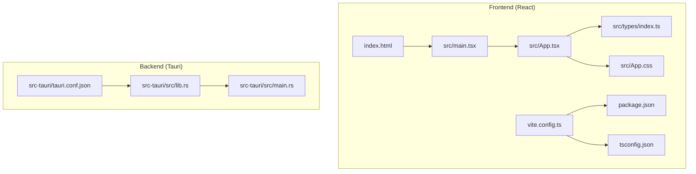
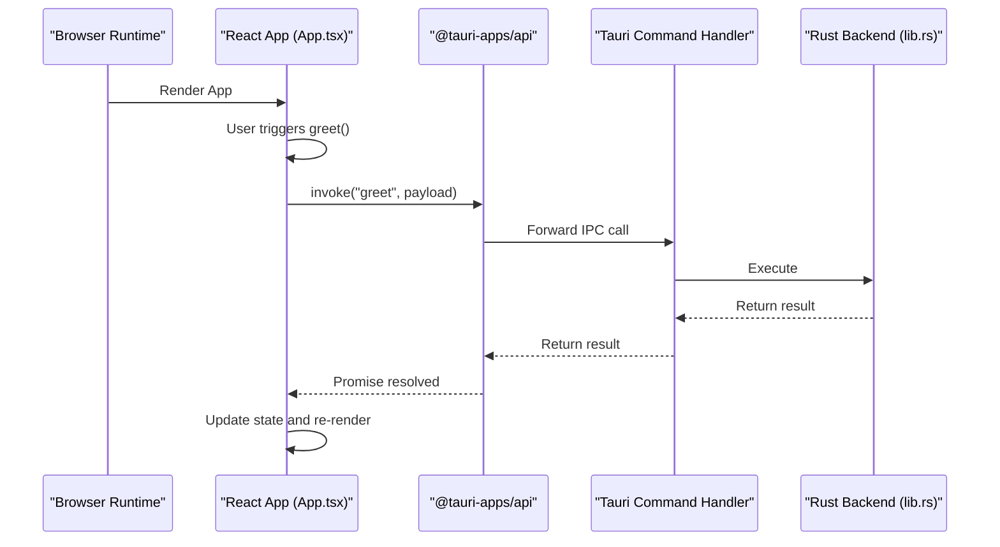
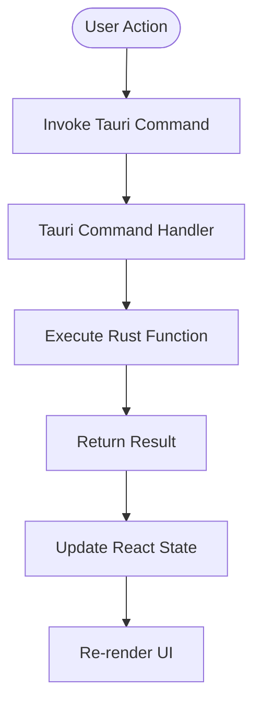
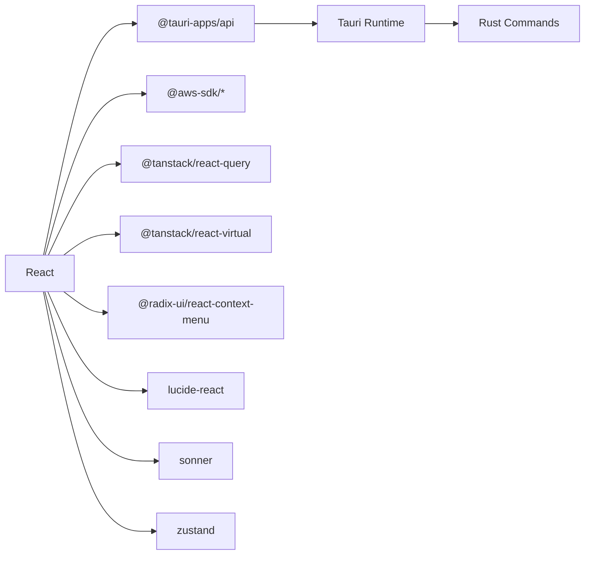

# Frontend Architecture

<cite>
**Referenced Files in This Document**
- [src/main.tsx](file://src/main.tsx)
- [src/App.tsx](file://src/App.tsx)
- [src/App.css](file://src/App.css)
- [vite.config.ts](file://vite.config.ts)
- [package.json](file://package.json)
- [tsconfig.json](file://tsconfig.json)
- [tsconfig.node.json](file://tsconfig.node.json)
- [index.html](file://index.html)
- [src/vite-env.d.ts](file://src/vite-env.d.ts)
- [src/types/index.ts](file://src/types/index.ts)
- [src-tauri/tauri.conf.json](file://src-tauri/tauri.conf.json)
- [src-tauri/src/lib.rs](file://src-tauri/src/lib.rs)
- [src-tauri/src/main.rs](file://src-tauri/src/main.rs)
- [PROJECT.md](file://PROJECT.md)
</cite>

## Table of Contents
1. [Introduction](#introduction)
2. [Project Structure](#project-structure)
3. [Core Components](#core-components)
4. [Architecture Overview](#architecture-overview)
5. [Detailed Component Analysis](#detailed-component-analysis)
6. [Dependency Analysis](#dependency-analysis)
7. [Performance Considerations](#performance-considerations)
8. [Troubleshooting Guide](#troubleshooting-guide)
9. [Conclusion](#conclusion)
10. [Appendices](#appendices)

## Introduction
This document describes the frontend architecture of S3 Explorer, a Tauri v2 desktop application built with React, TypeScript, and Tailwind CSS. It explains the component structure, main application entry points, styling approach, React component hierarchy, TypeScript type definitions, and integration with Tauri commands. It also covers state management patterns, UI rendering optimizations, build configuration with Vite, and the frontend-to-backend communication model via Tauri's IPC system.

## Project Structure
The project follows a clear separation between the React frontend and the Tauri Rust backend:
- Frontend: React application under src/, with TypeScript types under src/types/, Tailwind CSS integration, and Vite build tooling.
- Backend: Tauri application under src-tauri/, exposing commands invoked by the frontend.

**Diagram sources**
- [index.html](file://index.html)
- [src/main.tsx](file://src/main.tsx)
- [src/App.tsx](file://src/App.tsx)
- [src/types/index.ts](file://src/types/index.ts)
- [src/App.css](file://src/App.css)
- [vite.config.ts](file://vite.config.ts)
- [package.json](file://package.json)
- [tsconfig.json](file://tsconfig.json)
- [src-tauri/tauri.conf.json](file://src-tauri/tauri.conf.json)
- [src-tauri/src/lib.rs](file://src-tauri/src/lib.rs)
- [src-tauri/src/main.rs](file://src-tauri/src/main.rs)

**Section sources**
- [index.html](file://index.html)
- [src/main.tsx](file://src/main.tsx)
- [src/App.tsx](file://src/App.tsx)
- [src/types/index.ts](file://src/types/index.ts)
- [src/App.css](file://src/App.css)
- [vite.config.ts](file://vite.config.ts)
- [package.json](file://package.json)
- [tsconfig.json](file://tsconfig.json)
- [src-tauri/tauri.conf.json](file://src-tauri/tauri.conf.json)
- [src-tauri/src/lib.rs](file://src-tauri/src/lib.rs)
- [src-tauri/src/main.rs](file://src-tauri/src/main.rs)

## Core Components
- Application entry point: mounts the React root and renders the top-level App component.
- Root component: demonstrates Tauri IPC invocation via @tauri-apps/api and applies Tailwind-based styling.
- Type system: centralized TypeScript definitions for S3 providers, items, navigation, transfers, and UI states.
- Styling: Tailwind CSS configured via Vite plugin with a base stylesheet for cross-framework hover effects.

Key implementation references:
- Entry point mounting: [src/main.tsx](file://src/main.tsx)
- Root component with IPC and Tailwind classes: [src/App.tsx](file://src/App.tsx)
- Base styles and dark mode support: [src/App.css](file://src/App.css)
- TypeScript type definitions: [src/types/index.ts](file://src/types/index.ts)

**Section sources**
- [src/main.tsx](file://src/main.tsx)
- [src/App.tsx](file://src/App.tsx)
- [src/App.css](file://src/App.css)
- [src/types/index.ts](file://src/types/index.ts)

## Architecture Overview
The frontend and backend communicate through Tauri’s IPC:
- The frontend invokes Rust commands using @tauri-apps/api invoke.
- The backend registers commands in lib.rs and runs the Tauri runtime.
- Vite serves the React app during development and bundles it for production, with Tauri embedding the frontend distribution.

**Diagram sources**
- [src/App.tsx](file://src/App.tsx)
- [src-tauri/src/lib.rs](file://src-tauri/src/lib.rs)

**Section sources**
- [src/App.tsx](file://src/App.tsx)
- [src-tauri/src/lib.rs](file://src-tauri/src/lib.rs)

## Detailed Component Analysis

### Application Entry Point
- Mounts the React root and renders the App component within StrictMode.
- Ensures the DOM element with id "root" exists in index.html.

Implementation references:
- Root mount: [src/main.tsx](file://src/main.tsx)
- DOM container: [index.html](file://index.html)

**Section sources**
- [src/main.tsx](file://src/main.tsx)
- [index.html](file://index.html)

### Root Component (App)
- Demonstrates state management with useState for user input and response messages.
- Uses @tauri-apps/api invoke to call a backend command named "greet".
- Applies Tailwind utility classes for responsive layout, spacing, and dark mode-aware colors.
- Includes interactive form elements styled with Tailwind and semantic markup.

Implementation references:
- State and event handlers: [src/App.tsx](file://src/App.tsx)
- Tailwind-based styling: [src/App.tsx](file://src/App.tsx)
- Base stylesheet for framework logos: [src/App.css](file://src/App.css)

**Section sources**
- [src/App.tsx](file://src/App.tsx)
- [src/App.css](file://src/App.css)

### Build and Tooling (Vite + Tailwind)
- Vite configuration enables React and Tailwind CSS plugins, sets a fixed port for Tauri development, and ignores src-tauri from watching.
- Tailwind CSS v4 is integrated via @tailwindcss/vite plugin.
- TypeScript configuration targets ES2020 with bundler module resolution and JSX transform for React.

Implementation references:
- Vite config: [vite.config.ts](file://vite.config.ts)
- Package scripts and dependencies: [package.json](file://package.json)
- TypeScript compiler options: [tsconfig.json](file://tsconfig.json)
- Node-specific TS config: [tsconfig.node.json](file://tsconfig.node.json)

**Section sources**
- [vite.config.ts](file://vite.config.ts)
- [package.json](file://package.json)
- [tsconfig.json](file://tsconfig.json)
- [tsconfig.node.json](file://tsconfig.node.json)

### Styling Approach (Tailwind CSS)
- Tailwind is loaded via the Vite plugin and configured globally.
- Base CSS defines logo hover effects and dark mode variants for framework logos.
- React components apply Tailwind utility classes for layout, colors, and responsiveness.

Implementation references:
- Tailwind plugin registration: [vite.config.ts](file://vite.config.ts)
- Base stylesheet: [src/App.css](file://src/App.css)

**Section sources**
- [vite.config.ts](file://vite.config.ts)
- [src/App.css](file://src/App.css)

### TypeScript Type Definitions
Centralized type definitions for S3 Explorer domain:
- Provider and item types: S3Provider, ItemType, TransferType, TransferStatus, SortField, SortDirection.
- Domain models: S3Connection, S3Item, NavigationState, BreadcrumbItem, Transfer, ItemInfo, PresignedUrlResult.
- UI and API helpers: FileContextAction, FolderContextAction, ContextMenuTarget, AsyncState, ListBucketsResult, ListObjectsResult.
- Filter and sort configurations: SortConfig, FilterConfig.

Implementation references:
- Type definitions: [src/types/index.ts](file://src/types/index.ts)
- Project overview and intended structure: [PROJECT.md](file://PROJECT.md)

**Section sources**
- [src/types/index.ts](file://src/types/index.ts)
- [PROJECT.md](file://PROJECT.md)

### Tauri Integration and IPC
- Frontend invokes Rust commands via @tauri-apps/api invoke.
- Backend registers the greet command and runs the Tauri runtime.
- Vite dev server runs on a fixed port (1420) and forwards hot module replacement to the frontend.

Implementation references:
- IPC invocation in App: [src/App.tsx](file://src/App.tsx)
- Command registration: [src-tauri/src/lib.rs](file://src-tauri/src/lib.rs)
- Tauri configuration for dev/build: [src-tauri/tauri.conf.json](file://src-tauri/tauri.conf.json)
- Vite dev server settings: [vite.config.ts](file://vite.config.ts)

**Section sources**
- [src/App.tsx](file://src/App.tsx)
- [src-tauri/src/lib.rs](file://src-tauri/src/lib.rs)
- [src-tauri/tauri.conf.json](file://src-tauri/tauri.conf.json)
- [vite.config.ts](file://vite.config.ts)

### Conceptual Overview
The frontend-to-backend flow aligns with Tauri’s IPC model: React components trigger actions, the Tauri API forwards them to registered Rust commands, and results are returned to update React state and re-render the UI.

[No sources needed since this diagram shows conceptual workflow, not actual code structure]

## Dependency Analysis
External dependencies and their roles:
- React and ReactDOM: UI rendering and DOM management.
- @tauri-apps/api: IPC bridge to Rust backend.
- @aws-sdk/client-s3 and @aws-sdk/s3-request-presigner: S3 client and signed URL generation.
- @tanstack/react-query: asynchronous data fetching and caching.
- @tanstack/react-virtual: virtualized lists for performance.
- @radix-ui/react-context-menu: context menus.
- lucide-react: icons.
- sonner: toast notifications.
- zustand: lightweight state management.

Implementation references:
- Dependencies and scripts: [package.json](file://package.json)
- Project overview and intended stack: [PROJECT.md](file://PROJECT.md)

**Diagram sources**
- [package.json](file://package.json)
- [src-tauri/src/lib.rs](file://src-tauri/src/lib.rs)

**Section sources**
- [package.json](file://package.json)
- [PROJECT.md](file://PROJECT.md)
- [src-tauri/src/lib.rs](file://src-tauri/src/lib.rs)

## Performance Considerations
- Virtualization: Use @tanstack/react-virtual for large file lists to minimize DOM nodes and improve scrolling performance.
- Asynchronous data: Use @tanstack/react-query to cache and deduplicate network requests, manage loading states, and handle refetching efficiently.
- State management: Prefer zustand for small, focused stores to avoid unnecessary re-renders compared to heavier solutions.
- Styling: Leverage Tailwind utilities to reduce CSS overhead and maintain consistency.
- Build optimization: Vite provides fast development builds and optimized production bundles.

[No sources needed since this section provides general guidance]

## Troubleshooting Guide
- IPC invocation failures: Verify the command name matches between frontend invoke and backend registration.
- Dev server port conflicts: Ensure port 1420 is free; Vite is configured to enforce strict port usage during Tauri development.
- Missing assets: Confirm asset paths and that Vite ignores src-tauri during watch mode.
- TypeScript strictness: Compiler options enforce strict type checking; resolve unused locals/parameters and missing emits.

**Section sources**
- [vite.config.ts](file://vite.config.ts)
- [tsconfig.json](file://tsconfig.json)
- [src-tauri/src/lib.rs](file://src-tauri/src/lib.rs)

## Conclusion
S3 Explorer’s frontend leverages a modern React + TypeScript stack with Tailwind CSS for styling and Vite for build tooling. Tauri’s IPC enables seamless communication with the Rust backend, allowing the frontend to remain declarative and efficient. Centralized TypeScript types define the domain model, while external libraries address S3 operations, virtualization, state management, and UX polish. The architecture supports scalable enhancements such as advanced state stores, virtualized lists, and robust async data handling.

[No sources needed since this section summarizes without analyzing specific files]

## Appendices

### Appendix A: Frontend-to-Backend IPC Contract
- Command name: "greet"
- Payload: { name: string }
- Return: string greeting message
- Registration: see [src-tauri/src/lib.rs](file://src-tauri/src/lib.rs)
- Invocation site: see [src/App.tsx](file://src/App.tsx)

**Section sources**
- [src-tauri/src/lib.rs](file://src-tauri/src/lib.rs)
- [src/App.tsx](file://src/App.tsx)

### Appendix B: Development and Build Scripts
- Development: pnpm dev starts Vite dev server; pnpm tauri dev launches Tauri with the dev server URL.
- Build: pnpm build compiles TypeScript and bundles the frontend for production.
- Preview: pnpm preview serves the production bundle locally.

**Section sources**
- [package.json](file://package.json)
- [vite.config.ts](file://vite.config.ts)
- [src-tauri/tauri.conf.json](file://src-tauri/tauri.conf.json)