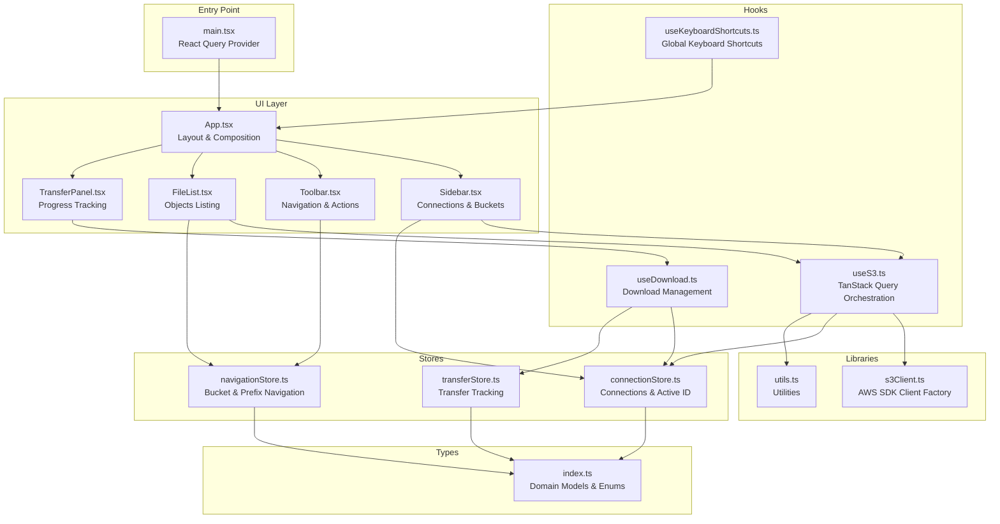
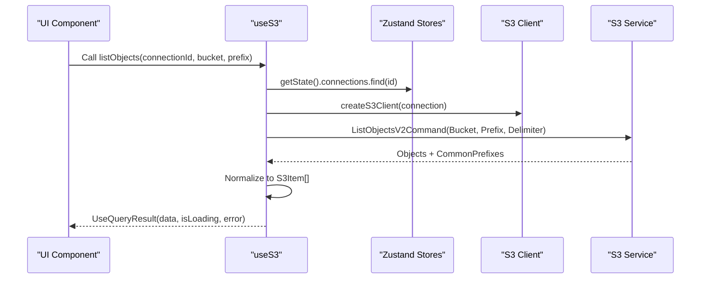
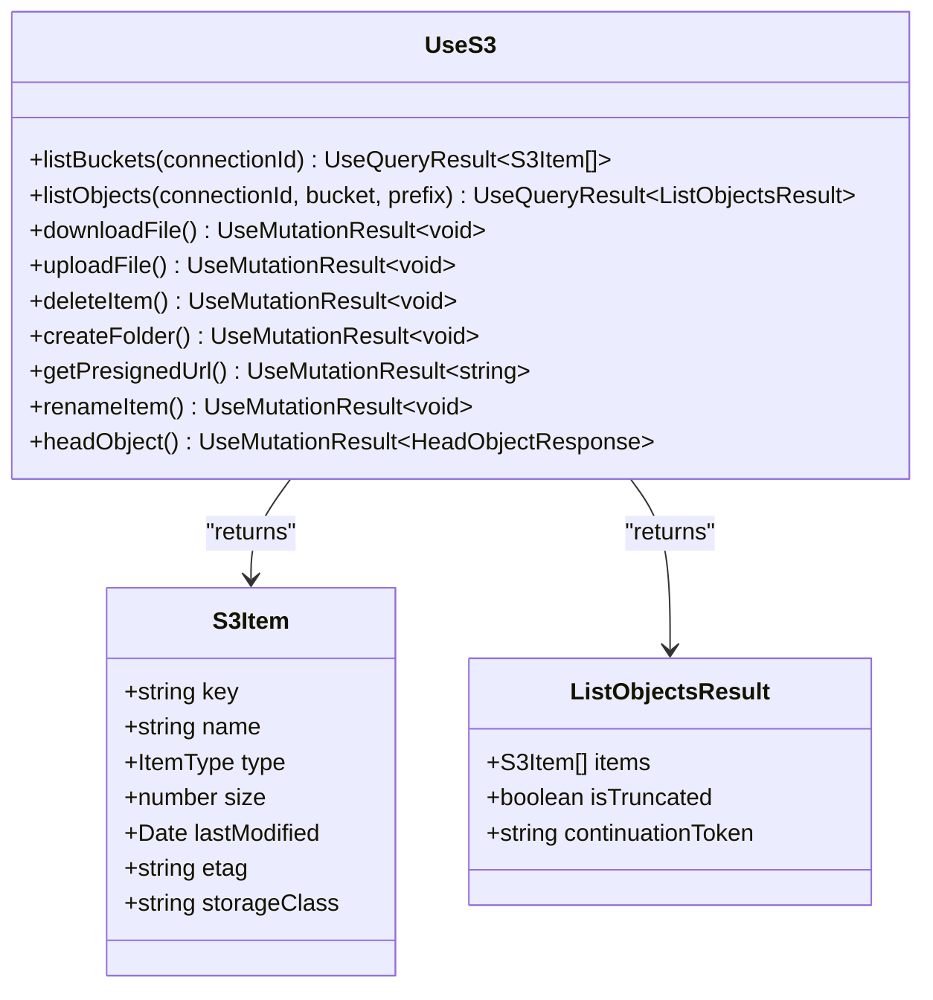
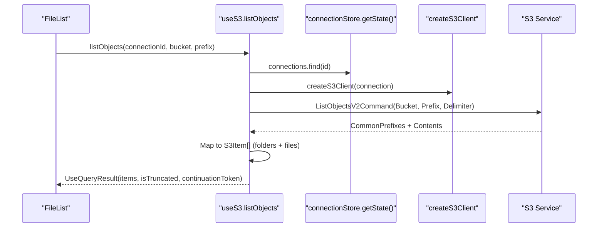
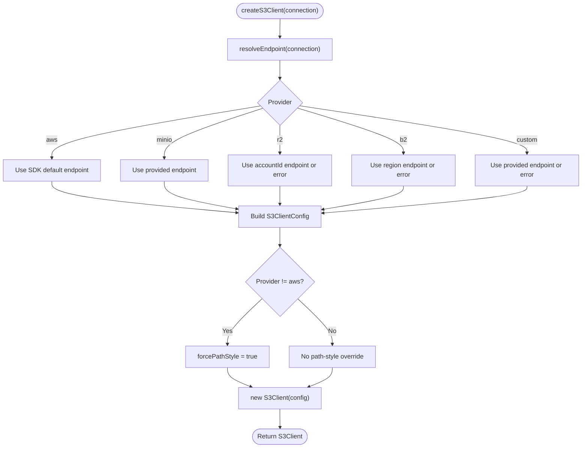
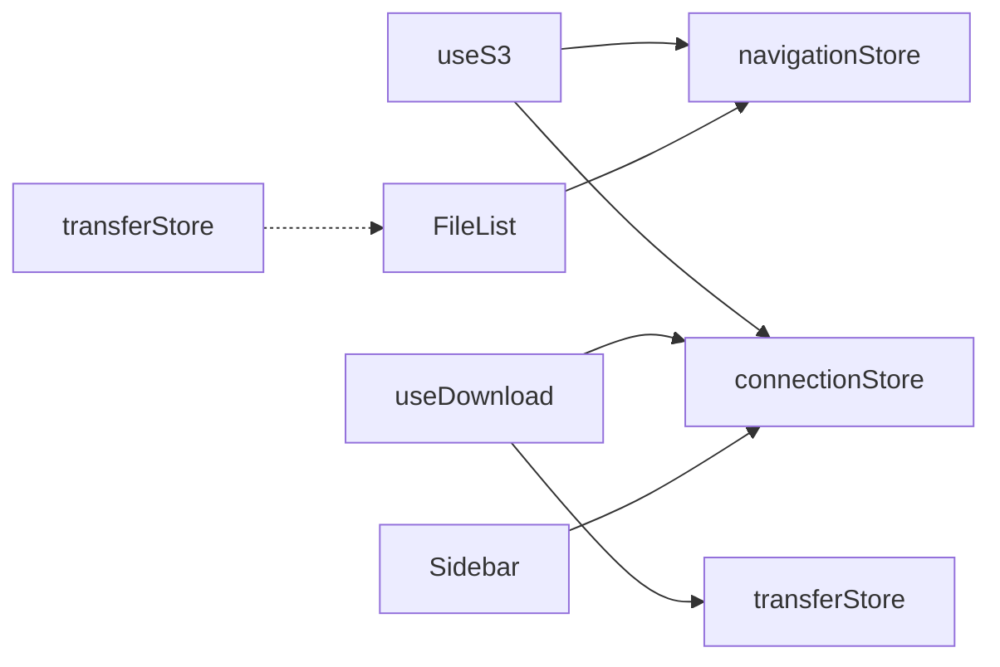
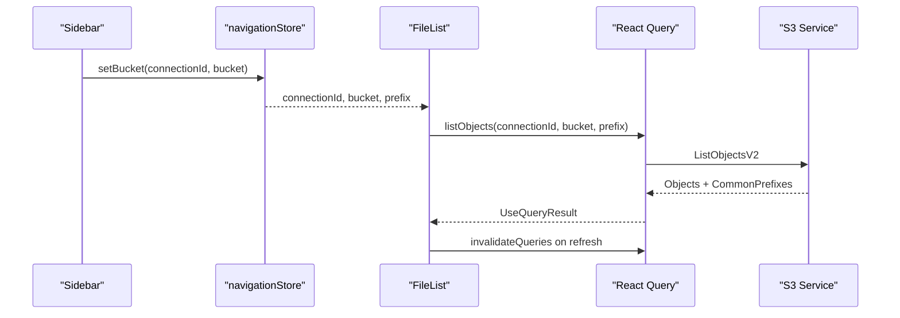
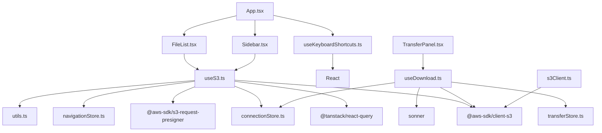

# React Hooks Architecture

<cite>
**Referenced Files in This Document**
- [useS3.ts](file://src/hooks/useS3.ts)
- [useKeyboardShortcuts.ts](file://src/hooks/useKeyboardShortcuts.ts)
- [useDownload.ts](file://src/hooks/useDownload.ts)
- [s3Client.ts](file://src/lib/s3Client.ts)
- [utils.ts](file://src/lib/utils.ts)
- [connectionStore.ts](file://src/store/connectionStore.ts)
- [navigationStore.ts](file://src/store/navigationStore.ts)
- [transferStore.ts](file://src/store/transferStore.ts)
- [index.ts](file://src/types/index.ts)
- [Sidebar.tsx](file://src/components/layout/Sidebar.tsx)
- [FileList.tsx](file://src/components/explorer/FileList.tsx)
- [Toolbar.tsx](file://src/components/layout/Toolbar.tsx)
- [App.tsx](file://src/App.tsx)
- [TransferPanel.tsx](file://src/components/layout/TransferPanel.tsx)
- [main.tsx](file://src/main.tsx)
</cite>

## Update Summary
**Changes Made**
- Added documentation for new useKeyboardShortcuts hook for global keyboard shortcuts
- Added documentation for new useDownload hook for file download management with progress tracking
- Updated architecture diagrams to reflect the expanded hook ecosystem
- Enhanced component integration patterns to show how new hooks work with existing infrastructure

## Table of Contents
1. [Introduction](#introduction)
2. [Project Structure](#project-structure)
3. [Core Components](#core-components)
4. [Architecture Overview](#architecture-overview)
5. [Detailed Component Analysis](#detailed-component-analysis)
6. [Dependency Analysis](#dependency-analysis)
7. [Performance Considerations](#performance-considerations)
8. [Troubleshooting Guide](#troubleshooting-guide)
9. [Conclusion](#conclusion)

## Introduction
This document explains the React Hooks architecture powering S3 Explorer, with a focus on the useS3 hook as the central orchestrator for all S3 operations. The architecture has been expanded to include useKeyboardShortcuts for global keyboard shortcuts and useDownload for comprehensive file download management with real-time progress tracking. The hooks integrate TanStack Query for data fetching and caching, encapsulate AWS SDK commands, and coordinate with local state stores for connections, navigation, and transfers. They provide typed query and mutation APIs for listing buckets, listing objects, uploading, downloading, renaming, deleting, and obtaining presigned URLs, while handling parameter validation, error propagation, and S3 item processing utilities.

## Project Structure
The application follows a feature-based structure with clear separation of concerns:
- Hooks: Central orchestration logic for S3 operations, UI interactions, and file operations
- Libraries: S3 client creation and shared utilities
- Stores: Global state for connections, navigation, and transfers
- Components: UI building blocks that consume hooks and stores
- Types: Shared TypeScript interfaces and enums



**Diagram sources**
- [main.tsx:1-26](file://src/main.tsx#L1-L26)
- [App.tsx:1-270](file://src/App.tsx#L1-L270)
- [Sidebar.tsx:1-184](file://src/components/layout/Sidebar.tsx#L1-L184)
- [FileList.tsx:1-402](file://src/components/explorer/FileList.tsx#L1-L402)
- [Toolbar.tsx:1-212](file://src/components/layout/Toolbar.tsx#L1-L212)
- [TransferPanel.tsx:1-208](file://src/components/layout/TransferPanel.tsx#L1-L208)
- [useS3.ts:1-410](file://src/hooks/useS3.ts#L1-L410)
- [useKeyboardShortcuts.ts:1-109](file://src/hooks/useKeyboardShortcuts.ts#L1-L109)
- [useDownload.ts:1-203](file://src/hooks/useDownload.ts#L1-L203)
- [s3Client.ts:1-83](file://src/lib/s3Client.ts#L1-L83)
- [utils.ts:1-197](file://src/lib/utils.ts#L1-L197)
- [connectionStore.ts:1-88](file://src/store/connectionStore.ts#L1-L88)
- [navigationStore.ts:1-86](file://src/store/navigationStore.ts#L1-L86)
- [transferStore.ts:1-62](file://src/store/transferStore.ts#L1-L62)
- [index.ts:1-166](file://src/types/index.ts#L1-L166)

**Section sources**
- [main.tsx:1-26](file://src/main.tsx#L1-L26)
- [App.tsx:1-270](file://src/App.tsx#L1-L270)
- [useS3.ts:1-410](file://src/hooks/useS3.ts#L1-L410)
- [useKeyboardShortcuts.ts:1-109](file://src/hooks/useKeyboardShortcuts.ts#L1-L109)
- [useDownload.ts:1-203](file://src/hooks/useDownload.ts#L1-L203)

## Core Components
- useS3: Central hook exporting TanStack Query-powered queries and mutations for S3 operations. It manages:
  - Query keys for caching and cache invalidation
  - Parameter validation and error handling
  - S3 item processing utilities
  - Connection resolution from the Zustand store
- useKeyboardShortcuts: Global keyboard shortcut manager that handles F5/Ctrl+R refresh, Backspace navigation, Ctrl+U upload, Delete selection, and Escape close actions while respecting text input contexts
- useDownload: Comprehensive download management system with real-time progress tracking, cancellation support, and large file handling
- s3Client: Creates configured S3 clients per provider with endpoint resolution and path-style addressing
- Utilities: Formatting helpers and S3 item name extraction
- Stores: Zustand stores for connections, navigation, and transfers
- Types: Strongly typed domain models and enums

**Section sources**
- [useS3.ts:47-410](file://src/hooks/useS3.ts#L47-L410)
- [useKeyboardShortcuts.ts:19-109](file://src/hooks/useKeyboardShortcuts.ts#L19-L109)
- [useDownload.ts:13-203](file://src/hooks/useDownload.ts#L13-L203)
- [s3Client.ts:51-83](file://src/lib/s3Client.ts#L51-L83)
- [utils.ts:13-197](file://src/lib/utils.ts#L13-L197)
- [connectionStore.ts:10-88](file://src/store/connectionStore.ts#L10-L88)
- [navigationStore.ts:29-86](file://src/store/navigationStore.ts#L29-L86)
- [transferStore.ts:28-62](file://src/store/transferStore.ts#L28-L62)
- [index.ts:38-166](file://src/types/index.ts#L38-L166)

## Architecture Overview
The architecture centers around the useS3 hook, which:
- Uses TanStack Query's useQuery/useMutation to manage server state
- Resolves S3 connections from the Zustand connection store
- Builds AWS SDK clients via s3Client with provider-specific endpoints
- Processes S3 items into normalized S3Item structures
- Integrates with navigation and transfer stores for UI state and progress tracking
- Complements useKeyboardShortcuts for global keyboard interaction
- Complements useDownload for comprehensive file operation management



**Diagram sources**
- [useS3.ts:69-144](file://src/hooks/useS3.ts#L69-L144)
- [s3Client.ts:60-82](file://src/lib/s3Client.ts#L60-L82)
- [connectionStore.ts:20-34](file://src/store/connectionStore.ts#L20-L34)

## Detailed Component Analysis

### useS3 Hook: Central Orchestrator
The useS3 hook exposes two categories of APIs:
- Queries (useQuery): listBuckets, listObjects
- Mutations (useMutation): downloadFile, uploadFile, deleteItem, createFolder, getPresignedUrl, renameItem, headObject

Key implementation patterns:
- Query keys: ["s3", "buckets"|"objects", connectionId, bucket?, prefix?] enable precise cache invalidation
- Enabled flags: queries only run when required parameters are truthy
- Parameter validation: throws descriptive errors for missing or invalid inputs
- S3 item normalization: converts raw AWS responses into S3Item structures with consistent fields
- Presigned URLs: generated for secure browser-based downloads and sharing

Return value structures:
- Queries return UseQueryResult<T> with data, isLoading, isError, error
- Mutations return UseMutationResult<T> with mutate/mutateAsync, data, isLoading, isError, error

Internal helper functions:
- getConnection: resolves connection from Zustand store; throws if not found
- nameFromKey: extracts display name from S3 key

Practical usage examples:
- Listing buckets: const { data, isLoading } = listBuckets(activeConnectionId)
- Listing objects: const { data, isLoading } = listObjects(connectionId, bucket, prefix)
- Uploading: await uploadFile().mutateAsync({ connectionId, bucket, prefix, file })
- Downloading: await downloadFile().mutateAsync({ connectionId, bucket, key })

Error handling strategies:
- Validation errors for invalid parameters (e.g., folder name)
- HTTP status checks on responses
- Propagation of thrown errors to React Query for UI rendering

Performance optimization techniques:
- Stale-time caching and retries configured at the QueryClient level
- Enabled flags prevent unnecessary requests
- Virtualization in FileList reduces DOM overhead

**Section sources**
- [useS3.ts:62-410](file://src/hooks/useS3.ts#L62-L410)

#### Class Diagram: useS3 Exposed APIs


**Diagram sources**
- [useS3.ts:62-410](file://src/hooks/useS3.ts#L62-L410)
- [index.ts:54-62](file://src/types/index.ts#L54-L62)
- [index.ts:158-165](file://src/types/index.ts#L158-L165)

#### Sequence Diagram: Object Listing Flow


**Diagram sources**
- [FileList.tsx:44-66](file://src/components/explorer/FileList.tsx#L44-L66)
- [useS3.ts:91-144](file://src/hooks/useS3.ts#L91-L144)
- [connectionStore.ts:20-34](file://src/store/connectionStore.ts#L20-L34)
- [s3Client.ts:60-82](file://src/lib/s3Client.ts#L60-L82)

### useKeyboardShortcuts: Global Keyboard Interaction
The useKeyboardShortcuts hook provides global keyboard shortcuts that are automatically disabled when users are typing in text inputs, textareas, or contenteditable elements. It handles the following shortcuts:

- **F5**: Refresh current view
- **Ctrl+R**: Refresh current view  
- **Backspace**: Navigate back (when not in an input)
- **Ctrl+U**: Open upload dialog
- **Delete**: Delete selected items (optional handler)
- **Escape**: Close modal / deselect

Implementation details:
- Uses `isEditable()` helper to detect when user is typing in form inputs
- Prevents default browser behavior for handled shortcuts
- Accepts callback handlers for each shortcut action
- Automatically cleans up event listeners on component unmount

Integration pattern:
- Used in App.tsx to provide global keyboard shortcuts for the entire application
- Handlers are passed from parent components to maintain separation of concerns
- Respects text input contexts to avoid interfering with user typing

**Section sources**
- [useKeyboardShortcuts.ts:19-109](file://src/hooks/useKeyboardShortcuts.ts#L19-L109)
- [App.tsx:75-92](file://src/App.tsx#L75-L92)

### useDownload: Comprehensive Download Management
The useDownload hook manages file downloads with real-time progress tracking via the Zustand transferStore. It provides:

**Features:**
- Real-time progress tracking with byte-level updates
- Cancellation support with AbortController
- Large file detection (threshold: 10MB)
- Browser-based streaming downloads with ReadableStream
- Toast notifications for success/error/cancel events
- Automatic cleanup of resources

**Download Strategies:**
- **Files < 10MB**: Browser `fetch` with `ReadableStream` for chunk-by-chunk progress updates
- **Files ≥ 10MB**: Currently falls back to browser download (Tauri Rust command planned for future)

**API:**
```typescript
const { startDownload, cancelDownload } = useDownload();
const transferId = await startDownload(connectionId, bucket, key);
cancelDownload(transferId);
```

**Internal mechanisms:**
- Generates unique transfer IDs using crypto.randomUUID or fallback
- Extracts file names from S3 keys using `nameFromKey()`
- Registers transfers in transferStore with initial status "active"
- Streams download progress and updates transferStore
- Handles AbortError for cancellations and other errors for failure reporting

**Integration with TransferPanel:**
- Used by TransferPanel.tsx to display download progress
- Provides cancelDownload functionality for active transfers
- Computes real-time download speeds using byte deltas

**Section sources**
- [useDownload.ts:13-203](file://src/hooks/useDownload.ts#L13-L203)
- [TransferPanel.tsx:30-147](file://src/components/layout/TransferPanel.tsx#L30-L147)

### S3 Client Factory
The s3Client module builds provider-aware S3 clients:
- Endpoint resolution for AWS, MinIO, Cloudflare R2, Backblaze B2, and custom providers
- Path-style addressing for non-AWS providers
- Credentials injection from connection data



**Diagram sources**
- [s3Client.ts:12-82](file://src/lib/s3Client.ts#L12-L82)

**Section sources**
- [s3Client.ts:12-82](file://src/lib/s3Client.ts#L12-L82)

### Utilities: S3 Item Processing
Utility functions support consistent item handling:
- formatFileSize: Human-readable size formatting
- formatDate: Locale-aware date formatting
- getFileIcon: Icon mapping by extension
- isFolder: Detect virtual folder keys ending with "/"
- getItemName: Extract display name from S3 key with prefix stripping

These utilities complement useS3 by ensuring consistent presentation and processing of S3 items across components.

**Section sources**
- [utils.ts:13-197](file://src/lib/utils.ts#L13-L197)

### State Management Integration
The hook integrates with Zustand stores for:
- Connection management: retrieving active connection and validating IDs
- Navigation: deriving bucket and prefix for queries
- Transfers: tracking upload/download progress (separate store)



**Diagram sources**
- [useS3.ts:22-34](file://src/hooks/useS3.ts#L22-L34)
- [useDownload.ts:54-91](file://src/hooks/useDownload.ts#L54-L91)
- [connectionStore.ts:30-88](file://src/store/connectionStore.ts#L30-L88)
- [navigationStore.ts:36-86](file://src/store/navigationStore.ts#L36-L86)
- [transferStore.ts:28-62](file://src/store/transferStore.ts#L28-L62)

**Section sources**
- [useS3.ts:22-34](file://src/hooks/useS3.ts#L22-L34)
- [useDownload.ts:54-91](file://src/hooks/useDownload.ts#L54-L91)
- [connectionStore.ts:30-88](file://src/store/connectionStore.ts#L30-L88)
- [navigationStore.ts:36-86](file://src/store/navigationStore.ts#L36-L86)
- [transferStore.ts:28-62](file://src/store/transferStore.ts#L28-L62)

### Component Communication Patterns
- Sidebar: Uses listBuckets to render bucket lists and sets active bucket via navigation store
- FileList: Consumes listObjects and applies local filtering/sorting; virtualizes rows for performance
- Toolbar: Manages breadcrumbs and refresh actions; triggers query invalidation
- App: Coordinates layout and provides global refresh via QueryClient, manages keyboard shortcuts
- TransferPanel: Displays download progress and allows cancellation



**Diagram sources**
- [Sidebar.tsx:50-108](file://src/components/layout/Sidebar.tsx#L50-L108)
- [FileList.tsx:44-66](file://src/components/explorer/FileList.tsx#L44-L66)
- [App.tsx:34-40](file://src/App.tsx#L34-L40)

**Section sources**
- [Sidebar.tsx:50-108](file://src/components/layout/Sidebar.tsx#L50-L108)
- [FileList.tsx:44-66](file://src/components/explorer/FileList.tsx#L44-L66)
- [App.tsx:34-40](file://src/App.tsx#L34-L40)

## Dependency Analysis
- useS3 depends on:
  - TanStack Query for caching and background synchronization
  - AWS SDK for S3 operations and signed URL generation
  - Zustand stores for connection and navigation state
  - Local utilities for item processing
- useKeyboardShortcuts depends on:
  - React useEffect for event listener management
  - DOM API for keyboard event handling
- useDownload depends on:
  - AWS SDK for S3 operations and signed URL generation
  - Zustand transferStore for progress tracking
  - Sonner for toast notifications
  - Browser APIs for streaming downloads
- s3Client depends on:
  - AWS SDK S3Client and endpoint resolver logic
- Components depend on:
  - useS3 for data and mutations
  - useKeyboardShortcuts for keyboard interactions
  - useDownload for download operations
  - Zustand stores for state updates



**Diagram sources**
- [useS3.ts:1-16](file://src/hooks/useS3.ts#L1-L16)
- [useKeyboardShortcuts.ts:1](file://src/hooks/useKeyboardShortcuts.ts#L1)
- [useDownload.ts:1-11](file://src/hooks/useDownload.ts#L1-L11)
- [s3Client.ts:1-2](file://src/lib/s3Client.ts#L1-L2)
- [connectionStore.ts:1-3](file://src/store/connectionStore.ts#L1-L3)
- [navigationStore.ts:1-3](file://src/store/navigationStore.ts#L1-L3)
- [transferStore.ts:1-3](file://src/store/transferStore.ts#L1-L3)
- [utils.ts:1-3](file://src/lib/utils.ts#L1-L3)
- [FileList.tsx:11-15](file://src/components/explorer/FileList.tsx#L11-L15)
- [Sidebar.tsx:13](file://src/components/layout/Sidebar.tsx#L13)
- [App.tsx:4-12](file://src/App.tsx#L4-L12)
- [TransferPanel.tsx:13-16](file://src/components/layout/TransferPanel.tsx#L13-L16)

**Section sources**
- [useS3.ts:1-16](file://src/hooks/useS3.ts#L1-L16)
- [useKeyboardShortcuts.ts:1](file://src/hooks/useKeyboardShortcuts.ts#L1)
- [useDownload.ts:1-11](file://src/hooks/useDownload.ts#L1-L11)
- [s3Client.ts:1-2](file://src/lib/s3Client.ts#L1-L2)
- [connectionStore.ts:1-3](file://src/store/connectionStore.ts#L1-L3)
- [navigationStore.ts:1-3](file://src/store/navigationStore.ts#L1-L3)
- [transferStore.ts:1-3](file://src/store/transferStore.ts#L1-L3)
- [utils.ts:1-3](file://src/lib/utils.ts#L1-L3)
- [FileList.tsx:11-15](file://src/components/explorer/FileList.tsx#L11-L15)
- [Sidebar.tsx:13](file://src/components/layout/Sidebar.tsx#L13)
- [App.tsx:4-12](file://src/App.tsx#L4-L12)
- [TransferPanel.tsx:13-16](file://src/components/layout/TransferPanel.tsx#L13-L16)

## Performance Considerations
- Caching and retries: QueryClient defaults configure staleTime and retry to balance freshness and resilience
- Virtualization: FileList uses TanStack Virtual to render large lists efficiently
- Conditional queries: enabled flags prevent unnecessary network calls
- Batch invalidation: Refresh action invalidates only the current folder query key
- Provider-specific client settings: forcePathStyle for non-AWS endpoints improves compatibility
- Streaming downloads: useDownload leverages ReadableStream for efficient memory usage during large file downloads
- Event cleanup: useKeyboardShortcuts automatically removes event listeners to prevent memory leaks
- Transfer cleanup: useDownload automatically cleans up AbortControllers and resources after completion

## Troubleshooting Guide
Common issues and resolutions:
- Connection not found: getConnection throws when the connection ID is missing; ensure activeConnectionId is set
- Missing endpoint/provider: s3Client validates provider-specific requirements and throws descriptive errors
- Invalid folder name: createFolder rejects empty or slash-containing names
- HTTP failures: Mutations check response status codes and surface errors
- Pagination: listObjects returns isTruncated and continuationToken for incremental loading
- Keyboard shortcuts not working: Ensure user is not typing in text inputs when expecting shortcuts
- Download progress not updating: Verify transferStore is properly initialized and useDownload is registered
- Large file downloads: Currently falls back to browser download; Tauri integration planned for future versions

**Section sources**
- [useS3.ts:22-34](file://src/hooks/useS3.ts#L22-L34)
- [s3Client.ts:12-49](file://src/lib/s3Client.ts#L12-L49)
- [useS3.ts:274-278](file://src/hooks/useS3.ts#L274-L278)
- [useS3.ts:220-225](file://src/hooks/useS3.ts#L220-L225)
- [useS3.ts:137-142](file://src/hooks/useS3.ts#L137-L142)
- [useKeyboardShortcuts.ts:56-107](file://src/hooks/useKeyboardShortcuts.ts#L56-L107)
- [useDownload.ts:54-60](file://src/hooks/useDownload.ts#L54-L60)
- [useDownload.ts:94-105](file://src/hooks/useDownload.ts#L94-L105)

## Conclusion
The useS3 hook serves as the backbone of S3 Explorer's data layer, seamlessly integrating TanStack Query, AWS SDK, and local state management. The addition of useKeyboardShortcuts and useDownload expands the hook ecosystem to provide comprehensive UI interaction and file operation capabilities. These new hooks complement the existing architecture by offering global keyboard shortcuts, real-time download progress tracking, and efficient resource management. The architecture balances performance, reliability, and developer experience, enabling scalable enhancements such as transfer progress tracking, advanced filtering, and improved user interaction patterns.