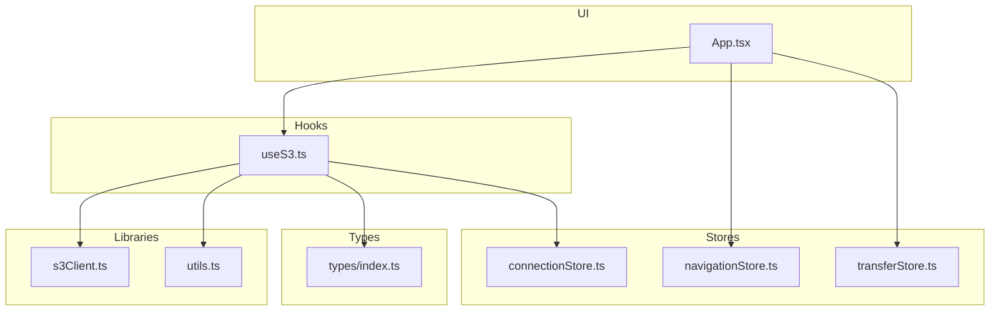
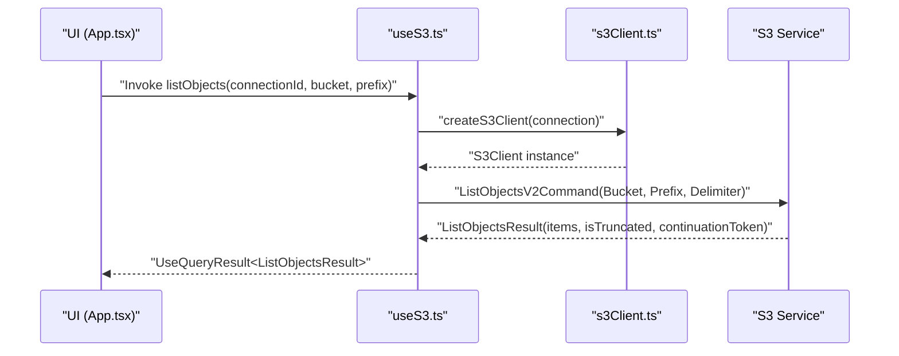
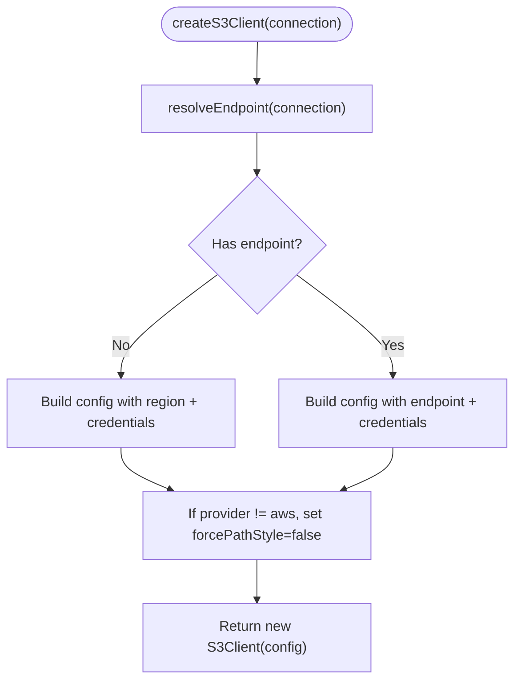
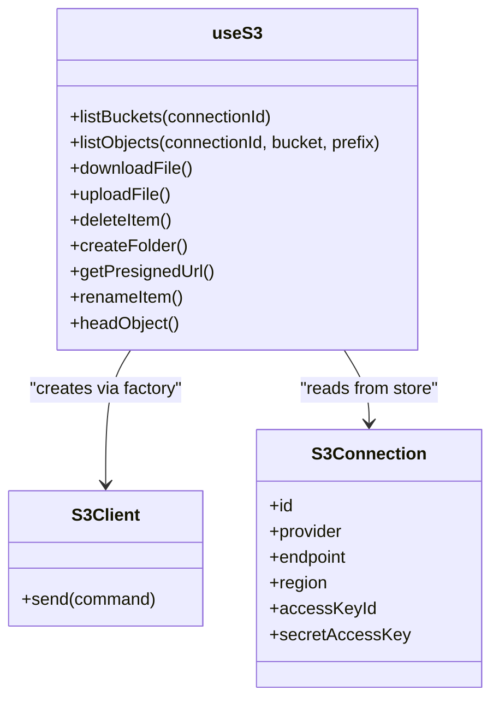
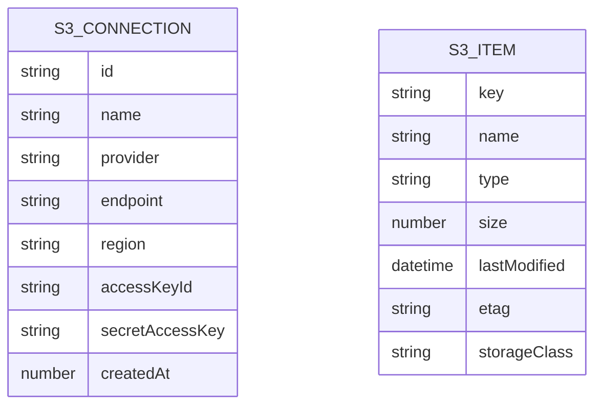
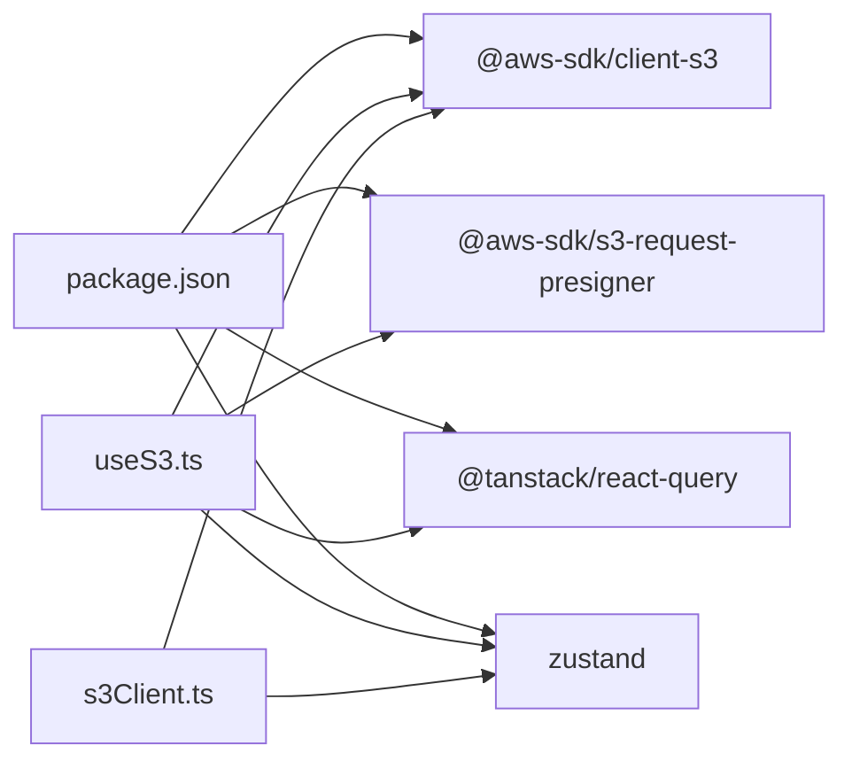
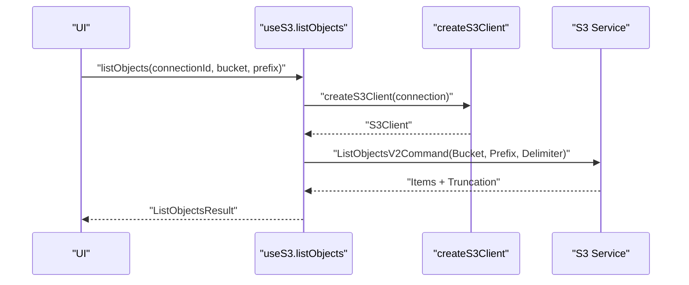
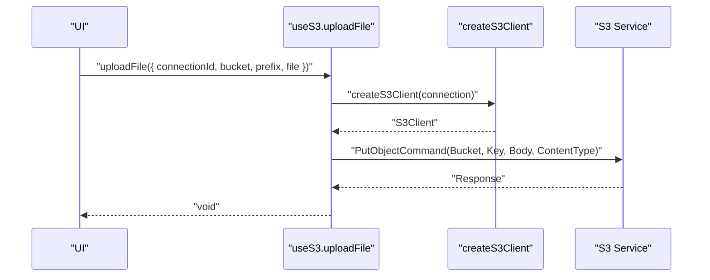
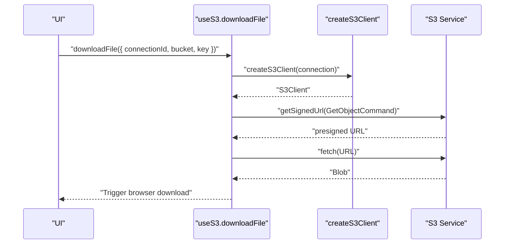

# S3 Integration

<cite>
**Referenced Files in This Document**
- [useS3.ts](file://src/hooks/useS3.ts)
- [s3Client.ts](file://src/lib/s3Client.ts)
- [connectionStore.ts](file://src/store/connectionStore.ts)
- [navigationStore.ts](file://src/store/navigationStore.ts)
- [transferStore.ts](file://src/store/transferStore.ts)
- [utils.ts](file://src/lib/utils.ts)
- [index.ts](file://src/types/index.ts)
- [App.tsx](file://src/App.tsx)
- [package.json](file://package.json)
</cite>

## Table of Contents
1. [Introduction](#introduction)
2. [Project Structure](#project-structure)
3. [Core Components](#core-components)
4. [Architecture Overview](#architecture-overview)
5. [Detailed Component Analysis](#detailed-component-analysis)
6. [Dependency Analysis](#dependency-analysis)
7. [Performance Considerations](#performance-considerations)
8. [Troubleshooting Guide](#troubleshooting-guide)
9. [Conclusion](#conclusion)
10. [Appendices](#appendices)

## Introduction
This document explains the S3 integration architecture in S3 Explorer. It focuses on the S3 client factory pattern, provider-specific configurations for AWS, MinIO, Cloudflare R2, and Backblaze B2, the S3 client creation process, credential handling, endpoint configuration, and error handling strategies. It also documents the useS3 hook as the centralized S3 operations hub, covering supported operations (list buckets, list objects, upload, download, delete, rename, create folder, presigned URLs, head object), and provides guidance on configuring different providers, handling authentication, and implementing custom endpoints. Finally, it outlines performance considerations, retry mechanisms, and best practices for S3 operations.

## Project Structure
The S3 integration spans several modules:
- Hooks: Centralized S3 operations exposed via a React hook powered by TanStack Query.
- Libraries: S3 client factory and utility helpers.
- Stores: State management for connections, navigation, and transfers.
- Types: Strongly typed domain models for S3 connections, items, and operations.

**Diagram sources**
- [useS3.ts:1-410](file://src/hooks/useS3.ts#L1-L410)
- [s3Client.ts:1-83](file://src/lib/s3Client.ts#L1-L83)
- [connectionStore.ts:1-88](file://src/store/connectionStore.ts#L1-L88)
- [navigationStore.ts:1-86](file://src/store/navigationStore.ts#L1-L86)
- [transferStore.ts:1-62](file://src/store/transferStore.ts#L1-L62)
- [utils.ts:1-197](file://src/lib/utils.ts#L1-L197)
- [index.ts:1-166](file://src/types/index.ts#L1-L166)
- [App.tsx:1-136](file://src/App.tsx#L1-L136)

**Section sources**
- [useS3.ts:1-410](file://src/hooks/useS3.ts#L1-L410)
- [s3Client.ts:1-83](file://src/lib/s3Client.ts#L1-L83)
- [connectionStore.ts:1-88](file://src/store/connectionStore.ts#L1-L88)
- [navigationStore.ts:1-86](file://src/store/navigationStore.ts#L1-L86)
- [transferStore.ts:1-62](file://src/store/transferStore.ts#L1-L62)
- [utils.ts:1-197](file://src/lib/utils.ts#L1-L197)
- [index.ts:1-166](file://src/types/index.ts#L1-L166)
- [App.tsx:1-136](file://src/App.tsx#L1-L136)

## Core Components
- S3 Client Factory: Creates a configured S3Client instance from an S3Connection, handling provider-specific endpoints and path-style addressing.
- useS3 Hook: Exposes TanStack Query-powered queries and mutations for S3 operations, including list buckets, list objects, upload, download, delete, rename, create folder, presigned URLs, and head object.
- Connection Store: Manages persisted S3 connections and active selection.
- Navigation Store: Tracks current connectionId, bucket, prefix, and navigation history.
- Transfer Store: Tracks uploads/downloads with status and progress.
- Utilities: Formatting helpers and S3 key/name utilities.

**Section sources**
- [s3Client.ts:60-82](file://src/lib/s3Client.ts#L60-L82)
- [useS3.ts:62-409](file://src/hooks/useS3.ts#L62-L409)
- [connectionStore.ts:30-87](file://src/store/connectionStore.ts#L30-L87)
- [navigationStore.ts:36-85](file://src/store/navigationStore.ts#L36-L85)
- [transferStore.ts:28-61](file://src/store/transferStore.ts#L28-L61)
- [utils.ts:13-27](file://src/lib/utils.ts#L13-L27)
- [utils.ts:178-196](file://src/lib/utils.ts#L178-L196)

## Architecture Overview
The S3 integration follows a layered architecture:
- UI Layer: App renders the explorer and delegates to stores and hooks.
- Hook Layer: useS3 orchestrates S3 operations using TanStack Query.
- Client Layer: s3Client factory builds provider-aware S3 clients.
- State Layer: Stores manage connections, navigation, and transfers.
- Types Layer: Strong typing for all domain models.

**Diagram sources**
- [App.tsx:13-94](file://src/App.tsx#L13-L94)
- [useS3.ts:91-144](file://src/hooks/useS3.ts#L91-L144)
- [s3Client.ts:60-82](file://src/lib/s3Client.ts#L60-L82)

## Detailed Component Analysis

### S3 Client Factory Pattern
The factory encapsulates provider-specific endpoint resolution and client configuration:
- Endpoint Resolution: Based on provider, validates required fields and constructs endpoint URLs.
- Path-Style Addressing: Enables forcePathStyle for non-AWS providers to support MinIO and compatible services.
- Credentials: Injects accessKeyId and secretAccessKey from the connection.
- Region: Defaults to us-east-1 if not provided.

**Diagram sources**
- [s3Client.ts:12-49](file://src/lib/s3Client.ts#L12-L49)
- [s3Client.ts:60-82](file://src/lib/s3Client.ts#L60-L82)

**Section sources**
- [s3Client.ts:12-49](file://src/lib/s3Client.ts#L12-L49)
- [s3Client.ts:60-82](file://src/lib/s3Client.ts#L60-L82)

### Provider-Specific Configurations
- AWS: Uses SDK defaults; region drives endpoint resolution.
- MinIO: Requires endpoint URL; path-style addressing enforced.
- Cloudflare R2: Requires endpoint URL in the form https://{accountId}.r2.cloudflarestorage.com.
- Backblaze B2: Requires endpoint URL or region; if only region is provided, constructs endpoint as https://s3.{region}.backblazeb2.com.
- Custom: Requires endpoint URL.

Validation and error messages are thrown when required fields are missing.

**Section sources**
- [s3Client.ts:15-48](file://src/lib/s3Client.ts#L15-L48)

### Credential Handling
- Access Key ID and Secret Access Key are extracted from the S3Connection and passed to the S3Client constructor.
- No explicit credential refresh or rotation logic is implemented in the factory; rely on the underlying SDK’s behavior.

**Section sources**
- [s3Client.ts:63-69](file://src/lib/s3Client.ts#L63-L69)
- [index.ts:38-48](file://src/types/index.ts#L38-L48)

### Endpoint Configuration
- For non-AWS providers, forcePathStyle is enabled to ensure path-style addressing.
- Endpoint is only set when explicitly provided by the connection.

**Section sources**
- [s3Client.ts:71-79](file://src/lib/s3Client.ts#L71-L79)

### Error Handling Strategies
- Validation errors are thrown early during endpoint resolution and folder creation.
- Operation-level errors are thrown when HTTP status codes indicate failure or when DeleteMarker is absent for delete operations.
- Download failures surface HTTP status and message.
- Head object returns metadata without downloading the body.

**Section sources**
- [s3Client.ts:21-30](file://src/lib/s3Client.ts#L21-L30)
- [s3Client.ts:34-38](file://src/lib/s3Client.ts#L34-L38)
- [useS3.ts:274-278](file://src/hooks/useS3.ts#L274-L278)
- [useS3.ts:171-175](file://src/hooks/useS3.ts#L171-L175)
- [useS3.ts:220-224](file://src/hooks/useS3.ts#L220-L224)
- [useS3.ts:248-253](file://src/hooks/useS3.ts#L248-L253)
- [useS3.ts:347-352](file://src/hooks/useS3.ts#L347-L352)

### useS3 Hook: Centralized S3 Operations Hub
The hook exposes TanStack Query queries and mutations for S3 operations:
- Queries
  - listBuckets(connectionId): Lists buckets for a given connection.
  - listObjects(connectionId, bucket, prefix): Lists objects and virtual folders under a prefix.
- Mutations
  - downloadFile(): Downloads via a presigned URL and triggers browser download.
  - uploadFile(): Uploads a file with automatic Content-Type detection.
  - deleteItem(): Deletes an object or folder placeholder.
  - createFolder(): Creates a virtual folder by placing an empty object ending with "/".
  - getPresignedUrl(): Generates a presigned GET URL for an object.
  - renameItem(): Renames an object by copying then deleting.
  - headObject(): Retrieves object metadata without downloading.

**Diagram sources**
- [useS3.ts:62-409](file://src/hooks/useS3.ts#L62-L409)
- [s3Client.ts:60-82](file://src/lib/s3Client.ts#L60-L82)
- [connectionStore.ts:30-87](file://src/store/connectionStore.ts#L30-L87)

**Section sources**
- [useS3.ts:69-85](file://src/hooks/useS3.ts#L69-L85)
- [useS3.ts:91-144](file://src/hooks/useS3.ts#L91-L144)
- [useS3.ts:152-189](file://src/hooks/useS3.ts#L152-L189)
- [useS3.ts:195-227](file://src/hooks/useS3.ts#L195-L227)
- [useS3.ts:232-256](file://src/hooks/useS3.ts#L232-L256)
- [useS3.ts:261-288](file://src/hooks/useS3.ts#L261-L288)
- [useS3.ts:293-312](file://src/hooks/useS3.ts#L293-L312)
- [useS3.ts:319-360](file://src/hooks/useS3.ts#L319-L360)
- [useS3.ts:366-391](file://src/hooks/useS3.ts#L366-L391)

### Data Models and Utilities
- S3Connection: Defines provider, endpoint, region, and credentials.
- S3Item: Represents files, folders, and buckets with metadata.
- Utilities: Formatting helpers and S3 key/name extraction.

**Diagram sources**
- [index.ts:38-62](file://src/types/index.ts#L38-L62)
- [index.ts:53-62](file://src/types/index.ts#L53-L62)

**Section sources**
- [index.ts:38-62](file://src/types/index.ts#L38-L62)
- [index.ts:53-62](file://src/types/index.ts#L53-L62)
- [utils.ts:13-27](file://src/lib/utils.ts#L13-L27)
- [utils.ts:178-196](file://src/lib/utils.ts#L178-L196)

## Dependency Analysis
External dependencies relevant to S3 integration:
- @aws-sdk/client-s3: S3 client library.
- @aws-sdk/s3-request-presigner: Presigned URL generation.
- @tanstack/react-query: Query and mutation orchestration.
- zustand: Local state management for connections, navigation, and transfers.

**Diagram sources**
- [package.json:12-25](file://package.json#L12-L25)
- [useS3.ts:1-15](file://src/hooks/useS3.ts#L1-L15)
- [s3Client.ts:1-2](file://src/lib/s3Client.ts#L1-L2)

**Section sources**
- [package.json:12-25](file://package.json#L12-L25)
- [useS3.ts:1-15](file://src/hooks/useS3.ts#L1-L15)
- [s3Client.ts:1-2](file://src/lib/s3Client.ts#L1-L2)

## Performance Considerations
- Pagination: listObjects returns isTruncated and continuationToken for incremental loading.
- Virtual Folders: CommonPrefixes are treated as virtual folders to reduce object enumeration overhead.
- Presigned URLs: Prefer presigned URLs for downloads to offload traffic from the app.
- Path-Style Addressing: Enabling forcePathStyle ensures compatibility with MinIO and compatible services; consider endpoint latency and DNS resolution.
- Query Invalidation: Use query invalidation to refresh cached results after mutations.

**Section sources**
- [useS3.ts:137-142](file://src/hooks/useS3.ts#L137-L142)
- [s3Client.ts:74-79](file://src/lib/s3Client.ts#L74-L79)
- [App.tsx:35-40](file://src/App.tsx#L35-L40)

## Troubleshooting Guide
Common issues and resolutions:
- Missing Endpoint for Non-AWS Providers: Ensure endpoint is provided for MinIO, R2, and B2; otherwise, factory throws an error.
- Missing Region for Backblaze B2: Provide region when endpoint is not supplied.
- Invalid Folder Name: Folder creation rejects empty names or names containing "/".
- HTTP Errors During Operations: Inspect thrown errors for HTTP status codes and messages; adjust permissions or endpoint configuration accordingly.
- Download Failures: Verify presigned URL validity and network connectivity.

**Section sources**
- [s3Client.ts:21-30](file://src/lib/s3Client.ts#L21-L30)
- [s3Client.ts:34-38](file://src/lib/s3Client.ts#L34-L38)
- [useS3.ts:274-278](file://src/hooks/useS3.ts#L274-L278)
- [useS3.ts:171-175](file://src/hooks/useS3.ts#L171-L175)
- [useS3.ts:220-224](file://src/hooks/useS3.ts#L220-L224)
- [useS3.ts:248-253](file://src/hooks/useS3.ts#L248-L253)
- [useS3.ts:347-352](file://src/hooks/useS3.ts#L347-L352)

## Conclusion
S3 Explorer’s S3 integration centers around a robust client factory and a comprehensive useS3 hook. The factory handles provider-specific endpoints and credentials, while the hook provides a unified API for listing and manipulating S3 resources. The architecture leverages TanStack Query for caching and invalidation, Zustand for local state, and strong TypeScript types for safety. By following the guidelines below, developers can configure providers, implement custom endpoints, and optimize performance and reliability.

## Appendices

### How to Configure Different S3 Providers
- AWS
  - Leave endpoint unset; the SDK resolves the endpoint from region.
  - Provide accessKeyId and secretAccessKey.
- MinIO
  - Provide endpoint URL (e.g., http://localhost:9000).
  - Provide accessKeyId and secretAccessKey.
- Cloudflare R2
  - Provide endpoint URL in the form https://{accountId}.r2.cloudflarestorage.com.
  - Provide accessKeyId and secretAccessKey.
- Backblaze B2
  - Either provide endpoint URL or region; if only region is provided, the factory constructs the endpoint.
  - Provide accessKeyId and secretAccessKey.
- Custom
  - Provide endpoint URL.
  - Provide accessKeyId and secretAccessKey.

**Section sources**
- [s3Client.ts:15-48](file://src/lib/s3Client.ts#L15-L48)
- [index.ts:38-48](file://src/types/index.ts#L38-L48)

### Authentication Best Practices
- Store credentials securely; avoid embedding secrets in client-side code.
- Rotate credentials regularly and update connections accordingly.
- Use least-privilege policies for accessKeyId and secretAccessKey.

**Section sources**
- [s3Client.ts:63-69](file://src/lib/s3Client.ts#L63-L69)
- [index.ts:38-48](file://src/types/index.ts#L38-L48)

### Implementing Custom Endpoints
- For non-AWS providers, ensure endpoint is set and forcePathStyle is enabled.
- Validate endpoint reachability and DNS resolution.
- Test with a small subset of operations before scaling.

**Section sources**
- [s3Client.ts:71-79](file://src/lib/s3Client.ts#L71-L79)

### Retry Mechanisms
- The current implementation does not include built-in retries.
- Consider integrating retry policies at the TanStack Query level or wrapping commands with retry logic as needed.

**Section sources**
- [useS3.ts:1-15](file://src/hooks/useS3.ts#L1-L15)

### Example Workflows

#### Listing Objects Under a Prefix

**Diagram sources**
- [useS3.ts:91-144](file://src/hooks/useS3.ts#L91-L144)
- [s3Client.ts:60-82](file://src/lib/s3Client.ts#L60-L82)

#### Uploading a File

**Diagram sources**
- [useS3.ts:195-227](file://src/hooks/useS3.ts#L195-L227)
- [s3Client.ts:60-82](file://src/lib/s3Client.ts#L60-L82)

#### Downloading a File via Presigned URL

**Diagram sources**
- [useS3.ts:152-189](file://src/hooks/useS3.ts#L152-L189)
- [s3Client.ts:60-82](file://src/lib/s3Client.ts#L60-L82)