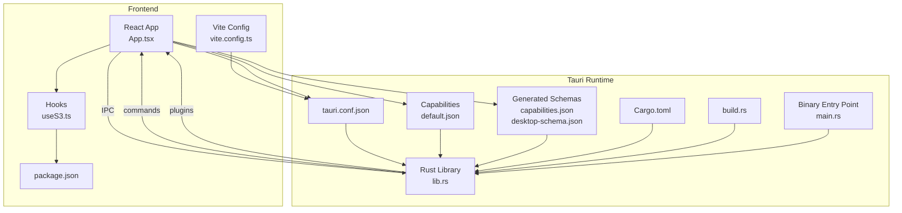
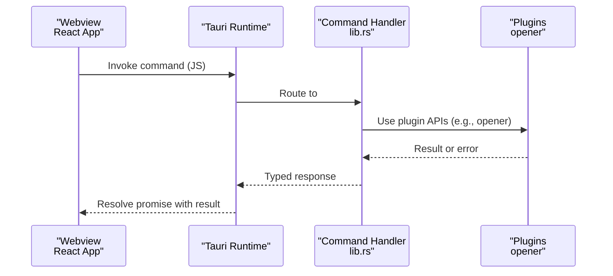
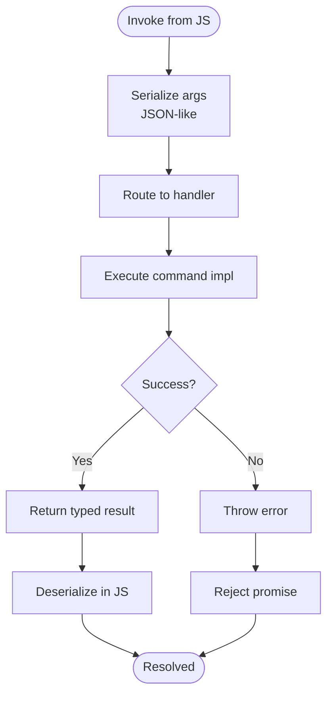
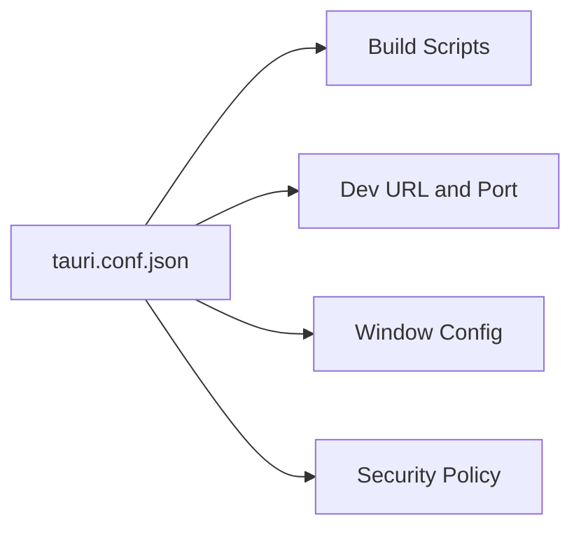
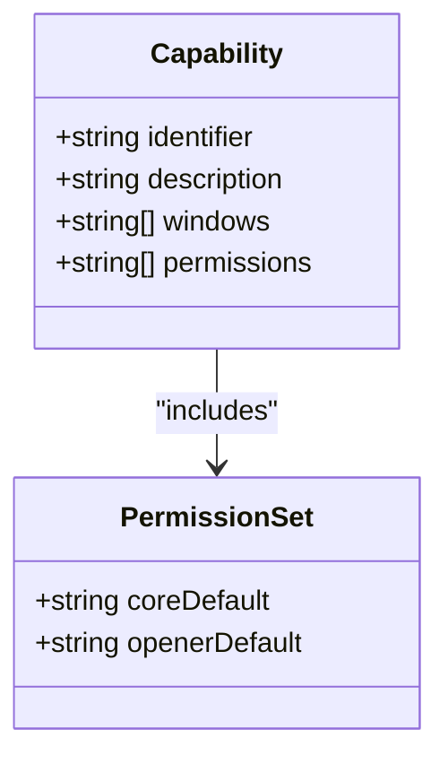
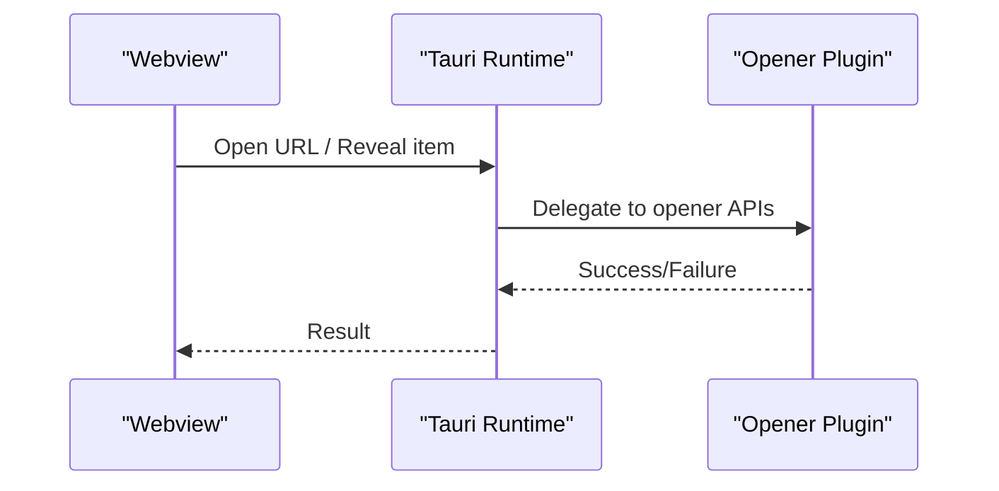
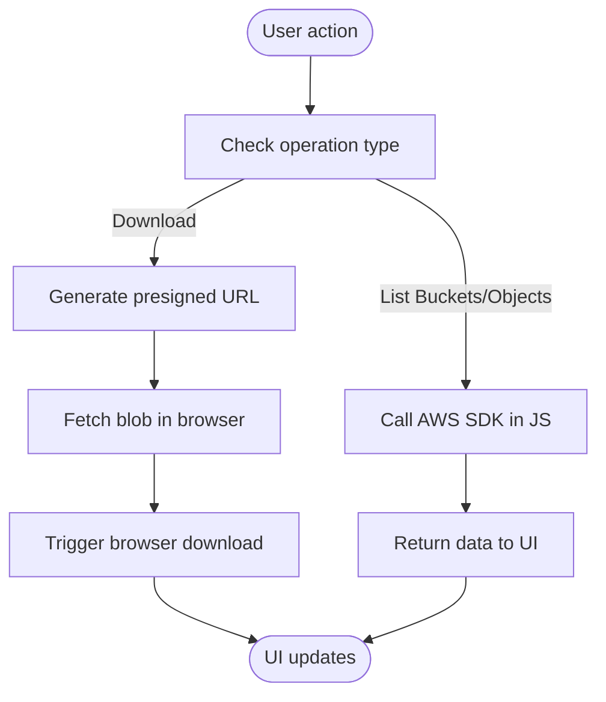
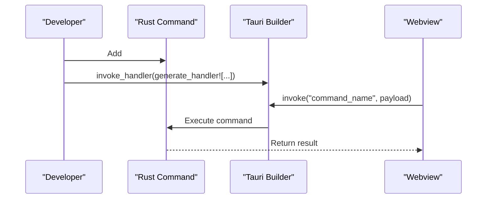
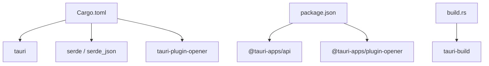

# Tauri Integration

<cite>
**Referenced Files in This Document**
- [Cargo.toml](file://src-tauri/Cargo.toml)
- [tauri.conf.json](file://src-tauri/tauri.conf.json)
- [lib.rs](file://src-tauri/src/lib.rs)
- [main.rs](file://src-tauri/src/main.rs)
- [default.json](file://src-tauri/capabilities/default.json)
- [desktop-schema.json](file://src-tauri/gen/schemas/desktop-schema.json)
- [capabilities.json](file://src-tauri/gen/schemas/capabilities.json)
- [package.json](file://package.json)
- [vite.config.ts](file://vite.config.ts)
- [App.tsx](file://src/App.tsx)
- [useS3.ts](file://src/hooks/useS3.ts)
- [s3Client.ts](file://src/lib/s3Client.ts)
- [build.rs](file://src-tauri/build.rs)
</cite>

## Table of Contents
1. [Introduction](#introduction)
2. [Project Structure](#project-structure)
3. [Core Components](#core-components)
4. [Architecture Overview](#architecture-overview)
5. [Detailed Component Analysis](#detailed-component-analysis)
6. [Dependency Analysis](#dependency-analysis)
7. [Performance Considerations](#performance-considerations)
8. [Troubleshooting Guide](#troubleshooting-guide)
9. [Conclusion](#conclusion)
10. [Appendices](#appendices)

## Introduction
This document explains how Tauri integrates with the S3 Explorer application. It covers the command bridge between JavaScript and Rust, Tauri configuration and capabilities, security model, native system access patterns, and practical guidance for extending the integration with custom commands. It also documents the build process, platform considerations, and deployment strategies.

## Project Structure
The application follows a dual-package structure:
- Frontend: React + Vite, TypeScript, hosted inside Tauri’s webview
- Backend: Rust library and binary that initialize the Tauri runtime, expose commands, and manage capabilities

Key integration points:
- Tauri configuration defines build, bundling, and security policies
- Capability files define which commands and permissions are granted to the webview
- Rust exposes commands via the Tauri command macro and registers them with the builder
- Frontend uses @tauri-apps/api to invoke commands and receive typed responses

**Diagram sources**
- [tauri.conf.json:1-36](file://src-tauri/tauri.conf.json#L1-L36)
- [default.json:1-11](file://src-tauri/capabilities/default.json#L1-L11)
- [desktop-schema.json:1-120](file://src-tauri/gen/schemas/desktop-schema.json#L1-L120)
- [capabilities.json:1-1](file://src-tauri/gen/schemas/capabilities.json#L1-L1)
- [lib.rs:1-15](file://src-tauri/src/lib.rs#L1-L15)
- [main.rs:1-7](file://src-tauri/src/main.rs#L1-L7)
- [Cargo.toml:1-26](file://src-tauri/Cargo.toml#L1-L26)
- [build.rs:1-3](file://src-tauri/build.rs#L1-L3)
- [package.json:1-37](file://package.json#L1-L37)
- [vite.config.ts:1-34](file://vite.config.ts#L1-L34)
- [App.tsx:1-125](file://src/App.tsx#L1-L125)
- [useS3.ts:1-410](file://src/hooks/useS3.ts#L1-L410)

**Section sources**
- [tauri.conf.json:1-36](file://src-tauri/tauri.conf.json#L1-L36)
- [default.json:1-11](file://src-tauri/capabilities/default.json#L1-L11)
- [desktop-schema.json:1-120](file://src-tauri/gen/schemas/desktop-schema.json#L1-L120)
- [capabilities.json:1-1](file://src-tauri/gen/schemas/capabilities.json#L1-L1)
- [lib.rs:1-15](file://src-tauri/src/lib.rs#L1-L15)
- [main.rs:1-7](file://src-tauri/src/main.rs#L1-L7)
- [Cargo.toml:1-26](file://src-tauri/Cargo.toml#L1-L26)
- [build.rs:1-3](file://src-tauri/build.rs#L1-L3)
- [package.json:1-37](file://package.json#L1-L37)
- [vite.config.ts:1-34](file://vite.config.ts#L1-L34)
- [App.tsx:1-125](file://src/App.tsx#L1-L125)
- [useS3.ts:1-410](file://src/hooks/useS3.ts#L1-L410)

## Core Components
- Tauri command bridge: Rust functions annotated with the command macro are exposed to the webview and invoked via @tauri-apps/api
- Capability system: Permissions are scoped per capability, enabling least-privilege access to commands and plugins
- Security policy: CSP is disabled in configuration; capabilities and permission sets control IPC access
- Native system access: The opener plugin is registered to support opening URLs and revealing items in system file explorers
- Build pipeline: Vite serves the frontend during development; Tauri CLI builds and bundles the app for distribution

**Section sources**
- [lib.rs:1-15](file://src-tauri/src/lib.rs#L1-L15)
- [default.json:1-11](file://src-tauri/capabilities/default.json#L1-L11)
- [tauri.conf.json:20-22](file://src-tauri/tauri.conf.json#L20-L22)
- [Cargo.toml:20-25](file://src-tauri/Cargo.toml#L20-L25)
- [package.json:18-19](file://package.json#L18-L19)

## Architecture Overview
The runtime architecture connects the React frontend to Rust commands through Tauri’s IPC layer. Commands are declared in Rust and invoked from the webview. Capabilities and permission sets govern which commands are callable and with what scope.

**Diagram sources**
- [lib.rs:2-14](file://src-tauri/src/lib.rs#L2-L14)
- [default.json:6-9](file://src-tauri/capabilities/default.json#L6-L9)
- [desktop-schema.json:140-190](file://src-tauri/gen/schemas/desktop-schema.json#L140-L190)

## Detailed Component Analysis

### Command Bridge: Registration, Serialization, and Response Handling
- Command declaration: A Rust function annotated with the command macro becomes a callable endpoint
- Handler registration: The Builder registers the handler so Tauri can route invocations
- Parameter serialization: Tauri serializes arguments and deserializes return values across the JS-Rust boundary
- Response handling: The webview receives a resolved promise on success or a rejected promise on error

**Diagram sources**
- [lib.rs:2-14](file://src-tauri/src/lib.rs#L2-L14)

**Section sources**
- [lib.rs:1-15](file://src-tauri/src/lib.rs#L1-L15)

### Tauri Configuration Setup
- Build lifecycle: Dev and build scripts delegate to Vite; frontendDist points to the built output
- Dev server: Fixed port and HMR configuration for Tauri development
- Window sizing and title: Single window with predefined dimensions
- Security: CSP is disabled; capabilities and permission sets provide access control

**Diagram sources**
- [tauri.conf.json:6-11](file://src-tauri/tauri.conf.json#L6-L11)
- [tauri.conf.json:13-19](file://src-tauri/tauri.conf.json#L13-L19)
- [tauri.conf.json:20-22](file://src-tauri/tauri.conf.json#L20-L22)
- [vite.config.ts:17-32](file://vite.config.ts#L17-L32)

**Section sources**
- [tauri.conf.json:1-36](file://src-tauri/tauri.conf.json#L1-L36)
- [vite.config.ts:1-34](file://vite.config.ts#L1-L34)

### Capability Definitions and Security Model
- Capability identity: Each capability has an identifier and description
- Windows association: Capabilities bind to specific windows (e.g., main)
- Permission sets: Core default and opener default permissions are included
- Schema validation: Generated JSON schema documents the capability format and permission identifiers

**Diagram sources**
- [default.json:1-11](file://src-tauri/capabilities/default.json#L1-L11)
- [desktop-schema.json:39-105](file://src-tauri/gen/schemas/desktop-schema.json#L39-L105)
- [desktop-schema.json:140-190](file://src-tauri/gen/schemas/desktop-schema.json#L140-L190)

**Section sources**
- [default.json:1-11](file://src-tauri/capabilities/default.json#L1-L11)
- [desktop-schema.json:1-120](file://src-tauri/gen/schemas/desktop-schema.json#L1-L120)
- [capabilities.json:1-1](file://src-tauri/gen/schemas/capabilities.json#L1-L1)

### Native System Access Patterns
- Opener plugin: Registered in the Tauri Builder; enables opening URLs and revealing items in the system file explorer
- Scope configuration: Permission entries can allow or deny specific URLs and paths; opener default set is included in the capability

**Diagram sources**
- [lib.rs:10-10](file://src-tauri/src/lib.rs#L10-L10)
- [default.json:8-8](file://src-tauri/capabilities/default.json#L8-L8)
- [desktop-schema.json:140-190](file://src-tauri/gen/schemas/desktop-schema.json#L140-L190)

**Section sources**
- [lib.rs:1-15](file://src-tauri/src/lib.rs#L1-L15)
- [default.json:1-11](file://src-tauri/capabilities/default.json#L1-L11)
- [desktop-schema.json:140-190](file://src-tauri/gen/schemas/desktop-schema.json#L140-L190)

### S3 Operations and JS-Rust Boundary
- Current JS-only S3 client: The frontend uses AWS SDK clients for S3 operations; no Tauri commands are invoked for S3
- Presigned URLs: Used for downloads; signed URLs are generated client-side and fetched in the browser
- Extension point: Future enhancements could move heavy operations to Rust commands for improved performance and security

**Diagram sources**
- [useS3.ts:69-85](file://src/hooks/useS3.ts#L69-L85)
- [useS3.ts:91-144](file://src/hooks/useS3.ts#L91-L144)
- [useS3.ts:152-189](file://src/hooks/useS3.ts#L152-L189)
- [s3Client.ts:60-83](file://src/lib/s3Client.ts#L60-L83)

**Section sources**
- [useS3.ts:1-410](file://src/hooks/useS3.ts#L1-L410)
- [s3Client.ts:1-83](file://src/lib/s3Client.ts#L1-L83)

### Custom Tauri Commands: Pattern and Implementation
- Define a command function annotated with the command macro
- Register the command with the Builder’s invoke handler
- Expose the command to the webview; call it from JS using @tauri-apps/api

**Diagram sources**
- [lib.rs:2-12](file://src-tauri/src/lib.rs#L2-L12)

**Section sources**
- [lib.rs:1-15](file://src-tauri/src/lib.rs#L1-L15)

### Error Handling Across the JS-Rust Boundary
- Rust panics and errors propagate to the webview as rejections
- Frontend should catch and surface errors appropriately
- Capability restrictions can prevent unauthorized command access, reducing unexpected failures

**Section sources**
- [lib.rs:8-14](file://src-tauri/src/lib.rs#L8-L14)

## Dependency Analysis
- Rust crate dependencies: Tauri core, serde, and tauri-plugin-opener
- Frontend dependencies: @tauri-apps/api and @tauri-apps/plugin-opener for invoking commands and opening URLs
- Build-time dependencies: tauri-build and build script integration

**Diagram sources**
- [Cargo.toml:20-25](file://src-tauri/Cargo.toml#L20-L25)
- [package.json:18-19](file://package.json#L18-L19)
- [build.rs:1-3](file://src-tauri/build.rs#L1-L3)

**Section sources**
- [Cargo.toml:1-26](file://src-tauri/Cargo.toml#L1-L26)
- [package.json:1-37](file://package.json#L1-L37)
- [build.rs:1-3](file://src-tauri/build.rs#L1-L3)

## Performance Considerations
- Prefer browser-based operations for lightweight tasks (e.g., small file downloads via presigned URLs)
- Offload heavy operations to Rust commands when feasible to leverage native performance and avoid large data transfers
- Use capabilities to limit unnecessary plugin access and reduce overhead
- Keep Vite watch exclusions configured to avoid rebuilding Rust code during development

[No sources needed since this section provides general guidance]

## Troubleshooting Guide
- Command not found: Verify the command is registered with the Builder and included in the handler list
- Permission denied: Confirm the capability includes the required permission set and the window matches the capability
- CSP-related issues: Since CSP is disabled, ensure capabilities and permission sets are correctly configured to restrict access
- Dev server port conflicts: Ensure the fixed port is available; adjust Vite server configuration if needed

**Section sources**
- [lib.rs:8-14](file://src-tauri/src/lib.rs#L8-L14)
- [default.json:6-9](file://src-tauri/capabilities/default.json#L6-L9)
- [tauri.conf.json:20-22](file://src-tauri/tauri.conf.json#L20-L22)
- [vite.config.ts:17-27](file://vite.config.ts#L17-L27)

## Conclusion
S3 Explorer integrates Tauri by exposing a minimal command bridge and leveraging capabilities for secure access control. The current implementation performs S3 operations in the browser using the AWS SDK, while the Tauri stack is ready to support native commands and enhanced system integrations. By extending the command bridge and refining capabilities, the application can scale to more demanding workloads and richer native features.

[No sources needed since this section summarizes without analyzing specific files]

## Appendices

### Build and Deployment References
- Development: Vite dev server runs on a fixed port; Tauri CLI orchestrates frontend and backend
- Production: Tauri CLI builds the app with bundled assets; icons and bundling targets are configured

**Section sources**
- [tauri.conf.json:6-11](file://src-tauri/tauri.conf.json#L6-L11)
- [tauri.conf.json:24-34](file://src-tauri/tauri.conf.json#L24-L34)
- [vite.config.ts:1-34](file://vite.config.ts#L1-L34)
- [package.json:6-11](file://package.json#L6-L11)