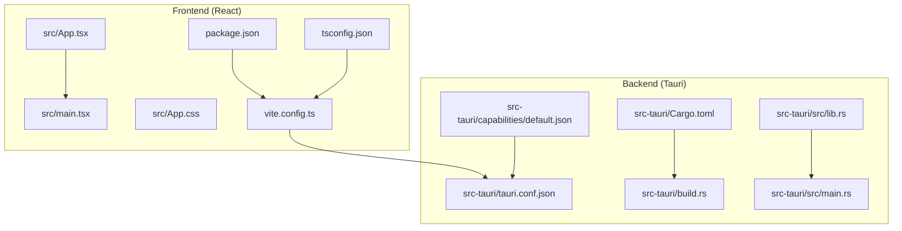
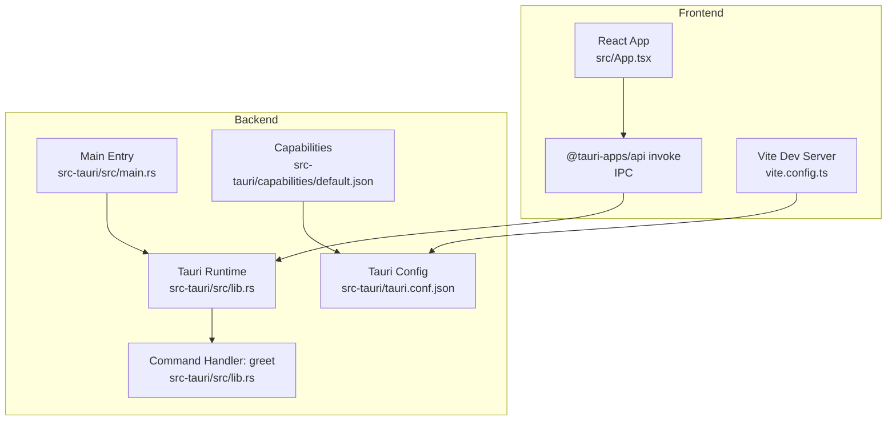
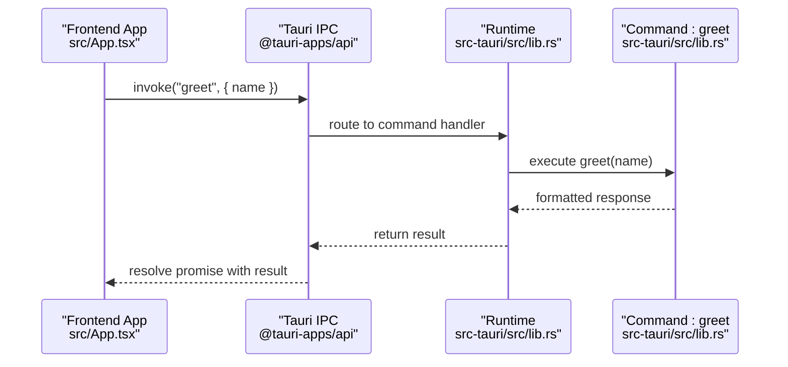
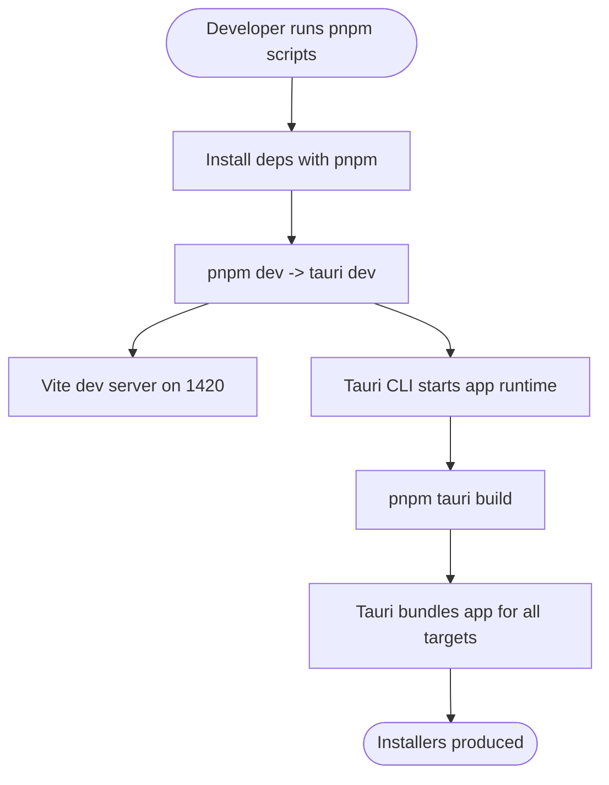
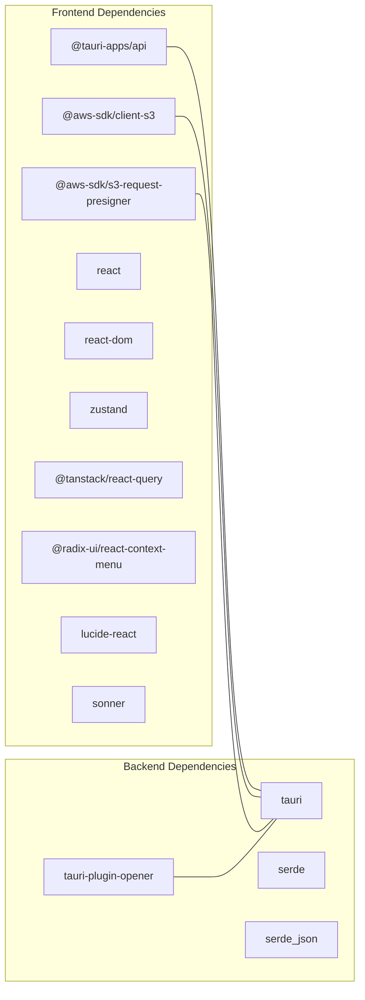

# Technical Implementation

<cite>
**Referenced Files in This Document**
- [README.md](file://README.md)
- [PROJECT.md](file://PROJECT.md)
- [package.json](file://package.json)
- [vite.config.ts](file://vite.config.ts)
- [tsconfig.json](file://tsconfig.json)
- [src/main.tsx](file://src/main.tsx)
- [src/App.tsx](file://src/App.tsx)
- [src/App.css](file://src/App.css)
- [src-tauri/tauri.conf.json](file://src-tauri/tauri.conf.json)
- [src-tauri/Cargo.toml](file://src-tauri/Cargo.toml)
- [src-tauri/build.rs](file://src-tauri/build.rs)
- [src-tauri/src/lib.rs](file://src-tauri/src/lib.rs)
- [src-tauri/src/main.rs](file://src-tauri/src/main.rs)
- [src-tauri/capabilities/default.json](file://src-tauri/capabilities/default.json)
</cite>

## Table of Contents
1. [Introduction](#introduction)
2. [Project Structure](#project-structure)
3. [Core Components](#core-components)
4. [Architecture Overview](#architecture-overview)
5. [Detailed Component Analysis](#detailed-component-analysis)
6. [Dependency Analysis](#dependency-analysis)
7. [Performance Considerations](#performance-considerations)
8. [Troubleshooting Guide](#troubleshooting-guide)
9. [Conclusion](#conclusion)
10. [Appendices](#appendices)

## Introduction
This document explains the technical implementation of S3 Explorer’s hybrid architecture built with Tauri v2 (Rust backend), React + TypeScript frontend, and AWS SDK integrations. It covers the frontend application structure, TypeScript type definitions, state management with Zustand, Tauri command implementations in Rust, AWS SDK usage patterns, IPC communication, build and deployment configuration, and practical guidance for error handling and performance optimization.

## Project Structure
The repository follows a clear separation of concerns:
- Frontend: React application under src/, TypeScript configuration, Vite build pipeline, Tailwind CSS styling
- Backend: Tauri application under src-tauri/, Rust crate configuration, capability permissions, and CLI configuration
- Shared concepts: Project overview and feature set are documented in PROJECT.md; quick-start guidance in README.md

**Diagram sources**
- [src/main.tsx:1-10](file://src/main.tsx#L1-L10)
- [src/App.tsx:1-56](file://src/App.tsx#L1-L56)
- [src/App.css:1-118](file://src/App.css#L1-L118)
- [vite.config.ts:1-34](file://vite.config.ts#L1-L34)
- [tsconfig.json:1-26](file://tsconfig.json#L1-L26)
- [package.json:1-37](file://package.json#L1-L37)
- [src-tauri/tauri.conf.json:1-36](file://src-tauri/tauri.conf.json#L1-L36)
- [src-tauri/Cargo.toml:1-26](file://src-tauri/Cargo.toml#L1-L26)
- [src-tauri/build.rs:1-4](file://src-tauri/build.rs#L1-L4)
- [src-tauri/src/lib.rs:1-15](file://src-tauri/src/lib.rs#L1-L15)
- [src-tauri/src/main.rs:1-7](file://src-tauri/src/main.rs#L1-L7)
- [src-tauri/capabilities/default.json:1-11](file://src-tauri/capabilities/default.json#L1-L11)

**Section sources**
- [README.md:1-8](file://README.md#L1-L8)
- [PROJECT.md:1-205](file://PROJECT.md#L1-L205)
- [package.json:1-37](file://package.json#L1-L37)
- [vite.config.ts:1-34](file://vite.config.ts#L1-L34)
- [tsconfig.json:1-26](file://tsconfig.json#L1-L26)
- [src/main.tsx:1-10](file://src/main.tsx#L1-L10)
- [src/App.tsx:1-56](file://src/App.tsx#L1-L56)
- [src/App.css:1-118](file://src/App.css#L1-L118)
- [src-tauri/tauri.conf.json:1-36](file://src-tauri/tauri.conf.json#L1-L36)
- [src-tauri/Cargo.toml:1-26](file://src-tauri/Cargo.toml#L1-L26)
- [src-tauri/build.rs:1-4](file://src-tauri/build.rs#L1-L4)
- [src-tauri/src/lib.rs:1-15](file://src-tauri/src/lib.rs#L1-L15)
- [src-tauri/src/main.rs:1-7](file://src-tauri/src/main.rs#L1-L7)
- [src-tauri/capabilities/default.json:1-11](file://src-tauri/capabilities/default.json#L1-L11)

## Core Components
- Frontend entry and rendering: React root mounts the App component
- Minimal IPC example: Frontend invokes a Tauri command named greet
- Backend command registration: Rust greet command returns a formatted message
- Build and dev server: Vite configured for Tauri with fixed ports and HMR for remote hosts
- Tauri app configuration: Dev URL, build commands, bundling, and window defaults
- Rust crate configuration: Library and binary entry points, dependencies, and build script
- Capability permissions: Default capability grants core and opener permissions

Key implementation patterns:
- IPC invocation pattern: Frontend uses @tauri-apps/api to call Rust commands
- Command handler registration: Tauri Builder registers commands for the frontend
- Type-safe configuration: TypeScript strict mode and bundler resolution
- Cross-platform bundling: Tauri configuration defines product metadata and icon sets

**Section sources**
- [src/main.tsx:1-10](file://src/main.tsx#L1-L10)
- [src/App.tsx:1-56](file://src/App.tsx#L1-L56)
- [src-tauri/src/lib.rs:1-15](file://src-tauri/src/lib.rs#L1-L15)
- [src-tauri/src/main.rs:1-7](file://src-tauri/src/main.rs#L1-L7)
- [vite.config.ts:1-34](file://vite.config.ts#L1-L34)
- [src-tauri/tauri.conf.json:1-36](file://src-tauri/tauri.conf.json#L1-L36)
- [src-tauri/Cargo.toml:1-26](file://src-tauri/Cargo.toml#L1-L26)
- [src-tauri/build.rs:1-4](file://src-tauri/build.rs#L1-L4)
- [src-tauri/capabilities/default.json:1-11](file://src-tauri/capabilities/default.json#L1-L11)
- [tsconfig.json:1-26](file://tsconfig.json#L1-L26)

## Architecture Overview
The hybrid architecture integrates a React frontend with a Tauri-powered Rust backend. The frontend communicates with the backend via Tauri’s IPC layer, invoking Rust commands and receiving typed responses. The backend can also expose native capabilities (e.g., opening URLs) through plugins.

**Diagram sources**
- [src/App.tsx:1-56](file://src/App.tsx#L1-L56)
- [src-tauri/src/lib.rs:1-15](file://src-tauri/src/lib.rs#L1-L15)
- [src-tauri/src/main.rs:1-7](file://src-tauri/src/main.rs#L1-L7)
- [src-tauri/capabilities/default.json:1-11](file://src-tauri/capabilities/default.json#L1-L11)
- [src-tauri/tauri.conf.json:1-36](file://src-tauri/tauri.conf.json#L1-L36)
- [vite.config.ts:1-34](file://vite.config.ts#L1-L34)

## Detailed Component Analysis

### Frontend Application Structure
- Root mounting: React creates the root and renders the App component
- UI composition: App.tsx renders a greeting form and displays the response from the backend
- Styling: Tailwind CSS is integrated via Vite plugin; theme-aware styles support light/dark modes
- Development server: Fixed port 1420 with optional HMR host for remote development

Implementation highlights:
- Strict TypeScript compilation with bundler module resolution
- Tailwind integration through Vite plugin
- Minimal IPC usage to demonstrate command invocation

**Section sources**
- [src/main.tsx:1-10](file://src/main.tsx#L1-L10)
- [src/App.tsx:1-56](file://src/App.tsx#L1-L56)
- [src/App.css:1-118](file://src/App.css#L1-L118)
- [vite.config.ts:1-34](file://vite.config.ts#L1-L34)
- [tsconfig.json:1-26](file://tsconfig.json#L1-L26)

### Tauri Backend Commands and IPC
- Command definition: greet command accepts a string parameter and returns a formatted string
- Command registration: Tauri Builder registers the greet command handler
- Plugin integration: Opener plugin is initialized during runtime
- Entry point: Main entry delegates to the library run function

IPC flow:
- Frontend invokes greet with payload
- Tauri runtime routes to registered handler
- Handler executes and returns result to frontend

**Diagram sources**
- [src/App.tsx:10-12](file://src/App.tsx#L10-L12)
- [src-tauri/src/lib.rs:2-5](file://src-tauri/src/lib.rs#L2-L5)
- [src-tauri/src/lib.rs:9-13](file://src-tauri/src/lib.rs#L9-L13)

**Section sources**
- [src-tauri/src/lib.rs:1-15](file://src-tauri/src/lib.rs#L1-L15)
- [src-tauri/src/main.rs:1-7](file://src-tauri/src/main.rs#L1-L7)
- [src/App.tsx:10-12](file://src/App.tsx#L10-L12)

### AWS SDK Integration Patterns
According to the project documentation, the frontend uses the AWS SDK for JavaScript v3 (@aws-sdk/client-s3 and @aws-sdk/s3-request-presigner) to perform S3 operations. The documented operations include:
- Listing buckets
- Listing objects with delimiter for virtual folders
- Downloading objects via streams
- Uploading objects (single or multipart)
- Deleting objects (single or batch)
- Generating presigned URLs
- Simulating rename via copy + delete
- Creating virtual folders via empty-key objects

These patterns align with the project’s MVP feature set and are intended to be implemented in dedicated hooks and stores (e.g., useS3.ts, store modules) referenced in PROJECT.md.

**Section sources**
- [PROJECT.md:143-168](file://PROJECT.md#L143-L168)
- [package.json:12-25](file://package.json#L12-L25)

### State Management with Zustand
The project documentation specifies Zustand for managing:
- Saved S3 connections
- Current navigation state (active connection, bucket, prefix, history)
- Transfer queue for uploads/downloads

Zustand enables small, focused slices of state with minimal boilerplate, suitable for desktop applications requiring reactive UI updates and persistence strategies.

**Section sources**
- [PROJECT.md:52-56](file://PROJECT.md#L52-L56)
- [package.json:24-24](file://package.json#L24-L24)

### Build Process, Dependency Management, and Deployment
- Package manager: pnpm (workspace and lockfile present)
- Frontend build: TypeScript transpile plus Vite build
- Dev server: Vite runs on port 1420 with strict port enforcement and optional HMR host
- Tauri build: CLI orchestrates frontend build and bundles the app per tauri.conf.json
- Rust crate: Cargo.toml configures staticlib/cdylib/rlib outputs and dependencies
- Capabilities: default capability grants core and opener permissions
- Bundling: Icons and targets configured for cross-platform distribution

**Diagram sources**
- [package.json:6-11](file://package.json#L6-L11)
- [vite.config.ts:17-32](file://vite.config.ts#L17-L32)
- [src-tauri/tauri.conf.json:6-11](file://src-tauri/tauri.conf.json#L6-L11)
- [src-tauri/Cargo.toml:10-15](file://src-tauri/Cargo.toml#L10-L15)
- [src-tauri/build.rs:1-4](file://src-tauri/build.rs#L1-L4)

**Section sources**
- [package.json:1-37](file://package.json#L1-L37)
- [vite.config.ts:1-34](file://vite.config.ts#L1-L34)
- [src-tauri/tauri.conf.json:1-36](file://src-tauri/tauri.conf.json#L1-L36)
- [src-tauri/Cargo.toml:1-26](file://src-tauri/Cargo.toml#L1-L26)
- [src-tauri/build.rs:1-4](file://src-tauri/build.rs#L1-L4)
- [src-tauri/capabilities/default.json:1-11](file://src-tauri/capabilities/default.json#L1-L11)

## Dependency Analysis
The frontend and backend dependencies are declared as follows:
- Frontend dependencies include React, React DOM, Tauri API, AWS SDK packages, UI libraries, and state management
- Backend dependencies include Tauri core, opener plugin, serialization crates, and build-time dependencies

**Diagram sources**
- [package.json:12-25](file://package.json#L12-L25)
- [src-tauri/Cargo.toml:20-25](file://src-tauri/Cargo.toml#L20-L25)

**Section sources**
- [package.json:12-25](file://package.json#L12-L25)
- [src-tauri/Cargo.toml:20-25](file://src-tauri/Cargo.toml#L20-L25)

## Performance Considerations
- Large downloads: Prefer Rust-based downloads for reliability and throughput on large files
- Virtualized lists: Use virtualization for buckets with thousands of objects
- Debounce and backoff: Avoid rapid requests; implement exponential backoff for retries
- Streaming: Use streaming APIs for downloads/uploads to reduce memory pressure
- Lazy loading: Load data on demand and cache minimally to keep UI responsive
- Asset optimization: Tailwind CSS and Vite bundling improve build performance

[No sources needed since this section provides general guidance]

## Troubleshooting Guide
- IPC invocation failures: Verify command registration and that the frontend uses the correct command name
- Port conflicts: Ensure port 1420 is free; Vite enforces strict port mode
- Remote HMR: Set TAURI_DEV_HOST to enable HMR over network
- Capability denied: Confirm capability permissions include required permissions for the window
- Rust linking: Ensure Cargo crate types match expected outputs for Tauri integration

**Section sources**
- [vite.config.ts:17-27](file://vite.config.ts#L17-L27)
- [src-tauri/tauri.conf.json:6-11](file://src-tauri/tauri.conf.json#L6-L11)
- [src-tauri/capabilities/default.json:6-9](file://src-tauri/capabilities/default.json#L6-L9)

## Conclusion
S3 Explorer leverages a robust hybrid architecture combining React and Tauri. The frontend uses modern web tooling with TypeScript and Tailwind CSS, while the backend provides secure, native-capable IPC via Rust. The documented AWS SDK patterns, state management with Zustand, and build/deployment configuration offer a scalable foundation for a feature-rich S3 client. Following the error handling and performance recommendations ensures a reliable user experience across platforms.

[No sources needed since this section summarizes without analyzing specific files]

## Appendices
- Quick start commands and environment expectations are documented in PROJECT.md and README.md
- TypeScript strictness and bundler configuration are defined in tsconfig.json and vite.config.ts

**Section sources**
- [PROJECT.md:187-198](file://PROJECT.md#L187-L198)
- [README.md:1-8](file://README.md#L1-L8)
- [tsconfig.json:1-26](file://tsconfig.json#L1-L26)
- [vite.config.ts:1-34](file://vite.config.ts#L1-L34)