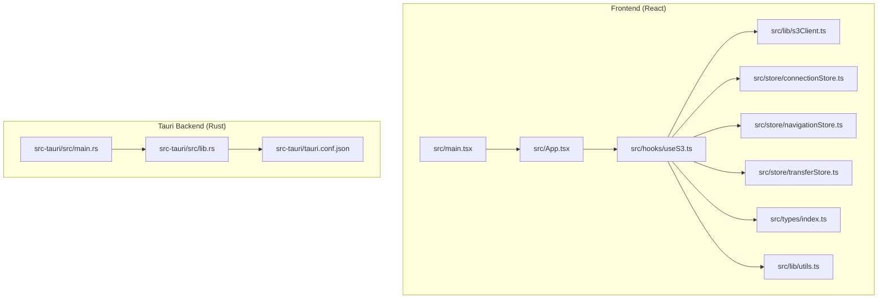
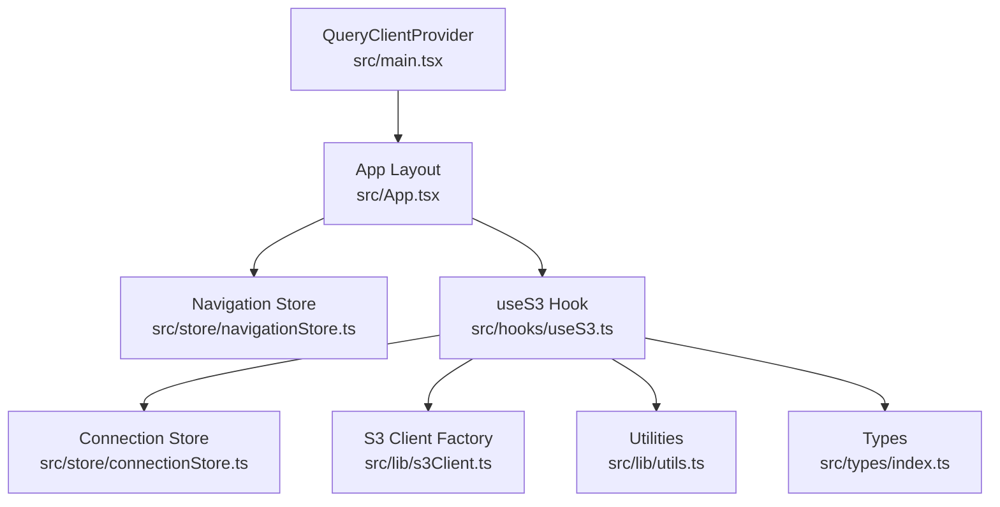
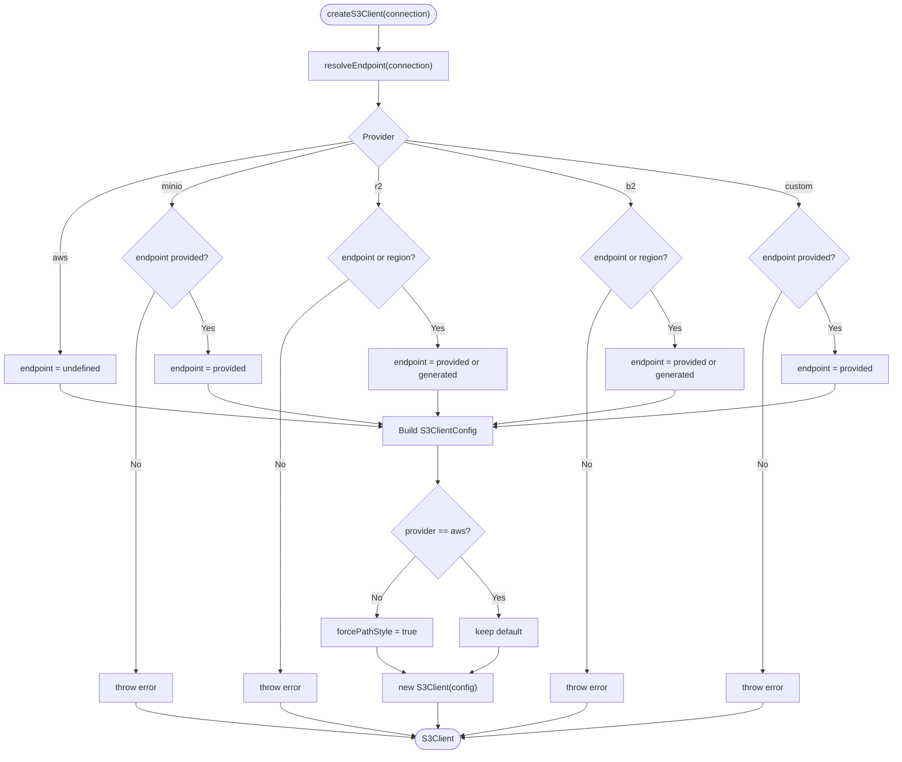
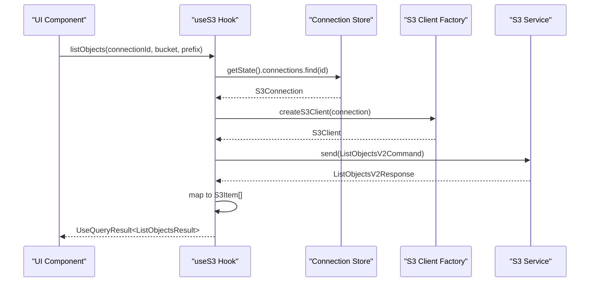
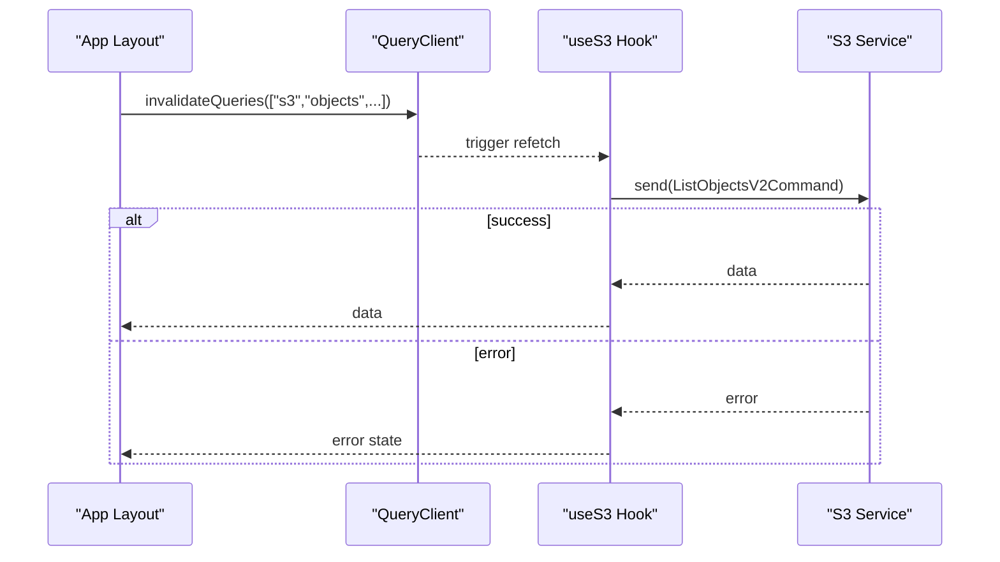
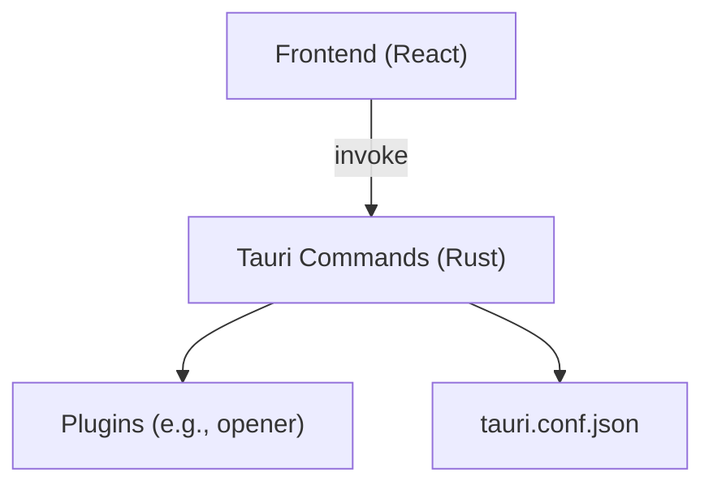
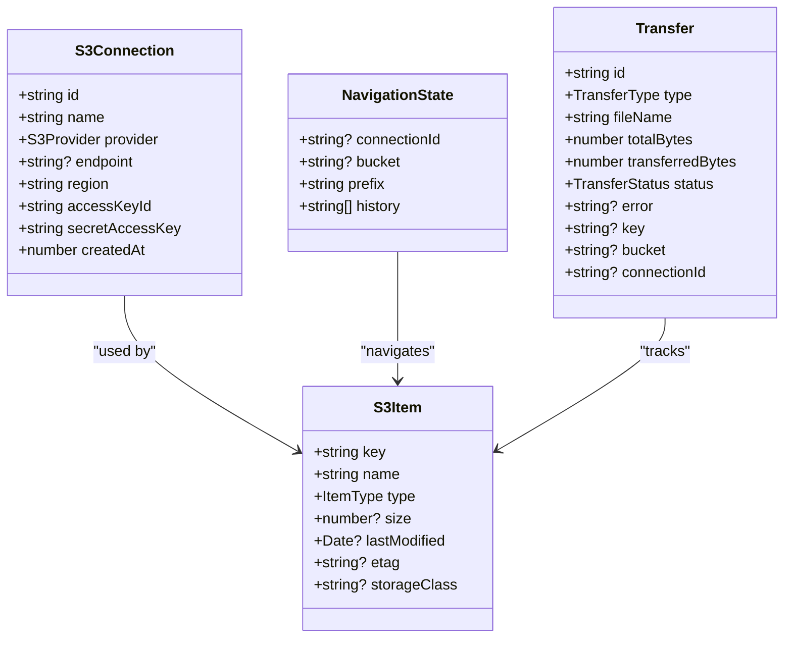
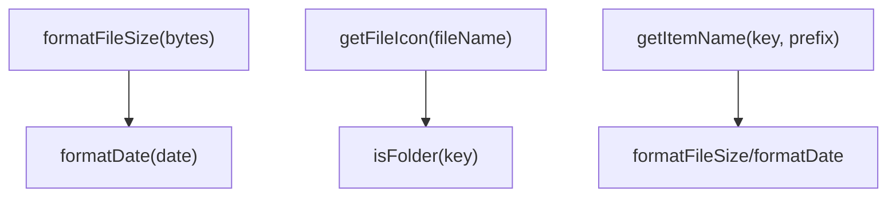
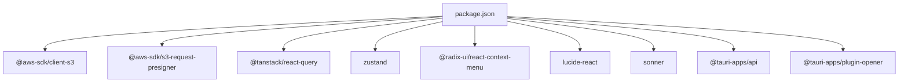

# Technical Implementation

<cite>
**Referenced Files in This Document**
- [s3Client.ts](file://src/lib/s3Client.ts)
- [useS3.ts](file://src/hooks/useS3.ts)
- [index.ts](file://src/types/index.ts)
- [connectionStore.ts](file://src/store/connectionStore.ts)
- [navigationStore.ts](file://src/store/navigationStore.ts)
- [transferStore.ts](file://src/store/transferStore.ts)
- [utils.ts](file://src/lib/utils.ts)
- [main.rs](file://src-tauri/src/main.rs)
- [lib.rs](file://src-tauri/src/lib.rs)
- [tauri.conf.json](file://src-tauri/tauri.conf.json)
- [main.tsx](file://src/main.tsx)
- [App.tsx](file://src/App.tsx)
- [package.json](file://package.json)
- [PROJECT.md](file://PROJECT.md)
</cite>

## Table of Contents
1. [Introduction](#introduction)
2. [Project Structure](#project-structure)
3. [Core Components](#core-components)
4. [Architecture Overview](#architecture-overview)
5. [Detailed Component Analysis](#detailed-component-analysis)
6. [Dependency Analysis](#dependency-analysis)
7. [Performance Considerations](#performance-considerations)
8. [Troubleshooting Guide](#troubleshooting-guide)
9. [Conclusion](#conclusion)
10. [Appendices](#appendices)

## Introduction
This document provides a comprehensive technical deep dive into S3 Explorer’s core systems. It covers the S3 integration architecture with a factory pattern for S3 clients, provider-specific configurations, and error handling strategies. It documents the React Hooks architecture centered around the useS3 hook, including TanStack Query integration for data fetching and mutations. It explains Tauri integration patterns, including the command bridge, native system access, and security considerations. It also documents the TypeScript type system, utility functions, and architectural patterns used throughout the codebase, with diagrams and rationale for key technical decisions.

## Project Structure
The project follows a clear separation of concerns:
- Frontend (React + TypeScript) under src/
- Tauri backend (Rust) under src-tauri/
- Shared types under src/types/
- State stores under src/store/
- Hooks and libraries under src/hooks/ and src/lib/

**Diagram sources**
- [main.tsx:1-26](file://src/main.tsx#L1-L26)
- [App.tsx:1-124](file://src/App.tsx#L1-L124)
- [useS3.ts:1-410](file://src/hooks/useS3.ts#L1-L410)
- [s3Client.ts:1-83](file://src/lib/s3Client.ts#L1-L83)
- [connectionStore.ts:1-88](file://src/store/connectionStore.ts#L1-L88)
- [navigationStore.ts:1-86](file://src/store/navigationStore.ts#L1-L86)
- [transferStore.ts:1-62](file://src/store/transferStore.ts#L1-L62)
- [index.ts:1-166](file://src/types/index.ts#L1-L166)
- [utils.ts:1-197](file://src/lib/utils.ts#L1-L197)
- [main.rs:1-7](file://src-tauri/src/main.rs#L1-L7)
- [lib.rs:1-15](file://src-tauri/src/lib.rs#L1-L15)
- [tauri.conf.json:1-36](file://src-tauri/tauri.conf.json#L1-L36)

**Section sources**
- [PROJECT.md:20-68](file://PROJECT.md#L20-L68)
- [package.json:1-37](file://package.json#L1-L37)

## Core Components
- S3 Client Factory: Centralized creation of S3Client instances with provider-aware endpoint resolution and path-style addressing for non-AWS providers.
- useS3 Hook: A TanStack Query-powered hook that exposes typed queries and mutations for S3 operations, including listing buckets/objects, uploads, downloads, deletions, folder creation, renaming, and metadata retrieval.
- Stores: Zustand stores for connection management, navigation state, and transfer tracking.
- Utilities: Formatting helpers for file sizes and dates, icon selection by extension, folder detection, and display name extraction.
- Tauri Bridge: Minimal Rust entrypoint and command registration for future native integrations.

**Section sources**
- [s3Client.ts:60-83](file://src/lib/s3Client.ts#L60-L83)
- [useS3.ts:62-410](file://src/hooks/useS3.ts#L62-L410)
- [connectionStore.ts:30-87](file://src/store/connectionStore.ts#L30-L87)
- [navigationStore.ts:36-85](file://src/store/navigationStore.ts#L36-L85)
- [transferStore.ts:28-61](file://src/store/transferStore.ts#L28-L61)
- [utils.ts:13-197](file://src/lib/utils.ts#L13-L197)
- [lib.rs:8-14](file://src-tauri/src/lib.rs#L8-L14)

## Architecture Overview
The frontend initializes a TanStack Query client with sensible defaults, wraps the app in a provider, and orchestrates navigation and S3 operations through hooks and stores. The useS3 hook encapsulates all S3 interactions, dynamically creating S3Client instances per operation based on the active connection. Provider-specific logic ensures correct endpoint construction and addressing modes. Tauri provides the desktop runtime and a future bridge for native operations.

**Diagram sources**
- [main.tsx:6-17](file://src/main.tsx#L6-L17)
- [App.tsx:11-82](file://src/App.tsx#L11-L82)
- [navigationStore.ts:36-85](file://src/store/navigationStore.ts#L36-L85)
- [connectionStore.ts:30-87](file://src/store/connectionStore.ts#L30-L87)
- [useS3.ts:62-410](file://src/hooks/useS3.ts#L62-L410)
- [s3Client.ts:60-83](file://src/lib/s3Client.ts#L60-L83)
- [utils.ts:13-197](file://src/lib/utils.ts#L13-L197)
- [index.ts:38-166](file://src/types/index.ts#L38-L166)

## Detailed Component Analysis

### S3 Client Factory Pattern
The factory creates a configured S3Client based on the active connection. It resolves provider-specific endpoints and sets path-style addressing for non-AWS providers to ensure compatibility. It also enforces required fields per provider and throws descriptive errors when missing.

**Diagram sources**
- [s3Client.ts:12-49](file://src/lib/s3Client.ts#L12-L49)
- [s3Client.ts:60-83](file://src/lib/s3Client.ts#L60-L83)

**Section sources**
- [s3Client.ts:12-49](file://src/lib/s3Client.ts#L12-L49)
- [s3Client.ts:60-83](file://src/lib/s3Client.ts#L60-L83)

### React Hooks Architecture and useS3 Implementation
The useS3 hook centralizes S3 operations using TanStack Query:
- Queries: listBuckets and listObjects return typed results and pagination info.
- Mutations: downloadFile, uploadFile, deleteItem, createFolder, getPresignedUrl, renameItem, headObject encapsulate S3 operations with robust error handling and browser-native download for small files.

**Diagram sources**
- [useS3.ts:91-144](file://src/hooks/useS3.ts#L91-L144)
- [connectionStore.ts:22-34](file://src/store/connectionStore.ts#L22-L34)
- [s3Client.ts:60-83](file://src/lib/s3Client.ts#L60-L83)

**Section sources**
- [useS3.ts:62-410](file://src/hooks/useS3.ts#L62-L410)
- [connectionStore.ts:22-34](file://src/store/connectionStore.ts#L22-L34)

### TanStack Query Integration and Error Handling
- QueryClientProvider wraps the app with default options: disabled refetch on window focus, 30s stale time, and retry attempts.
- useS3 leverages useQuery for reads and useMutation for writes, returning typed results and error states.
- Error handling is explicit: thrown errors bubble to UI for notification and logging.

**Diagram sources**
- [main.tsx:6-17](file://src/main.tsx#L6-L17)
- [App.tsx:23-28](file://src/App.tsx#L23-L28)
- [useS3.ts:96-144](file://src/hooks/useS3.ts#L96-L144)

**Section sources**
- [main.tsx:6-17](file://src/main.tsx#L6-L17)
- [App.tsx:23-28](file://src/App.tsx#L23-L28)
- [useS3.ts:96-144](file://src/hooks/useS3.ts#L96-L144)

### Tauri Integration Patterns
- Minimal Rust entrypoint delegates to a library function that configures plugins and registers commands.
- The configuration defines the dev/build URLs, window properties, and security policy.
- Native system access is prepared via a plugin for opening external resources.

**Diagram sources**
- [lib.rs:8-14](file://src-tauri/src/lib.rs#L8-L14)
- [main.rs:4-6](file://src-tauri/src/main.rs#L4-L6)
- [tauri.conf.json:1-36](file://src-tauri/tauri.conf.json#L1-L36)

**Section sources**
- [lib.rs:2-14](file://src-tauri/src/lib.rs#L2-L14)
- [main.rs:4-6](file://src-tauri/src/main.rs#L4-L6)
- [tauri.conf.json:20-22](file://src-tauri/tauri.conf.json#L20-L22)

### TypeScript Type System
The type system defines provider types, item types, transfer lifecycles, sort/filter configs, and domain models for connections, items, navigation, transfers, and API wrappers. It ensures strong typing across stores, hooks, and UI components.

**Diagram sources**
- [index.ts:38-98](file://src/types/index.ts#L38-L98)

**Section sources**
- [index.ts:7-166](file://src/types/index.ts#L7-L166)

### Utility Functions
Utilities provide:
- Human-friendly file size formatting.
- Localized date formatting.
- Icon selection by file extension.
- Folder detection and display name extraction from S3 keys.

**Diagram sources**
- [utils.ts:13-44](file://src/lib/utils.ts#L13-L44)
- [utils.ts:144-150](file://src/lib/utils.ts#L144-L150)
- [utils.ts:162-196](file://src/lib/utils.ts#L162-L196)

**Section sources**
- [utils.ts:13-197](file://src/lib/utils.ts#L13-L197)

## Dependency Analysis
External dependencies include AWS SDK for JavaScript, TanStack Query, Zustand, Radix UI, Lucide React, Sonner, and Tauri APIs/plugins. The frontend depends on the S3 SDK for operations and integrates with Tauri for native capabilities.

**Diagram sources**
- [package.json:12-24](file://package.json#L12-L24)

**Section sources**
- [package.json:12-24](file://package.json#L12-L24)

## Performance Considerations
- Stale-time caching reduces redundant network requests during navigation.
- Provider-specific path-style addressing avoids bucket endpoint rewrites for compatible services.
- Large downloads should leverage native Rust commands to improve reliability and throughput.
- Virtualized lists and pagination minimize DOM overhead for large buckets.

[No sources needed since this section provides general guidance]

## Troubleshooting Guide
- Connection not found: The internal helper throws when a requested connection ID does not exist in the store.
- Provider endpoint errors: Explicit validation throws when required fields are missing for MinIO, R2, B2, or custom providers.
- Mutation failures: HTTP status checks and thrown errors surface actionable messages for upload/delete/rename operations.
- Query invalidation: Use the QueryClient to refresh folder contents after mutations.

**Section sources**
- [useS3.ts:21-34](file://src/hooks/useS3.ts#L21-L34)
- [s3Client.ts:20-48](file://src/lib/s3Client.ts#L20-L48)
- [useS3.ts:207-225](file://src/hooks/useS3.ts#L207-L225)
- [useS3.ts:242-254](file://src/hooks/useS3.ts#L242-L254)
- [useS3.ts:331-358](file://src/hooks/useS3.ts#L331-L358)
- [App.tsx:23-28](file://src/App.tsx#L23-L28)

## Conclusion
S3 Explorer’s architecture combines a robust S3 client factory, a cohesive React Hooks layer powered by TanStack Query, and a pragmatic state management strategy with Zustand. The TypeScript type system enforces correctness across the stack, while utilities simplify UI concerns. Tauri provides a solid foundation for native integrations and desktop deployment. The documented patterns enable maintainability, scalability, and clear separation of concerns.

[No sources needed since this section summarizes without analyzing specific files]

## Appendices
- Provider support and endpoint rules are enforced centrally in the factory.
- The useS3 hook encapsulates all S3 operations and returns typed results for seamless UI integration.
- Stores manage persistence and state transitions for connections, navigation, and transfers.
- Tauri configuration and Rust entrypoint prepare the app for native capabilities.

[No sources needed since this section provides general guidance]