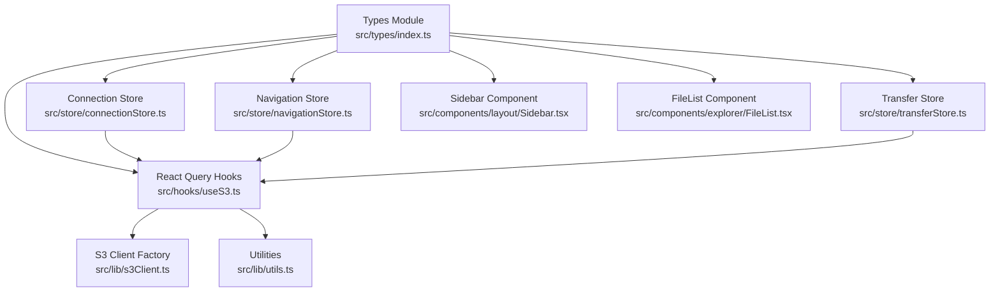
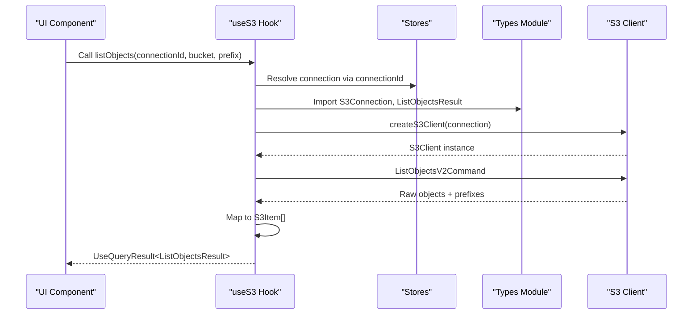
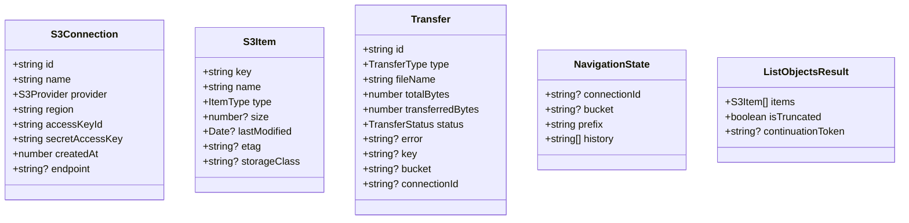
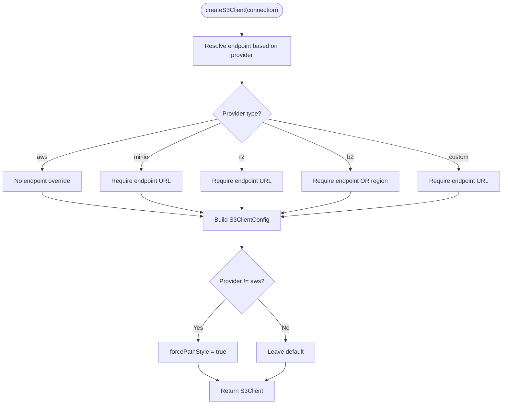
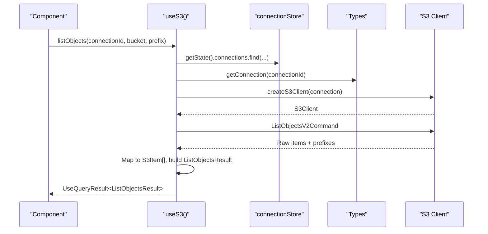
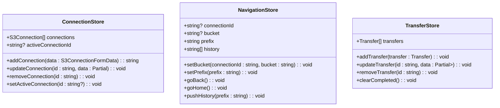
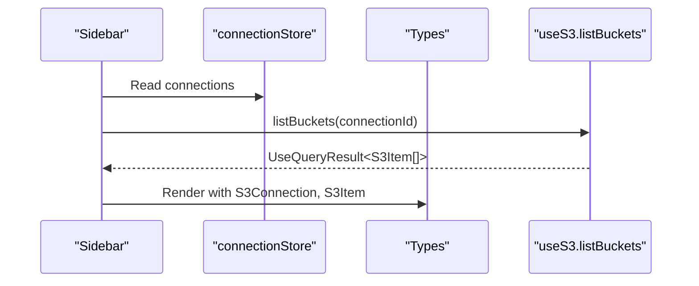
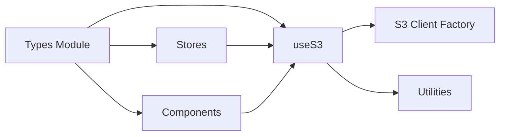

# Type System

<cite>
**Referenced Files in This Document**
- [index.ts](file://src/types/index.ts)
- [s3Client.ts](file://src/lib/s3Client.ts)
- [useS3.ts](file://src/hooks/useS3.ts)
- [connectionStore.ts](file://src/store/connectionStore.ts)
- [navigationStore.ts](file://src/store/navigationStore.ts)
- [transferStore.ts](file://src/store/transferStore.ts)
- [utils.ts](file://src/lib/utils.ts)
- [Sidebar.tsx](file://src/components/layout/Sidebar.tsx)
- [FileList.tsx](file://src/components/explorer/FileList.tsx)
- [tsconfig.json](file://tsconfig.json)
</cite>

## Table of Contents
1. [Introduction](#introduction)
2. [Project Structure](#project-structure)
3. [Core Components](#core-components)
4. [Architecture Overview](#architecture-overview)
5. [Detailed Component Analysis](#detailed-component-analysis)
6. [Dependency Analysis](#dependency-analysis)
7. [Performance Considerations](#performance-considerations)
8. [Troubleshooting Guide](#troubleshooting-guide)
9. [Conclusion](#conclusion)

## Introduction
This document explains the TypeScript type system used in S3 Explorer. It focuses on core domain and UI types, utility types, enums, and how they integrate with runtime behavior. The type system ensures strong contracts between components, hooks, stores, and the S3 client, enabling better developer experience, safer refactoring, and fewer runtime errors.

## Project Structure
The type system is centralized in a single module and consumed across UI components, hooks, and stores. Strict TypeScript compiler options enforce correctness.

**Diagram sources**
- [index.ts:1-166](file://src/types/index.ts#L1-L166)
- [s3Client.ts:1-83](file://src/lib/s3Client.ts#L1-L83)
- [useS3.ts:1-410](file://src/hooks/useS3.ts#L1-L410)
- [connectionStore.ts:1-88](file://src/store/connectionStore.ts#L1-L88)
- [navigationStore.ts:1-86](file://src/store/navigationStore.ts#L1-L86)
- [transferStore.ts:1-62](file://src/store/transferStore.ts#L1-L62)
- [utils.ts:1-197](file://src/lib/utils.ts#L1-L197)
- [Sidebar.tsx:1-184](file://src/components/layout/Sidebar.tsx#L1-L184)
- [FileList.tsx:1-401](file://src/components/explorer/FileList.tsx#L1-L401)

**Section sources**
- [tsconfig.json:1-25](file://tsconfig.json#L1-L25)

## Core Components
This section documents the primary TypeScript types and how they are used across the application.

- S3Provider: Discriminated union of supported providers.
- ItemType: Union of item categories.
- TransferType and TransferStatus: Transfer direction and lifecycle.
- SortField and SortDirection: Sorting configuration.
- FileContextAction and FolderContextAction: Context menu actions.
- S3Connection: Immutable connection model persisted in a store.
- S3ConnectionFormData: Subset of connection fields for forms.
- S3Item: Unified representation of buckets, folders, and files.
- NavigationState and BreadcrumbItem: Application navigation model.
- Transfer: Transfer progress and metadata.
- SortConfig and FilterConfig: UI sorting and filtering state.
- ItemInfo: “Get Info” dialog payload.
- PresignedUrlResult: Signed URL generation result.
- ContextMenuTarget: Context menu invocation payload.
- AsyncState<T>: Generic async operation wrapper.
- ListBucketsResult and ListObjectsResult: API response envelopes.

These types are imported and used in hooks, stores, and components to maintain consistent contracts and predictable behavior.

**Section sources**
- [index.ts:7-166](file://src/types/index.ts#L7-L166)

## Architecture Overview
The type system enforces a clean separation between UI, state, and data access layers. Components consume typed hooks and stores, while the S3 client factory relies on typed connection models.

**Diagram sources**
- [useS3.ts:69-144](file://src/hooks/useS3.ts#L69-L144)
- [s3Client.ts:60-82](file://src/lib/s3Client.ts#L60-L82)
- [index.ts:38-165](file://src/types/index.ts#L38-L165)
- [connectionStore.ts:22-34](file://src/store/connectionStore.ts#L22-L34)

## Detailed Component Analysis

### Types Module
The types module defines all core domain and UI types. It includes:
- Provider and item type unions
- Transfer direction/status
- Sort/filter configuration
- Core models: S3Connection, S3Item, Transfer
- Navigation and UI models
- API result wrappers

**Diagram sources**
- [index.ts:38-165](file://src/types/index.ts#L38-L165)

**Section sources**
- [index.ts:7-166](file://src/types/index.ts#L7-L166)

### S3 Client Factory
The S3 client factory consumes a typed S3Connection and returns a configured S3Client. It validates provider-specific requirements and sets endpoint/path-style behavior accordingly.

**Diagram sources**
- [s3Client.ts:12-82](file://src/lib/s3Client.ts#L12-L82)

**Section sources**
- [s3Client.ts:1-83](file://src/lib/s3Client.ts#L1-L83)

### useS3 Hook
The central hook exposes typed TanStack Query queries and mutations. It:
- Resolves connections from the store using typed identifiers
- Maps raw S3 responses to S3Item and ListObjectsResult
- Exposes typed mutations for upload, download, delete, rename, and metadata retrieval

**Diagram sources**
- [useS3.ts:69-144](file://src/hooks/useS3.ts#L69-L144)
- [connectionStore.ts:22-34](file://src/store/connectionStore.ts#L22-L34)

**Section sources**
- [useS3.ts:62-410](file://src/hooks/useS3.ts#L62-L410)

### Stores and Typed State
- Connection store: Manages S3Connection list and active ID, using typed actions.
- Navigation store: Manages navigation state and history, typed via NavigationState.
- Transfer store: Manages Transfer list with typed updates.

**Diagram sources**
- [connectionStore.ts:10-88](file://src/store/connectionStore.ts#L10-L88)
- [navigationStore.ts:29-86](file://src/store/navigationStore.ts#L29-L86)
- [transferStore.ts:4-62](file://src/store/transferStore.ts#L4-L62)

**Section sources**
- [connectionStore.ts:1-88](file://src/store/connectionStore.ts#L1-L88)
- [navigationStore.ts:1-86](file://src/store/navigationStore.ts#L1-L86)
- [transferStore.ts:1-62](file://src/store/transferStore.ts#L1-L62)

### Utilities and Runtime Validation
Utilities provide safe helpers that complement the type system:
- formatFileSize: Formats bytes to human-readable strings.
- formatDate: Safely formats dates with fallback for invalid inputs.
- getFileIcon: Maps file extensions to icon names.
- isFolder: Validates S3 folder keys.
- getItemName: Extracts display names from S3 keys with optional prefix stripping.

These functions accept primitive inputs and return primitives, but they rely on the types to ensure correct usage upstream.

**Section sources**
- [utils.ts:13-197](file://src/lib/utils.ts#L13-L197)

### UI Components and Type Usage
- Sidebar: Renders connections and buckets using typed S3Connection and S3Item.
- FileList: Consumes typed listObjects query result, applies typed filters and sorts, and renders rows with typed S3Item.

**Diagram sources**
- [Sidebar.tsx:51-108](file://src/components/layout/Sidebar.tsx#L51-L108)
- [connectionStore.ts:118-120](file://src/store/connectionStore.ts#L118-L120)
- [useS3.ts:69-85](file://src/hooks/useS3.ts#L69-L85)
- [index.ts:38-62](file://src/types/index.ts#L38-L62)

**Section sources**
- [Sidebar.tsx:1-184](file://src/components/layout/Sidebar.tsx#L1-L184)
- [FileList.tsx:43-121](file://src/components/explorer/FileList.tsx#L43-L121)

## Dependency Analysis
The type system creates clear boundaries:
- UI components depend on typed props and hooks.
- Hooks depend on typed stores and types.
- Stores depend on typed models.
- Utilities depend on primitives but are used by typed code.

**Diagram sources**
- [index.ts:1-166](file://src/types/index.ts#L1-L166)
- [useS3.ts:1-410](file://src/hooks/useS3.ts#L1-L410)
- [s3Client.ts:1-83](file://src/lib/s3Client.ts#L1-L83)
- [utils.ts:1-197](file://src/lib/utils.ts#L1-L197)
- [connectionStore.ts:1-88](file://src/store/connectionStore.ts#L1-L88)
- [navigationStore.ts:1-86](file://src/store/navigationStore.ts#L1-L86)
- [transferStore.ts:1-62](file://src/store/transferStore.ts#L1-L62)
- [Sidebar.tsx:1-184](file://src/components/layout/Sidebar.tsx#L1-L184)
- [FileList.tsx:1-401](file://src/components/explorer/FileList.tsx#L1-L401)

**Section sources**
- [index.ts:1-166](file://src/types/index.ts#L1-L166)
- [useS3.ts:1-410](file://src/hooks/useS3.ts#L1-L410)
- [s3Client.ts:1-83](file://src/lib/s3Client.ts#L1-L83)
- [utils.ts:1-197](file://src/lib/utils.ts#L1-L197)
- [connectionStore.ts:1-88](file://src/store/connectionStore.ts#L1-L88)
- [navigationStore.ts:1-86](file://src/store/navigationStore.ts#L1-L86)
- [transferStore.ts:1-62](file://src/store/transferStore.ts#L1-L62)
- [Sidebar.tsx:1-184](file://src/components/layout/Sidebar.tsx#L1-L184)
- [FileList.tsx:1-401](file://src/components/explorer/FileList.tsx#L1-L401)

## Performance Considerations
- Using discriminated unions and literal types avoids expensive runtime checks and enables efficient switch statements.
- Generic AsyncState<T> reduces duplication and improves caching behavior in TanStack Query.
- Virtualization in FileList minimizes DOM work; typed memoization prevents unnecessary re-renders.
- Strict typing helps catch performance regressions early during development.

## Troubleshooting Guide
Common type-related issues and resolutions:
- Unexpected nullish values: Ensure consumers check for optional fields (e.g., size, lastModified) before rendering.
- Provider endpoint errors: Verify provider-specific requirements in the S3 client factory.
- Store state mismatches: Confirm activeConnectionId exists before invoking S3 operations.
- Sorting inconsistencies: Validate SortField and SortDirection usage in UI components.

**Section sources**
- [s3Client.ts:12-49](file://src/lib/s3Client.ts#L12-L49)
- [connectionStore.ts:71-76](file://src/store/connectionStore.ts#L71-L76)
- [FileList.tsx:84-121](file://src/components/explorer/FileList.tsx#L84-L121)

## Conclusion
The type system in S3 Explorer provides strong contracts across UI, state, and data layers. By leveraging unions, generics, and strict compiler settings, the application achieves better developer experience, safer refactoring, and reduced runtime errors. The types guide how components and hooks interact, ensuring predictable behavior and maintainable code.