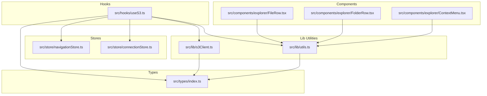
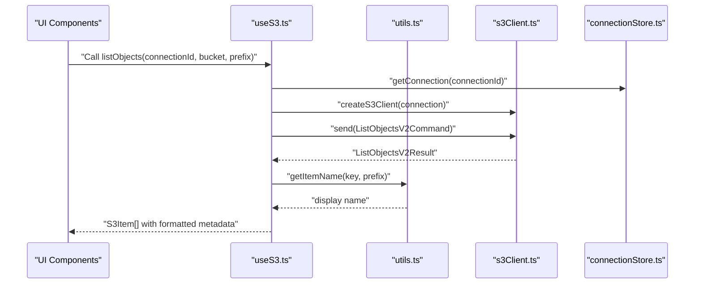
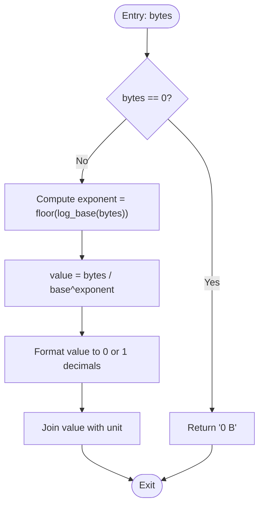
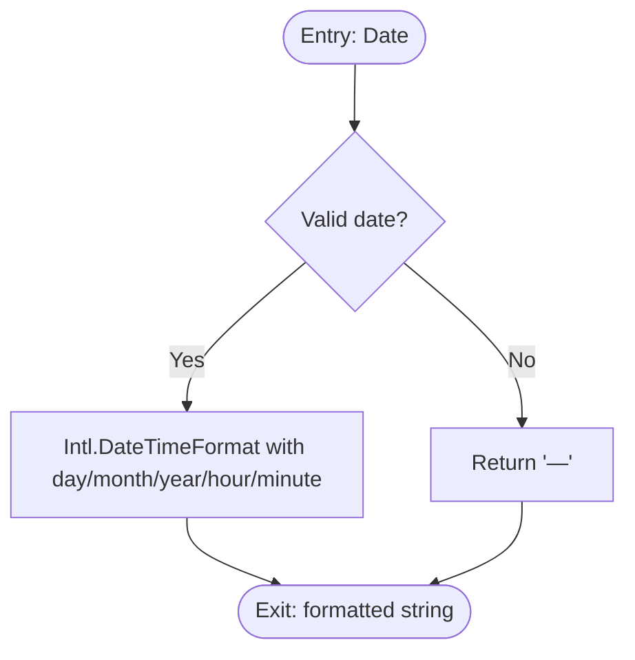
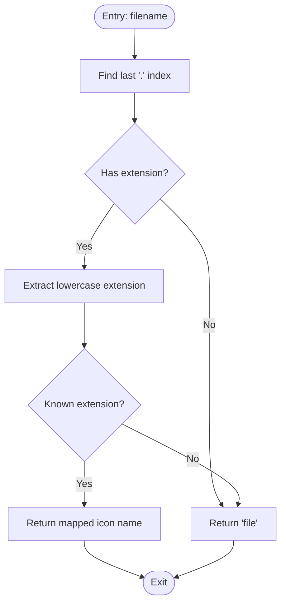
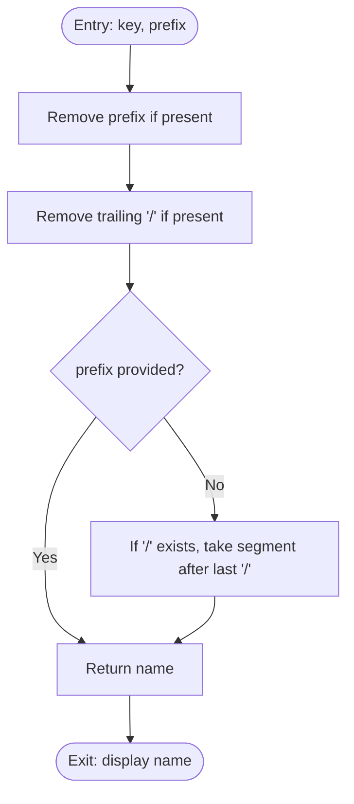
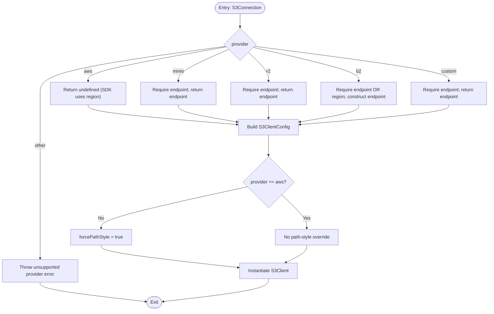
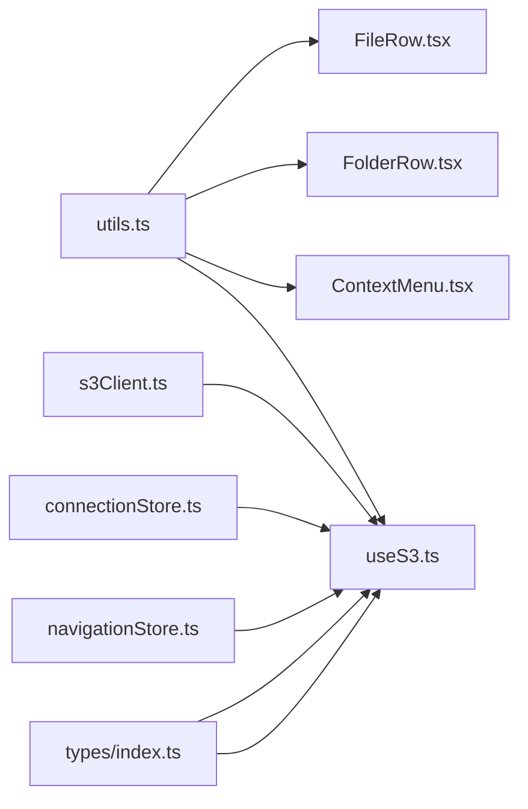

# Utility Functions

<cite>
**Referenced Files in This Document**
- [utils.ts](file://src/lib/utils.ts)
- [s3Client.ts](file://src/lib/s3Client.ts)
- [useS3.ts](file://src/hooks/useS3.ts)
- [connectionStore.ts](file://src/store/connectionStore.ts)
- [navigationStore.ts](file://src/store/navigationStore.ts)
- [index.ts](file://src/types/index.ts)
- [FileRow.tsx](file://src/components/explorer/FileRow.tsx)
- [FolderRow.tsx](file://src/components/explorer/FolderRow.tsx)
- [ContextMenu.tsx](file://src/components/explorer/ContextMenu.tsx)
</cite>

## Table of Contents
1. [Introduction](#introduction)
2. [Project Structure](#project-structure)
3. [Core Components](#core-components)
4. [Architecture Overview](#architecture-overview)
5. [Detailed Component Analysis](#detailed-component-analysis)
6. [Dependency Analysis](#dependency-analysis)
7. [Performance Considerations](#performance-considerations)
8. [Troubleshooting Guide](#troubleshooting-guide)
9. [Conclusion](#conclusion)

## Introduction
This document describes the utility functions and helper modules used throughout S3 Explorer. It focuses on:
- Human-readable file size formatting
- Date formatting helpers
- Icon mapping for file types
- S3-specific utilities for path handling and folder detection
- S3 client creation and endpoint resolution
- String manipulation and path utilities
- Data transformation helpers
- Practical usage examples across the UI and hooks
- Performance considerations and best practices for extending the utility library

These utilities are foundational building blocks that keep UI components clean, reduce duplication, and ensure consistent behavior across the application.

## Project Structure
The utility layer is organized into focused modules:
- Formatting and presentation helpers: file size, dates, and icon mapping
- S3 client configuration and endpoint resolution
- Path and naming helpers for S3 keys
- Stores and hooks that orchestrate S3 operations and leverage utilities

**Diagram sources**
- [utils.ts](file://src/lib/utils.ts)
- [s3Client.ts](file://src/lib/s3Client.ts)
- [useS3.ts](file://src/hooks/useS3.ts)
- [connectionStore.ts](file://src/store/connectionStore.ts)
- [navigationStore.ts](file://src/store/navigationStore.ts)
- [FileRow.tsx](file://src/components/explorer/FileRow.tsx)
- [FolderRow.tsx](file://src/components/explorer/FolderRow.tsx)
- [ContextMenu.tsx](file://src/components/explorer/ContextMenu.tsx)
- [index.ts](file://src/types/index.ts)

**Section sources**
- [utils.ts](file://src/lib/utils.ts)
- [s3Client.ts](file://src/lib/s3Client.ts)
- [useS3.ts](file://src/hooks/useS3.ts)
- [connectionStore.ts](file://src/store/connectionStore.ts)
- [navigationStore.ts](file://src/store/navigationStore.ts)
- [index.ts](file://src/types/index.ts)
- [FileRow.tsx](file://src/components/explorer/FileRow.tsx)
- [FolderRow.tsx](file://src/components/explorer/FolderRow.tsx)
- [ContextMenu.tsx](file://src/components/explorer/ContextMenu.tsx)

## Core Components
This section documents the primary utility functions and their roles.

- File size formatting
  - Purpose: Convert raw bytes into human-readable strings with appropriate units and rounding.
  - Example usage: Displayed in file and context menus.
  - Implementation reference: [formatFileSize:13-27](file://src/lib/utils.ts#L13-L27)

- Date formatting
  - Purpose: Render localized timestamps for UI display.
  - Example usage: File and folder rows, context menu info.
  - Implementation reference: [formatDate:34-44](file://src/lib/utils.ts#L34-L44)

- Icon mapping by file extension
  - Purpose: Map file extensions to Lucide React icon names for consistent file type visuals.
  - Example usage: File row rendering.
  - Implementation reference: [getFileIcon:144-150](file://src/lib/utils.ts#L144-L150)

- S3 path helpers
  - isFolder: Determine if an S3 key represents a folder.
    - Reference: [isFolder:162-164](file://src/lib/utils.ts#L162-L164)
  - getItemName: Extract display name from an S3 key, optionally stripping a prefix.
    - Reference: [getItemName:178-196](file://src/lib/utils.ts#L178-L196)

- S3 client configuration and endpoint resolution
  - Purpose: Construct a properly configured S3Client based on provider and connection settings.
  - Implementation reference: [createS3Client:60-82](file://src/lib/s3Client.ts#L60-L82), [resolveEndpoint:12-49](file://src/lib/s3Client.ts#L12-L49)

- String manipulation helpers
  - PascalCase conversion for dynamic icon component resolution.
    - Reference: [toPascalCase:8-13](file://src/components/explorer/FileRow.tsx#L8-L13)

**Section sources**
- [utils.ts:13-27](file://src/lib/utils.ts#L13-L27)
- [utils.ts:34-44](file://src/lib/utils.ts#L34-L44)
- [utils.ts:144-150](file://src/lib/utils.ts#L144-L150)
- [utils.ts:162-164](file://src/lib/utils.ts#L162-L164)
- [utils.ts:178-196](file://src/lib/utils.ts#L178-L196)
- [s3Client.ts:60-82](file://src/lib/s3Client.ts#L60-L82)
- [s3Client.ts:12-49](file://src/lib/s3Client.ts#L12-L49)
- [FileRow.tsx:8-13](file://src/components/explorer/FileRow.tsx#L8-L13)

## Architecture Overview
Utilities are consumed by UI components and the S3 hook to maintain separation of concerns. The S3 hook orchestrates operations and delegates formatting and path logic to utilities.

**Diagram sources**
- [useS3.ts](file://src/hooks/useS3.ts)
- [utils.ts](file://src/lib/utils.ts)
- [s3Client.ts](file://src/lib/s3Client.ts)
- [connectionStore.ts](file://src/store/connectionStore.ts)

## Detailed Component Analysis

### File Size Formatting
- Functionality: Converts bytes to a human-readable unit string with one decimal place, dropping the decimal when whole.
- Complexity: O(1) time and space.
- Usage sites:
  - File row display: [FileRow.tsx:69-71](file://src/components/explorer/FileRow.tsx#L69-L71)
  - Context menu info: [ContextMenu.tsx:133-141](file://src/components/explorer/ContextMenu.tsx#L133-L141)

**Diagram sources**
- [utils.ts:13-27](file://src/lib/utils.ts#L13-L27)

**Section sources**
- [utils.ts:13-27](file://src/lib/utils.ts#L13-L27)
- [FileRow.tsx:69-71](file://src/components/explorer/FileRow.tsx#L69-L71)
- [ContextMenu.tsx:133-141](file://src/components/explorer/ContextMenu.tsx#L133-L141)

### Date Formatting
- Functionality: Formats Date instances into a localized string with day, month, year, hour, and minute.
- Complexity: O(1) time and space.
- Usage sites:
  - File row display: [FileRow.tsx:74-76](file://src/components/explorer/FileRow.tsx#L74-L76)
  - Folder row display: [FolderRow.tsx:58-60](file://src/components/explorer/FolderRow.tsx#L58-L60)
  - Context menu info: [ContextMenu.tsx:135-138](file://src/components/explorer/ContextMenu.tsx#L135-L138)

**Diagram sources**
- [utils.ts:34-44](file://src/lib/utils.ts#L34-L44)

**Section sources**
- [utils.ts:34-44](file://src/lib/utils.ts#L34-L44)
- [FileRow.tsx:74-76](file://src/components/explorer/FileRow.tsx#L74-L76)
- [FolderRow.tsx:58-60](file://src/components/explorer/FolderRow.tsx#L58-L60)
- [ContextMenu.tsx:135-138](file://src/components/explorer/ContextMenu.tsx#L135-L138)

### Icon Mapping by Extension
- Functionality: Maps file extensions to Lucide icon names. Falls back to a generic file icon for unknown extensions.
- Complexity: O(1) lookup via record.
- Usage site:
  - Dynamic icon resolution in file rows: [FileRow.tsx:41-46](file://src/components/explorer/FileRow.tsx#L41-L46)

**Diagram sources**
- [utils.ts:144-150](file://src/lib/utils.ts#L144-L150)

**Section sources**
- [utils.ts:144-150](file://src/lib/utils.ts#L144-L150)
- [FileRow.tsx:41-46](file://src/components/explorer/FileRow.tsx#L41-L46)

### S3 Path Helpers
- isFolder: Checks if an S3 key ends with '/' to treat it as a virtual folder.
  - Reference: [isFolder:162-164](file://src/lib/utils.ts#L162-L164)
- getItemName: Strips a given prefix, removes trailing '/', and extracts the final segment when no prefix is provided.
  - Reference: [getItemName:178-196](file://src/lib/utils.ts#L178-L196)
- Usage sites:
  - Hook transforms prefixes to display names: [useS3.ts:115-117](file://src/hooks/useS3.ts#L115-L117), [useS3.ts:127-129](file://src/hooks/useS3.ts#L127-L129)

**Diagram sources**
- [utils.ts:178-196](file://src/lib/utils.ts#L178-L196)

**Section sources**
- [utils.ts:162-164](file://src/lib/utils.ts#L162-L164)
- [utils.ts:178-196](file://src/lib/utils.ts#L178-L196)
- [useS3.ts:115-117](file://src/hooks/useS3.ts#L115-L117)
- [useS3.ts:127-129](file://src/hooks/useS3.ts#L127-L129)

### S3 Client Utilities and Endpoint Resolution
- resolveEndpoint: Determines the S3 endpoint URL based on provider and inputs, with strict validation for required fields.
  - References: [resolveEndpoint:12-49](file://src/lib/s3Client.ts#L12-L49)
- createS3Client: Builds an S3Client with region, credentials, optional endpoint, and path-style addressing for non-AWS providers.
  - References: [createS3Client:60-82](file://src/lib/s3Client.ts#L60-L82)
- Usage site:
  - Hook creates clients per operation: [useS3.ts](file://src/hooks/useS3.ts#L74), [useS3.ts](file://src/hooks/useS3.ts#L100), [useS3.ts](file://src/hooks/useS3.ts#L163), [useS3.ts](file://src/hooks/useS3.ts#L208), [useS3.ts](file://src/hooks/useS3.ts#L243), [useS3.ts](file://src/hooks/useS3.ts#L280), [useS3.ts](file://src/hooks/useS3.ts#L304), [useS3.ts](file://src/hooks/useS3.ts#L377)

**Diagram sources**
- [s3Client.ts:12-49](file://src/lib/s3Client.ts#L12-L49)
- [s3Client.ts:60-82](file://src/lib/s3Client.ts#L60-L82)

**Section sources**
- [s3Client.ts:12-49](file://src/lib/s3Client.ts#L12-L49)
- [s3Client.ts:60-82](file://src/lib/s3Client.ts#L60-L82)
- [useS3.ts](file://src/hooks/useS3.ts#L74)
- [useS3.ts](file://src/hooks/useS3.ts#L100)
- [useS3.ts](file://src/hooks/useS3.ts#L163)
- [useS3.ts](file://src/hooks/useS3.ts#L208)
- [useS3.ts](file://src/hooks/useS3.ts#L243)
- [useS3.ts](file://src/hooks/useS3.ts#L280)
- [useS3.ts](file://src/hooks/useS3.ts#L304)
- [useS3.ts](file://src/hooks/useS3.ts#L377)

### String Manipulation and Path Utilities
- PascalCase conversion for Lucide icon names:
  - Reference: [toPascalCase:8-13](file://src/components/explorer/FileRow.tsx#L8-L13)
- Name extraction from S3 keys (alternative implementation in hook):
  - Reference: [nameFromKey:37-41](file://src/hooks/useS3.ts#L37-L41)

Usage sites:
- Dynamic icon resolution: [FileRow.tsx:41-46](file://src/components/explorer/FileRow.tsx#L41-L46)
- Context menu rename helper: [ContextMenu.tsx:90-94](file://src/components/explorer/ContextMenu.tsx#L90-L94)

**Section sources**
- [FileRow.tsx:8-13](file://src/components/explorer/FileRow.tsx#L8-L13)
- [useS3.ts:37-41](file://src/hooks/useS3.ts#L37-L41)
- [ContextMenu.tsx:90-94](file://src/components/explorer/ContextMenu.tsx#L90-L94)

### Data Transformation Helpers
- S3Item construction and transformation:
  - Buckets: [useS3.ts:77-83](file://src/hooks/useS3.ts#L77-L83)
  - Objects: [useS3.ts:114-135](file://src/hooks/useS3.ts#L114-L135)
  - Metadata fetch: [useS3.ts:382-388](file://src/hooks/useS3.ts#L382-L388)
- Navigation state management:
  - History push/pop: [navigationStore.ts:54-74](file://src/store/navigationStore.ts#L54-L74)
- Connection state management:
  - ID generation and CRUD: [connectionStore.ts:6-8](file://src/store/connectionStore.ts#L6-L8), [connectionStore.ts:39-76](file://src/store/connectionStore.ts#L39-L76)

**Section sources**
- [useS3.ts:77-83](file://src/hooks/useS3.ts#L77-L83)
- [useS3.ts:114-135](file://src/hooks/useS3.ts#L114-L135)
- [useS3.ts:382-388](file://src/hooks/useS3.ts#L382-L388)
- [navigationStore.ts:54-74](file://src/store/navigationStore.ts#L54-L74)
- [connectionStore.ts:6-8](file://src/store/connectionStore.ts#L6-L8)
- [connectionStore.ts:39-76](file://src/store/connectionStore.ts#L39-L76)

## Dependency Analysis
Utilities are consumed across components and hooks, forming a cohesive layer that reduces coupling between UI and S3 logic.

**Diagram sources**
- [utils.ts](file://src/lib/utils.ts)
- [s3Client.ts](file://src/lib/s3Client.ts)
- [useS3.ts](file://src/hooks/useS3.ts)
- [connectionStore.ts](file://src/store/connectionStore.ts)
- [navigationStore.ts](file://src/store/navigationStore.ts)
- [index.ts](file://src/types/index.ts)
- [FileRow.tsx](file://src/components/explorer/FileRow.tsx)
- [FolderRow.tsx](file://src/components/explorer/FolderRow.tsx)
- [ContextMenu.tsx](file://src/components/explorer/ContextMenu.tsx)

**Section sources**
- [utils.ts](file://src/lib/utils.ts)
- [s3Client.ts](file://src/lib/s3Client.ts)
- [useS3.ts](file://src/hooks/useS3.ts)
- [connectionStore.ts](file://src/store/connectionStore.ts)
- [navigationStore.ts](file://src/store/navigationStore.ts)
- [index.ts](file://src/types/index.ts)
- [FileRow.tsx](file://src/components/explorer/FileRow.tsx)
- [FolderRow.tsx](file://src/components/explorer/FolderRow.tsx)
- [ContextMenu.tsx](file://src/components/explorer/ContextMenu.tsx)

## Performance Considerations
- Avoid repeated conversions: Cache computed display names and icons when rendering long lists.
- Minimize DOM work: Use memoization for expensive computations in render-heavy components.
- Endpoint resolution: Perform once per connection change; reuse the client instance where possible.
- Formatting: These functions are O(1); however, avoid calling them excessively in tight loops without batching.
- Network-bound operations: Offload heavy downloads to native commands when supported; use presigned URLs for browser-based small files.

## Troubleshooting Guide
Common issues and resolutions:
- Invalid date formatting
  - Symptom: Displays "—" for dates.
  - Cause: Non-date or invalid Date object passed.
  - Fix: Validate inputs before calling [formatDate:34-44](file://src/lib/utils.ts#L34-L44).
- Unknown file extension icon
  - Symptom: Generic file icon shown.
  - Cause: Extension not present in mapping.
  - Fix: Extend [EXTENSION_ICON_MAP:48-134](file://src/lib/utils.ts#L48-L134) as needed.
- Incorrect folder detection
  - Symptom: Files treated as folders or vice versa.
  - Cause: Key does not end with "/" for virtual folders.
  - Fix: Ensure S3 keys follow S3 conventions; verify [isFolder:162-164](file://src/lib/utils.ts#L162-L164).
- Endpoint errors for non-AWS providers
  - Symptom: Client creation fails.
  - Cause: Missing endpoint or region for provider.
  - Fix: Provide required fields; see [resolveEndpoint:12-49](file://src/lib/s3Client.ts#L12-L49).
- Client path-style addressing
  - Symptom: Bucket endpoint errors for MinIO/R2/B2.
  - Cause: Missing forcePathStyle.
  - Fix: [createS3Client:76-78](file://src/lib/s3Client.ts#L76-L78) sets this for non-AWS providers.
- Name extraction edge cases
  - Symptom: Unexpected display names.
  - Cause: Prefix mismatch or missing trailing slash handling.
  - Fix: Use [getItemName:178-196](file://src/lib/utils.ts#L178-L196) consistently.

**Section sources**
- [utils.ts:34-44](file://src/lib/utils.ts#L34-L44)
- [utils.ts:48-134](file://src/lib/utils.ts#L48-L134)
- [utils.ts:162-164](file://src/lib/utils.ts#L162-L164)
- [utils.ts:178-196](file://src/lib/utils.ts#L178-L196)
- [s3Client.ts:12-49](file://src/lib/s3Client.ts#L12-L49)
- [s3Client.ts:76-78](file://src/lib/s3Client.ts#L76-L78)

## Conclusion
The utility layer in S3 Explorer provides robust, reusable helpers for formatting, path handling, and S3 client configuration. By centralizing these concerns, the application remains maintainable, consistent, and easy to extend. When adding new features, prefer augmenting existing utilities or creating new ones in the same module to preserve cohesion and simplify testing.