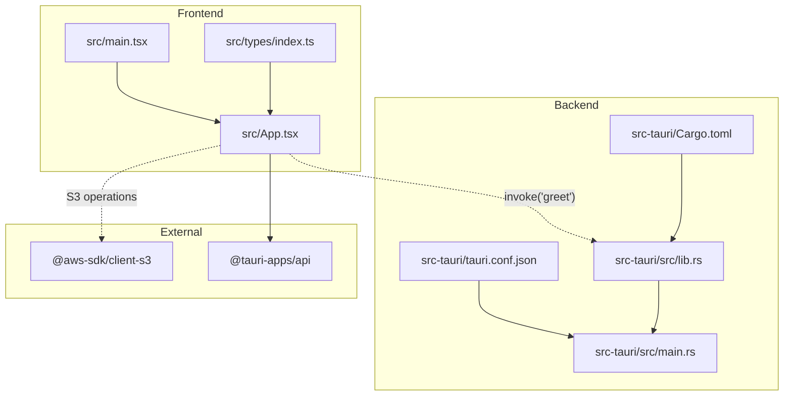
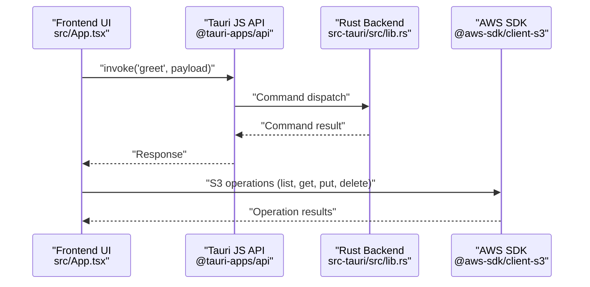
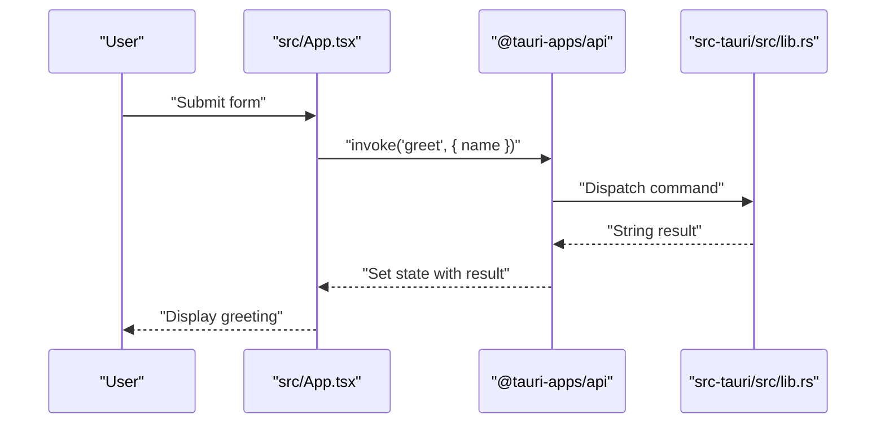
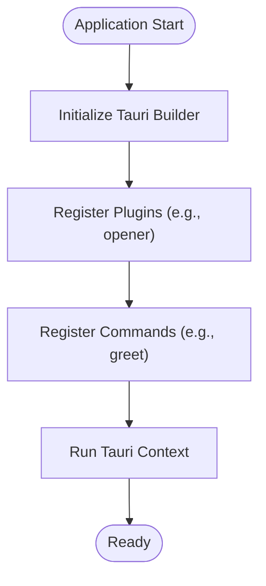
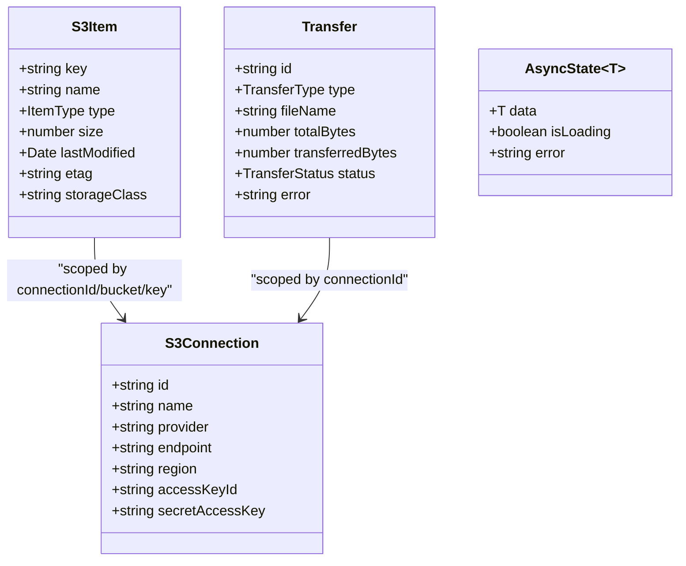
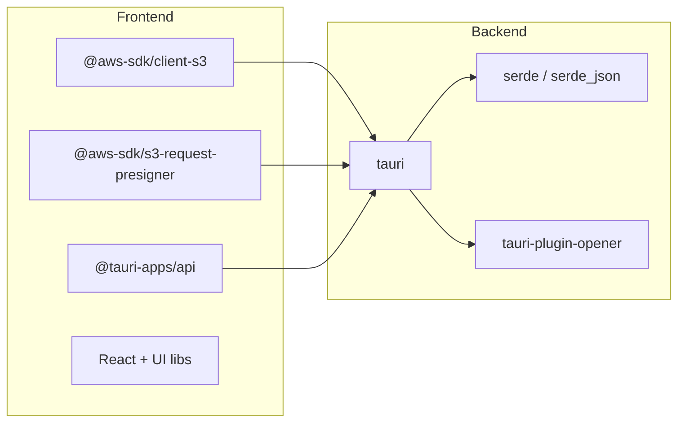

# Troubleshooting

<cite>
**Referenced Files in This Document**
- [README.md](file://README.md)
- [PROJECT.md](file://PROJECT.md)
- [package.json](file://package.json)
- [Cargo.toml](file://src-tauri/Cargo.toml)
- [tauri.conf.json](file://src-tauri/tauri.conf.json)
- [src-tauri/src/lib.rs](file://src-tauri/src/lib.rs)
- [src-tauri/src/main.rs](file://src-tauri/src/main.rs)
- [src/App.tsx](file://src/App.tsx)
- [src/main.tsx](file://src/main.tsx)
- [src/types/index.ts](file://src/types/index.ts)
</cite>

## Table of Contents
1. [Introduction](#introduction)
2. [Project Structure](#project-structure)
3. [Core Components](#core-components)
4. [Architecture Overview](#architecture-overview)
5. [Detailed Component Analysis](#detailed-component-analysis)
6. [Dependency Analysis](#dependency-analysis)
7. [Performance Considerations](#performance-considerations)
8. [Troubleshooting Guide](#troubleshooting-guide)
9. [Conclusion](#conclusion)
10. [Appendices](#appendices)

## Introduction
This document provides a comprehensive troubleshooting guide for S3 Explorer. It focuses on diagnosing and resolving common issues such as connection problems with S3 providers, authentication failures, file operation errors, and performance issues with large file listings. It also covers systematic debugging approaches for Tauri command failures, AWS SDK integration problems, and frontend-backend communication issues. Platform-specific guidance for Windows, macOS, and Linux is included, along with logging strategies, error reporting mechanisms, and diagnostic tools. Finally, it outlines step-by-step resolutions for build failures, dependency conflicts, and runtime errors.

## Project Structure
S3 Explorer follows a clear separation of concerns:
- Frontend (React + TypeScript): Handles UI, state, and user interactions.
- Backend (Tauri + Rust): Exposes safe commands to the frontend and integrates with native systems.
- AWS SDK integration: Uses @aws-sdk/client-s3 for S3 operations.
- Build and packaging: Managed via Tauri CLI and Vite.

**Diagram sources**
- [src/App.tsx:1-56](file://src/App.tsx#L1-L56)
- [src/main.tsx:1-10](file://src/main.tsx#L1-L10)
- [src/types/index.ts:1-165](file://src/types/index.ts#L1-L165)
- [src-tauri/src/lib.rs:1-15](file://src-tauri/src/lib.rs#L1-L15)
- [src-tauri/src/main.rs:1-7](file://src-tauri/src/main.rs#L1-L7)
- [src-tauri/Cargo.toml:1-26](file://src-tauri/Cargo.toml#L1-L26)
- [src-tauri/tauri.conf.json:1-36](file://src-tauri/tauri.conf.json#L1-L36)
- [package.json:1-37](file://package.json#L1-L37)

**Section sources**
- [README.md:1-8](file://README.md#L1-L8)
- [PROJECT.md:1-205](file://PROJECT.md#L1-L205)
- [package.json:1-37](file://package.json#L1-L37)
- [src-tauri/Cargo.toml:1-26](file://src-tauri/Cargo.toml#L1-L26)
- [src-tauri/tauri.conf.json:1-36](file://src-tauri/tauri.conf.json#L1-L36)

## Core Components
- Frontend entry and invocation demo:
  - The frontend app demonstrates invoking a Tauri command from the frontend and displaying the response.
  - The demo command is named greet and is registered in the backend.
- Backend initialization:
  - The backend initializes Tauri, registers plugins, and exposes commands to the frontend.
- Types and contracts:
  - TypeScript types define S3 connection, item, transfer, and API state contracts used across the app.
- Build and packaging:
  - The project uses Tauri CLI and Vite for building and bundling the application.

**Section sources**
- [src/App.tsx:1-56](file://src/App.tsx#L1-L56)
- [src-tauri/src/lib.rs:1-15](file://src-tauri/src/lib.rs#L1-L15)
- [src-tauri/src/main.rs:1-7](file://src-tauri/src/main.rs#L1-L7)
- [src/types/index.ts:1-165](file://src/types/index.ts#L1-L165)
- [package.json:1-37](file://package.json#L1-L37)
- [src-tauri/Cargo.toml:1-26](file://src-tauri/Cargo.toml#L1-L26)
- [src-tauri/tauri.conf.json:1-36](file://src-tauri/tauri.conf.json#L1-L36)

## Architecture Overview
The system architecture separates UI logic from backend commands and AWS SDK operations. The frontend communicates with the backend via Tauri’s invoke mechanism and with AWS via the JavaScript SDK.

**Diagram sources**
- [src/App.tsx:1-56](file://src/App.tsx#L1-L56)
- [src-tauri/src/lib.rs:1-15](file://src-tauri/src/lib.rs#L1-L15)
- [package.json:12-25](file://package.json#L12-L25)

## Detailed Component Analysis

### Frontend Command Invocation Demo
- Purpose: Demonstrates how the frontend invokes a backend command and receives a response.
- Key behaviors:
  - Captures user input and calls invoke with a command name and payload.
  - Updates UI state with the returned message.
- Typical issues:
  - Command not found errors indicate missing registration or incorrect command name.
  - CORS-like restrictions are not applicable here because Tauri handles IPC internally.

**Diagram sources**
- [src/App.tsx:10-12](file://src/App.tsx#L10-L12)
- [src-tauri/src/lib.rs:2-5](file://src-tauri/src/lib.rs#L2-L5)

**Section sources**
- [src/App.tsx:1-56](file://src/App.tsx#L1-L56)
- [src-tauri/src/lib.rs:1-15](file://src-tauri/src/lib.rs#L1-L15)

### Backend Initialization and Plugin Registration
- Purpose: Initializes the Tauri application, registers plugins, and exposes commands.
- Key behaviors:
  - Registers the greet command.
  - Initializes the opener plugin.
  - Runs the Tauri context.
- Typical issues:
  - Missing plugin initialization leads to runtime panics when attempting to use unavailable APIs.
  - Incorrect builder configuration can prevent commands from being recognized.

**Diagram sources**
- [src-tauri/src/lib.rs:8-14](file://src-tauri/src/lib.rs#L8-L14)

**Section sources**
- [src-tauri/src/lib.rs:1-15](file://src-tauri/src/lib.rs#L1-L15)

### AWS SDK Integration Contracts
- Purpose: Define the shape of S3 operations and data structures used across the app.
- Key contracts:
  - S3Connection: provider, endpoint, region, credentials.
  - S3Item: key, name, type, size, timestamps.
  - Transfer: upload/download state machine with status and optional error.
  - AsyncState: generic loading/error state wrapper.
- Typical issues:
  - Mismatched types cause runtime errors or unexpected behavior.
  - Missing optional fields lead to undefined access in UI.

**Diagram sources**
- [src/types/index.ts:38-98](file://src/types/index.ts#L38-L98)
- [src/types/index.ts:145-150](file://src/types/index.ts#L145-L150)

**Section sources**
- [src/types/index.ts:1-165](file://src/types/index.ts#L1-L165)

## Dependency Analysis
- Frontend dependencies:
  - @aws-sdk/client-s3 and @aws-sdk/s3-request-presigner for S3 operations.
  - @tauri-apps/api for invoking backend commands.
  - React, Zustand, TanStack Query, Radix UI, Sonner, Tailwind CSS.
- Backend dependencies:
  - tauri, serde, serde_json, tauri-plugin-opener.
- Build and packaging:
  - Tauri CLI, Vite, TypeScript, Tailwind CSS.

**Diagram sources**
- [package.json:12-25](file://package.json#L12-L25)
- [src-tauri/Cargo.toml:20-25](file://src-tauri/Cargo.toml#L20-L25)

**Section sources**
- [package.json:1-37](file://package.json#L1-L37)
- [src-tauri/Cargo.toml:1-26](file://src-tauri/Cargo.toml#L1-L26)

## Performance Considerations
- Large file listings:
  - Use pagination and continuation tokens to avoid overwhelming memory and network resources.
  - Implement virtualized lists for smooth rendering of thousands of items.
- Uploads and downloads:
  - Prefer Rust-backed transfers for large files to improve reliability and throughput.
  - Implement progress tracking and resumable operations where supported by the provider.
- Retry and backoff:
  - Apply exponential backoff to handle throttling and transient errors from S3 providers.
- UI responsiveness:
  - Keep long-running operations off the main thread and use async state management.

[No sources needed since this section provides general guidance]

## Troubleshooting Guide

### 1) Connection Problems with S3 Providers
Symptoms:
- Cannot list buckets or navigate folders.
- Frequent timeouts or SSL/TLS handshake errors.
- Endpoint or region mismatch errors.

Systematic checks:
- Verify provider selection and endpoint configuration for non-AWS providers.
- Confirm region correctness and whether the provider requires a custom endpoint.
- Test connectivity to the endpoint using external tools (curl or browser) to isolate network issues.
- Review credentials validity and rotation policies.

Resolution steps:
- Update the connection profile with the correct provider and endpoint.
- Ensure the region matches the bucket’s location.
- If using a proxy or corporate firewall, configure environment variables or system proxy settings accordingly.
- For self-signed certificates or custom CA, validate certificate chain and trust store configuration.

**Section sources**
- [src/types/index.ts:38-82](file://src/types/index.ts#L38-L82)
- [PROJECT.md:143-168](file://PROJECT.md#L143-L168)

### 2) Authentication Failures
Symptoms:
- 403 Forbidden or invalid signature errors.
- “Invalid access key” or “cannot parse credential” messages.

Systematic checks:
- Confirm accessKeyId and secretAccessKey are correct and not expired.
- Validate IAM policies and permissions scoped to the bucket and prefix.
- Check for multi-factor authentication or temporary credentials expiration.
- Ensure the signing method and algorithm match the provider’s expectations.

Resolution steps:
- Rotate and re-enter credentials securely.
- Use provider-specific credential helpers or assume-role flows if applicable.
- Re-test with a known-good credential using a separate client (e.g., AWS CLI configured with the same profile).
- For custom providers, verify the signature version and compatibility.

**Section sources**
- [src/types/index.ts:38-82](file://src/types/index.ts#L38-L82)
- [PROJECT.md:200-205](file://PROJECT.md#L200-L205)

### 3) File Operation Errors
Symptoms:
- Uploads fail mid-stream.
- Downloads stall or produce corrupted files.
- Batch delete operations partially succeed.

Systematic checks:
- Inspect transfer state and error fields for detailed failure reasons.
- Validate multipart upload boundaries and part sizes.
- Check for object lock or retention policies blocking writes/deletes.
- Review provider rate limits and throttling behavior.

Resolution steps:
- Implement retry with exponential backoff for transient errors.
- Split large uploads into parts and resume failed parts.
- Use batch operations carefully and handle partial failures.
- For presigned URLs, confirm expiration and correct HTTP method alignment.

**Section sources**
- [src/types/index.ts:104-112](file://src/types/index.ts#L104-L112)
- [PROJECT.md:143-168](file://PROJECT.md#L143-L168)

### 4) Performance Issues with Large File Lists
Symptoms:
- Slow UI updates, lag during navigation, high memory usage.

Systematic checks:
- Confirm pagination and continuation token usage.
- Verify virtualization is enabled for the file list.
- Monitor network bandwidth and latency.

Resolution steps:
- Enable pagination and lazy-loading for folder contents.
- Increase virtualized row heights and optimize rendering callbacks.
- Reduce concurrent requests and apply client-side caching for metadata.

**Section sources**
- [src/types/index.ts:157-165](file://src/types/index.ts#L157-L165)
- [PROJECT.md:17-17](file://PROJECT.md#L17-L17)

### 5) Tauri Command Failures
Symptoms:
- “Command not found” errors when invoking backend commands.
- Application crashes or freezes after invoking commands.

Systematic checks:
- Ensure the command is registered in the backend builder.
- Verify the command name matches exactly between frontend invoke and backend registration.
- Confirm the Tauri JS API is imported and available in the frontend.

Resolution steps:
- Register the command in the backend and rebuild the app.
- Double-check the command name and payload structure.
- Restart the development server and rebuild the Tauri binary.

**Section sources**
- [src-tauri/src/lib.rs:2-5](file://src-tauri/src/lib.rs#L2-L5)
- [src-tauri/src/lib.rs:10-12](file://src-tauri/src/lib.rs#L10-L12)
- [src/App.tsx:3-12](file://src/App.tsx#L3-L12)

### 6) AWS SDK Integration Problems
Symptoms:
- Type mismatches causing runtime errors.
- Unexpected nulls or missing optional fields.
- Network errors or throttling.

Systematic checks:
- Validate TypeScript types for S3Connection, S3Item, and Transfer.
- Confirm SDK client initialization with correct region and credentials.
- Check for correct command usage (ListBuckets, ListObjectsV2, GetObject, PutObject, DeleteObject(s)).

Resolution steps:
- Align frontend types with backend expectations and provider capabilities.
- Initialize the S3 client with explicit region and endpoint for custom providers.
- Implement robust error handling and retry logic around SDK calls.

**Section sources**
- [src/types/index.ts:38-98](file://src/types/index.ts#L38-L98)
- [src/types/index.ts:153-165](file://src/types/index.ts#L153-L165)
- [PROJECT.md:143-168](file://PROJECT.md#L143-L168)

### 7) Frontend-Backend Communication Issues
Symptoms:
- invoke failures, unhandled rejections, or silent command drops.

Systematic checks:
- Confirm Tauri dev server is running and reachable.
- Verify the frontend is bundled correctly and pointing to the correct dev URL.
- Check Tauri configuration for dev/build URLs and frontend distribution path.

Resolution steps:
- Start the dev server and ensure the dev URL is reachable.
- Rebuild the frontend and backend after configuration changes.
- Validate tauri.conf.json settings for build and dev commands.

**Section sources**
- [src-tauri/tauri.conf.json:6-11](file://src-tauri/tauri.conf.json#L6-L11)
- [package.json:6-11](file://package.json#L6-L11)

### 8) Platform-Specific Troubleshooting

Windows:
- Ensure the Windows subsystem setting is configured for production builds.
- Verify antivirus or security software is not blocking outbound S3 traffic.
- Check Windows Defender Firewall rules if using custom endpoints.

macOS:
- Confirm notarization and hardened runtime settings if distributing outside the App Store.
- Validate system keychain access for secure credential storage.
- Review Gatekeeper and security prompts during installation.

Linux:
- Install system dependencies required by the app (e.g., libwebkit2gtk).
- Verify desktop environment integration and file associations.
- Check SELinux or AppArmor policies if present.

**Section sources**
- [src-tauri/src/main.rs:1-2](file://src-tauri/src/main.rs#L1-L2)
- [PROJECT.md:194-199](file://PROJECT.md#L194-L199)

### 9) Logging Strategies, Error Reporting, and Diagnostic Tools
Logging strategies:
- Frontend:
  - Use a toast/notification library to surface user-visible errors.
  - Log to the browser console for developers and support teams.
- Backend:
  - Emit structured logs from Rust commands for diagnostics.
  - Use environment variables to toggle log verbosity during development.

Error reporting mechanisms:
- Capture and report command errors with stack traces and payloads.
- Aggregate errors centrally for trend analysis and alerting.

Diagnostic tools:
- Browser DevTools for frontend debugging and network inspection.
- Tauri Inspector for backend command tracing.
- Network capture tools (Wireshark or tcpdump) for low-level protocol analysis.

**Section sources**
- [PROJECT.md:183-184](file://PROJECT.md#L183-L184)

### 10) Build Failures, Dependency Conflicts, and Runtime Errors

Build failures:
- Symptoms: cargo errors, missing dependencies, or Vite build failures.
- Checks:
  - Ensure Rust stable toolchain and Node.js LTS are installed.
  - Clear caches and reinstall dependencies if lockfiles are inconsistent.
- Resolution:
  - Update dependencies per package managers.
  - Clean and rebuild the project incrementally (frontend, then backend).

Dependency conflicts:
- Symptoms: incompatible versions, duplicated crates, or conflicting peer dependencies.
- Checks:
  - Align SDK versions with Tauri v2 compatibility.
  - Resolve version ranges to single compatible versions.
- Resolution:
  - Pin versions explicitly in manifests.
  - Use a single source of truth for dependency versions.

Runtime errors:
- Symptoms: panics, segmentation faults, or unhandled exceptions.
- Checks:
  - Validate command registration and payload shapes.
  - Confirm plugin initialization and availability.
- Resolution:
  - Add defensive checks and error boundaries around sensitive operations.
  - Use try/catch patterns in frontend and unwrap/expect patterns in backend with clear error messages.

**Section sources**
- [package.json:1-37](file://package.json#L1-L37)
- [src-tauri/Cargo.toml:1-26](file://src-tauri/Cargo.toml#L1-L26)
- [src-tauri/src/lib.rs:8-14](file://src-tauri/src/lib.rs#L8-L14)

## Conclusion
This guide consolidates practical troubleshooting procedures for S3 Explorer across connection, authentication, file operations, performance, Tauri commands, AWS SDK integration, and platform-specific environments. By following the systematic checks and resolution steps outlined above, most issues can be identified and resolved efficiently. Adopting robust logging, error reporting, and diagnostic practices will further improve maintainability and user support.

## Appendices

### A) Quick Reference: Common Commands and Their Roles
- greet: Demo Tauri command invoked from the frontend.
- download (from project plan): Rust-backed download for large files.
- fs access (from project plan): Local filesystem operations via Tauri.

**Section sources**
- [src-tauri/src/lib.rs:2-5](file://src-tauri/src/lib.rs#L2-L5)
- [PROJECT.md:65-68](file://PROJECT.md#L65-L68)

### B) Suggested Debugging Checklist
- Verify credentials and permissions.
- Confirm endpoint, region, and provider compatibility.
- Test SDK client initialization and basic operations.
- Inspect frontend/backend command invocation.
- Profile performance and enable pagination/virtualization.
- Review logs and error surfaces on both sides.

[No sources needed since this section provides general guidance]