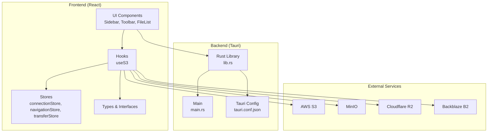
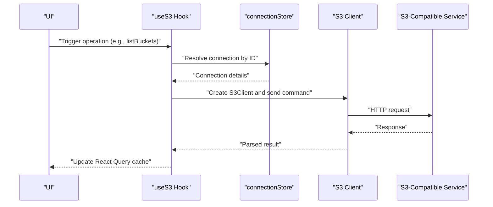
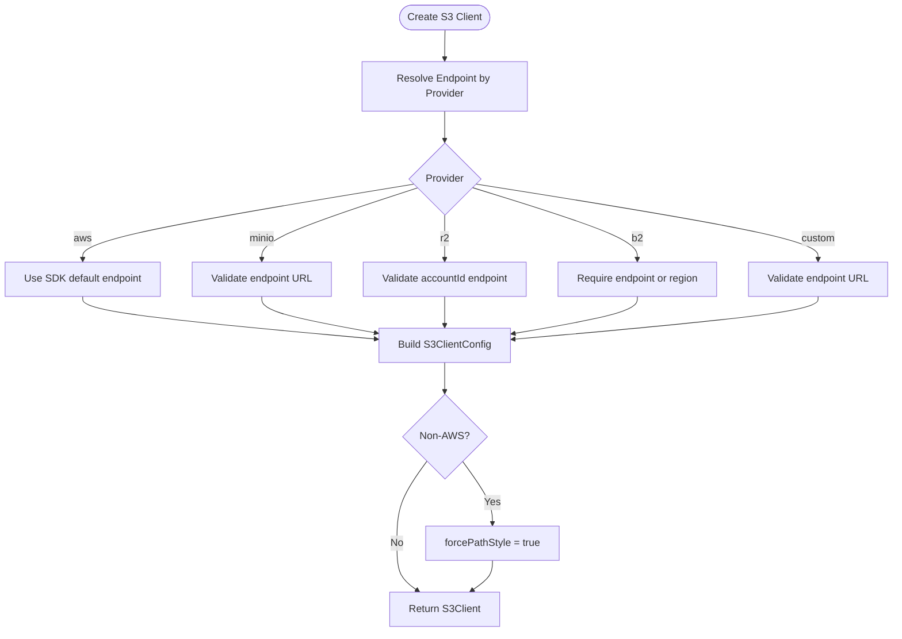
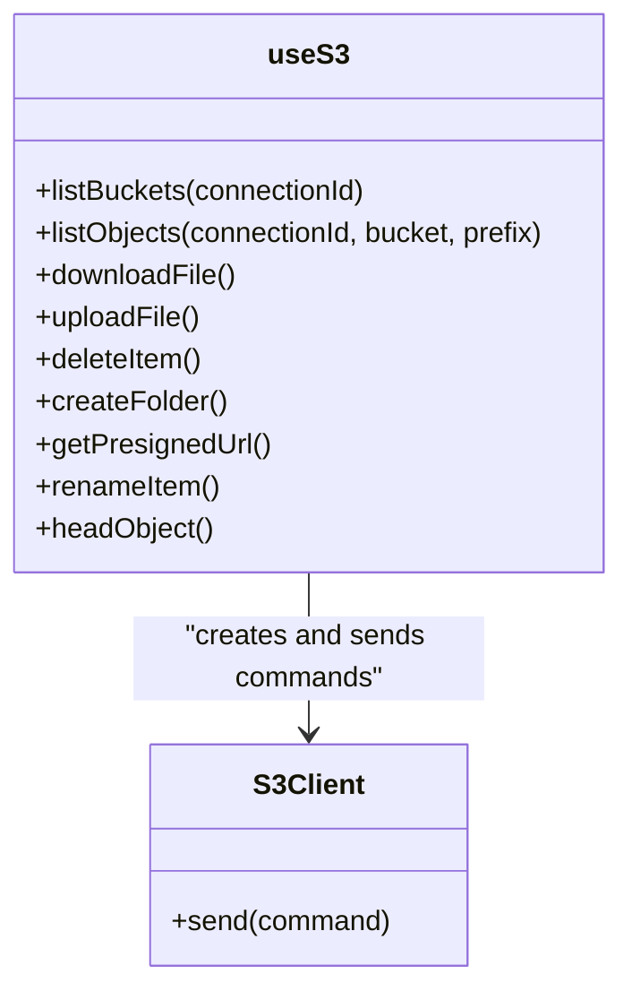
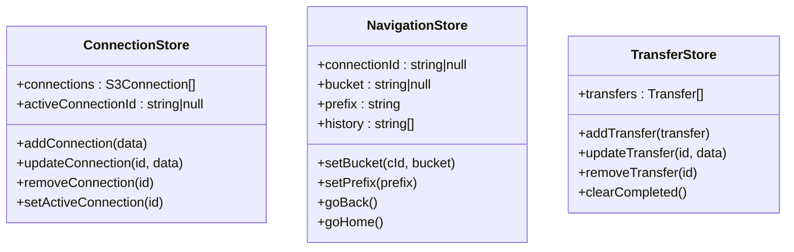
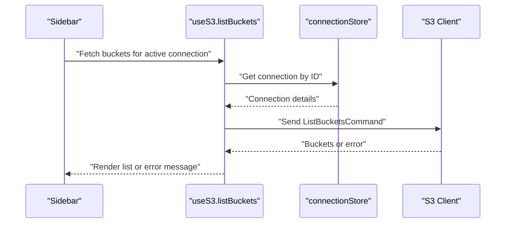
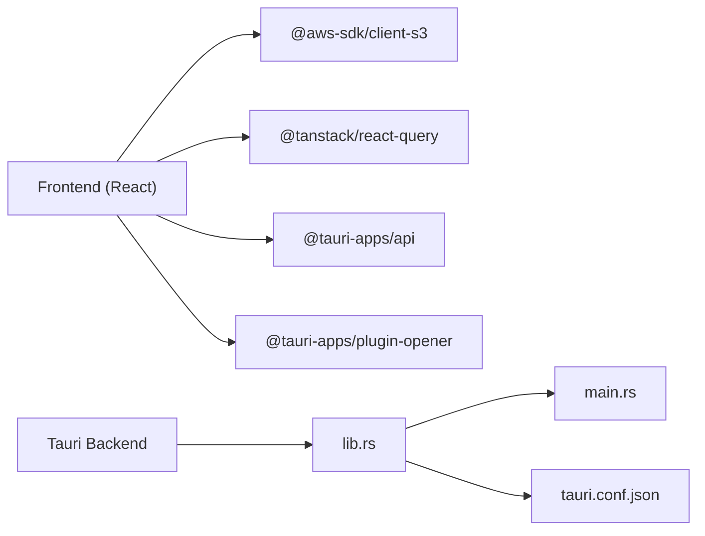

# Troubleshooting

<cite>
**Referenced Files in This Document**
- [README.md](file://README.md)
- [package.json](file://package.json)
- [vite.config.ts](file://vite.config.ts)
- [tauri.conf.json](file://src-tauri/tauri.conf.json)
- [lib.rs](file://src-tauri/src/lib.rs)
- [main.rs](file://src-tauri/src/main.rs)
- [s3Client.ts](file://src/lib/s3Client.ts)
- [useS3.ts](file://src/hooks/useS3.ts)
- [connectionStore.ts](file://src/store/connectionStore.ts)
- [navigationStore.ts](file://src/store/navigationStore.ts)
- [transferStore.ts](file://src/store/transferStore.ts)
- [utils.ts](file://src/lib/utils.ts)
- [Sidebar.tsx](file://src/components/layout/Sidebar.tsx)
- [App.tsx](file://src/App.tsx)
- [index.ts (types)](file://src/types/index.ts)
</cite>

## Table of Contents
1. [Introduction](#introduction)
2. [Project Structure](#project-structure)
3. [Core Components](#core-components)
4. [Architecture Overview](#architecture-overview)
5. [Detailed Component Analysis](#detailed-component-analysis)
6. [Dependency Analysis](#dependency-analysis)
7. [Performance Considerations](#performance-considerations)
8. [Troubleshooting Guide](#troubleshooting-guide)
9. [Conclusion](#conclusion)
10. [Appendices](#appendices)

## Introduction
This document provides comprehensive troubleshooting guidance for S3 Explorer. It focuses on diagnosing and resolving common issues related to S3 connectivity, authentication, file operations, and UI behavior. It also covers systematic debugging approaches for Tauri command failures, UI rendering issues, and performance bottlenecks. Guidance includes error message interpretation, safe troubleshooting practices, and security considerations for credential management.

## Project Structure
S3 Explorer is a Tauri + React + TypeScript application. The frontend handles S3 operations via AWS SDK clients and React Query, while Tauri bridges the UI to native capabilities. Stores manage state for connections, navigation, and transfers. The backend Rust module currently exposes a minimal greeting command and opens external links.

**Diagram sources**
- [Sidebar.tsx:117-183](file://src/components/layout/Sidebar.tsx#L117-L183)
- [useS3.ts:62-409](file://src/hooks/useS3.ts#L62-L409)
- [connectionStore.ts:30-87](file://src/store/connectionStore.ts#L30-L87)
- [navigationStore.ts:36-85](file://src/store/navigationStore.ts#L36-L85)
- [transferStore.ts:28-61](file://src/store/transferStore.ts#L28-L61)
- [lib.rs:8-14](file://src-tauri/src/lib.rs#L8-L14)
- [main.rs:4-6](file://src-tauri/src/main.rs#L4-L6)
- [tauri.conf.json:1-36](file://src-tauri/tauri.conf.json#L1-L36)

**Section sources**
- [README.md:1-8](file://README.md#L1-L8)
- [package.json:1-37](file://package.json#L1-L37)
- [vite.config.ts:1-34](file://vite.config.ts#L1-L34)
- [tauri.conf.json:1-36](file://src-tauri/tauri.conf.json#L1-L36)
- [lib.rs:1-15](file://src-tauri/src/lib.rs#L1-L15)
- [main.rs:1-7](file://src-tauri/src/main.rs#L1-L7)

## Core Components
- S3 client factory and endpoint resolution: constructs S3Client instances with provider-specific endpoints and credentials.
- React Query hooks for S3 operations: list buckets/objects, upload, download, delete, rename, head object, and presigned URLs.
- Store modules: manage persistent connections, navigation state, and transfer progress.
- UI components: sidebar connection list, toolbar, and placeholders for file list and modals.
- Tauri integration: minimal commands and opener plugin; configuration for dev/build and CSP.

**Section sources**
- [s3Client.ts:60-82](file://src/lib/s3Client.ts#L60-L82)
- [useS3.ts:62-409](file://src/hooks/useS3.ts#L62-L409)
- [connectionStore.ts:30-87](file://src/store/connectionStore.ts#L30-L87)
- [navigationStore.ts:36-85](file://src/store/navigationStore.ts#L36-L85)
- [transferStore.ts:28-61](file://src/store/transferStore.ts#L28-L61)
- [Sidebar.tsx:117-183](file://src/components/layout/Sidebar.tsx#L117-L183)
- [lib.rs:8-14](file://src-tauri/src/lib.rs#L8-L14)
- [tauri.conf.json:20-22](file://src-tauri/tauri.conf.json#L20-L22)

## Architecture Overview
The application architecture separates concerns across frontend and backend:
- Frontend orchestrates S3 operations using AWS SDK commands and React Query caching.
- Backend exposes Tauri commands and integrates with OS-level capabilities.
- Stores encapsulate state persistence and UI navigation.

**Diagram sources**
- [useS3.ts:69-84](file://src/hooks/useS3.ts#L69-L84)
- [connectionStore.ts:22-34](file://src/store/connectionStore.ts#L22-L34)
- [s3Client.ts:60-82](file://src/lib/s3Client.ts#L60-L82)

## Detailed Component Analysis

### S3 Client and Endpoint Resolution
- Endpoint resolution enforces provider-specific requirements and throws descriptive errors for missing fields.
- Non-AWS providers force path-style addressing to ensure compatibility.
- Credentials are passed directly to the client; ensure they are valid and scoped appropriately.

**Diagram sources**
- [s3Client.ts:12-49](file://src/lib/s3Client.ts#L12-L49)
- [s3Client.ts:60-82](file://src/lib/s3Client.ts#L60-L82)

**Section sources**
- [s3Client.ts:12-49](file://src/lib/s3Client.ts#L12-L49)
- [s3Client.ts:60-82](file://src/lib/s3Client.ts#L60-L82)

### React Query Hooks for S3 Operations
- Centralized hook exposes queries and mutations for S3 operations.
- Mutations include upload, download (presigned URL), delete, rename, create folder, head object, and presigned URL generation.
- Errors are thrown with descriptive messages for HTTP failures and invalid inputs.

**Diagram sources**
- [useS3.ts:62-409](file://src/hooks/useS3.ts#L62-L409)
- [s3Client.ts:60-82](file://src/lib/s3Client.ts#L60-L82)

**Section sources**
- [useS3.ts:69-84](file://src/hooks/useS3.ts#L69-L84)
- [useS3.ts:91-144](file://src/hooks/useS3.ts#L91-L144)
- [useS3.ts:152-189](file://src/hooks/useS3.ts#L152-L189)
- [useS3.ts:195-227](file://src/hooks/useS3.ts#L195-L227)
- [useS3.ts:232-256](file://src/hooks/useS3.ts#L232-L256)
- [useS3.ts:261-288](file://src/hooks/useS3.ts#L261-L288)
- [useS3.ts:293-312](file://src/hooks/useS3.ts#L293-L312)
- [useS3.ts:319-360](file://src/hooks/useS3.ts#L319-L360)
- [useS3.ts:366-391](file://src/hooks/useS3.ts#L366-L391)

### Stores and State Management
- Connection store persists multiple S3 connections and supports adding/updating/removing connections and selecting an active connection.
- Navigation store manages connectionId, bucket, prefix, and history for back navigation.
- Transfer store tracks uploads/downloads with status and error messages.

**Diagram sources**
- [connectionStore.ts:30-87](file://src/store/connectionStore.ts#L30-L87)
- [navigationStore.ts:36-85](file://src/store/navigationStore.ts#L36-L85)
- [transferStore.ts:28-61](file://src/store/transferStore.ts#L28-L61)

**Section sources**
- [connectionStore.ts:30-87](file://src/store/connectionStore.ts#L30-L87)
- [navigationStore.ts:36-85](file://src/store/navigationStore.ts#L36-L85)
- [transferStore.ts:28-61](file://src/store/transferStore.ts#L28-L61)

### UI Components and Rendering
- Sidebar displays saved connections, expands to show buckets, and renders loading/error states.
- Toolbar and main content area are placeholders awaiting wiring to file list and actions.
- UI surfaces errors from queries and mutations for quick diagnosis.

**Diagram sources**
- [Sidebar.tsx:51-108](file://src/components/layout/Sidebar.tsx#L51-L108)
- [useS3.ts:69-84](file://src/hooks/useS3.ts#L69-L84)
- [connectionStore.ts:22-34](file://src/store/connectionStore.ts#L22-L34)

**Section sources**
- [Sidebar.tsx:51-108](file://src/components/layout/Sidebar.tsx#L51-L108)
- [App.tsx:11-82](file://src/App.tsx#L11-L82)

## Dependency Analysis
- Frontend dependencies include AWS SDK clients, React Query, Radix UI, and Tauri APIs.
- Tauri configuration defines dev/build behavior, window properties, and security policy.
- The Rust library currently registers a greeting command and the opener plugin.

**Diagram sources**
- [package.json:12-25](file://package.json#L12-L25)
- [lib.rs:8-14](file://src-tauri/src/lib.rs#L8-L14)
- [tauri.conf.json:1-36](file://src-tauri/tauri.conf.json#L1-L36)

**Section sources**
- [package.json:12-25](file://package.json#L12-L25)
- [lib.rs:8-14](file://src-tauri/src/lib.rs#L8-L14)
- [tauri.conf.json:1-36](file://src-tauri/tauri.conf.json#L1-L36)

## Performance Considerations
- Large file downloads: prefer Rust-backed downloads for large objects to avoid browser memory pressure; the frontend download mentions limitations for very large files.
- Pagination and listing: leverage continuation tokens and delimiter-based folder simulation to reduce payload sizes.
- Caching: React Query caches results; invalidate queries after mutations to keep UI in sync without redundant network calls.
- Rendering: Virtualization and lazy loading will be beneficial for large file lists; placeholders indicate future implementation.
- Memory management: Revoke object URLs after downloads and avoid holding large blobs in state.

[No sources needed since this section provides general guidance]

## Troubleshooting Guide

### Connection Problems
Symptoms
- Cannot list buckets or navigate to buckets.
- Error messages appear in the sidebar for bucket loading.

Common causes and resolutions
- Missing or incorrect provider configuration:
  - Ensure provider is set and endpoint/region are valid for non-AWS providers.
  - Verify endpoint URLs for MinIO, R2, and B2; region is required for B2 when endpoint is not provided.
- Network connectivity:
  - Confirm firewall/proxy allows outbound HTTPS to the chosen endpoint.
  - Test endpoint reachability externally.
- Region mismatch:
  - For AWS, ensure region matches the bucket’s location if applicable.
- UI state:
  - Select an active connection and bucket; the UI indicates empty state when none is selected.

Diagnostic steps
- Inspect connection store for active connection ID and credentials.
- Verify S3 client creation and endpoint resolution.
- Check React Query error messages surfaced by the UI.

**Section sources**
- [s3Client.ts:12-49](file://src/lib/s3Client.ts#L12-L49)
- [s3Client.ts:60-82](file://src/lib/s3Client.ts#L60-L82)
- [connectionStore.ts:30-87](file://src/store/connectionStore.ts#L30-L87)
- [Sidebar.tsx:51-108](file://src/components/layout/Sidebar.tsx#L51-L108)

### Authentication Failures
Symptoms
- HTTP 403/401 responses during S3 operations.
- Errors indicating invalid credentials.

Root causes
- Incorrect access key or secret.
- IAM policies or bucket policies denying access.
- Expired or insufficiently scoped credentials.

Resolution steps
- Regenerate and re-enter access key and secret.
- Verify IAM permissions and bucket ACL/block public access settings.
- For custom endpoints, confirm credentials support the service’s authentication model.

**Section sources**
- [s3Client.ts:63-69](file://src/lib/s3Client.ts#L63-L69)
- [index.ts (types):38-48](file://src/types/index.ts#L38-L48)

### File Upload/Download Errors
Symptoms
- Upload fails with HTTP error codes.
- Download returns non-OK responses or fails to trigger browser download.

Resolutions
- Upload:
  - Validate bucket write permissions and object key naming.
  - Check for HTTP status codes returned by the SDK mutation.
- Download:
  - Use presigned URL generation for large files to bypass browser memory limits.
  - Ensure the presigned URL is fetched successfully and the response is OK.

**Section sources**
- [useS3.ts:195-227](file://src/hooks/useS3.ts#L195-L227)
- [useS3.ts:152-189](file://src/hooks/useS3.ts#L152-L189)
- [useS3.ts:293-312](file://src/hooks/useS3.ts#L293-L312)

### Performance Issues
Symptoms
- Slow listing of large buckets or deep folder structures.
- UI lag or memory spikes during downloads.

Optimization tips
- Use pagination and continuation tokens to limit batch sizes.
- Prefer Rust-backed downloads for large files.
- Clear completed transfers periodically to reduce state overhead.
- Defer heavy computations until data is available.

**Section sources**
- [useS3.ts:91-144](file://src/hooks/useS3.ts#L91-L144)
- [transferStore.ts:54-61](file://src/store/transferStore.ts#L54-L61)

### Tauri Command Failures
Current state
- Minimal commands exposed; greeting command is registered but not used for S3 operations.
- Opener plugin is available for opening external resources.

Debugging approach
- Enable Tauri dev logs and inspect console output.
- Verify command registration and handler wiring.
- Confirm CSP settings and dev server configuration.

**Section sources**
- [lib.rs:8-14](file://src-tauri/src/lib.rs#L8-L14)
- [tauri.conf.json:20-22](file://src-tauri/tauri.conf.json#L20-L22)
- [vite.config.ts:17-32](file://vite.config.ts#L17-L32)

### UI Rendering Issues
Symptoms
- Buckets not loading or showing error immediately.
- Empty state shown when selection is valid.

Checks
- Ensure active connection and bucket are set.
- Confirm query keys match expected patterns for bucket/object listings.
- Validate that the sidebar fetches and renders based on the active connection ID.

**Section sources**
- [Sidebar.tsx:51-108](file://src/components/layout/Sidebar.tsx#L51-L108)
- [useS3.ts:69-84](file://src/hooks/useS3.ts#L69-L84)
- [App.tsx:71-78](file://src/App.tsx#L71-L78)

### Error Message Reference
- “Connection not found”:
  - Cause: Attempting S3 operations with a deleted or unselected connection ID.
  - Action: Re-select a valid connection or reload the store.
- “MinIO connections require an endpoint URL”:
  - Cause: Missing endpoint for MinIO provider.
  - Action: Provide a valid endpoint URL.
- “Cloudflare R2 connections require an endpoint URL”:
  - Cause: Missing endpoint for R2 provider.
  - Action: Provide endpoint in the form documented by the provider.
- “Backblaze B2 connections require a region”:
  - Cause: Missing region when endpoint is not provided.
  - Action: Supply a valid region or endpoint.
- “Custom S3 connections require an endpoint URL”:
  - Cause: Missing endpoint for custom provider.
  - Action: Provide endpoint URL.
- “Invalid folder name”:
  - Cause: Empty or containing “/”.
  - Action: Use a valid folder name without slashes.
- “New name must be different”:
  - Cause: Rename target equals current name.
  - Action: Provide a different target name.
- “Download failed”:
  - Cause: Non-OK HTTP response from presigned URL.
  - Action: Regenerate URL and retry; check service availability.
- “Upload failed”:
  - Cause: Non-OK HTTP status from PutObject.
  - Action: Verify permissions and key naming; retry.
- “Delete failed”:
  - Cause: Non-OK HTTP status from DeleteObject.
  - Action: Check permissions and object existence; retry.
- “Rename failed at copy step”:
  - Cause: Non-OK HTTP status from CopyObject.
  - Action: Ensure source exists and destination is writable; retry.

**Section sources**
- [useS3.ts:27-34](file://src/hooks/useS3.ts#L27-L34)
- [s3Client.ts:20-47](file://src/lib/s3Client.ts#L20-L47)
- [useS3.ts:274-278](file://src/hooks/useS3.ts#L274-L278)
- [useS3.ts:332-334](file://src/hooks/useS3.ts#L332-L334)
- [useS3.ts:170-175](file://src/hooks/useS3.ts#L170-L175)
- [useS3.ts:220-224](file://src/hooks/useS3.ts#L220-L224)
- [useS3.ts:248-253](file://src/hooks/useS3.ts#L248-L253)
- [useS3.ts:347-352](file://src/hooks/useS3.ts#L347-L352)

### Security Considerations and Safe Practices
- Credential management:
  - Store only the minimum required credentials; avoid embedding long-lived admin keys.
  - Rotate credentials regularly and revoke compromised ones.
- Least privilege:
  - Scope IAM roles and bucket policies to required actions and prefixes.
- Transport security:
  - Use HTTPS endpoints for all providers; avoid plain HTTP.
- Data handling:
  - Revoke object URLs after downloads; avoid retaining large blobs in memory.
- Logging:
  - Do not log sensitive credentials; sanitize logs in development.

[No sources needed since this section provides general guidance]

## Conclusion
This guide consolidates actionable troubleshooting steps for S3 Explorer across connectivity, authentication, file operations, performance, and UI stability. By validating provider configurations, ensuring proper credentials and permissions, leveraging presigned URLs for large downloads, and following safe practices for credential and memory management, most issues can be resolved efficiently. Use the referenced components and stores to systematically isolate problems and apply targeted fixes.

## Appendices

### Quick Diagnostic Checklist
- Confirm provider and endpoint/region correctness.
- Verify active connection and bucket selection.
- Test endpoint accessibility from the host machine.
- Check IAM/bucket policies for required actions.
- Use presigned URLs for large downloads.
- Clear and invalidate React Query cache after mutations.
- Review Tauri dev logs and CSP configuration.

[No sources needed since this section provides general guidance]