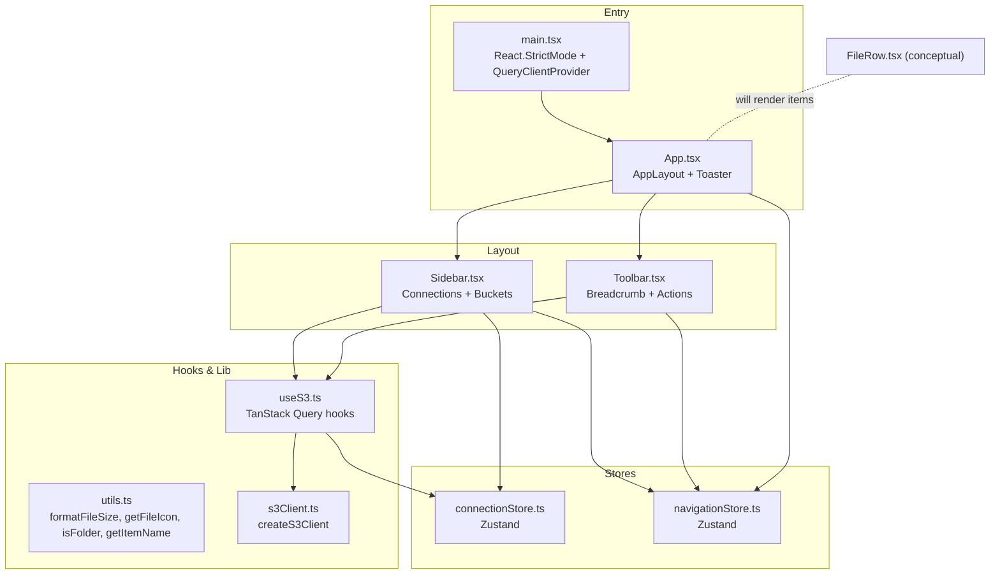
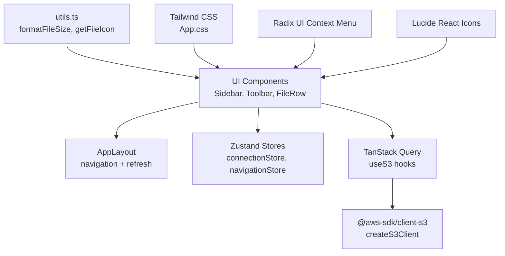
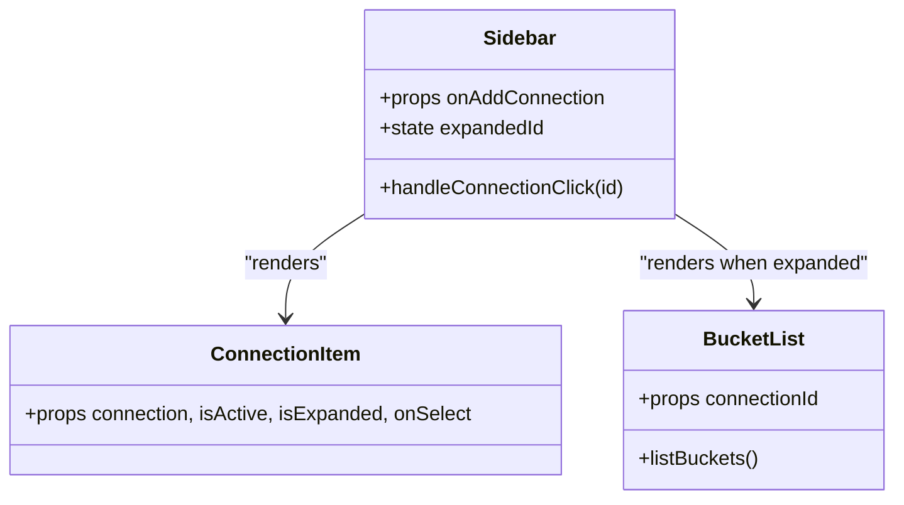
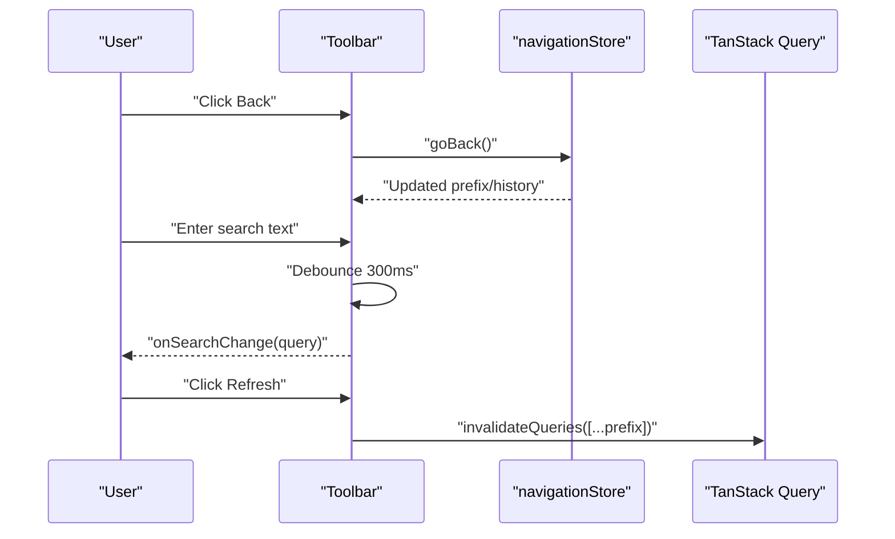
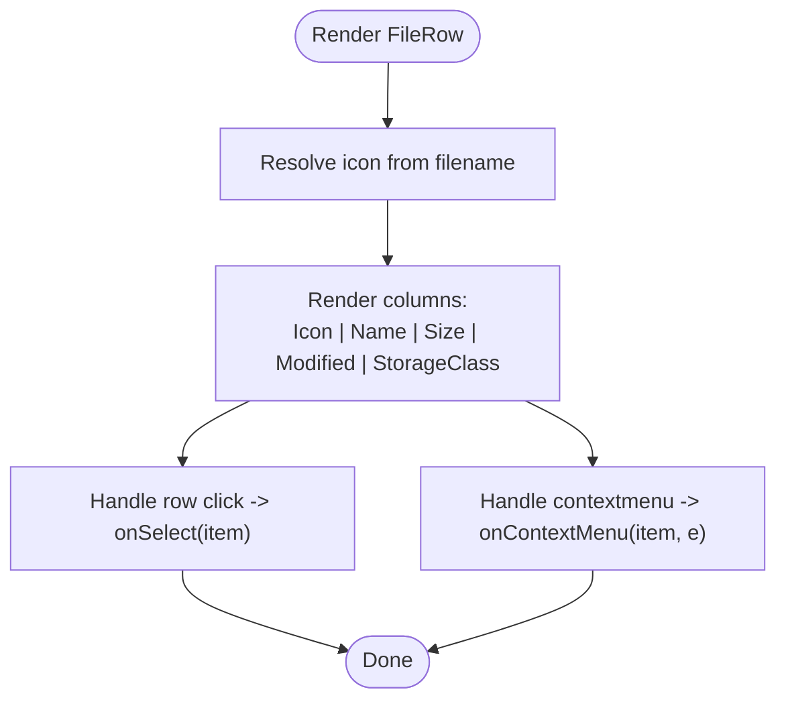
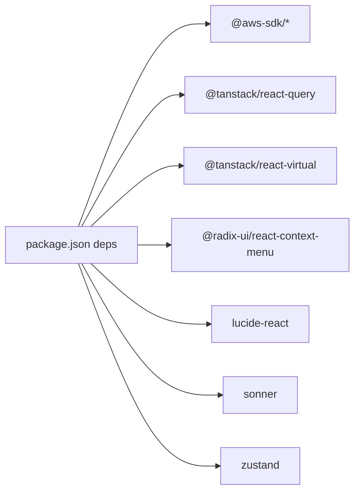

# UI Components

<cite>
**Referenced Files in This Document**
- [Sidebar.tsx](file://src/components/layout/Sidebar.tsx)
- [Toolbar.tsx](file://src/components/layout/Toolbar.tsx)
- [FileRow.tsx](file://src/components/explorer/FileRow.tsx)
- [App.tsx](file://src/App.tsx)
- [main.tsx](file://src/main.tsx)
- [connectionStore.ts](file://src/store/connectionStore.ts)
- [navigationStore.ts](file://src/store/navigationStore.ts)
- [useS3.ts](file://src/hooks/useS3.ts)
- [utils.ts](file://src/lib/utils.ts)
- [s3Client.ts](file://src/lib/s3Client.ts)
- [index.ts](file://src/types/index.ts)
- [App.css](file://src/App.css)
- [package.json](file://package.json)
</cite>

## Table of Contents
1. [Introduction](#introduction)
2. [Project Structure](#project-structure)
3. [Core Components](#core-components)
4. [Architecture Overview](#architecture-overview)
5. [Detailed Component Analysis](#detailed-component-analysis)
6. [Dependency Analysis](#dependency-analysis)
7. [Performance Considerations](#performance-considerations)
8. [Troubleshooting Guide](#troubleshooting-guide)
9. [Conclusion](#conclusion)
10. [Appendices](#appendices)

## Introduction
This document describes the UI component system of S3 Explorer, focusing on layout components (Sidebar and Toolbar), file display components (virtualized file list row), and supporting stores and utilities. It explains component structure, props, interaction patterns, styling with Tailwind CSS, and responsive design considerations. It also outlines composition patterns, customization options, and integration guidelines for extending the system with modals and the upcoming FileList.

## Project Structure
The UI is organized around a main App shell that composes a left-hand Sidebar and a right-hand content area containing a top Toolbar and a main content region. Stores manage global state for connections and navigation. Hooks encapsulate S3 operations via TanStack Query. Utilities provide icon mapping and formatting helpers.

**Diagram sources**
- [main.tsx:19-25](file://src/main.tsx#L19-L25)
- [App.tsx:49-81](file://src/App.tsx#L49-L81)
- [Sidebar.tsx:117-183](file://src/components/layout/Sidebar.tsx#L117-L183)
- [Toolbar.tsx:30-186](file://src/components/layout/Toolbar.tsx#L30-L186)
- [connectionStore.ts:30-87](file://src/store/connectionStore.ts#L30-L87)
- [navigationStore.ts:36-85](file://src/store/navigationStore.ts#L36-L85)
- [useS3.ts:62-409](file://src/hooks/useS3.ts#L62-L409)
- [utils.ts:13-196](file://src/lib/utils.ts#L13-L196)
- [s3Client.ts:60-82](file://src/lib/s3Client.ts#L60-L82)

**Section sources**
- [main.tsx:19-25](file://src/main.tsx#L19-L25)
- [App.tsx:49-81](file://src/App.tsx#L49-L81)

## Core Components
- Sidebar: Renders S3 connections and expands to show buckets. Supports adding a new connection and selection of active connection/bucket.
- Toolbar: Provides back navigation, breadcrumb navigation, refresh, upload, new folder, and search filtering.
- FileRow (conceptual): Will render individual items in a virtualized file list with icon mapping, size/date formatting, and context menu support.

These components are composed inside AppLayout, which orchestrates navigation state and refresh behavior.

**Section sources**
- [Sidebar.tsx:117-183](file://src/components/layout/Sidebar.tsx#L117-L183)
- [Toolbar.tsx:30-186](file://src/components/layout/Toolbar.tsx#L30-L186)
- [App.tsx:11-82](file://src/App.tsx#L11-L82)

## Architecture Overview
The UI relies on:
- React + Vite for runtime
- TanStack Query for S3 data fetching and caching
- Zustand for lightweight global state (connections and navigation)
- Tailwind CSS for styling
- Radix UI Context Menu for context menus
- Lucide React for icons
- AWS SDK for S3 operations

**Diagram sources**
- [App.tsx:11-82](file://src/App.tsx#L11-L82)
- [connectionStore.ts:30-87](file://src/store/connectionStore.ts#L30-L87)
- [navigationStore.ts:36-85](file://src/store/navigationStore.ts#L36-L85)
- [useS3.ts:62-409](file://src/hooks/useS3.ts#L62-L409)
- [s3Client.ts:60-82](file://src/lib/s3Client.ts#L60-L82)
- [utils.ts:13-196](file://src/lib/utils.ts#L13-L196)
- [App.css:1-118](file://src/App.css#L1-L118)
- [package.json:12-35](file://package.json#L12-L35)

## Detailed Component Analysis

### Sidebar
Responsibilities:
- Render list of S3 connections
- Expand/collapse to show buckets per connection
- Highlight active connection and active bucket
- Trigger add-connection action

Props:
- onAddConnection?: () => void

Interaction pattern:
- Clicking a connection toggles expansion and sets active connection
- Clicking a bucket triggers navigation to that bucket (via navigation store)

Styling:
- Uses Tailwind classes for layout, spacing, and hover/active states
- Dark theme background and subtle borders

Composition:
- Sub-components: ConnectionItem and BucketList
- Integrates with connectionStore and navigationStore

**Diagram sources**
- [Sidebar.tsx:117-183](file://src/components/layout/Sidebar.tsx#L117-L183)
- [Sidebar.tsx:19-48](file://src/components/layout/Sidebar.tsx#L19-L48)
- [Sidebar.tsx:51-108](file://src/components/layout/Sidebar.tsx#L51-L108)

**Section sources**
- [Sidebar.tsx:117-183](file://src/components/layout/Sidebar.tsx#L117-L183)
- [connectionStore.ts:30-87](file://src/store/connectionStore.ts#L30-L87)
- [navigationStore.ts:36-85](file://src/store/navigationStore.ts#L36-L85)

### Toolbar
Responsibilities:
- Back navigation using history
- Breadcrumb navigation by clicking segments
- Refresh action to invalidate current folder query
- Upload and New Folder actions
- Search input with debounced callback

Props:
- connectionId, bucket, prefix, history
- onBack, onNavigate, onRefresh
- onUpload?, onNewFolder?, onSearchChange?

Interaction pattern:
- Builds breadcrumb segments from prefix
- Disables actions when no bucket is selected
- Debounces search input before invoking onSearchChange

Styling:
- Clean white background with subtle borders
- Disabled states for buttons when inactive
- Focus styles for inputs

**Diagram sources**
- [Toolbar.tsx:30-186](file://src/components/layout/Toolbar.tsx#L30-L186)
- [App.tsx:23-28](file://src/App.tsx#L23-L28)
- [navigationStore.ts:63-74](file://src/store/navigationStore.ts#L63-L74)

**Section sources**
- [Toolbar.tsx:30-186](file://src/components/layout/Toolbar.tsx#L30-L186)
- [App.tsx:23-47](file://src/App.tsx#L23-L47)
- [navigationStore.ts:36-85](file://src/store/navigationStore.ts#L36-L85)

### FileRow (conceptual)
Planned responsibilities:
- Render a single S3 item row with icon, name, size, last modified, and storage class
- Support selection, focus, and context menu
- Integrate with virtualization (TanStack Virtual) via fixed row height and grid layout

Props:
- item: S3Item
- isSelected: boolean
- isFocused: boolean
- onSelect: (item) => void
- onContextMenu?: (item, event) => void

Icon mapping:
- Resolves Lucide icon based on file extension via utils.getFileIcon

Styling:
- Grid layout with fixed column widths
- Hover and selection states
- Focus ring for keyboard navigation

**Diagram sources**
- [FileRow.tsx:26-82](file://src/components/explorer/FileRow.tsx#L26-L82)
- [utils.ts:144-150](file://src/lib/utils.ts#L144-L150)

**Section sources**
- [FileRow.tsx:26-82](file://src/components/explorer/FileRow.tsx#L26-L82)
- [utils.ts:13-27](file://src/lib/utils.ts#L13-L27)
- [utils.ts:144-150](file://src/lib/utils.ts#L144-L150)

### Modal Components (Conceptual)
- Connection Management Modal: Should allow adding/updating/removing S3 connections. Integrates with connectionStore.
- File Operation Modals: Upload, New Folder, Rename, Delete, Get Info. Integrates with useS3 mutations and navigation state.

Integration points:
- Triggered from Toolbar actions (Upload, New Folder) and FileRow context menu
- Use Radix UI Context Menu for cross-component context menu support

[No sources needed since this section doesn't analyze specific files]

## Dependency Analysis
External libraries and their roles:
- @aws-sdk/client-s3 and @aws-sdk/s3-request-presigner: S3 operations and signed URLs
- @tanstack/react-query: Data fetching, caching, invalidation
- @tanstack/react-virtual: Virtualized file list rendering
- @radix-ui/react-context-menu: Context menu primitives
- lucide-react: Icons
- sonner: Notifications
- zustand: Global state for connections and navigation

**Diagram sources**
- [package.json:12-35](file://package.json#L12-L35)

**Section sources**
- [package.json:12-35](file://package.json#L12-L35)

## Performance Considerations
- Virtualization: FileRow defines a fixed row height and grid layout suitable for TanStack Virtual. Ensure estimateSize matches the computed row height to avoid layout thrashing.
- Query caching: TanStack Query is configured with a short stale time and retries to balance freshness and performance.
- Icon resolution: getFileIcon performs a simple extension lookup; keep the icon map minimal and cache results if needed.
- Rendering: Prefer memoization for derived breadcrumb items and avoid unnecessary re-renders in Toolbar.

[No sources needed since this section provides general guidance]

## Troubleshooting Guide
Common issues and remedies:
- No buckets displayed: Verify active connection is set and listBuckets query is enabled.
- Navigation not working: Ensure navigationStore actions are called and history is updated.
- Icons missing: Confirm getFileIcon returns a valid Lucide icon name and that icons are imported.
- Styling inconsistencies: Check Tailwind configuration and ensure App.css imports Tailwind properly.

**Section sources**
- [useS3.ts:69-85](file://src/hooks/useS3.ts#L69-L85)
- [navigationStore.ts:42-78](file://src/store/navigationStore.ts#L42-L78)
- [utils.ts:144-150](file://src/lib/utils.ts#L144-L150)
- [App.css:1-118](file://src/App.css#L1-L118)

## Conclusion
The UI component system is structured around a clean separation of concerns: layout components (Sidebar, Toolbar) orchestrate navigation and actions, stores manage state, and hooks encapsulate S3 operations. Styling leverages Tailwind CSS, and future virtualization and context menus are well-scoped for maintainability and scalability.

[No sources needed since this section summarizes without analyzing specific files]

## Appendices

### Props Reference

- Sidebar
  - onAddConnection?: () => void

- Toolbar
  - connectionId: string | null
  - bucket: string | null
  - prefix: string
  - history: string[]
  - onBack: () => void
  - onNavigate: (prefix: string) => void
  - onRefresh: () => void
  - onUpload?: () => void
  - onNewFolder?: () => void
  - onSearchChange?: (query: string) => void

- FileRow (conceptual)
  - item: S3Item
  - isSelected: boolean
  - isFocused: boolean
  - onSelect: (item) => void
  - onContextMenu?: (item, event) => void

**Section sources**
- [Sidebar.tsx:112-115](file://src/components/layout/Sidebar.tsx#L112-L115)
- [Toolbar.tsx:14-26](file://src/components/layout/Toolbar.tsx#L14-L26)
- [FileRow.tsx:26-32](file://src/components/explorer/FileRow.tsx#L26-L32)

### Composition Patterns
- AppLayout composes Sidebar and Toolbar, wiring navigation and refresh handlers.
- Sidebar delegates bucket loading to useS3 and updates navigation store on selection.
- Toolbar builds breadcrumbs from prefix and invokes navigation callbacks.

**Section sources**
- [App.tsx:11-82](file://src/App.tsx#L11-L82)
- [Sidebar.tsx:51-108](file://src/components/layout/Sidebar.tsx#L51-L108)
- [Toolbar.tsx:53-67](file://src/components/layout/Toolbar.tsx#L53-L67)

### Styling and Responsive Design
- Tailwind classes define layout, spacing, and interactive states.
- Dark mode support via color tokens and media queries in App.css.
- Responsive breakpoints are implicit in Tailwind defaults; adjust container sizes and paddings as needed.

**Section sources**
- [App.css:1-118](file://src/App.css#L1-L118)
- [Sidebar.tsx:130-181](file://src/components/layout/Sidebar.tsx#L130-L181)
- [Toolbar.tsx:73-186](file://src/components/layout/Toolbar.tsx#L73-L186)

### Integration Guidelines
- Extending FileRow:
  - Add new columns by updating ROW_GRID and rendering additional cells.
  - Integrate with TanStack Virtual by ensuring ROW_HEIGHT matches rendered height.
- Adding Modals:
  - Connect trigger events from Toolbar and FileRow to modal handlers.
  - Use Radix UI Context Menu for unified context experiences.
- Extending useS3:
  - Add new mutations/queries following existing patterns.
  - Keep query keys stable and scoped to connectionId/bucket/prefix.

**Section sources**
- [FileRow.tsx:18-22](file://src/components/explorer/FileRow.tsx#L18-L22)
- [Toolbar.tsx:165-186](file://src/components/layout/Toolbar.tsx#L165-L186)
- [useS3.ts:62-409](file://src/hooks/useS3.ts#L62-L409)