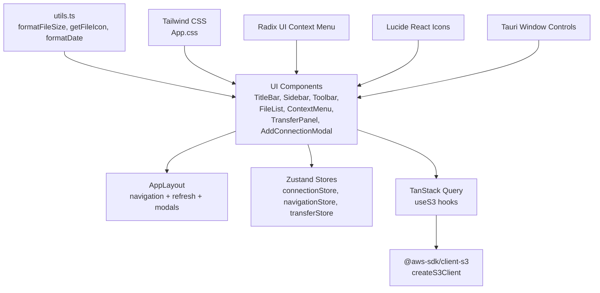
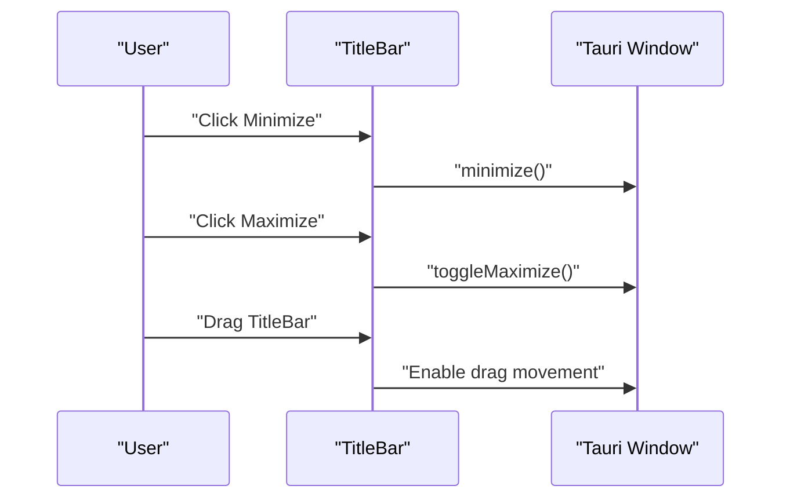
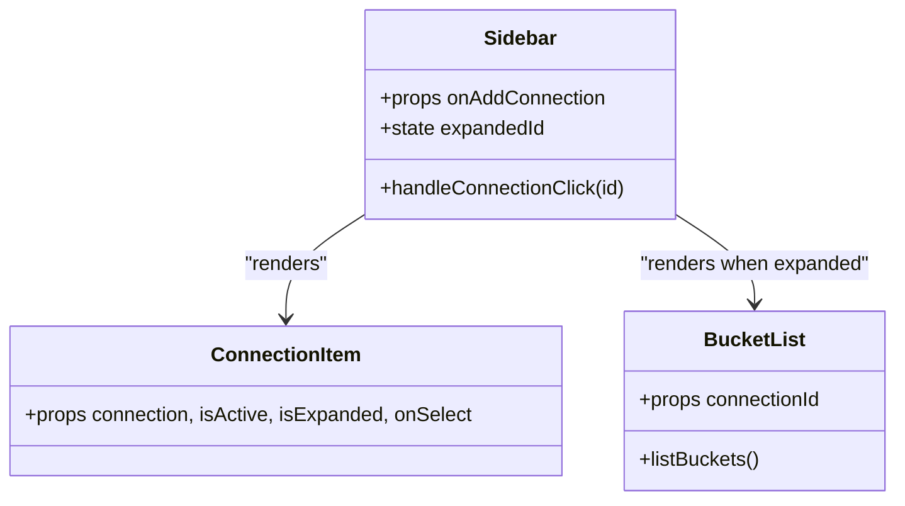
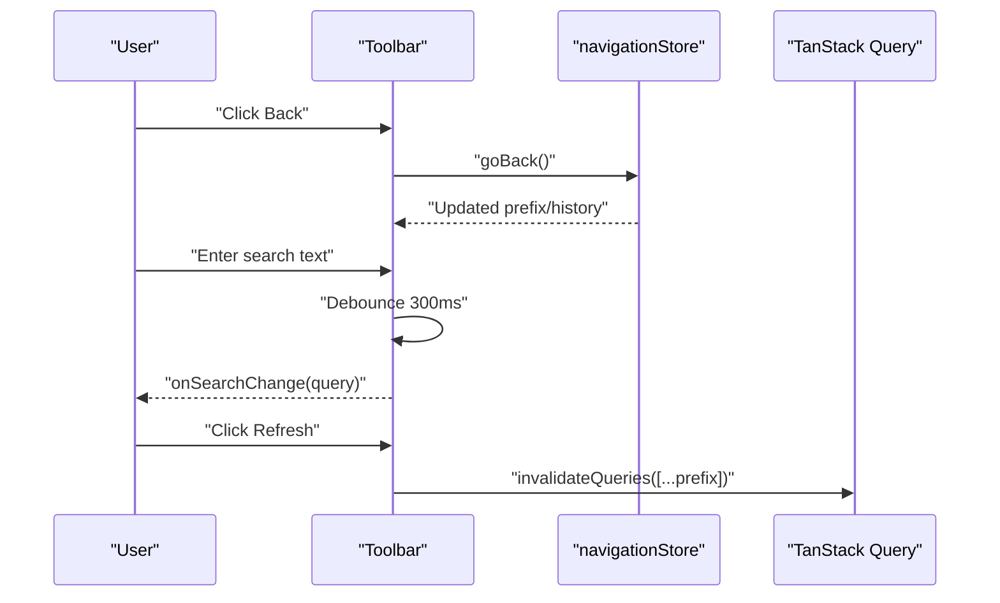
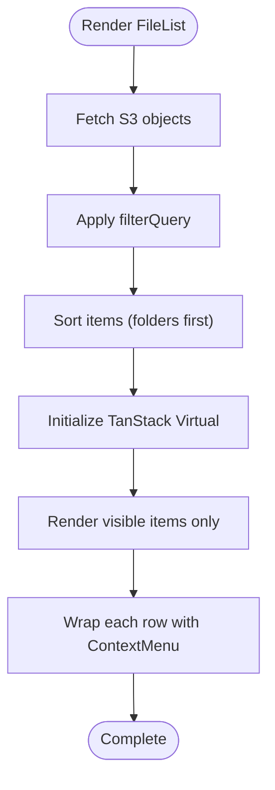
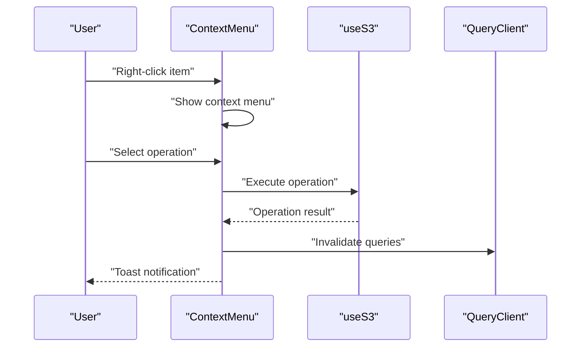
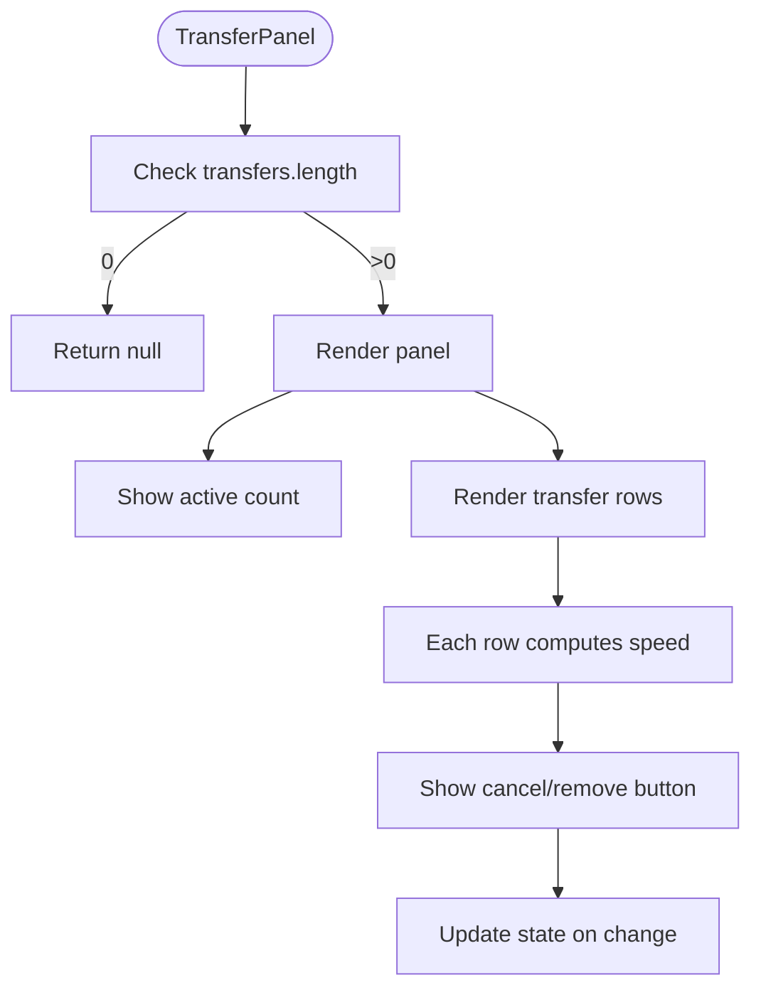
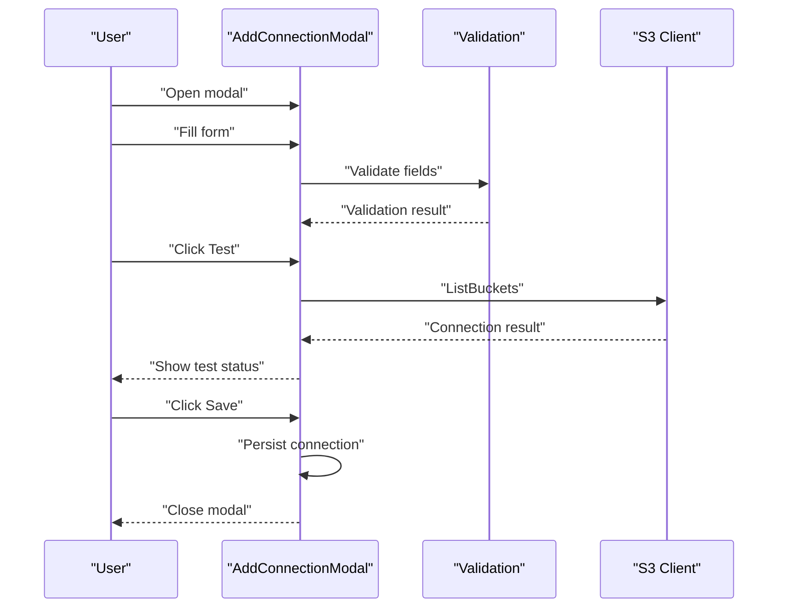
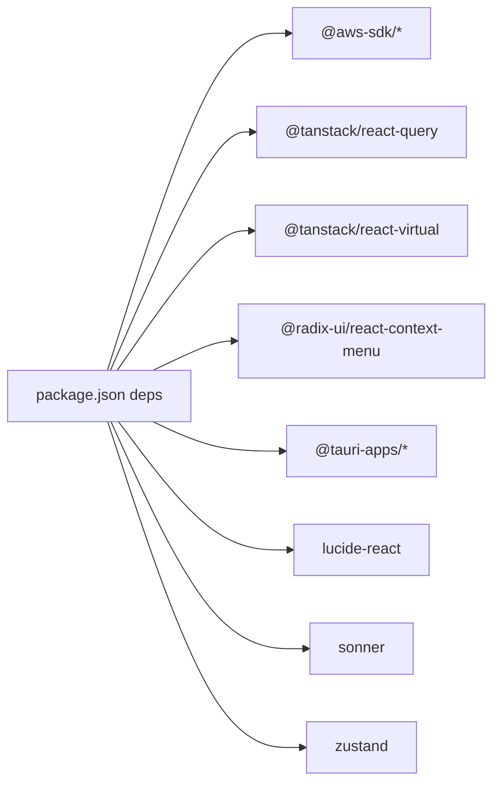

# UI Components

<cite>
**Referenced Files in This Document**
- [Sidebar.tsx](file://src/components/layout/Sidebar.tsx)
- [Toolbar.tsx](file://src/components/layout/Toolbar.tsx)
- [FileList.tsx](file://src/components/explorer/FileList.tsx)
- [FileRow.tsx](file://src/components/explorer/FileRow.tsx)
- [FolderRow.tsx](file://src/components/explorer/FolderRow.tsx)
- [ContextMenu.tsx](file://src/components/explorer/ContextMenu.tsx)
- [TransferPanel.tsx](file://src/components/layout/TransferPanel.tsx)
- [AddConnectionModal.tsx](file://src/components/modals/AddConnectionModal.tsx)
- [TitleBar.tsx](file://src/components/layout/TitleBar.tsx)
- [App.tsx](file://src/App.tsx)
- [main.tsx](file://src/main.tsx)
- [connectionStore.ts](file://src/store/connectionStore.ts)
- [navigationStore.ts](file://src/store/navigationStore.ts)
- [useDownload.ts](file://src/hooks/useDownload.ts)
- [useKeyboardShortcuts.ts](file://src/hooks/useKeyboardShortcuts.ts)
- [useS3.ts](file://src/hooks/useS3.ts)
- [utils.ts](file://src/lib/utils.ts)
- [s3Client.ts](file://src/lib/s3Client.ts)
- [index.ts](file://src/types/index.ts)
- [App.css](file://src/App.css)
- [package.json](file://package.json)
</cite>

## Update Summary
**Changes Made**
- Added documentation for new ContextMenu component with comprehensive file and folder operations
- Added documentation for TransferPanel component with real-time transfer monitoring
- Added documentation for AddConnectionModal with multi-provider support and validation
- Added documentation for TitleBar component with Tauri window controls
- Enhanced FileList documentation with improved context menu integration
- Updated component composition patterns to include new UI elements

## Table of Contents
1. [Introduction](#introduction)
2. [Project Structure](#project-structure)
3. [Core Components](#core-components)
4. [Architecture Overview](#architecture-overview)
5. [Detailed Component Analysis](#detailed-component-analysis)
6. [Dependency Analysis](#dependency-analysis)
7. [Performance Considerations](#performance-considerations)
8. [Troubleshooting Guide](#troubleshooting-guide)
9. [Conclusion](#conclusion)
10. [Appendices](#appendices)

## Introduction
This document describes the UI component system of S3 Explorer, focusing on layout components (Sidebar, Toolbar, TitleBar), file display components (virtualized FileList with ContextMenu integration), transfer management components (TransferPanel), and modal components (AddConnectionModal). It explains component structure, props, interaction patterns, styling with Tailwind CSS, and responsive design considerations. It also outlines composition patterns, customization options, and integration guidelines for extending the system.

## Project Structure
The UI is organized around a main App shell that composes a custom TitleBar, left-hand Sidebar, and a right-hand content area containing a top Toolbar and a main content region with FileList. TransferPanel provides persistent transfer monitoring, while AddConnectionModal handles connection management. Stores manage global state for connections, navigation, and transfers. Hooks encapsulate S3 operations via TanStack Query. Utilities provide icon mapping and formatting helpers.

```mermaid
graph TB
subgraph "Entry"
MAIN["main.tsx<br/>React.StrictMode + QueryClientProvider"]
APP["App.tsx<br/>AppLayout + Toaster + TransferPanel"]
END
subgraph "Layout"
TITLE_BAR["TitleBar.tsx<br/>Tauri window controls"]
SIDEBAR["Sidebar.tsx<br/>Connections + Buckets"]
TOOLBAR["Toolbar.tsx<br/>Breadcrumb + Actions"]
END
subgraph "Explorer"
FILE_LIST["FileList.tsx<br/>Virtualized + ContextMenu"]
FILE_ROW["FileRow.tsx<br/>Individual file row"]
FOLDER_ROW["FolderRow.tsx<br/>Individual folder row"]
CONTEXT_MENU["ContextMenu.tsx<br/>File operations"]
END
subgraph "Modals"
ADD_CONN_MODAL["AddConnectionModal.tsx<br/>Connection management"]
END
subgraph "Transfers"
TRANSFER_PANEL["TransferPanel.tsx<br/>Real-time monitoring"]
END
subgraph "Stores"
CONN_STORE["connectionStore.ts<br/>Zustand"]
NAV_STORE["navigationStore.ts<br/>Zustand"]
TRANS_STORE["transferStore.ts<br/>Zustand"]
END
subgraph "Hooks & Lib"
USE_S3["useS3.ts<br/>TanStack Query hooks"]
USE_DOWNLOAD["useDownload.ts<br/>Transfer utilities"]
KEYBOARD_SHORTCUTS["useKeyboardShortcuts.ts<br/>Global shortcuts"]
UTILS["utils.ts<br/>formatFileSize, getFileIcon, formatDate"]
S3_CLIENT["s3Client.ts<br/>createS3Client"]
END
MAIN --> APP
APP --> TITLE_BAR
APP --> SIDEBAR
APP --> TOOLBAR
APP --> FILE_LIST
FILE_LIST --> CONTEXT_MENU
FILE_LIST --> FILE_ROW
FILE_LIST --> FOLDER_ROW
APP --> TRANSFER_PANEL
SIDEBAR --> CONN_STORE
SIDEBAR --> NAV_STORE
TOOLBAR --> NAV_STORE
FILE_LIST --> NAV_STORE
APP --> NAV_STORE
CONTEXT_MENU --> USE_S3
FILE_LIST --> USE_S3
ADD_CONN_MODAL --> CONN_STORE
TRANSFER_PANEL --> TRANS_STORE
USE_S3 --> S3_CLIENT
USE_S3 --> CONN_STORE
USE_DOWNLOAD --> TRANS_STORE
```

**Diagram sources**
- [main.tsx:19-25](file://src/main.tsx#L19-L25)
- [App.tsx:17-147](file://src/App.tsx#L17-L147)
- [TitleBar.tsx:51-114](file://src/components/layout/TitleBar.tsx#L51-L114)
- [Sidebar.tsx:117-183](file://src/components/layout/Sidebar.tsx#L117-L183)
- [Toolbar.tsx:30-186](file://src/components/layout/Toolbar.tsx#L30-L186)
- [FileList.tsx:43-339](file://src/components/explorer/FileList.tsx#L43-L339)
- [ContextMenu.tsx:37-272](file://src/components/explorer/ContextMenu.tsx#L37-L272)
- [FileRow.tsx:34-85](file://src/components/explorer/FileRow.tsx#L34-L85)
- [FolderRow.tsx:18-67](file://src/components/explorer/FolderRow.tsx#L18-L67)
- [AddConnectionModal.tsx:56-410](file://src/components/modals/AddConnectionModal.tsx#L56-L410)
- [TransferPanel.tsx:151-208](file://src/components/layout/TransferPanel.tsx#L151-L208)
- [connectionStore.ts:30-87](file://src/store/connectionStore.ts#L30-L87)
- [navigationStore.ts:36-85](file://src/store/navigationStore.ts#L36-L85)
- [useS3.ts:62-409](file://src/hooks/useS3.ts#L62-L409)
- [useDownload.ts](file://src/hooks/useDownload.ts)
- [utils.ts:13-196](file://src/lib/utils.ts#L13-L196)
- [s3Client.ts:60-82](file://src/lib/s3Client.ts#L60-L82)

**Section sources**
- [main.tsx:19-25](file://src/main.tsx#L19-L25)
- [App.tsx:17-147](file://src/App.tsx#L17-L147)

## Core Components
- **TitleBar**: Custom window controls for Tauri application with minimize, maximize/restore, and close functionality
- **Sidebar**: Renders S3 connections and expands to show buckets. Supports adding a new connection and selection of active connection/bucket
- **Toolbar**: Provides back navigation, breadcrumb navigation, refresh, upload, new folder, and search filtering
- **FileList**: Virtualized file listing with sorting, filtering, selection, keyboard navigation, and context menu integration
- **ContextMenu**: Comprehensive context menu for file and folder operations including download, rename, delete, and info
- **TransferPanel**: Persistent transfer monitoring with real-time progress, speed calculation, and cancellation
- **AddConnectionModal**: Multi-provider connection management with validation, testing, and secure credential handling

These components are composed inside AppLayout, which orchestrates navigation state, refresh behavior, and modal management.

**Section sources**
- [TitleBar.tsx:51-114](file://src/components/layout/TitleBar.tsx#L51-L114)
- [Sidebar.tsx:117-183](file://src/components/layout/Sidebar.tsx#L117-L183)
- [Toolbar.tsx:30-186](file://src/components/layout/Toolbar.tsx#L30-L186)
- [FileList.tsx:43-339](file://src/components/explorer/FileList.tsx#L43-L339)
- [ContextMenu.tsx:37-272](file://src/components/explorer/ContextMenu.tsx#L37-L272)
- [TransferPanel.tsx:151-208](file://src/components/layout/TransferPanel.tsx#L151-L208)
- [AddConnectionModal.tsx:56-410](file://src/components/modals/AddConnectionModal.tsx#L56-L410)

## Architecture Overview
The UI relies on:
- React + Vite for runtime
- TanStack Query for S3 data fetching and caching
- Zustand for lightweight global state (connections, navigation, transfers)
- Tailwind CSS for styling
- Radix UI Context Menu for context menus
- Lucide React for icons
- AWS SDK for S3 operations
- Tauri for native window controls



**Diagram sources**
- [App.tsx:17-147](file://src/App.tsx#L17-L147)
- [connectionStore.ts:30-87](file://src/store/connectionStore.ts#L30-L87)
- [navigationStore.ts:36-85](file://src/store/navigationStore.ts#L36-L85)
- [useS3.ts:62-409](file://src/hooks/useS3.ts#L62-L409)
- [s3Client.ts:60-82](file://src/lib/s3Client.ts#L60-L82)
- [utils.ts:13-196](file://src/lib/utils.ts#L13-L196)
- [App.css:1-118](file://src/App.css#L1-L118)
- [package.json:12-35](file://package.json#L12-L35)

## Detailed Component Analysis

### TitleBar
Responsibilities:
- Provide native window controls (minimize, maximize/restore, close)
- Enable drag-to-move functionality for custom window decorations
- Display application title in dark-themed header
- Sync maximize state with window state

Props: None (self-contained)

Interaction pattern:
- Buttons trigger Tauri window commands
- Drag region uses `data-tauri-drag-region` attribute
- Window state listeners keep UI in sync

Styling:
- Dark blue background (#1a1a2e) matching modern app aesthetics
- Hover effects with transparency overlays
- Proper sizing (44px height) for touch-friendly controls



**Diagram sources**
- [TitleBar.tsx:51-114](file://src/components/layout/TitleBar.tsx#L51-L114)

**Section sources**
- [TitleBar.tsx:51-114](file://src/components/layout/TitleBar.tsx#L51-L114)

### Sidebar
Responsibilities:
- Render list of S3 connections
- Expand/collapse to show buckets per connection
- Highlight active connection and active bucket
- Trigger add-connection action

Props:
- onAddConnection?: () => void

Interaction pattern:
- Clicking a connection toggles expansion and sets active connection
- Clicking a bucket triggers navigation to that bucket (via navigation store)

Styling:
- Uses Tailwind classes for layout, spacing, and hover/active states
- Dark theme background and subtle borders

Composition:
- Sub-components: ConnectionItem and BucketList
- Integrates with connectionStore and navigationStore



**Diagram sources**
- [Sidebar.tsx:117-183](file://src/components/layout/Sidebar.tsx#L117-L183)
- [Sidebar.tsx:19-48](file://src/components/layout/Sidebar.tsx#L19-L48)
- [Sidebar.tsx:51-108](file://src/components/layout/Sidebar.tsx#L51-L108)

**Section sources**
- [Sidebar.tsx:117-183](file://src/components/layout/Sidebar.tsx#L117-L183)
- [connectionStore.ts:30-87](file://src/store/connectionStore.ts#L30-L87)
- [navigationStore.ts:36-85](file://src/store/navigationStore.ts#L36-L85)

### Toolbar
Responsibilities:
- Back navigation using history
- Breadcrumb navigation by clicking segments
- Refresh action to invalidate current folder query
- Upload and New Folder actions
- Search input with debounced callback

Props:
- connectionId, bucket, prefix, history
- onBack, onNavigate, onRefresh
- onUpload?, onNewFolder?, onSearchChange?

Interaction pattern:
- Builds breadcrumb segments from prefix
- Disables actions when no bucket is selected
- Debounces search input before invoking onSearchChange

Styling:
- Clean white background with subtle borders
- Disabled states for buttons when inactive
- Focus styles for inputs



**Diagram sources**
- [Toolbar.tsx:30-186](file://src/components/layout/Toolbar.tsx#L30-L186)
- [App.tsx:23-28](file://src/App.tsx#L23-L28)
- [navigationStore.ts:63-74](file://src/store/navigationStore.ts#L63-L74)

**Section sources**
- [Toolbar.tsx:30-186](file://src/components/layout/Toolbar.tsx#L30-L186)
- [App.tsx:23-47](file://src/App.tsx#L23-L47)
- [navigationStore.ts:36-85](file://src/store/navigationStore.ts#L36-L85)

### FileList
Responsibilities:
- Virtualized rendering of S3 objects with efficient scrolling
- Sorting by name, size, last modified, and storage class
- Filtering by search query with case-insensitive matching
- Selection management with keyboard navigation
- Context menu integration for file operations
- Status reporting and empty state handling

Props:
- filterQuery: string

Interaction pattern:
- Uses TanStack Virtual for efficient rendering
- Maintains selection state across navigation
- Handles keyboard navigation (arrow keys, enter)
- Integrates with ContextMenu for operations

Styling:
- Grid layout with fixed column widths matching FileRow/FolderRow
- Hover states, selection highlighting, and focus rings
- Responsive design with proper overflow handling



**Diagram sources**
- [FileList.tsx:43-339](file://src/components/explorer/FileList.tsx#L43-L339)
- [FileRow.tsx:18-22](file://src/components/explorer/FileRow.tsx#L18-L22)
- [FolderRow.tsx:4-6](file://src/components/explorer/FolderRow.tsx#L4-L6)

**Section sources**
- [FileList.tsx:43-339](file://src/components/explorer/FileList.tsx#L43-L339)
- [FileRow.tsx:18-22](file://src/components/explorer/FileRow.tsx#L18-L22)
- [FolderRow.tsx:4-6](file://src/components/explorer/FolderRow.tsx#L4-L6)

### ContextMenu
Responsibilities:
- Provide comprehensive context menu for file and folder operations
- Handle file operations: download, copy URL, rename, delete, get info
- Handle folder operations: download as ZIP (placeholder), delete folder, get info
- Manage toast notifications for operation feedback
- Invalidate queries after successful operations
- Generate presigned URLs for secure access

Props:
- item: S3Item
- children: React.ReactNode (trigger element)

Interaction pattern:
- Uses Radix UI ContextMenu primitives
- Differentiates between file and folder operations
- Handles async operations with proper error handling
- Integrates with useS3 hooks for S3 operations

Styling:
- Consistent with Radix UI design system
- Custom styling for menu items and separators
- Disabled states and highlight effects
- Proper z-index management for portal rendering



**Diagram sources**
- [ContextMenu.tsx:37-272](file://src/components/explorer/ContextMenu.tsx#L37-L272)
- [useS3.ts:62-409](file://src/hooks/useS3.ts#L62-L409)

**Section sources**
- [ContextMenu.tsx:37-272](file://src/components/explorer/ContextMenu.tsx#L37-L272)
- [useS3.ts:62-409](file://src/hooks/useS3.ts#L62-L409)

### TransferPanel
Responsibilities:
- Monitor and display ongoing S3 transfers
- Calculate real-time transfer speeds
- Show progress bars with completion status
- Allow cancellation of active downloads
- Clear completed transfers
- Toggle visibility with collapse/expand functionality

Props: None (self-contained)

Interaction pattern:
- Monitors transferStore for updates
- Computes speed based on byte deltas over time intervals
- Provides cancel/download actions per transfer
- Auto-hides when no transfers exist

Styling:
- Fixed positioning in bottom-right corner
- Card-like design with shadow and borders
- Color-coded status indicators (blue for active, green for done, red for error)
- Smooth transitions for state changes



**Diagram sources**
- [TransferPanel.tsx:151-208](file://src/components/layout/TransferPanel.tsx#L151-L208)
- [useDownload.ts](file://src/hooks/useDownload.ts)

**Section sources**
- [TransferPanel.tsx:151-208](file://src/components/layout/TransferPanel.tsx#L151-L208)
- [useDownload.ts](file://src/hooks/useDownload.ts)

### AddConnectionModal
Responsibilities:
- Multi-provider connection management (AWS, MinIO, R2, B2, Custom)
- Form validation with real-time error feedback
- Connection testing with ListBuckets command
- Secure credential handling with show/hide toggle
- Provider-specific configuration (endpoint, region)
- Toast notifications for success/error states

Props:
- onClose: () => void

Interaction pattern:
- Provider dropdown controls conditional fields
- Test button validates credentials against S3 service
- Save button persists validated connection
- Escape key closes modal

Styling:
- Modal overlay with backdrop blur
- Card layout with proper spacing and typography
- Conditional field visibility based on provider
- Status indicators for test results



**Diagram sources**
- [AddConnectionModal.tsx:56-410](file://src/components/modals/AddConnectionModal.tsx#L56-L410)
- [s3Client.ts:60-82](file://src/lib/s3Client.ts#L60-L82)

**Section sources**
- [AddConnectionModal.tsx:56-410](file://src/components/modals/AddConnectionModal.tsx#L56-L410)
- [s3Client.ts:60-82](file://src/lib/s3Client.ts#L60-L82)

### FileRow and FolderRow
Responsibilities:
- Render individual S3 items with consistent layout
- FileRow: Dynamic icon resolution, size formatting, date formatting
- FolderRow: Specialized folder handling with double-click navigation
- Selection and focus states for keyboard navigation
- Context menu integration for operations

Props:
- FileRow: item, isSelected, isFocused, onSelect, onContextMenu?
- FolderRow: item, isSelected, isFocused, onSelect, onOpen, onContextMenu?

Interaction pattern:
- Click for selection, double-click for folder navigation
- Context menu for operations
- Keyboard navigation support

Styling:
- Shared ROW_GRID layout for consistent column alignment
- Hover states, selection highlighting, focus rings
- Proper spacing and typography for different item types

**Section sources**
- [FileRow.tsx:34-85](file://src/components/explorer/FileRow.tsx#L34-L85)
- [FolderRow.tsx:18-67](file://src/components/explorer/FolderRow.tsx#L18-L67)

### Modal Components
- **Connection Management Modal**: Allows adding/updating/removing S3 connections with multi-provider support
- **File Operation Modals**: Upload, New Folder, Rename, Delete, Get Info (planned)
- **Transfer Management**: Real-time monitoring and control of active transfers

Integration points:
- Triggered from Toolbar actions (Upload, New Folder) and FileRow context menu
- Use Radix UI Context Menu for cross-component context menu support
- Persistent TransferPanel for ongoing operations

**Section sources**
- [AddConnectionModal.tsx:56-410](file://src/components/modals/AddConnectionModal.tsx#L56-L410)
- [ContextMenu.tsx:37-272](file://src/components/explorer/ContextMenu.tsx#L37-L272)
- [TransferPanel.tsx:151-208](file://src/components/layout/TransferPanel.tsx#L151-L208)

## Dependency Analysis
External libraries and their roles:
- @aws-sdk/client-s3 and @aws-sdk/s3-request-presigner: S3 operations and signed URLs
- @tanstack/react-query: Data fetching, caching, invalidation
- @tanstack/react-virtual: Virtualized file list rendering
- @radix-ui/react-context-menu: Context menu primitives
- @tauri-apps/api: Native window controls and system integration
- lucide-react: Icons
- sonner: Notifications
- zustand: Global state for connections, navigation, and transfers



**Diagram sources**
- [package.json:12-35](file://package.json#L12-L35)

**Section sources**
- [package.json:12-35](file://package.json#L12-L35)

## Performance Considerations
- **Virtualization**: FileList defines a fixed row height (40px) and grid layout suitable for TanStack Virtual. Ensure estimateSize matches the computed row height to avoid layout thrashing.
- **Query caching**: TanStack Query is configured with a short stale time and retries to balance freshness and performance.
- **Icon resolution**: getFileIcon performs a simple extension lookup; keep the icon map minimal and cache results if needed.
- **Transfer monitoring**: TransferPanel uses efficient state updates and speed calculations with throttled updates.
- **Context menu**: ContextMenu components are lightweight and only rendered when needed.
- **Rendering**: Prefer memoization for derived breadcrumb items and avoid unnecessary re-renders in Toolbar and FileList.

## Troubleshooting Guide
Common issues and remedies:
- **No buckets displayed**: Verify active connection is set and listBuckets query is enabled
- **Navigation not working**: Ensure navigationStore actions are called and history is updated
- **Icons missing**: Confirm getFileIcon returns a valid Lucide icon name and that icons are imported
- **Context menu not appearing**: Check Radix UI ContextMenu installation and proper portal rendering
- **Transfer panel not showing**: Verify transferStore has active transfers and proper z-index
- **Window controls not working**: Ensure Tauri window API is available and TitleBar is properly mounted
- **Styling inconsistencies**: Check Tailwind configuration and ensure App.css imports Tailwind properly

**Section sources**
- [useS3.ts:69-85](file://src/hooks/useS3.ts#L69-L85)
- [navigationStore.ts:42-78](file://src/store/navigationStore.ts#L42-L78)
- [utils.ts:144-150](file://src/lib/utils.ts#L144-L150)
- [App.css:1-118](file://src/App.css#L1-L118)
- [ContextMenu.tsx:37-272](file://src/components/explorer/ContextMenu.tsx#L37-L272)
- [TransferPanel.tsx:151-208](file://src/components/layout/TransferPanel.tsx#L151-L208)
- [TitleBar.tsx:51-114](file://src/components/layout/TitleBar.tsx#L51-L114)

## Conclusion
The UI component system is structured around a comprehensive set of specialized components: custom TitleBar for native window controls, enhanced FileList with robust context menu integration, TransferPanel for persistent transfer monitoring, and sophisticated modal components for connection management. The system maintains clean separation of concerns with layout components orchestrating navigation and actions, stores managing state, and hooks encapsulating S3 operations. Styling leverages Tailwind CSS, and the architecture supports future enhancements with virtualization, context menus, and transfer management.

## Appendices

### Props Reference

- **TitleBar**
  - None (self-contained)

- **Sidebar**
  - onAddConnection?: () => void

- **Toolbar**
  - connectionId: string | null
  - bucket: string | null
  - prefix: string
  - history: string[]
  - onBack: () => void
  - onNavigate: (prefix: string) => void
  - onRefresh: () => void
  - onUpload?: () => void
  - onNewFolder?: () => void
  - onSearchChange?: (query: string) => void

- **FileList**
  - filterQuery: string

- **FileRow**
  - item: S3Item
  - isSelected: boolean
  - isFocused: boolean
  - onSelect: (item) => void
  - onContextMenu?: (item, event) => void

- **FolderRow**
  - item: S3Item
  - isSelected: boolean
  - isFocused: boolean
  - onSelect: (item) => void
  - onOpen: (item) => void
  - onContextMenu?: (item, event) => void

- **ContextMenu**
  - item: S3Item
  - children: React.ReactNode

- **TransferPanel**
  - None (self-contained)

- **AddConnectionModal**
  - onClose: () => void

**Section sources**
- [TitleBar.tsx:51-114](file://src/components/layout/TitleBar.tsx#L51-L114)
- [Sidebar.tsx:112-115](file://src/components/layout/Sidebar.tsx#L112-L115)
- [Toolbar.tsx:14-26](file://src/components/layout/Toolbar.tsx#L14-L26)
- [FileList.tsx:38-41](file://src/components/explorer/FileList.tsx#L38-L41)
- [FileRow.tsx:26-32](file://src/components/explorer/FileRow.tsx#L26-L32)
- [FolderRow.tsx:8-16](file://src/components/explorer/FolderRow.tsx#L8-L16)
- [ContextMenu.tsx:19-24](file://src/components/explorer/ContextMenu.tsx#L19-L24)
- [TransferPanel.tsx:151-208](file://src/components/layout/TransferPanel.tsx#L151-L208)
- [AddConnectionModal.tsx:52-54](file://src/components/modals/AddConnectionModal.tsx#L52-L54)

### Composition Patterns
- **AppLayout** composes TitleBar, Sidebar, Toolbar, FileList, and manages modals
- **FileList** integrates ContextMenu for all items, enabling comprehensive operations
- **TransferPanel** provides persistent monitoring without interfering with main content
- **AddConnectionModal** handles complex form validation and testing
- **Sidebar** delegates bucket loading to useS3 and updates navigation store on selection
- **Toolbar** builds breadcrumbs from prefix and invokes navigation callbacks

**Section sources**
- [App.tsx:17-147](file://src/App.tsx#L17-L147)
- [FileList.tsx:289-319](file://src/components/explorer/FileList.tsx#L289-L319)
- [Sidebar.tsx:51-108](file://src/components/layout/Sidebar.tsx#L51-L108)
- [Toolbar.tsx:53-67](file://src/components/layout/Toolbar.tsx#L53-L67)

### Styling and Responsive Design
- Tailwind classes define layout, spacing, and interactive states
- Dark mode support via color tokens and media queries in App.css
- Custom TitleBar uses dark theme (#1a1a2e) for consistent branding
- Responsive breakpoints are implicit in Tailwind defaults; adjust container sizes and paddings as needed
- ContextMenu uses portal rendering for proper z-index stacking
- TransferPanel uses fixed positioning for non-intrusive monitoring

**Section sources**
- [App.css:1-118](file://src/App.css#L1-L118)
- [TitleBar.tsx:77-114](file://src/components/layout/TitleBar.tsx#L77-L114)
- [Sidebar.tsx:130-181](file://src/components/layout/Sidebar.tsx#L130-L181)
- [Toolbar.tsx:73-186](file://src/components/layout/Toolbar.tsx#L73-L186)
- [ContextMenu.tsx:28-33](file://src/components/explorer/ContextMenu.tsx#L28-L33)

### Integration Guidelines
- **Extending FileList**:
  - Add new columns by updating ROW_GRID and rendering additional cells
  - Integrate with TanStack Virtual by ensuring ROW_HEIGHT matches rendered height
  - Extend ContextMenu for additional operations
- **Adding Modals**:
  - Connect trigger events from Toolbar and FileRow to modal handlers
  - Use Radix UI Context Menu for unified context experiences
  - Implement proper form validation and error handling
- **Extending useS3**:
  - Add new mutations/queries following existing patterns
  - Keep query keys stable and scoped to connectionId/bucket/prefix
- **Transfer Management**:
  - Use transferStore for state management
  - Implement proper cleanup and error handling
  - Provide user feedback through toast notifications

**Section sources**
- [FileRow.tsx:18-22](file://src/components/explorer/FileRow.tsx#L18-L22)
- [Toolbar.tsx:165-186](file://src/components/layout/Toolbar.tsx#L165-L186)
- [useS3.ts:62-409](file://src/hooks/useS3.ts#L62-L409)
- [TransferPanel.tsx:151-208](file://src/components/layout/TransferPanel.tsx#L151-L208)
- [AddConnectionModal.tsx:56-410](file://src/components/modals/AddConnectionModal.tsx#L56-L410)