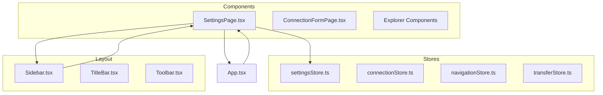
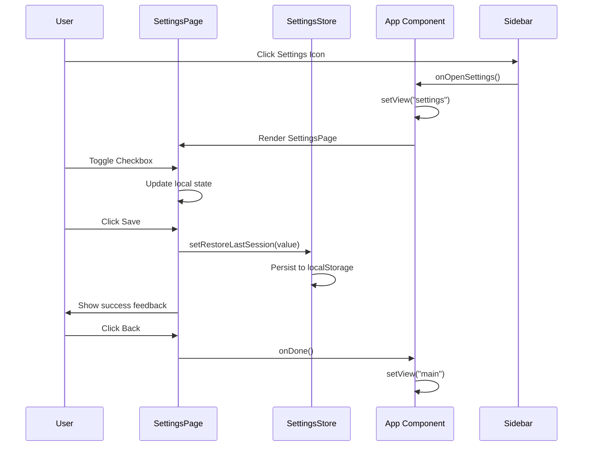
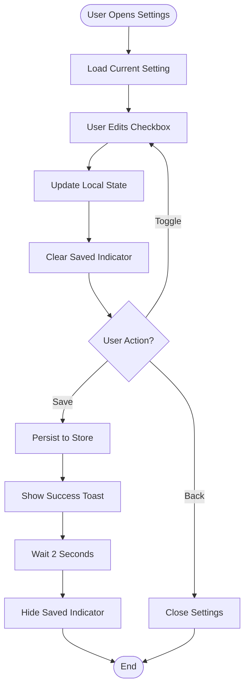
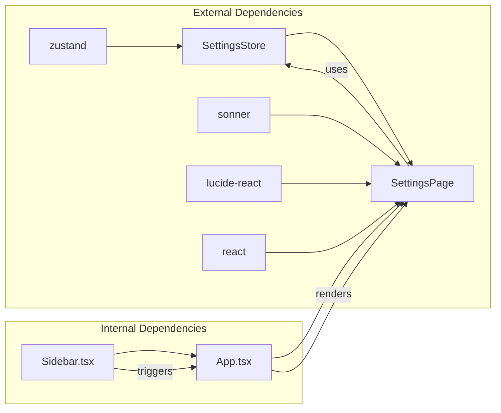

# Settings Page

<cite>
**Referenced Files in This Document**
- [SettingsPage.tsx](file://src/components/SettingsPage.tsx)
- [settingsStore.ts](file://src/store/settingsStore.ts)
- [App.tsx](file://src/App.tsx)
- [Sidebar.tsx](file://src/components/layout/Sidebar.tsx)
- [navigationStore.ts](file://src/store/navigationStore.ts)
- [index.ts](file://src/types/index.ts)
- [utils.ts](file://src/lib/utils.ts)
</cite>

## Table of Contents
1. [Introduction](#introduction)
2. [Project Structure](#project-structure)
3. [Core Components](#core-components)
4. [Architecture Overview](#architecture-overview)
5. [Detailed Component Analysis](#detailed-component-analysis)
6. [Dependency Analysis](#dependency-analysis)
7. [Performance Considerations](#performance-considerations)
8. [Troubleshooting Guide](#troubleshooting-guide)
9. [Conclusion](#conclusion)

## Introduction

The Settings Page is a focused React component that manages application preferences for S3 Explorer. It provides users with the ability to configure startup behavior, specifically controlling whether the application should restore the last session (previously viewed bucket and folder) or always start at the home page when launched.

This component demonstrates clean separation of concerns by maintaining its own local state while delegating persistent storage to a centralized Zustand store. The implementation follows React best practices with controlled components and immediate feedback mechanisms.

## Project Structure

The Settings Page is part of a larger S3 Explorer application built with React, TypeScript, and Tauri. The component is organized within the components directory alongside other UI elements and follows a logical file structure:

**Diagram sources**
- [SettingsPage.tsx:1-97](file://src/components/SettingsPage.tsx#L1-L97)
- [settingsStore.ts:1-29](file://src/store/settingsStore.ts#L1-L29)
- [App.tsx:1-341](file://src/App.tsx#L1-L341)

**Section sources**
- [SettingsPage.tsx:1-97](file://src/components/SettingsPage.tsx#L1-L97)
- [App.tsx:1-341](file://src/App.tsx#L1-L341)

## Core Components

The Settings Page consists of several key elements that work together to provide a seamless user experience:

### Component Structure
- **Header Section**: Contains back navigation and page title
- **Content Area**: Displays configuration options with explanatory text
- **Control Section**: Provides save functionality with visual feedback
- **State Management**: Uses both local component state and global store persistence

### State Management Approach
The component implements a dual-state strategy:
- **Local State**: Manages form input changes without immediately persisting
- **Global State**: Persists changes to the settings store upon user confirmation
- **Visual Feedback**: Provides immediate user feedback through saved indicators

**Section sources**
- [SettingsPage.tsx:10-23](file://src/components/SettingsPage.tsx#L10-L23)
- [settingsStore.ts:15-28](file://src/store/settingsStore.ts#L15-L28)

## Architecture Overview

The Settings Page integrates with the broader application architecture through well-defined boundaries and communication patterns:

**Diagram sources**
- [Sidebar.tsx:242-250](file://src/components/layout/Sidebar.tsx#L242-L250)
- [App.tsx:175-186](file://src/App.tsx#L175-L186)
- [SettingsPage.tsx:18-23](file://src/components/SettingsPage.tsx#L18-L23)

The architecture demonstrates clear separation of concerns:
- **Presentation Layer**: SettingsPage handles UI rendering and user interactions
- **State Management**: SettingsStore manages persistent application state
- **Navigation Control**: App component coordinates view transitions
- **Integration Points**: Sidebar provides access to settings from the main interface

**Section sources**
- [App.tsx:45-54](file://src/App.tsx#L45-L54)
- [Sidebar.tsx:158-160](file://src/components/layout/Sidebar.tsx#L158-L160)

## Detailed Component Analysis

### SettingsPage Component

The SettingsPage component is a functional React component that implements a controlled checkbox interface with sophisticated state management:

#### Component Props and Interface
The component accepts a single prop interface:
- **onDone**: Callback function triggered when the user wants to exit settings mode
- **Local State Management**: Maintains separate local state for form editing

#### State Management Implementation
The component uses React's useState hook to manage:
- **localRestore**: Local copy of the restoreLastSession setting
- **saved**: Visual indicator for successful save operations

#### User Interaction Flow

**Diagram sources**
- [SettingsPage.tsx:14-23](file://src/components/SettingsPage.tsx#L14-L23)

#### Accessibility and UX Features
- **Immediate Feedback**: Visual indication of saved state using checkmark icon
- **Toast Notifications**: Non-intrusive success notifications
- **Keyboard Navigation**: Standard tab order and focus management
- **Responsive Design**: Mobile-friendly touch targets and spacing

**Section sources**
- [SettingsPage.tsx:18-23](file://src/components/SettingsPage.tsx#L18-L23)
- [SettingsPage.tsx:25-96](file://src/components/SettingsPage.tsx#L25-L96)

### SettingsStore Integration

The SettingsStore provides persistent state management through Zustand with localStorage persistence:

#### Store Configuration
- **State Persistence**: Automatic synchronization with browser localStorage
- **Default Values**: Safe defaults prevent undefined behavior
- **Type Safety**: Strict TypeScript interfaces ensure data integrity

#### Store Methods
- **setRestoreLastSession**: Updates the restoreLastSession preference
- **State Access**: Provides reactive access to current settings

**Section sources**
- [settingsStore.ts:15-28](file://src/store/settingsStore.ts#L15-L28)

### Navigation Integration

The Settings Page integrates with the application's navigation system:

#### Startup Behavior Control
The component works in conjunction with the main App component to control application startup behavior:
- **Initial Load**: Checks settings store on application initialization
- **Session Restoration**: Determines whether to restore previous session or show home page

#### View Management
The Settings Page participates in the application's view management system:
- **Settings View**: Dedicated view state for settings interface
- **Navigation Back**: Seamless return to main application view

**Section sources**
- [App.tsx:45-54](file://src/App.tsx#L45-L54)
- [App.tsx:175-186](file://src/App.tsx#L175-L186)

## Dependency Analysis

The Settings Page has minimal but well-chosen dependencies that support its focused functionality:

**Diagram sources**
- [SettingsPage.tsx:1-4](file://src/components/SettingsPage.tsx#L1-L4)
- [settingsStore.ts:1-2](file://src/store/settingsStore.ts#L1-L2)

### External Dependencies
- **Zustand**: State management library for persistent settings storage
- **Sonner**: Toast notification system for user feedback
- **Lucide React**: SVG icon library for consistent UI elements
- **React**: Core framework for component development

### Internal Dependencies
- **SettingsStore**: Centralized state management
- **App Component**: Application orchestration and view management
- **Sidebar Component**: Navigation and access to settings

**Section sources**
- [package.json:12-26](file://package.json#L12-L26)
- [SettingsPage.tsx:1-4](file://src/components/SettingsPage.tsx#L1-L4)

## Performance Considerations

The Settings Page is designed for optimal performance characteristics:

### Rendering Performance
- **Minimal Re-renders**: Uses local state updates without triggering global state changes until save
- **Efficient Updates**: React's controlled component pattern ensures predictable re-rendering
- **Memory Management**: Cleanup of timeouts and event listeners prevents memory leaks

### State Persistence
- **Batched Updates**: Settings are persisted only on explicit user action
- **LocalStorage Optimization**: Efficient serialization/deserialization of settings data
- **Debounced Operations**: Prevents excessive write operations to storage

### User Experience
- **Instant Feedback**: Local state updates provide immediate visual response
- **Graceful Degradation**: Settings continue to work even if storage is unavailable
- **Accessibility**: Proper ARIA labels and keyboard navigation support

## Troubleshooting Guide

Common issues and their solutions when working with the Settings Page:

### Settings Not Persisting
**Symptoms**: Settings revert after application restart
**Causes**: 
- Browser storage disabled or blocked
- SettingsStore persistence configuration issues
- Application state corruption

**Solutions**:
- Verify browser localStorage availability
- Check for console errors related to storage operations
- Clear browser cache and retry

### Settings Not Applying
**Symptoms**: Changes appear locally but don't affect application behavior
**Causes**:
- Incorrect integration with App component startup logic
- State synchronization delays
- Navigation state conflicts

**Solutions**:
- Verify SettingsStore integration in App component
- Check for proper state propagation to navigation store
- Review console for state update errors

### UI Issues
**Symptoms**: Settings page displays incorrectly or icons appear missing
**Causes**:
- Missing external dependencies
- CSS class conflicts
- Component rendering errors

**Solutions**:
- Ensure all dependencies are properly installed
- Check for CSS specificity conflicts
- Verify component imports and exports

**Section sources**
- [settingsStore.ts:24-28](file://src/store/settingsStore.ts#L24-L28)
- [App.tsx:45-54](file://src/App.tsx#L45-L54)

## Conclusion

The Settings Page represents a well-architected solution for managing application preferences in the S3 Explorer ecosystem. Its implementation demonstrates several key principles:

### Strengths
- **Clean Separation of Concerns**: Local state management with persistent storage abstraction
- **User-Centric Design**: Immediate feedback and intuitive interaction patterns
- **Robust Architecture**: Integration with broader application state and navigation systems
- **Performance Optimization**: Minimal re-renders and efficient state persistence

### Technical Excellence
The component showcases modern React patterns including controlled components, proper state management, and thoughtful user experience design. The integration with Zustand provides reliable persistence while maintaining application responsiveness.

### Future Considerations
Potential enhancements could include:
- Additional settings categories beyond startup behavior
- Settings validation and error handling
- Export/import functionality for settings backup
- Advanced accessibility features for diverse user needs

The Settings Page serves as a solid foundation for extending the application's configuration capabilities while maintaining the high standards of usability and performance established throughout the S3 Explorer codebase.